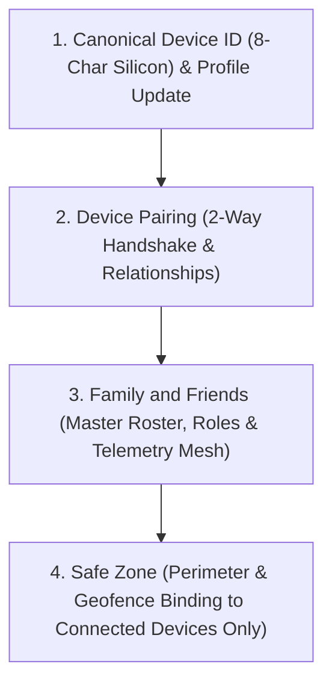

# Program Mapping - Master Relationship Table (Enterprise Standard v5.0)
# Antigravity Enterprise AI Agent Protocol (V3.0 Enterprise Taskforce)

## Workforce Domains & Agent Registry
1. **Workforce Domain 1: Orchestrator & Governance**
   - Agent 1: Product Architect & Hardware Identity Sentinel (SSOT Silicon Root Key: `ro.ril.oem.sno`, `ro.boot.serialno`, persistent external storage anchor `.silicon_anchor`, dynamic Settings override with Zero hardcoded device strings).
2. **Workforce Domain 2: Technology & Architecture**
   - Agent 2: Dual-Engine Database & Backend Logic Architect (SQLite Schema V81.2 (Northwind 2003 Referential Integrity & Tri-Tier Taxonomy across 27 Normalized Tables + 13 Compatibility Views) ↔ Firebase Realtime Cloud SSOT, real-time closed-loop `ACTION_PROFILE_SYNCED` lifecycle broadcast).
   - Agent 6: GIS, Spatial & Geofencing Architect (2D Kalman filter, Haversine, Ray-Casting Polygon SafeZones).
3. **Workforce Domain 3: AI Engineering & Frontend UI/UX**
   - Agent 3: Frontend UI/UX & Lightweight Viewport Architect (UiArchitect L7 Standard: Buttons, Validated Textboxes, Switches, Toggles, Flippers, Dropdowns, Multi-choice Dialogs, Slide-in Notifications).
4. **Workforce Domain 4: Quality & Reliability Operations**
   - Agent 4: Integration, QA & Build Quarantine Agent (Build Quarantine Protocol: autonomous `./gradlew` strictly quarantined).
   - Agent 5: Crash & Silent Failure Hunter (Foreground service lifecycle, Doze mode bypass, Coroutine boundary containment).
5. **Workforce Domain 5: Operations & Performance**
   - Agent 7: Performance & Battery Optimization Agent (Dynamic telemetry intervals, adaptive motion duty-cycles, rolling storage hygiene & SQLite VACUUM).

---

## Master Screen & Component Relationship Table

| Layer (L1-L5) | Screen / Component | Architecture | Agent Owner | Dependencies | Integration Points & Relational SSOT | Status |
| :--- | :--- | :--- | :--- | :--- | :--- | :--- |
| **L1 Root** | `SplashActivity` | MVC Router | Agent 1 | `AuthCheck`, `SessionRouter` | Auto-login & Identity Verification | Active SSOT |
| **L1 Auth** | `AuthActivity` | MVVM | Agent 1, Agent 2 | `AuthViewModel`, `ValidationEngine` | Firebase Auth ↔ `user_identity` Table | Active SSOT |
| **L2 Spatial**| `MapActivity` | MVVM / SSOT | Agent 3, Agent 6, Agent 2 | `MapViewModel`, `MultiMarkerEngine`, `LocationEngine` | `/locations/{id}`, `/devices/{id}`, `LocationEventTable` | Active SSOT |
| **L2 Spatial**| `LiveMapDashboardActivity` | Quarantined Shell | Agent 3, Agent 4 | Canonical `MapActivity` | Quarantined to `legacy/archived_tools/android_shells/`; callers route to MapActivity | Quarantined Legacy |
| **L2 Spatial**| `MapActivity2` | Quarantined Shell | Agent 3, Agent 4 | Canonical `MapActivity` | Quarantined to `legacy/archived_tools/android_shells/`; manifest cleaned | Quarantined Legacy |
| **L2 Mesh** | `NetworkGatewayActivity` | MVVM | Agent 1, Agent 2 | `GroupViewModel`, `PairingRepository` | 2x2 Cloud & P2P Symmetrical Pairing Matrix (`device_pairings`) | Active SSOT |
| **L2 Mesh** | `GroupActivity` | Quarantined Shell | Agent 1, Agent 4 | Canonical `NetworkGatewayActivity` | Quarantined to `legacy/archived_tools/android_shells/`; SettingsActivity L759 routes to NetworkGatewayActivity | Quarantined Legacy |
| **L2 Mesh** | `FamilyFriendsActivity` | MVVM | Agent 3, Agent 2 | `FamilyFriendsViewModel`, `RosterTree` | Guardians & Family Multi-tier Roster (`MASTER_ROSTER`) | Active SSOT |
| **L2 Mesh** | `PersonDetailsActivity` | MVVM | Agent 3, Agent 1, Agent 2 | `PersonDetailsViewModel`, `ValidationEngine` | Relational Node Metadata & ACLs (`user_profile`, `user_identity`) | Active SSOT |
| **L3 Boundary**| `GeofenceActivity` | MVVM | Agent 6, Agent 3 | `GeofenceViewModel`, `GeofenceHelper` | Safe Zones (`safe_zones`, `safe_zone_user_map`) | Active SSOT |
| **L3 Boundary**| `GeofenceNotificationActivity`| MVC | Agent 6, Agent 5 | `GeofenceBroadcastReceiver` | Transition Audit Ledger (`geofence_events`) | Active SSOT |
| **L3 Trace** | `HistoryActivity` | MVVM | Agent 5, Agent 6 | `HistoryViewModel`, `LocationRepository` | Historical Trajectory Replay (`location_event`) | Active SSOT |
| **L3 Alert** | `NotifActivity` | MVVM | Agent 5, Agent 2 | `NotifViewModel`, `AlertManager` | Alerts, SOS Ingress/Egress (`alerts`) | Active SSOT |
| **L3 Alert** | `AcousticSirenActivity` | MVC | Agent 5, Agent 7 | `AudioOverrideService` | DND Override 30s Acoustic Alarm Beacon | Active SSOT |
| **L3 Health** | `HealthActivity` | MVC | Agent 7, Agent 1 | `HardwareStatusMonitor`, `CellTowerSentinel`, `SimTransportValidator` | Real-time Battery, GPS, Baseband Cellular Tower (MCC/MNC/LAC/CID), Closed-Loop Latency & Actionable Human-in-The-Loop Fix Banner | Active SSOT |
| **L3 Forensic**| `SimForensicWorker` / `CellTowerSentinel` | MVC Engine | Agent 1, Agent 6 | `TelephonyManager`, `CellInfo` | Cellular Tower (MCC/MNC/LAC/CID) Triangulation & `sim_transactions` | Active SSOT |
| **L3 Transport**| `SimTransportValidator` | Diagnostic Sentinel | Agent 4, Agent 5 | `ConnectivityManager`, `PowerManager` | 14-Condition Mobile Data, Doze & Carrier Blocking Audit | Active SSOT |
| **L3 Failover** | `TelemetryFailoverRouter` | Failover Switch | Agent 1, Agent 2, Agent 4 | `FirebaseComm`, `OfflineSyncManager` | 5-Tier Interchangeable Mesh (Cellular -> Wi-Fi -> SMS -> SQLite) | Active SSOT |
| **L3 Feedback** | `TelemetryClosedLoopSentinel` | Closed-Loop Engine | Agent 2, Agent 4, Agent 5 | `FirebaseDatabase`, `DatabaseHelper` | Bidirectional Cloud ACK, RTT Latency (<5s) & Trip-Wire Failover | Active SSOT |
| **L3 Privacy**| `PrivacyActivity` | MVC | Agent 1, Agent 5 | `SecurityEngine`, `PrivacyEngine` | Permission Matrix & Ghost Mode Locks (`system_registry`) | Active SSOT |
| **L4 Control**| `SettingsActivity` | Dual-Tab MVVM | Agent 3, Agent 7 | `RegistryManager`, `AllScreensRegistry` | Tab 1: Universal Settings (Priorities 1-8, Priority 7C: Closed-Loop ACK Timeout, Circuit Breaker Failure Threshold, SOS SMS Target), Tab 2: Modules | Active SSOT |
| **L4 Control**| `UiConfigActivity` | MVC | Agent 3 | `UiArchitect`, `ThemeManager`, `AngelLoad` | Dynamic Theme Palette, 5-Stage Sizing & Border Geometry | Active SSOT |
| **L4 Control**| `UiGalleryActivity` | MVC | Agent 3 | `UiArchitect` | Component Suite Visual Showcase | Active SSOT |
| **L4 Engine** | `BackgroundJobsConfigDialog`| 4-Tier Waterfall | Agent 7, Agent 2 | `BackgroundJobManager` | 13 Engine Workers, Periodic Cadence & Manual Execution | Active SSOT |
| **L4 Vault** | `ForensicVaultExplorerActivity`| MVC | Agent 5, Agent 2 | `DatabaseHelper` | Encrypted SQLite Forensic Inspector (27 Normalized Tables + 16 Zero-Loss Views & Bidirectional Triggers) | Active SSOT |
| **L4 Audit** | `WatchDogAuditActivity`| MVVM | Agent 5 | `WatchDogViewModel` | Process Liveness & SQLite Integrity Verifier | Active SSOT |
| **L4 Admin** | `DatabaseManagementActivity` | MVC | Agent 2, Agent 4 | `DatabaseHelper` | SQLite Schema Inspector & Table Maintenance Console | Active SSOT |
| **L4 Admin** | `FirebaseCloudMatrixActivity` | MVC | Agent 1, Agent 2 | `FirebaseComm` | Cloud Realtime Database Mesh Inspector | Active SSOT |
| **L4 Admin** | `SystemLogActivity` | MVC | Agent 5, Agent 7 | `SystemLogger` | Rolling Realtime Runtime Trace Logger (`sys_log`) | Active SSOT |
| **L5 Maint** | `SystemUpdateActivity` | MVVM | Agent 4, Agent 5 | `SilentUpdateWorker`, `ApkInstallerHelper`| Self-Healing Silent APK Updater & Hash Verifier | Active SSOT |
| **L5 Maint** | `FactoryResetActivity` | MVVM | Agent 4, Agent 1 | `FactoryResetViewModel` | Selective Purge & Cloud Recovery Console | Active SSOT |
| **L5 Support**| `HelpSupportActivity` | MVC | Agent 3 | `UserManual` | Technical Documentation & Diagnostics Gateway | Active SSOT |
| **L5 Support**| `AboutActivity` | MVC | Agent 1, Agent 3 | `BuildConfig` | Application Manifest & Build Identity Dossier | Active SSOT |

---

## Web Mission Control & Forensic Gateway Relationship Table (Decoupled Sovereign Workspace: `C:\Users\jiten\jAnitGravity\jFindMeWeb`)

| Layer | Subsystem / File | Port / Protocol | Architecture | Role & Integration Points | Status |
| :--- | :--- | :--- | :--- | :--- | :--- |
| **W1 Gateway** | `C:\Users\jiten\jAnitGravity\jFindMeWeb\js\server.js` | Port 3000 (REST) | Express Proxy | Firebase Admin SDK, OTA broadcast, RTDB REST endpoints | Active SSOT |
| **W1 Gateway** | `C:\Users\jiten\jAnitGravity\jFindMeWeb\js\static_server.js` | Port 8080 (HTTP) | Reverse Proxy | Serves static assets, reverse-proxies `/api/*` to Port 3000 | Active SSOT |
| **W2 Shell** | `C:\Users\jiten\jAnitGravity\jFindMeWeb\index.html` | Port 8080 (SPA) | Tactical Radar | Main web workspace, Leaflet/Google Maps radar, audit ledger | Active SSOT |
| **W2 Orchestrator**| `C:\Users\jiten\jAnitGravity\jFindMeWeb\js\app.js` | ES6 Module | Master Controller | State dispatch, routing, telemetry subscriptions, terminal | Active SSOT |
| **W2 Matrix** | `C:\Users\jiten\jAnitGravity\jFindMeWeb\database-sync-settings.html` | Standalone HTML | 20-Screen Sync | 178 Master Parameter Dual-Engine Synchronization Console | Active SSOT |
| **W3 Models** | `DeviceModel.js`, `SettingsModel.js`, `SafeZoneModel.js`, `DeviceFilterModel.js` | MVC Model | Data Entities | Hardware silicon ID binding, boundary polygons, telemetry, geographic cascading hierarchy & dynamic bandwidth hygiene | Active SSOT |
| **W3 Controllers**| `DeviceController.js`, `MapController.js`, `SafeZoneController.js` | MVC Controller | Action Handlers | Device filtering, interrogation, map event dispatching, selective telemetry stream injection | Active SSOT |
| **W3 Services** | `FirebaseService.js` (FBBridge), `AvatarService.js`, `SanitizerService.js` | Service Layer | Network & IO | SSE event streaming, XSS sanitization, avatar asset mapping, selective polling URL query encoder | Active SSOT |
| **W3 Views** | `DashboardView.js`, `DeviceCardView.js`, `DeviceUserView.js`, `GeofencingView.js`, `MapView.js`, `MapSettingsView.js`, `DeviceFilterModalView.js` | MVC View | Visual Renderers | Real-time map pins, KPI metrics, device dossier, multi-column geographic fleet filter modal, dynamic settings UI | Active SSOT |
| **W4 Release** | `C:\Users\jiten\jAnitGravity\jFindMe\apk\sync_service.py` | Port 8085 (Daemon)| Python Singleton Daemon | Singleton supervisor (`sync_service.pid`), dual-config SSOT atomic sync (`jFindMe/apk` ⇄ `jFindMeWeb`), hardware binary badging, staged release engine, SHA-256 integrity, GitHub git automation & bsdiff differential hotpatching | Active SSOT |
| **W4 Studio**  | `C:\Users\jiten\jAnitGravity\jFindMeWeb\jButterflyGithubSync_v2.html` | Client UI (Port 3000/8085) | HTML5 / OOPS MVC | 1-Click Promote Next Build, zero-latency reactive metadata refresher, Option 1 (ADB Install vs Copy to Downloads), WhatsApp deep link, QR modal, slide-out activity console | Active SSOT |

---

## 4-Tier Chronological Background Jobs Waterfall

```
┌────────────────────────────────────────────────────────────────────────┐
│ TIER 1: 🛰️ PRIMARY TELEMETRY & CORE GPS PIPELINE (Root / Critical)     │
│ ├── JOB_TRACKING_SERVICE      : Foreground GPS Telemetry Service       │
│ ├── JOB_LOCATION_WATCHDOG     : Sentinel Process Keep-Alive Monitor    │
│ └── JOB_GEOFENCE_SENTINEL     : Hardware Geofence Perimeter Sentinel   │
└───────────────────────────────────┬────────────────────────────────────┘
                                    │ (Sequential Dependency)
┌───────────────────────────────────▼────────────────────────────────────┐
│ TIER 2: ☁️ CLOUD SYNC & PEER STREAMING HUB (Network Synchronization)   │
│ ├── JOB_LIVE_MAP_STREAM       : Peer WebSocket RTDB Stream (Ghost-Excl)│
│ ├── JOB_PRESENCE_PULSE        : Real-time Presence Pulse & Vitals Ping │
│ ├── JOB_OFFLINE_SYNC          : Encrypted Offline SQLite Queue Flusher │
│ └── JOB_FCM_MESSAGING         : High-Priority FCM Push Sentinel        │
└───────────────────────────────────┬────────────────────────────────────┘
                                    │ (Sequential Dependency)
┌───────────────────────────────────▼────────────────────────────────────┐
│ TIER 3: 📱 FORENSIC HARDWARE & SECURITY (Passive Hardware Interceptors)│
│ ├── JOB_SECURITY_RECEIVER     : Power, Boot, Flight Mode Interceptor   │
│ ├── JOB_ACOUSTIC_SIREN        : Emergency Beacon & Audio Bridge        │
│ └── JOB_SIM_FORENSIC          : SIM & Cellular Tower Hardware Sentinel │
└───────────────────────────────────┬────────────────────────────────────┘
                                    │ (Sequential Dependency)
┌───────────────────────────────────▼────────────────────────────────────┐
│ TIER 4: ⚡ STORAGE PRUNING & SYSTEM INTEGRITY (Maintenance & Hygiene)   │
│ ├── JOB_STORAGE_PRUNE         : Rolling Retention Purge & SQLite VACUUM│
│ ├── JOB_SILENT_UPDATE         : Binary Hash Check & Update Sentinel    │
│ └── JOB_APP_UPGRADE_WATCH     : Post-Install Auto-Restart Sentinel     │
└────────────────────────────────────────────────────────────────────────┘
```

---

## Quarantined Legacy & Scratch Inventory (Prime Directive 1 Compliance)

All obsolete prototypes, temporary test files, and historical binaries have been safely relocated to `legacy/` rather than deleted, guaranteeing 100% auditability without polluting the active production tree:

1. **`legacy/archived_tools/`**:
   - `android_shells/`: Quarantined redirect shells (`MapActivity2.java`, `LiveMapDashboardActivity.java`, `GroupActivity.java`). Callers modernized to canonical `MapActivity` and `NetworkGatewayActivity`.
   - `diagnostics/`: 12 one-time diagnostic node scripts (`purge_all_database.js`, `cleanup_lookups.js`, `cleanup_database_gaps.js`, `check_fcm.js`, `sync_vibgyor.js`, `inspect_devices.js`, `inspect_versions.js`, `check_all_roots.js`, `check_device_geofences.js`, `check_device_timestamps.js`, `diagnose_devices.js`).
   - `unity_avatar_prototypes/`: 7 C# Unity avatar scripts (`AvatarAnimationController.cs`, `AvatarController.cs`, `AvatarLoader.cs`, `AvatarLoadingPipeline.cs`, `AvatarMapPositioner.cs`, `AvatarProfileRenderer.cs`, `ModularAvatarAssembler.cs`).
   - `html_sync/`: Obsolete v1 `jButterflyGithubSync.html` (superseded by `jButterflyGithubSync_v2.html`).
   - `launchers/`: Obsolete `jFindMeWeb/launcher.hta` and hardcoded ADB test script `scripts/auto_reinstall_device.bat`.
   - `root_engine_duplicate/`: Contains orphaned `MarkerClusterer.kt` duplicate from root.
   - `web_enterprise_orphans/`: Contains unimported `js/enterprise/` (`App.js`, `DataGrid.js`, `SchemaView.js`, `Store.js`).
   - `web_prototypes/`: Contains dead prototype island (`MainController.js`, `DataRenderer.js`, `ModalUI.js`, `DatabaseProvider.js`, `OptimizedLeafletMap.js`, `MapPerformance.js`, `server-settings-api.js`, `GoogleFindHubView.js`).
   - `download.py`, `find_img.py`, `inspect_gdrive.py`, `drive_file.html`, `process_avatars.py`: One-off asset scraping scripts.
   - `_temp_script_0.js`: Extracted APK scratch script.
   - `watchdog_dog.png`: Unused root image.

2. **`legacy/archived_scratch/`**:
   - `root_avatar_backup/`: Quarantined root `Avatar/` (51 duplicate loose PNG/JPG/WebP files, preserved under Chesterton's Fence; web serves from `jFindMeWeb/assets/avatars/`).
   - `web_scratch/`: Quarantined `jFindMeWeb/scratch/` (including 19.65 MB enterprise repair backup snapshot & 32 scratch scripts).
   - `root_scratch/`: Quarantined `scratch/jbutterfly/` (~285 MB old APKs) & `scratch/backup_db/` (2.7 MB DB).

3. **`legacy/jButterFly/`**:
   - Complete historical reference project tree preserved under Chesterton's Fence.

---

## Master Database Relationship Architecture (Schema V81.2 Gold Master)

### 1. Master 3-Tier Database Taxonomy (27 Normalized Tables)

```mermaid
graph TD
    subgraph Tier1 ["Tier 1: Master Entities (Canonical Anchors)"]
        UI["user_identity (id PK, uid_1, uid_2, auth_uid)"]
        D["device (device_id PK, identity_id FK, hardware_id)"]
        G["groups (group_id PK, group_name, invite_code)"]
        SZ["safe_zone (zone_id PK, created_by, lat, lng)"]
        SMK["security_master_keys (key_id PK, identity_id FK, public_key)"]
        ORG["organization (org_id PK, org_name, clearance_level)"]
    end

    subgraph Tier2 ["Tier 2: Sub-Masters & Dimension Tables"]
        UP["user_profile (id PK, identity_id FK, blood_group, pin_hash)"]
        UOM["user_org_map (id PK, identity_id FK, org_id FK)"]
        DP["device_pairing (pair_id PK, device_a_id, device_b_id)"]
        SIM["sim (sim_serial PK, device_id FK, phone_number)"]
        DPS["device_policy_state (policy_id PK, device_id FK)"]
        GM["group_members (id PK, group_id FK, identity_id FK, agent_id)"]
        SZUM["safe_zone_user_map (id PK, zone_id FK, identity_id FK)"]
        SSC["stealth_schedule_config (config_key PK, config_value)"]
        RGC["reverse_geocode_cache (id PK, lat_rounded, lng_rounded, address)"]
    end

    subgraph Tier3 ["Tier 3: High-Velocity Transactional & Audit Ledgers"]
        LE["location_event (id PK, identity_id FK, lat, lng, day_key)"]
        PSQ["pending_sync_queue (queue_id PK, entity_type, payload)"]
        DV["device_vitals (id PK, hardware_id, battery_pct, motion_state)"]
        AH["alert_history (alert_id PK, target_identity_id, alert_type)"]
        WRL["watchdog_resurrection_log (id PK, hardware_id, latency_ms)"]
        TFR["telemetry_failover_routes (route_id PK, identity_id FK, priority_tier)"]
        SL["sys_log (id PK, level, tag, message, timestamp)"]
        PMP["p2p_mesh_packets (packet_id PK, identity_id FK, hop_count)"]
        INV["invitations (id PK, token, group_id FK, initiator_identity_id FK)"]
        ST["sim_transactions (tx_id PK, sim_serial, cell_id, lac)"]
        GE["geofence_event (event_id PK, zone_id, identity_id, event_type)"]
        SQ["sync_queue (sync_id PK, payload, status)"]
        CL["change_log (id PK, category, entity_id, change_type)"]
        SAL["security_audit_log (log_id PK, event_type, severity)"]
    end

    UI --> UP
    UI --> UOM
    UI --> D
    UI --> SMK
    UI --> LE
    UI --> TFR
    UI --> PMP
    UI --> INV
    UI --> SZUM
    UI --> GM

    ORG --> UOM
    G --> GM
    G --> INV
    SZ --> SZUM
    SZ --> GE
    D --> SIM
    D --> DPS
    D --> DV
    SIM --> ST
```



### 2. 13 Zero-Loss Compatibility Views (Master Temporal Query Invariant: Latest-Data-First DESC)
All views are strictly sorted by date/time descending to ensure every default consumer receives the most recent active record first:
1. `devices` ➔ `SELECT * FROM device ORDER BY updated_at DESC, device_id DESC`
2. `safe_zones` ➔ `SELECT * FROM safe_zone ORDER BY updated_at DESC, zone_id DESC`
3. `geofence_events` ➔ `SELECT * FROM geofence_event ORDER BY timestamp DESC, event_id DESC`
4. `sys_logs` ➔ `SELECT * FROM sys_log ORDER BY timestamp DESC, id DESC`
5. `security_evasion_audit_log` ➔ `SELECT * FROM security_audit_log ORDER BY timestamp DESC, log_id DESC`
6. `watchdog_resurrection_ledger` ➔ `SELECT * FROM watchdog_resurrection_log ORDER BY timestamp DESC, id DESC`
7. `device_policy` ➔ `SELECT * FROM device_policy_state ORDER BY updated_at DESC, id DESC`
8. `device_pairings` ➔ `SELECT * FROM device_pairing ORDER BY updated_at DESC, pair_id DESC`
9. `alerts` ➔ `SELECT * FROM alert_history ORDER BY timestamp DESC, id DESC`
10. `MASTER_ROSTER` ➔ `SELECT * FROM group_members ORDER BY joined_at DESC, id DESC`
11. `master_roster` ➔ `SELECT * FROM group_members ORDER BY joined_at DESC, id DESC`
12. `organizations` ➔ `SELECT * FROM organization ORDER BY updated_at DESC, org_id DESC`
13. `sim_inventory` ➔ `SELECT * FROM sim ORDER BY updated_at DESC, sim_id DESC`

> **Core Governance Rule — Master Temporal Query Invariant**: Every database query across SQLite and Firebase RTDB MUST fetch the latest data ordered by timestamp/datetime descending (`ORDER BY timestamp DESC`, `ORDER BY updated_at DESC`) by default. Historical playback, trajectory breadcrumbs, or sequential audit reconstruction flows are explicit opt-in exceptions specifying ascending order (`ORDER BY timestamp ASC`).

### 3. Dynamic Variable & Settings Master Map (Zero Hardcoded Rules)

| Setting Name / Parameter | Database SSOT (`stealth_schedule_config`) | Registry Manager Key (`system_registry`) | Default Value | Tunable Options / Range | UI Screen Location |
| :--- | :--- | :--- | :--- | :--- | :--- |
| **Storage History Retention** | `retention_days` | `pref_storage_retention_days` | `3` Days | 1, 2, 3, 7, 14, 30 Days | `SettingsActivity` Card 7 |
| **Geocode Cache Capacity** | `max_geocode_cache_size` | `pref_max_geocode_cache` | `5,000` Entries | 1k, 2.5k, 5k, 10k, 20k Entries | `SettingsActivity` Card 7 |
| **Pending Sync Queue TTL** | `sync_queue_ttl_hours` | `pref_sync_queue_ttl_hours` | `48` Hours | 12, 24, 48, 72 Hours | `SettingsActivity` Card 7 |
| **System Audit Log TTL** | `sys_log_ttl_hours` | `pref_sys_log_ttl_hours` | `48` Hours | 24, 48, 72, 168 Hours | `SettingsActivity` Card 7 |
| **P2P Mesh Packet TTL** | `p2p_mesh_ttl_hours` | `pref_p2p_mesh_ttl_hours` | `24` Hours | 6, 12, 24, 48 Hours | `SettingsActivity` Card 7 |
| **Invitation Token TTL** | `invitation_ttl_days` | `pref_invitation_ttl_days` | `7` Days | 1, 3, 7, 14 Days | `SettingsActivity` Card 2 |
| **Batch Pagination Limit** | `default_page_limit` | `pref_default_page_limit` | `50` Rows | 25, 50, 100, 200 Rows | `ForensicVaultExplorerActivity` |
| **Radar Proximity Radius** | `radar_proximity_radius` | `pref_radar_proximity_radius`| `5,000` Meters| 500m - 50km | `SettingsActivity` Card 5 |
| **Distant Device Threshold**| `distant_device_threshold`| `pref_distant_device_threshold`| `15,000` Meters| 1km - 100km | `SettingsActivity` Card 5 |
| **Motion Co-Processor Ping**| `pref_tracking_interval` | `pref_tracking_interval` | `10,000` ms | 5s, 10s, 30s, 60s, 120s | `SettingsActivity` Card 3 |

### 4. Online-Only Cloud Node Lifecycle & 7-Day Closed Feedback Loop Protocol

| Cloud Node Path | Current Role | Closed Feedback Loop Mechanism | 7-Day Eviction / Purge Policy | What Breaks If Blindly Deleted? | Safe Remediation & Hardening |
| :--- | :--- | :--- | :--- | :--- | :--- |
| **`/lookup_indices/`** | Fast $O(1)$ Reverse Auth UID ➔ Hardware Device ID lookup for Web Mission Control | Closes loop on device unlinking or deletion (`deleteRosterNode` / `FactoryReset` removes index entry) | Stale entries with zero active heartbeat for **> 7 Days** auto-evicted | Web Mission Control (`/api/devices-live`) fails to map `authUid` to device without doing expensive full-tree scans of `/devices/` | Keep pending/active devices; purge dead ghost nodes older than 7 days |
| **`/Version_Update/`** | Distributes OTA update manifests, APK links, and binary checksums | Closes loop when update completes: pins current build to `/Version_Update/{id}/latest` | Historical version nodes (`V75`, `V76`, etc.) older than **7 Days** purged | `SilentUpdateWorker` cannot verify whether a new APK build is available for rollout | Keep `/latest` and active rollout channel; purge dead historical version records after 7 days |
| **`/relationships/{id}/signals/`** | Ephemeral pub/sub websocket trigger notifying circle members of roster/safezone changes | Closes loop when client reads signal: client records last handled timestamp and triggers local refresh | Signals older than **24h - 7 Days** or belonging to disbanded circles auto-purged | Real-time push synchronization across circle members breaks; clients must fall back to slow periodic polling | Keep signal keys active while circle is live; purge orphaned signals when group is deleted or dormant > 7 days |

---

### 5. Physical Device Ecosystem & Relational Tree SSOT



#### Canonical 5 Physical Devices Master Table

| Canonical Device ID | Device Name | Hardware Model | Role in Circle | Active Group SSOT | Status |
| :--- | :--- | :--- | :--- | :--- | :--- |
| **`2C811042`** | Redmi 5pro | Xiaomi whyred | Parent / Member | `GRP_2T929153` | 🟢 ONLINE / ACTIVE |
| **`2D113789`** | INNOVANT | Android Device | Friend / Member | `GRP_2T929153` | 🟢 ONLINE / ACTIVE |
| **`2T929153`** | REDMI N7 | Redmi Note 7 Pro | Root Circle Admin / Host | `GRP_2T929153` | 🟢 ONLINE / ACTIVE |
| **`4379A761`** | RIDDHI | Android Device | Child / Daughter | `GRP_2T929153`, `GRP_4379A761` | 🟢 ONLINE / ACTIVE |
| **`F8CAFC67`** | PUSHPA | Redmi Note 10 Pro | Spouse / Parent | `GRP_2T929153`, `GRP_F8CAFC67` | 🟢 ONLINE / ACTIVE |

#### Ghost / Duplicate Nodes RCA & Resolution Summary

| Legacy/Ghost Node | Classification | Root Cause Identified | Final Remediation |
| :--- | :--- | :--- | :--- |
| `2C819R121042` | Raw Serial Stub | Unstripped 12-char silicon serial used prior to agent ID caching | Compressing sanitizer added (`take(4)+takeLast(4)`); node pruned from RTDB |
| `2D112R123789` | Raw Serial Stub | Unstripped 12-char silicon serial used prior to agent ID caching | Compressing sanitizer added; node pruned from RTDB |
| `2T921R129153` | Raw Serial Stub | Unstripped 12-char silicon serial used prior to agent ID caching | Compressing sanitizer added; node pruned from RTDB |
| `HW_2C811042` | Hardware Prefix Stub | `MasterDataSyncSentinel` fan-out to raw `uid_2` inbox path | Sanitized `getAllPairedDeviceIds()` & inbox call sites; node pruned |
| `HW_2D113789` | Hardware Prefix Stub | `MasterDataSyncSentinel` fan-out to raw `uid_2` inbox path | Sanitized `getAllPairedDeviceIds()` & inbox call sites; node pruned |
| `HW_2T929153` | Hardware Prefix Stub | `MasterDataSyncSentinel` fan-out to raw `uid_2` inbox path | Sanitized `getAllPairedDeviceIds()` & inbox call sites; node pruned |
| `HW_HW_2C811042`| Double-Prefix Corruption | `ProfileViewModel` passed `"HW_${hardwareId}"` where `hardwareId` already had `HW_` | Stripped `HW_` iteratively; merged profile; node pruned |
| `HW_HW_2T929153`| Double-Prefix Corruption | `ProfileViewModel` passed `"HW_${hardwareId}"` where `hardwareId` already had `HW_` | Stripped `HW_` iteratively; merged profile; node pruned |
| `UNIT0001` | Test Mock Stub | Injected by legacy mock testing script | Pruned from RTDB |
| `UNIT0002` | Test Mock Stub | Injected by legacy mock testing script | Pruned from RTDB |
| `A7D5968D` | Reinstall Orphan Node | Riddhi's prior device ID before app reinstall; >100k unconsumed sync messages | Consolidated history to `4379A761`, batched-deleted `master_sync`, node pruned |


