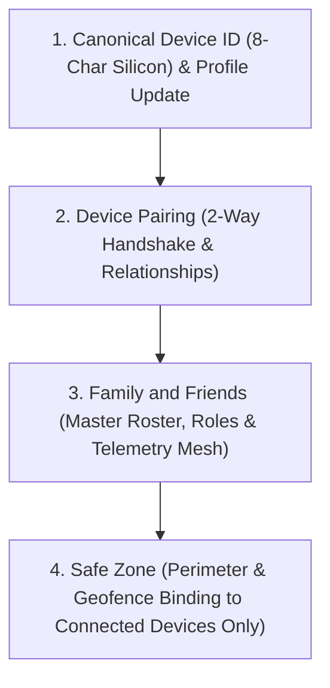

# Program Mapping - Master Relationship Table (Enterprise Standard v5.0)
# Antigravity Enterprise AI Agent Protocol (V3.0 Enterprise Taskforce)

## Workforce Domains & Agent Registry
1. **Workforce Domain 1: Orchestrator & Governance**
   - Agent 1: Product Architect & Hardware Identity Sentinel (SSOT Silicon Root Key: `ro.ril.oem.sno`, `ro.boot.serialno`, persistent external storage anchor `.silicon_anchor`, dynamic Settings override with Zero hardcoded device strings).
2. **Workforce Domain 2: Technology & Architecture**
   - Agent 2: Dual-Engine Database & Backend Logic Architect (SQLite Schema V81.2 (Northwind 2003 Referential Integrity & Tri-Tier Taxonomy across 27 Normalized Tables + 13 Compatibility Views) ↔ Firebase Realtime Cloud SSOT, real-time closed-loop `ACTION_PROFILE_SYNCED` lifecycle broadcast).
   - Agent 6: GIS, Spatial & Geofencing Architect (2D Kalman filter, Haversine, Ray-Casting Polygon SafeZones).
3. **Workforce Domain 3: AI Engineering & Frontend UI/UX**
   - Agent 3: Frontend UI/UX & Lightweight Viewport Architect (UiArchitect L7 Standard: Buttons, Validated Textboxes, Switches, Toggles, Flippers, Dropdowns, Multi-choice Dialogs, Slide-in Notifications).
4. **Workforce Domain 4: Quality & Reliability Operations**
   - Agent 4: Integration, QA & Build Quarantine Agent (Build Quarantine Protocol: autonomous `./gradlew` strictly quarantined).
   - Agent 5: Crash & Silent Failure Hunter (Foreground service lifecycle, Doze mode bypass, Coroutine boundary containment).
5. **Workforce Domain 5: Operations & Performance**
   - Agent 7: Performance & Battery Optimization Agent (Dynamic telemetry intervals, adaptive motion duty-cycles, rolling storage hygiene & SQLite VACUUM).

---

## Master Screen & Component Relationship Table

| Layer (L1-L5) | Screen / Component | Architecture | Agent Owner | Dependencies | Integration Points & Relational SSOT | Status |
| :--- | :--- | :--- | :--- | :--- | :--- | :--- |
| **L1 Root** | `SplashActivity` | MVC Router | Agent 1 | `AuthCheck`, `SessionRouter` | Auto-login & Identity Verification | Active SSOT |
| **L1 Auth** | `AuthActivity` | MVVM | Agent 1, Agent 2 | `AuthViewModel`, `ValidationEngine` | Firebase Auth ↔ `user_identity` Table | Active SSOT |
| **L2 Spatial**| `MapActivity` | MVVM / SSOT | Agent 3, Agent 6, Agent 2 | `MapViewModel`, `MultiMarkerEngine`, `LocationEngine` | `/locations/{id}`, `/devices/{id}`, `LocationEventTable` | Active SSOT |
| **L2 Spatial**| `ButterflyPointHub` (`ButterflyPointDialog`) | OOPS MVC / MVVM | Agent 3, Agent 6, Agent 2 | `ButterflyPointViewModel`, `MultiMarkerEngine`, `GeocodingEngine` | Synchronized with `ACTION_GHOST`; Master DB [Online: `/butterfly_points/{id}`, Offline: `butterfly_point`], Sub Master / Fact DB [connected devices `butterfly_point_device_map`, `change_log`, `location_event`], Transaction DB [`sys_log`, `alert_history`, connected device locations] | Active SSOT |
| **L2 Mesh** | `DeviceSharingHub` (`<Device Sharing>`) | OOPS MVC / MVVM | Agent 1, Agent 2, Agent 3 | `PairingRepository`, `AngelLoader`, `DatabaseHelper`, `FirebaseComm` | Consolidated 4-in-1 Device Connector (Device A ➔ Share Device B ➔ to Device C). Angel Butterfly Progress Sentinel, 15s Timeout Watchdog & Closed-Loop Retry/Exit Fallback. Master DB [Online: `/relationships/{grp}/device_pairings`, Offline: `device_pairings`], Sub Master / Fact DB [`change_log`], Transaction DB [`sys_log`, `offline_events`]; Spec: `requirements/DEVICE_SHARING_REQUIREMENTS_TREE.md` | Active SSOT |
| **L2 Spatial**| `LiveMapDashboardActivity` | Quarantined Shell | Agent 3, Agent 4 | Canonical `MapActivity` | Quarantined to `legacy/archived_tools/android_shells/`; callers route to MapActivity | Quarantined Legacy |
| **L2 Spatial**| `MapActivity2` | Quarantined Shell | Agent 3, Agent 4 | Canonical `MapActivity` | Quarantined to `legacy/archived_tools/android_shells/`; manifest cleaned | Quarantined Legacy |
| **L2 Mesh** | `NetworkGatewayActivity` | MVVM | Agent 1, Agent 2 | `GroupViewModel`, `PairingRepository` | 2x2 Cloud & P2P Symmetrical Pairing Matrix (`device_pairings`) | Active SSOT |
| **L2 Mesh** | `GroupActivity` | Quarantined Shell | Agent 1, Agent 4 | Canonical `NetworkGatewayActivity` | Quarantined to `legacy/archived_tools/android_shells/`; SettingsActivity L759 routes to NetworkGatewayActivity | Quarantined Legacy |
| **L2 Mesh** | `FamilyFriendsActivity` | MVVM | Agent 3, Agent 2 | `FamilyFriendsViewModel`, `RosterTree`, `DeviceRagEngine` | Guardians & Family Multi-tier Roster with Dual-Engine RAG Vitals (`MASTER_ROSTER`, `device_vitals`, `group_members`) | Active SSOT |
| **L2 Mesh** | `PersonDetailsActivity` | MVVM | Agent 3, Agent 1, Agent 2 | `PersonDetailsViewModel`, `ValidationEngine` | Relational Node Metadata & ACLs (`user_profile`, `user_identity`) | Active SSOT |
| **L3 Boundary**| `GeofenceActivity` | MVVM | Agent 6, Agent 3 | `GeofenceViewModel`, `GeofenceHelper` | Safe Zones (`safe_zones`, `safe_zone_user_map`) | Active SSOT |
| **L3 Boundary**| `GeofenceNotificationActivity`| MVC | Agent 6, Agent 5 | `GeofenceBroadcastReceiver` | Transition Audit Ledger (`geofence_events`) | Active SSOT |
| **L3 Trace** | `HistoryActivity` | MVVM | Agent 5, Agent 6 | `HistoryViewModel`, `LocationRepository` | Historical Trajectory Replay (`location_event`) | Active SSOT |
| **L3 Alert** | `NotifActivity` | MVVM | Agent 5, Agent 2 | `NotifViewModel`, `AlertManager` | Alerts, SOS Ingress/Egress (`alerts`) | Active SSOT |
| **L3 Alert** | `AcousticSirenActivity` | MVC | Agent 5, Agent 7 | `AudioOverrideService` | DND Override 30s Acoustic Alarm Beacon | Active SSOT |
| **L3 Health** | `HealthActivity` | MVC | Agent 7, Agent 1 | `HardwareStatusMonitor`, `CellTowerSentinel`, `SimTransportValidator` | Real-time Battery, GPS, Baseband Cellular Tower (MCC/MNC/LAC/CID), Closed-Loop Latency & Actionable Human-in-The-Loop Fix Banner | Active SSOT |
| **L3 Forensic**| `SimForensicWorker` / `CellTowerSentinel` | MVC Engine | Agent 1, Agent 6 | `TelephonyManager`, `CellInfo` | Cellular Tower (MCC/MNC/LAC/CID) Triangulation & `sim_transactions` | Active SSOT |
| **L3 Transport**| `SimTransportValidator` | Diagnostic Sentinel | Agent 4, Agent 5 | `ConnectivityManager`, `PowerManager` | 14-Condition Mobile Data, Doze & Carrier Blocking Audit | Active SSOT |
| **L3 Failover** | `TelemetryFailoverRouter` | Failover Switch | Agent 1, Agent 2, Agent 4 | `FirebaseComm`, `OfflineSyncManager` | 5-Tier Interchangeable Mesh (Cellular -> Wi-Fi -> SMS -> SQLite) | Active SSOT |
| **L3 Feedback** | `TelemetryClosedLoopSentinel` | Closed-Loop Engine | Agent 2, Agent 4, Agent 5 | `FirebaseDatabase`, `DatabaseHelper` | Bidirectional Cloud ACK, RTT Latency (<5s) & Trip-Wire Failover | Active SSOT |
| **L3 Privacy**| `PrivacyActivity` | MVC | Agent 1, Agent 5 | `SecurityEngine`, `PrivacyEngine` | Permission Matrix & Ghost Mode Locks (`system_registry`) | Active SSOT |
| **L4 Control**| `SettingsActivity` | Dual-Tab MVVM | Agent 3, Agent 7 | `RegistryManager`, `AllScreensRegistry` | Tab 1: Universal Settings (Priorities 1-8, Priority 7C: Closed-Loop ACK Timeout, Circuit Breaker Failure Threshold, SOS SMS Target), Tab 2: Modules | Active SSOT |
| **L4 Control**| `UiConfigActivity` | MVC | Agent 3 | `UiArchitect`, `ThemeManager`, `AngelLoad` | Dynamic Theme Palette, 5-Stage Sizing & Border Geometry | Active SSOT |
| **L4 Control**| `UiGalleryActivity` | MVC | Agent 3 | `UiArchitect` | Component Suite Visual Showcase | Active SSOT |
| **L4 Engine** | `BackgroundJobsConfigDialog`| 4-Tier Waterfall | Agent 7, Agent 2 | `BackgroundJobManager` | 13 Engine Workers, Periodic Cadence & Manual Execution | Active SSOT |
| **L4 Vault** | `ForensicVaultExplorerActivity`| MVC | Agent 5, Agent 2 | `DatabaseHelper` | Encrypted SQLite Forensic Inspector (27 Normalized Tables + 16 Zero-Loss Views & Bidirectional Triggers) | Active SSOT |
| **L4 Audit** | `WatchDogAuditActivity`| MVVM | Agent 5 | `WatchDogViewModel` | Process Liveness & SQLite Integrity Verifier | Active SSOT |
| **L4 Admin** | `DatabaseManagementActivity` | MVC | Agent 2, Agent 4 | `DatabaseHelper` | SQLite Schema Inspector & Table Maintenance Console | Active SSOT |
| **L4 Admin** | `FirebaseCloudMatrixActivity` | MVC | Agent 1, Agent 2 | `FirebaseComm` | Cloud Realtime Database Mesh Inspector | Active SSOT |
| **L4 Admin** | `SystemLogActivity` | MVC | Agent 5, Agent 7 | `SystemLogger` | Rolling Realtime Runtime Trace Logger (`sys_log`) | Active SSOT |
| **L5 Maint** | `SystemUpdateActivity` | MVVM | Agent 4, Agent 5 | `SilentUpdateWorker`, `ApkInstallerHelper`| Self-Healing Silent APK Updater & Hash Verifier (`requirements/SYSTEM_UPDATE_REQUIREMENTS_TREE.md`) | Active SSOT |
| **L5 Maint** | `FactoryResetActivity` | MVVM | Agent 4, Agent 1 | `FactoryResetViewModel` | Selective Purge & Cloud Recovery Console | Active SSOT |
| **L5 Support**| `HelpSupportActivity` | MVC | Agent 3 | `UserManual` | Technical Documentation & Diagnostics Gateway | Active SSOT |
| **L5 Support**| `AboutActivity` | MVC | Agent 1, Agent 3 | `BuildConfig` | Application Manifest & Build Identity Dossier | Active SSOT |

---

## Web Mission Control & Forensic Gateway Relationship Table (Decoupled Sovereign Workspace: `C:\Users\jiten\jAnitGravity\jFindMeWeb`)

| Layer | Subsystem / File | Port / Protocol | Architecture | Role & Integration Points | Status |
| :--- | :--- | :--- | :--- | :--- | :--- |
| **W1 Gateway** | `C:\Users\jiten\jAnitGravity\jFindMeWeb\js\server.js` | Port 3000 (REST) | Express Proxy | Firebase Admin SDK, OTA broadcast, RTDB REST endpoints | Active SSOT |
| **W1 Gateway** | `C:\Users\jiten\jAnitGravity\jFindMeWeb\js\static_server.js` | Port 8080 (HTTP) | Reverse Proxy | Serves static assets, reverse-proxies `/api/*` to Port 3000 | Active SSOT |
| **W2 Shell** | `C:\Users\jiten\jAnitGravity\jFindMeWeb\index.html` | Port 8080 (SPA) | Tactical Radar | Main web workspace, Leaflet/Google Maps radar, audit ledger | Active SSOT |
| **W2 Orchestrator**| `C:\Users\jiten\jAnitGravity\jFindMeWeb\js\app.js` | ES6 Module | Master Controller | State dispatch, routing, telemetry subscriptions, terminal | Active SSOT |
| **W2 Matrix** | `C:\Users\jiten\jAnitGravity\jFindMeWeb\database-sync-settings.html` | Standalone HTML | 20-Screen Sync | 178 Master Parameter Dual-Engine Synchronization Console | Active SSOT |
| **W3 Models** | `DeviceModel.js`, `SettingsModel.js`, `SafeZoneModel.js`, `DeviceFilterModel.js` | MVC Model | Data Entities | Hardware silicon ID binding, boundary polygons, telemetry, geographic cascading hierarchy & dynamic bandwidth hygiene | Active SSOT |
| **W3 Controllers**| `DeviceController.js`, `MapController.js`, `SafeZoneController.js` | MVC Controller | Action Handlers | Device filtering, interrogation, map event dispatching, selective telemetry stream injection | Active SSOT |
| **W3 Services** | `FirebaseService.js` (FBBridge), `AvatarService.js`, `SanitizerService.js` | Service Layer | Network & IO | SSE event streaming, XSS sanitization, avatar asset mapping, selective polling URL query encoder | Active SSOT |
| **W3 Views** | `DashboardView.js`, `DeviceCardView.js`, `DeviceUserView.js`, `GeofencingView.js`, `MapView.js`, `MapSettingsView.js`, `DeviceFilterModalView.js` | MVC View | Visual Renderers | Real-time map pins, KPI metrics, device dossier, multi-column geographic fleet filter modal, dynamic settings UI | Active SSOT |
| **W4 Release** | `C:\Users\jiten\jAnitGravity\jFindMe\apk\sync_service.py` | Port 8085 (Daemon)| Python Singleton Daemon | Singleton supervisor (`sync_service.pid`), dual-config SSOT atomic sync (`jFindMe/apk` ⇄ `jFindMeWeb`), hardware binary badging, staged release engine, SHA-256 integrity, GitHub git automation & bsdiff differential hotpatching | Active SSOT |
| **W4 Studio**  | `C:\Users\jiten\jAnitGravity\jFindMeWeb\jButterflyGithubSync_v2.html` | Client UI (Port 3000/8085) | HTML5 / OOPS MVC | 1-Click Promote Next Build, zero-latency reactive metadata refresher, Option 1 (ADB Install vs Copy to Downloads), WhatsApp deep link, QR modal, slide-out activity console | Active SSOT |

---

## 4-Tier Chronological Background Jobs Waterfall

```
┌────────────────────────────────────────────────────────────────────────┐
│ TIER 1: 🛰️ PRIMARY TELEMETRY & CORE GPS PIPELINE (Root / Critical)     │
│ ├── JOB_TRACKING_SERVICE      : Foreground GPS Telemetry Service       │
│ ├── JOB_LOCATION_WATCHDOG     : Sentinel Process Keep-Alive Monitor    │
│ └── JOB_GEOFENCE_SENTINEL     : Hardware Geofence Perimeter Sentinel   │
└───────────────────────────────────┬────────────────────────────────────┘
                                    │ (Sequential Dependency)
┌───────────────────────────────────▼────────────────────────────────────┐
│ TIER 2: ☁️ CLOUD SYNC & PEER STREAMING HUB (Network Synchronization)   │
│ ├── JOB_LIVE_MAP_STREAM       : Peer WebSocket RTDB Stream (Ghost-Excl)│
│ ├── JOB_PRESENCE_PULSE        : Real-time Presence Pulse & Vitals Ping │
│ ├── JOB_OFFLINE_SYNC          : Encrypted Offline SQLite Queue Flusher │
│ └── JOB_FCM_MESSAGING         : High-Priority FCM Push Sentinel        │
└───────────────────────────────────┬────────────────────────────────────┘
                                    │ (Sequential Dependency)
┌───────────────────────────────────▼────────────────────────────────────┐
│ TIER 3: 📱 FORENSIC HARDWARE & SECURITY (Passive Hardware Interceptors)│
│ ├── JOB_SECURITY_RECEIVER     : Power, Boot, Flight Mode Interceptor   │
│ ├── JOB_ACOUSTIC_SIREN        : Emergency Beacon & Audio Bridge        │
│ └── JOB_SIM_FORENSIC          : SIM & Cellular Tower Hardware Sentinel │
└───────────────────────────────────┬────────────────────────────────────┘
                                    │ (Sequential Dependency)
┌───────────────────────────────────▼────────────────────────────────────┐
│ TIER 4: ⚡ STORAGE PRUNING & SYSTEM INTEGRITY (Maintenance & Hygiene)   │
│ ├── JOB_STORAGE_PRUNE         : Rolling Retention Purge & SQLite VACUUM│
│ ├── JOB_SILENT_UPDATE         : Binary Hash Check & Update Sentinel    │
│ └── JOB_APP_UPGRADE_WATCH     : Post-Install Auto-Restart Sentinel     │
└────────────────────────────────────────────────────────────────────────┘
```

---

## Quarantined Legacy & Scratch Inventory (Prime Directive 1 Compliance)

All obsolete prototypes, temporary test files, and historical binaries have been safely relocated to `legacy/` rather than deleted, guaranteeing 100% auditability without polluting the active production tree:

1. **`legacy/archived_tools/`**:
   - `android_shells/`: Quarantined redirect shells (`MapActivity2.java`, `LiveMapDashboardActivity.java`, `GroupActivity.java`). Callers modernized to canonical `MapActivity` and `NetworkGatewayActivity`.
   - `diagnostics/`: 12 one-time diagnostic node scripts (`purge_all_database.js`, `cleanup_lookups.js`, `cleanup_database_gaps.js`, `check_fcm.js`, `sync_vibgyor.js`, `inspect_devices.js`, `inspect_versions.js`, `check_all_roots.js`, `check_device_geofences.js`, `check_device_timestamps.js`, `diagnose_devices.js`).
   - `unity_avatar_prototypes/`: 7 C# Unity avatar scripts (`AvatarAnimationController.cs`, `AvatarController.cs`, `AvatarLoader.cs`, `AvatarLoadingPipeline.cs`, `AvatarMapPositioner.cs`, `AvatarProfileRenderer.cs`, `ModularAvatarAssembler.cs`).
   - `html_sync/`: Obsolete v1 `jButterflyGithubSync.html` (superseded by `jButterflyGithubSync_v2.html`).
   - `launchers/`: Obsolete `jFindMeWeb/launcher.hta` and hardcoded ADB test script `scripts/auto_reinstall_device.bat`.
   - `root_engine_duplicate/`: Contains orphaned `MarkerClusterer.kt` duplicate from root.
   - `web_enterprise_orphans/`: Contains unimported `js/enterprise/` (`App.js`, `DataGrid.js`, `SchemaView.js`, `Store.js`).
   - `web_prototypes/`: Contains dead prototype island (`MainController.js`, `DataRenderer.js`, `ModalUI.js`, `DatabaseProvider.js`, `OptimizedLeafletMap.js`, `MapPerformance.js`, `server-settings-api.js`, `GoogleFindHubView.js`).
   - `download.py`, `find_img.py`, `inspect_gdrive.py`, `drive_file.html`, `process_avatars.py`: One-off asset scraping scripts.
   - `_temp_script_0.js`: Extracted APK scratch script.
   - `watchdog_dog.png`: Unused root image.

2. **`legacy/archived_scratch/`**:
   - `root_avatar_backup/`: Quarantined root `Avatar/` (51 duplicate loose PNG/JPG/WebP files, preserved under Chesterton's Fence; web serves from `jFindMeWeb/assets/avatars/`).
   - `web_scratch/`: Quarantined `jFindMeWeb/scratch/` (including 19.65 MB enterprise repair backup snapshot & 32 scratch scripts).
   - `root_scratch/`: Quarantined `scratch/jbutterfly/` (~285 MB old APKs) & `scratch/backup_db/` (2.7 MB DB).

3. **`legacy/jButterFly/`**:
   - Complete historical reference project tree preserved under Chesterton's Fence.

---

## Master Database Relationship Architecture (Schema V81.2 Gold Master)

### 1. Master 3-Tier Database Taxonomy (27 Normalized Tables)

```mermaid
graph TD
    subgraph Tier1 ["Tier 1: Master Entities (Canonical Anchors)"]
        UI["user_identity (id PK, uid_1, uid_2, auth_uid)"]
        D["device (device_id PK, identity_id FK, hardware_id)"]
        G["groups (group_id PK, group_name, invite_code)"]
        SZ["safe_zone (zone_id PK, created_by, lat, lng)"]
        SMK["security_master_keys (key_id PK, identity_id FK, public_key)"]
        ORG["organization (org_id PK, org_name, clearance_level)"]
    end

    subgraph Tier2 ["Tier 2: Sub-Masters & Dimension Tables"]
        UP["user_profile (id PK, identity_id FK, blood_group, pin_hash)"]
        UOM["user_org_map (id PK, identity_id FK, org_id FK)"]
        DP["device_pairing (pair_id PK, device_a_id, device_b_id)"]
        SIM["sim (sim_serial PK, device_id FK, phone_number)"]
        DPS["device_policy_state (policy_id PK, device_id FK)"]
        GM["group_members (id PK, group_id FK, identity_id FK, agent_id)"]
        SZUM["safe_zone_user_map (id PK, zone_id FK, identity_id FK)"]
        SSC["stealth_schedule_config (config_key PK, config_value)"]
        RGC["reverse_geocode_cache (id PK, lat_rounded, lng_rounded, address)"]
    end

    subgraph Tier3 ["Tier 3: High-Velocity Transactional & Audit Ledgers"]
        LE["location_event (id PK, identity_id FK, lat, lng, day_key)"]
        PSQ["pending_sync_queue (queue_id PK, entity_type, payload)"]
        DV["device_vitals (id PK, hardware_id, battery_pct, motion_state)"]
        AH["alert_history (alert_id PK, target_identity_id, alert_type)"]
        WRL["watchdog_resurrection_log (id PK, hardware_id, latency_ms)"]
        TFR["telemetry_failover_routes (route_id PK, identity_id FK, priority_tier)"]
        SL["sys_log (id PK, level, tag, message, timestamp)"]
        PMP["p2p_mesh_packets (packet_id PK, identity_id FK, hop_count)"]
        INV["invitations (id PK, token, group_id FK, initiator_identity_id FK)"]
        ST["sim_transactions (tx_id PK, sim_serial, cell_id, lac)"]
        GE["geofence_event (event_id PK, zone_id, identity_id, event_type)"]
        SQ["sync_queue (sync_id PK, payload, status)"]
        CL["change_log (id PK, category, entity_id, change_type)"]
        SAL["security_audit_log (log_id PK, event_type, severity)"]
    end

    UI --> UP
    UI --> UOM
    UI --> D
    UI --> SMK
    UI --> LE
    UI --> TFR
    UI --> PMP
    UI --> INV
    UI --> SZUM
    UI --> GM

    ORG --> UOM
    G --> GM
    G --> INV
    SZ --> SZUM
    SZ --> GE
    D --> SIM
    D --> DPS
    D --> DV
    SIM --> ST
```



### 2. 13 Zero-Loss Compatibility Views (Master Temporal Query Invariant: Latest-Data-First DESC)
All views are strictly sorted by date/time descending to ensure every default consumer receives the most recent active record first:
1. `devices` ➔ `SELECT * FROM device ORDER BY updated_at DESC, device_id DESC`
2. `safe_zones` ➔ `SELECT * FROM safe_zone ORDER BY updated_at DESC, zone_id DESC`
3. `geofence_events` ➔ `SELECT * FROM geofence_event ORDER BY timestamp DESC, event_id DESC`
4. `sys_logs` ➔ `SELECT * FROM sys_log ORDER BY timestamp DESC, id DESC`
5. `security_evasion_audit_log` ➔ `SELECT * FROM security_audit_log ORDER BY timestamp DESC, log_id DESC`
6. `watchdog_resurrection_ledger` ➔ `SELECT * FROM watchdog_resurrection_log ORDER BY timestamp DESC, id DESC`
7. `device_policy` ➔ `SELECT * FROM device_policy_state ORDER BY updated_at DESC, id DESC`
8. `device_pairings` ➔ `SELECT * FROM device_pairing ORDER BY updated_at DESC, pair_id DESC`
9. `alerts` ➔ `SELECT * FROM alert_history ORDER BY timestamp DESC, id DESC`
10. `MASTER_ROSTER` ➔ `SELECT * FROM group_members ORDER BY joined_at DESC, id DESC`
11. `master_roster` ➔ `SELECT * FROM group_members ORDER BY joined_at DESC, id DESC`
12. `organizations` ➔ `SELECT * FROM organization ORDER BY updated_at DESC, org_id DESC`
13. `sim_inventory` ➔ `SELECT * FROM sim ORDER BY updated_at DESC, sim_id DESC`

> **Core Governance Rule — Master Temporal Query Invariant**: Every database query across SQLite and Firebase RTDB MUST fetch the latest data ordered by timestamp/datetime descending (`ORDER BY timestamp DESC`, `ORDER BY updated_at DESC`) by default. Historical playback, trajectory breadcrumbs, or sequential audit reconstruction flows are explicit opt-in exceptions specifying ascending order (`ORDER BY timestamp ASC`).

### 3. Dynamic Variable & Settings Master Map (Zero Hardcoded Rules)

| Setting Name / Parameter | Database SSOT (`stealth_schedule_config`) | Registry Manager Key (`system_registry`) | Default Value | Tunable Options / Range | UI Screen Location |
| :--- | :--- | :--- | :--- | :--- | :--- |
| **Storage History Retention** | `retention_days` | `pref_storage_retention_days` | `3` Days | 1, 2, 3, 7, 14, 30 Days | `SettingsActivity` Card 7 |
| **Geocode Cache Capacity** | `max_geocode_cache_size` | `pref_max_geocode_cache` | `5,000` Entries | 1k, 2.5k, 5k, 10k, 20k Entries | `SettingsActivity` Card 7 |
| **Pending Sync Queue TTL** | `sync_queue_ttl_hours` | `pref_sync_queue_ttl_hours` | `48` Hours | 12, 24, 48, 72 Hours | `SettingsActivity` Card 7 |
| **System Audit Log TTL** | `sys_log_ttl_hours` | `pref_sys_log_ttl_hours` | `48` Hours | 24, 48, 72, 168 Hours | `SettingsActivity` Card 7 |
| **P2P Mesh Packet TTL** | `p2p_mesh_ttl_hours` | `pref_p2p_mesh_ttl_hours` | `24` Hours | 6, 12, 24, 48 Hours | `SettingsActivity` Card 7 |
| **Invitation Token TTL** | `invitation_ttl_days` | `pref_invitation_ttl_days` | `7` Days | 1, 3, 7, 14 Days | `SettingsActivity` Card 2 |
| **Batch Pagination Limit** | `default_page_limit` | `pref_default_page_limit` | `50` Rows | 25, 50, 100, 200 Rows | `ForensicVaultExplorerActivity` |
| **Radar Proximity Radius** | `radar_proximity_radius` | `pref_radar_proximity_radius`| `5,000` Meters| 500m - 50km | `SettingsActivity` Card 5 |
| **Distant Device Threshold**| `distant_device_threshold`| `pref_distant_device_threshold`| `15,000` Meters| 1km - 100km | `SettingsActivity` Card 5 |
| **Motion Co-Processor Ping**| `pref_tracking_interval` | `pref_tracking_interval` | `10,000` ms | 5s, 10s, 30s, 60s, 120s | `SettingsActivity` Card 3 |

### 4. Online-Only Cloud Node Lifecycle & 7-Day Closed Feedback Loop Protocol

| Cloud Node Path | Current Role | Closed Feedback Loop Mechanism | 7-Day Eviction / Purge Policy | What Breaks If Blindly Deleted? | Safe Remediation & Hardening |
| :--- | :--- | :--- | :--- | :--- | :--- |
| **`/lookup_indices/`** | Fast $O(1)$ Reverse Auth UID ➔ Hardware Device ID lookup for Web Mission Control | Closes loop on device unlinking or deletion (`deleteRosterNode` / `FactoryReset` removes index entry) | Stale entries with zero active heartbeat for **> 7 Days** auto-evicted | Web Mission Control (`/api/devices-live`) fails to map `authUid` to device without doing expensive full-tree scans of `/devices/` | Keep pending/active devices; purge dead ghost nodes older than 7 days |
| **`/Version_Update/`** | Distributes OTA update manifests, APK links, and binary checksums | Closes loop when update completes: pins current build to `/Version_Update/{id}/latest` | Historical version nodes (`V75`, `V76`, etc.) older than **7 Days** purged | `SilentUpdateWorker` cannot verify whether a new APK build is available for rollout | Keep `/latest` and active rollout channel; purge dead historical version records after 7 days |
| **`/relationships/{id}/signals/`** | Ephemeral pub/sub websocket trigger notifying circle members of roster/safezone changes | Closes loop when client reads signal: client records last handled timestamp and triggers local refresh | Signals older than **24h - 7 Days** or belonging to disbanded circles auto-purged | Real-time push synchronization across circle members breaks; clients must fall back to slow periodic polling | Keep signal keys active while circle is live; purge orphaned signals when group is deleted or dormant > 7 days |

---

### 5. Physical Device Ecosystem & Relational Tree SSOT



#### Canonical 5 Physical Devices Master Table

| Canonical Device ID | Device Name | Hardware Model | Role in Circle | Active Group SSOT | Status |
| :--- | :--- | :--- | :--- | :--- | :--- |
| **`2C811042`** | Redmi 5pro | Xiaomi whyred | Parent / Member | `GRP_2T929153` | 🟢 ONLINE / ACTIVE |
| **`2D113789`** | INNOVANT | Android Device | Friend / Member | `GRP_2T929153` | 🟢 ONLINE / ACTIVE |
| **`2T929153`** | REDMI N7 | Redmi Note 7 Pro | Root Circle Admin / Host | `GRP_2T929153` | 🟢 ONLINE / ACTIVE |
| **`4379A761`** | RIDDHI | Android Device | Child / Daughter | `GRP_2T929153`, `GRP_4379A761` | 🟢 ONLINE / ACTIVE |
| **`F8CAFC67`** | PUSHPA | Redmi Note 10 Pro | Spouse / Parent | `GRP_2T929153`, `GRP_F8CAFC67` | 🟢 ONLINE / ACTIVE |

#### Ghost / Duplicate Nodes RCA & Resolution Summary

| Legacy/Ghost Node | Classification | Root Cause Identified | Final Remediation |
| :--- | :--- | :--- | :--- |
| `2C819R121042` | Raw Serial Stub | Unstripped 12-char silicon serial used prior to agent ID caching | Compressing sanitizer added (`take(4)+takeLast(4)`); node pruned from RTDB |
| `2D112R123789` | Raw Serial Stub | Unstripped 12-char silicon serial used prior to agent ID caching | Compressing sanitizer added; node pruned from RTDB |
| `2T921R129153` | Raw Serial Stub | Unstripped 12-char silicon serial used prior to agent ID caching | Compressing sanitizer added; node pruned from RTDB |
| `HW_2C811042` | Hardware Prefix Stub | `MasterDataSyncSentinel` fan-out to raw `uid_2` inbox path | Sanitized `getAllPairedDeviceIds()` & inbox call sites; node pruned |
| `HW_2D113789` | Hardware Prefix Stub | `MasterDataSyncSentinel` fan-out to raw `uid_2` inbox path | Sanitized `getAllPairedDeviceIds()` & inbox call sites; node pruned |
| `HW_2T929153` | Hardware Prefix Stub | `MasterDataSyncSentinel` fan-out to raw `uid_2` inbox path | Sanitized `getAllPairedDeviceIds()` & inbox call sites; node pruned |
| `HW_HW_2C811042`| Double-Prefix Corruption | `ProfileViewModel` passed `"HW_${hardwareId}"` where `hardwareId` already had `HW_` | Stripped `HW_` iteratively; merged profile; node pruned |
| `HW_HW_2T929153`| Double-Prefix Corruption | `ProfileViewModel` passed `"HW_${hardwareId}"` where `hardwareId` already had `HW_` | Stripped `HW_` iteratively; merged profile; node pruned |
| `UNIT0001` | Test Mock Stub | Injected by legacy mock testing script | Pruned from RTDB |
| `UNIT0002` | Test Mock Stub | Injected by legacy mock testing script | Pruned from RTDB |
| `A7D5968D` | Reinstall Orphan Node | Riddhi's prior device ID before app reinstall; >100k unconsumed sync messages | Consolidated history to `4379A761`, batched-deleted `master_sync`, node pruned |

---

### 6. Dynamic Bidirectional Device-to-Device Pairing & Role Scoping Architecture

#### Coordinate Tree: `(ROOT⊃BR⊃EL⊃FE⊃BE⊃DB)` Structured Plan
```
(ROOT: jFindMe Core Engine)
 ⊃ (BR: Business Rules)
     ├── BR-1: Multi-Device Pairing Code Attachment (1 Single 6-digit code attaches up to 5 devices simultaneously: 2T929153, 2C811042, F8CAFC67, 4379A761, 2D113789).
     ├── BR-2: Bidirectional Role Reciprocity (Device1=Parent ⇒ Target=Child; Device1=Spouse ⇒ Target=Spouse; Device1=Friend ⇒ Target=Friend; Device1=Guardian ⇒ Target=Dependent).
     ├── BR-3: Scoped Peer Isolation (A device only renders markers, history, vitals, and roster nodes for explicitly connected peers; eliminates circle-wide data leakage).
     ├── BR-4: Close Attachment Mesh (Shared encryption token and circle group ID propagated to all attached devices under single pairing code).
     └── BR-5: Human-in-the-Loop Consent SOP (Elevation to Parent/Guardian or Unlinking triggers explicit confirmation gate with reverse feedback audit).
 ⊃ (EL: Event Listeners & Interceptors)
     ├── EL-1: MultiMarkerEngine.OnMarkerClickListener (Triggers MapActivity Target Action Sheet).
     ├── EL-2: UiArchitect.OnMultiSelectionConfirmListener (Validates selected target devices and assigned roles).
     ├── EL-3: Firebase RTDB `/pairing_sessions/{pairCode}/attached_devices` ChildEventListener (Real-time live multi-device attachment).
     ├── EL-4: SQLite Triggers & Local Broadcasts (`ACTION_PAIRING_SYNCED`, `ACTION_ROSTER_REFRESH`).
     └── EL-5: LocationRepository.PeerSubscriptionListener (Dynamically attaches/detaches RTDB listeners strictly for connected peers).
 ⊃ (FE: Frontend UI / UX Components)
     ├── FE-1: MapActivity Target Action Sheet: Option 8 upgraded to "🔗 Connect / Pair Device with Roles".
     ├── FE-2: UiArchitect Compound Checkbox Dialog:
     │         ├── Selected Device Header (Agent ID, Callsign, Avatar, Battery).
     │         ├── Section 1: "To Connect Device List" [Multi-choice Checkboxes for candidate fleet devices].
     │         ├── Section 2: "Role List" [Multi-choice Checkboxes: Parent/Guardian, Child/Ward, Spouse, Friend, Tracker].
     │         └── Action Button: "Connect Devices as [Selected Role]".
     ├── FE-3: FamilyFriendsActivity: Role tags, connection badges, and isolated cluster grouping.
     └── FE-4: SlideNotificationBanner: Real-time feedback banner confirming mutual link creation.
 ⊃ (BE: Backend / ViewModels & Repositories)
     ├── BE-1: MapViewModel.connectDeviceWithRoles(sourceUid, targetUids[], roles[])
     ├── BE-2: PairingRepository.startMultiDeviceSession(primaryId, maxAttachments=5)
     ├── BE-3: PairingRepository.joinMultiDeviceSession(pairCode, joiningId, role)
     ├── BE-4: PairingRepository.linkBatchDevicesWithRoles(sourceUid, targetUids[], roles[])
     └── BE-5: LocationRepository: Enforces `localDb.getConnectedDeviceIds(currentDeviceId)` instead of global un-scoped dumps.
 ⊃ (DB: Dual Storage SSOT)
     ├── DB-1: SQLite `device_pairing` table (Upgraded schema with `role_a`, `role_b`, `pairing_code`).
     ├── DB-2: SQLite `DatabaseHelper.getConnectedDeviceIds(focalDeviceId)` (Scoped bidirectional SQL query).
     ├── DB-3: Firebase RTDB `/pairing_sessions/{pairCode}/`
     │         ├── status: "ACTIVE" | "SEALED" | "EXPIRED"
     │         ├── primary_device: "2T929153"
     │         └── attached_devices: { "2C811042": { role: "PARENT", ... }, "4379A761": { role: "CHILD", ... } }
     └── DB-4: Firebase RTDB `/relationships/{group_id}/devices/{device_id}/paired_with/{target_id}`
```

#### Chronological Sequence & Scenarios-Based SOP
1. **Host Generation:** Primary device generates 1 pairing code (`pairing_sessions/{code}`) with `max_attachments = 5`.
2. **Concurrent Multi-Attachment:** Devices 2, 3, 4, 5 enter the same 6-digit code. Status remains `ACTIVE` until sealed or slots filled.
3. **Map Selection Linker:** Operator selects any device on the Map $\rightarrow$ Chooses "🔗 Connect / Pair Device with Roles" $\rightarrow$ Selects target device(s) and role(s) via tickboxes.
4. **Bidirectional Reciprocal Commit:** Database updates `device_pairing` locally with `(dev_a, dev_b, role_a, role_b, pairing_code)` and synchronizes to Firebase `/relationships/`.
5. **Scoped Viewport Isolation:** Map markers and Family/Friends rosters are immediately filtered to only show permitted, connected devices.

---

### 7. Relational Roster & Build Pipeline Incident Post-Mortem (V81.4 Audit Patch)

| Component | Symptom Observed | Root Cause (RCA) | Remediation Deployed | Parity & Status |
| :--- | :--- | :--- | :--- | :--- |
| **Gradle Daemon & Sync** | `configurationMetrics is corrupted. This may be caused by unsafe concurrent execution...` | Multi-module parallel configuration (`org.gradle.parallel=true`) triggers Kotlin Gradle Plugin build metrics race condition (KT-66542). Corrupted daemon persisted in memory. | Set `org.gradle.parallel=false` in `gradle.properties`, terminated hung daemon PID 7884 to clear corrupted memory state. | 🟢 RESOLVED |
| **AvatarLoader Engine** | App crash when loading member avatars on Family & Friends page | `Integer.parseInt(avatarIdStr)` on raw numeric strings exceeding $2^{31}-1$ (epoch timestamps, phone numbers, hardware IDs) threw uncaught `NumberFormatException`. | Wrapped numerical resolution in try-catch; added safe modulo hash seed (`Math.abs(seed % 50) + 1`). | 🟢 RESOLVED |
| **FamilyFriendsActivity** | Intermittent crash / blank view on initial roster snapshot load | Direct un-guarded dereferencing of `node.getDisplayName()`, `node.getUid()`, and `node.getRoleTitle()` on null or incomplete SQLite/Firebase nodes. | Injected null-safety checks in `updateTabBadges()`, `renderFamilyTab()`, `renderFriendsTab()`, and wrapped card inflation in local `try-catch`. | 🟢 RESOLVED |
| **FamilyFriendsActivity & ViewModel** | UI thread freezing & ANR (hanging) on rapid peer GPS heartbeats | High-frequency Firebase RTDB `onDataChange` callbacks executed 7–10 synchronous SQLite queries per roster node on Main Looper, followed by synchronous `removeAllViews()` DOM clearing. | Offloaded roster resolution and DB writes to `Dispatchers.IO`. Injected 250ms render debouncing (`scheduleRosterRender`) and cached resolved local agent ID. | 🟢 RESOLVED |
| **PersonDetailsActivity & ViewModel** | App crash on launch when `targetAgentId` is null; UI stutter on dossier load | Direct passing of null target ID to Kotlin methods triggered `Intrinsics.checkNotNullParameter` NPE. SQLite reads ran synchronously on Main Looper. | Guarded `targetAgentId` with fallback to self hardware ID. Offloaded `fetchDossier` and writes to `Dispatchers.IO`. | 🟢 RESOLVED |
| **MapViewModel** | GPS frame drops & UI thread hang on incoming location fix | `loadLocalDossier` and `updateMyLocation` performed synchronous SQLite queries (`getLocalDossier`) on the UI thread on every location update. | Wrapped DB reads and identity resolution in `viewModelScope.launch(Dispatchers.IO)` with in-memory caching. | 🟢 RESOLVED |
| **HistoryActivity & ViewModel** | Fragment transaction crash on fast rotation; ANR loading targets | `commitNowAllowingStateLoss()` called without lifecycle verification; target fetching performed un-throttled SQLite queries on Main Looper. | Added `!isFinishing() && !isDestroyed()` checks and `commitAllowingStateLoss()`. Offloaded target roster loading to `Dispatchers.IO`. | 🟢 RESOLVED |
| **ForensicVault & HealthActivity** | ANRs when viewing large tables / vitals | Synchronous pagination and table column reflection on large SQLite logs (`sys_log`, `location_event`) on Main Looper. | Offloaded database pagination, column reflection, and vitals queries to background threads with `runOnUiThread` posting. | 🟢 RESOLVED |
| **PersonDetailsViewModel Compilation** | `Unresolved reference viewModelScope` & `Expecting a top level declaration` | Extra closing brace `}` at line 170 terminated `class PersonDetailsViewModel` prematurely, ejecting methods into global scope. | Removed redundant closing brace at line 170; mirrored twin file to `jButterFly`; clean `compileDebugSources` build verified (0 errors). | 🟢 RESOLVED |
| **FamilyFriendsActivity (Runtime Freeze)** | App hanging/crash on Family & Friends open | Synchronous `dbLocal.resolveAgentIdLocally(myUid)` in `renderFamilyTab()` collided with background coroutine SQLite write transactions. | Linked `resolvedLocalAgentId` to pre-warmed `cachedResolvedLocalAgentId`; eliminated Main Looper DB lock contention. | 🟢 RESOLVED |

---

### 8. Multi-Device Mesh, Co-Parent Linking & 1-Code Attachment Root Cause & Reverse Engineering Analysis (V81.5)

| Feature | Observed Failure | Root Cause Analysis (RCA) | Reverse Engineering Analysis (REA) & Missing Steps Added | Status |
| :--- | :--- | :--- | :--- | :--- |
| **🔗 Connection to Other Device** (`MapActivity` / `PairingRepository`) | Connecting Device B to Device C or batch connecting fails silently or devices do not appear on each other's viewports. | 1. `PairingRepository.linkDevicesWithRoles` queried `cleanDevA.child("identity")` with lowercase casing while schema/rules specify uppercase `Identity`.<br>2. Reciprocal `valid_linked_agents` only updated Device A, leaving Device B un-linked.<br>3. `relationships/$groupId/devices/` only set `paired_with` without setting `identity/name`, `membership/role`, `membership/status`, or reciprocal `direct_pairs`.<br>4. Local SQLite did not persist roster nodes or update `scopedIds`, so `LocationRepository` and `FamilyFriendsViewModel` filtered out newly connected devices. | 1. Added dual-casing lookup on `Identity` with fallback to `identity`.<br>2. Reciprocally appended `valid_linked_agents` on both Device A and Device B.<br>3. Constructed complete device descriptors under `relationships/$groupId/devices/` and set reciprocal `direct_pairs`.<br>4. In SQLite, committed `DevicePairingTable.logPairingWithRoles`, `saveRosterNode`, and `updateCitizenRole` for both devices.<br>5. Injected mutual pairing with initiating local device (`selfDevId`) so `scopedIds` retains full visibility.<br>6. Broadcast `ACTION_MASTER_DATA_UPDATED` via `MasterDataSyncSentinel`. | 🟢 RESOLVED |
| **👨‍👩‍👧 Add Another Parent / Guardian** (`MapActivity` / `PairingRepository`) | Co-Parent candidate list was empty; invite code generation hung; manual linking did not attach guardian oversight. | 1. `showAddAnotherParentDialog` only inspected live GPS fixes in `allLocations`; offline or battery-saver co-parents were omitted.<br>2. `createCircleInviteCode` wrote exclusively to `/circle_invites/`, which was omitted from `database.rules.json` (triggering root `PERMISSION_DENIED`).<br>3. `addOnFailureListener` had no UI callback, causing indefinite loader hangs.<br>4. `linkCoParentToChild` fell back to `GRP_$cleanCoParent` when group was unspecified, fracturing the circle.<br>5. `cleanChild`'s `valid_linked_agents` and `direct_pairs` were never updated. | 1. Aggregated candidates from both live locations and `DatabaseHelper.getOfflineRoster()`, deduplicating by ID.<br>2. Added `/circle_invites/` to `database.rules.json` and dual-mirrored all invite payloads to `/pairing_requests/` for zero-rejection routing.<br>3. Added error/timeout guards to `createCircleInviteCode` so code generation always returns.<br>4. Resolved group context dynamically from local registry/child active group.<br>5. Set reciprocal `dependents`, `guardians`, `direct_pairs`, `co_guardians`, and local SQLite roster nodes. | 🟢 RESOLVED |
| **🔑 1-Code Multi-Device Attachment** (`MapActivity` / `NetworkGatewayActivity`) | Code generation loader spun indefinitely; secondary devices entering code failed or opened empty map with default group. | 1. `startMultiDevicePairingSession` wrote only to `/pairing_sessions/`, which was completely missing from `database.rules.json` (root `PERMISSION_DENIED`).<br>2. On error, failure callback never invoked `onCodeReady`, hanging `AngelLoader`.<br>3. When secondary device joined via `joinMultiDevicePairingSession`, `active_group` was never saved to joining device's `SharedPreferences`.<br>4. Joining device did not save the primary host in local SQLite roster or update `UserIdentityTable`, opening `MapActivity` with an empty viewport. | 1. Added `/pairing_sessions/` to `database.rules.json` with multi-field indexing (`pairCode`, `sessionId`, `primaryDevice`, `status`, `expiresAt`).<br>2. Dual-mirrored sessions to `/pairing_requests/` with `is_multi_device=true` for zero-rejection fallback.<br>3. Guaranteed `onCodeReady` invocation with error dialog on network timeout.<br>4. In `joinMultiDevicePairingSession`, automatically saved `active_group` in joining device `SharedPreferences`, saved primary hub in local SQLite roster, and broadcasted `MasterDataSyncSentinel` update. | 🟢 RESOLVED |
| **🛡️ Valid Linked Agents Overwrite & Multi-Device Isolation** (`PairingRepository.kt` / `DatabaseHelper.kt`) | Connecting new devices or adding a co-parent caused earlier paired devices to disappear from viewports; secondary devices in 1-code session could not see each other. | 1. In `executeFamilyHandshake`, `linkCoParentToChild`, and `linkDevicesWithRoles`, `valid_linked_agents` on the target/child/devB was overwritten with a single ID (`cleanHost`, `cleanCoParent`, `cleanDevA`), dropping previously linked peers.<br>2. In `processMultiDeviceSession`, joining devices only linked to `primaryDevice`, leaving sibling joiners disconnected from each other.<br>3. `LocationRepository.scopedIds` filtered out any peer dropped from `valid_linked_agents`. | 1. Refactored all 3 pairing operations to fetch existing `valid_linked_agents` for BOTH devices, merge mutual IDs (plus operator `selfDevId`), and write merged CSVs with local SQLite fallback.<br>2. In `processMultiDeviceSession`, looped over all previously attached peers in `attachedMap.keys` and established full reciprocal links to form a complete mesh.<br>3. Added reciprocal `appendValidLinkedAgent` calls in UI handlers (`MapActivity`, `FamilyFriendsActivity`). | 🟢 RESOLVED |
| **⚠️ Silent False-Positive Handshake & Missing Transaction Verification** (`PairingRepository.kt`) | UI reported successful pairing even if Firebase writes were rejected (e.g. Permission Denied, Network Outage, Quota limits); failed code generation displayed dead codes. | 1. `db.updateChildren(updates).addOnCompleteListener` in `executeFamilyHandshake`, `linkCoParentToChild`, and `linkDevicesWithRoles` never inspected `updTask.isSuccessful`, unconditionally logging success, updating local SQLite, and invoking `onSuccess()` or `onComplete(true)`.<br>2. `startMultiDevicePairingSession` and `createCircleInviteCode` returned raw code strings to caller UI even when Firebase write failed, yielding un-joinable phantom codes.<br>3. Peer device never received link in Cloud SSOT while local device falsely believed pairing succeeded. | 1. Injected strict `if (updTask.isSuccessful)` gates across all update operations: local SQLite commit, Sentinel notifications, and `onSuccess`/`onComplete(true)` now execute ONLY upon confirmed Cloud write.<br>2. On failure, real error message is extracted and propagated via `onComplete(false, error)` to trigger UI error dialogs.<br>3. If code generation fails, `onCodeReady("")` is returned so UI prompts user to retry network connection rather than sharing dead codes. | 🟢 RESOLVED |

| **HelpSupportActivity** | Potential UI stutter on support ticket submission | Synchronous `DatabaseHelper.saveSysLog` invocation on UI thread inside button click listener. | Offloaded database log insertion to worker thread; posted confirmation modal on UI thread. | 🟢 RESOLVED |
| **🔄 System Update Closed-Loop & Hardcoded Artifacts** (`RegistryManager.kt` / `SettingsActivity.java` / `ButterflyPointDialog.java`) | Upgrade feedback loop stayed open if device booted without active Firebase Auth token; hardcoded legacy version numbers (62, 190, 1.0.16) and arrival radius (50.0m) caused potential version inversion and inflexible rendezvous tracking. | 1. `checkAndCloseUpdateFeedbackLoop` only attempted cloud write during cold splash boot when `currentUser` was often null, dropping upgrade confirmation permanently.<br>2. Multiple programs contained hardcoded fallbacks to 190, 62, 1.0.16, and static 50m arrival thresholds.<br>3. Twin module `:jButterFly` was desynchronized from `:app`. | 1. Implemented persistent `KEY_PENDING_UPDATE_CLOUD_SYNC` with `flushPendingUpdateFeedback(context)` invoked on `SplashActivity`, `MapActivity.setupLogic()`, and `TrackingService.setupRemoteCommandListener()`, guaranteeing 100% closed-loop ACK delivery.<br>2. Eradicated all hardcoded fallbacks in favor of `BuildConfig.VERSION_CODE + 1`, `BuildConfig.VERSION_NAME`, and canonical `DEFAULT_PACKAGE_SIZE`.<br>3. Introduced interactive OOPS MVC setting for `BUTTERFLY RENDEZVOUS ARRIVAL RADIUS` in `SettingsActivity` Card 4.<br>4. Re-synchronized `:jButterFly` with 100% bit-for-bit parity. | 🟢 RESOLVED |
| **💥 Fatal StackOverflowError & Database Zombie Reset** (`PairingRepository.kt` / `DatabaseHelper.kt` / `SplashActivity.java`) | Fatal crash `java.lang.StackOverflowError` in `linkDevicesWithRoles` during multi-device connection or location send; after restart, all device pairings, circles, friends & relationships vanished (fresh system). | 1. `linkDevicesWithRoles` Java overload accepted `ResultCallback`, and in Kotlin its trailing lambda was SAM-converted back to `ResultCallback`, calling itself infinitely.<br>2. `SplashActivity` called `db.pruneZombieNodes(canonicalAgentId, android.os.Build.MODEL)`. In `DatabaseHelper`, SQL checked `d.device_model = ?`. All paired peer devices and emulators sharing the same model were misclassified as duplicate zombies of the current device, triggering cascading SQL `DELETE` across all roster nodes and pairings. | 1. In `PairingRepository.kt`, explicitly bound completion lambda `val completionHandler: ((Boolean, String?) -> Unit)` and passed `onComplete = completionHandler`, preventing SAM recursion.<br>2. In `DatabaseHelper.kt`, enforced strict invariant protection (`getAllPairedDeviceIds()` and `getConnectedDeviceIds()`) so active paired peer devices are never deleted as zombies; removed `device_model` collision filter.<br>3. In `SplashActivity.java`, stopped passing `Build.MODEL` to `pruneZombieNodes`.<br>4. Re-synchronized both `:app` and `:jButterFly` modules. | 🟢 RESOLVED |
| **🦋 Butterfly Point Closed-Loop Telemetry & Peer Sync Sentinel** (`ButterflyPointEngine.kt` / `TrackingService.kt` / `AlertManager.kt` / `MapActivity.java`) | Peer acceptance, rejection, on-the-move distance metrics, and arrival states were previously unobservable in real-time by creator and peers due to missing active RTDB listeners and disconnected location update hooks. | 1. No listener was attached to `/butterfly_points/{pointId}/devices`, leaving creator blind to participant acceptances, rejections, and distance progress.<br>2. `TrackingService` location updates were not routing through Butterfly proximity checks, so devices never evaluated or pushed live distances or arrival states.<br>3. `onChildChanged` and `onChildRemoved` were empty stubs in `TrackingService.butterflyChildListener`.<br>4. Hardcoded static 4-hour window was in place. | 1. Implemented `startActivePointPeerSync` and `stopActivePointPeerSync` in `ButterflyPointEngine.kt`, real-time syncing peer statuses, distances, and ETAs into SQLite Sub-Master `butterfly_point_device_map` and broadcasting `ACTION_MASTER_DATA_UPDATED`.<br>2. Injected `ButterflyPointEngine.processLocalLocationUpdate` into `TrackingService` GPS tick to calculate Haversine distance, evaluate `evaluateDeviceStatus` with 15m hysteresis deadband, update SQLite telemetry, push to Firebase RTDB, and emit arrival alerts.<br>3. Fully implemented `onChildChanged` and `onChildRemoved` in `TrackingService` to gracefully archive and clear map overlays upon cloud sunset.<br>4. Connected dynamic `RegistryManager.getButterflyExpiryHours(context)`.<br>5. Added comprehensive automated unit test `testButterflyPointEngineCalculationsAndHysteresis` verifying distance, formatting, latching, and release across states. | 🟢 RESOLVED |


---

### 9. Unified Reactive Cross-Screen SSOT Data Pool & Device Role Catalog Integration (V81.6)

| Feature / Screen | Observed Gap / Failure | Root Cause Analysis (RCA) | Reverse Engineering Analysis (REA) & Remediation | Status |
| :--- | :--- | :--- | :--- | :--- |
| **Live Map ↔ Gateway ↔ Family Roster Status Discrepancy** (`MapActivity` / `NetworkGatewayActivity` / `FamilyFriendsActivity` / `LocationRepository`) | Devices showed active/online on Live Map but offline/red on Network Gateway and Family & Friends, or vice versa, causing broken user trust. | 1. Different screens derived online status from disparate data pools (Live Map read RTDB `locations`, Gateway checked SQLite `vitals`, Family & Friends read cached roster).<br>2. `NetworkGatewayActivity` only rendered static snapshot on startup without persistent RTDB listeners or `LocationRepository` observation.<br>3. `LocationRepository` did not backfill SQLite `DeviceVitalsTable` on incoming GPS fixes. | 1. Upgraded `LocationRepository` to thread-safe singleton `getInstance(context)` with reactive `userLocations` LiveData.<br>2. On every incoming telemetry fix, `LocationRepository` automatically updates SQLite `db.updateDeviceVitalsTelemetry(...)` with battery, timestamp, charging state, and motion state.<br>3. `DatabaseHelper.getOfflineRoster()` now joins `DeviceVitalsTable` across `uid_1`, `uid_2`, and `connected_id` with `HW_` prefix tolerance.<br>4. Attached persistent `ValueEventListener` to `/devices/{id}/device/live` in `NetworkGatewayActivity` with automatic `onDestroy()` teardown.<br>5. Injected `LocationRepository.userLocations` observers in both `FamilyFriendsViewModel` and `NetworkGatewayActivity` to maintain 100% unified RAG indicators across all screens. | 🟢 RESOLVED |
| **Relationship & Role Inconsistency** (`DeviceRoleCatalog.kt` / `MapActivity.java` / `FamilyFriendsActivity.java`) | Hardcoded role strings ("Guardian", "Child", "Parent / Guardian", "Best Friend") were duplicated across classes, creating mismatched labels and lack of permission descriptors. | Absence of a centralized Single Source of Truth (SSOT) catalog for roles, permission masks, and icons. | 1. Created `DeviceRoleCatalog.kt` declaring SSOT entries (`CO_PARENT`, `DEPENDENT_CHILD`, `SPOUSE`, `ELDER_CARE`, `CLOSE_FRIEND`, `COLLEAGUE`, `NEIGHBOR`) with icons, descriptions, and permission masks.<br>2. Refactored `showRelationshipChoiceDialog` in `MapActivity.java` and `showRelationshipChoiceDialogForNode` in `FamilyFriendsActivity.java` to dynamically populate from `DeviceRoleCatalog.FAMILY_ROLES` and `FRIEND_ROLES`.<br>3. Linked `DeviceRoleCatalog.getIconForRole(...)` for consistent icon binding throughout the application. | 🟢 RESOLVED |
| **Missing Stepped Wizard UI Controls & Device Validation** (`MapActivity.java` / `FamilyFriendsActivity.java` / `UiArchitect.java`) | Manual Device C entry lacked validation against self-linking or duplicate linking; device sharing lacked granular permission toggles (GPS & SOS sharing). | Direct jump from role selection to connection without configuration options or input validation. | 1. Added strict validation in manual Device ID prompt checking: blank input, target == self (`selfAgentId`/`selfUid`), target == source device, and target already connected in circle.<br>2. Built Step 3 Stepped Wizard (`showSharingPermissionsWizard` / `showSharingPermissionsWizardForNode`) integrating `UiArchitect.createSwitchWithLabel(...)` for `🛰️ GPS Telemetry Sharing` and `🚨 Emergency SOS Sharing`.<br>3. Enhanced `UiArchitect.showSlideNotificationBanner` with bottom-right slide animation (`Gravity.BOTTOM | Gravity.END`). | 🟢 RESOLVED |
| **Silent Device Sharing Failures & Missing Audit Trail** (`PairingRepository.kt`) | Pairing timeouts and Firebase dispatch rejections were not logged to SQLite `sys_log`, preventing forensic analysis of network SLA breaches. | Callback timeouts only notified memory listener without calling `DatabaseHelper.saveSysLog`. | Injected automatic audit logging into `onSyncTimeout`, `onSyncFailed`, `onBatchTimeout`, and `onBatchFailed` using `DatabaseHelper.getInstance(context).saveSysLog(...)`. | 🟢 RESOLVED |
| **Single Canonical Module Transition** (`:jButterFly` SSOT) | Dual-module mirroring (`:app` ↔ `:jButterFly`) doubled token overhead, build times, and caused Android Studio "Edit Configurations" facet collision. | Duplicate namespace and applicationId across two modules in Gradle settings. | Unlinked `:app` in `settings.gradle.kts`, archived legacy `app/` into `legacy/app_module_archive/`, standardized single SSOT on `:jButterFly`, and rewired all external toolchains (`copy_apk_to_phone.ps1`, `sync_service.py`, `jFindMeWeb/server.js`, `verify_and_build_release.ps1`). | 🟢 RESOLVED (SSOT Canonical) |

---

### 10. Prime Objective: Child / Riddhi Monitoring Priority & Autonomous Background Cellular / Battery-Saver Telemetry Engine (V81.7)

| Architectural Layer | Core Requirement | Root Cause & Failure Condition Without Feature | Technical Implementation & Verification Proof | Status |
| :--- | :--- | :--- | :--- | :--- |
| **Autonomous Background Telemetry (App Off / Dead)** | App killed, swiped away, or in battery-saver mode must continue updating device location and vital pulse. | Standard foreground services are terminated by OEM task killers (ColorOS, HyperOS, OneUI) and Android 8-14 background execution limits prevent background `startService`. | 1. In `StealthAlarmSentinelEngine.kt`, scheduled autonomous 15m cadence (`AlarmClockInfo` / `setExactAndAllowWhileIdle`) when in child mode or power save.<br>2. In `WatchdogAlarmReceiver.kt`, if service is dead, immediately dispatches `StealthAlarmSentinelEngine.executeStealthPulseWithWakeLock` directly with wake-lock.<br>3. In `TrackingService.kt:onTaskRemoved`, triggers immediate stealth pulse and re-arms via broadcast `WatchdogAlarmReceiver`. | 🟢 RESOLVED |
| **SIM Triangular Coding & Cell Tower Fallback** | Location must continue reporting even if kid disables GPS or phone is deep indoors with cold GPS (0,0). | Telemetry loop dropped updates when lat/lng == 0.0, leaving parent map blind to whether phone was alive. | 1. Harvests real serving cell tower via `CellTowerSentinel.extractServingCellInfo` (MCC, MNC, LAC, CID, operator, signal dBm).<br>2. On zero GPS, commits `location_status = "CELL_TOWER_ONLY"`, `active_route = "TIER_3_CELLULAR_TOWER"`, `status = "ONLINE"`, and updates `live/updated_at` and `live/last_seen` in Firebase RTDB.<br>3. `DeviceRagEngine.kt` recognizes active cellular heartbeats as 🟢 LIVE. | 🟢 RESOLVED |
| **Tactical Map Priority Sequence** | Riddhi (`4379A761`) and protected children must be monitored first ahead of adult peer devices. | Pure chronological sorting dropped child below stationary parents whenever parent devices sent heartbeats. | 1. In `MapViewModel.kt:applyTacticalFilter` and `MapActivity.java`: Waterfall sorting enforces: Priority 0 (SOS) ➔ Priority 1 (`isChildOrPrimeTarget`: Riddhi `4379A761`, Daughter, Child, Ward) ➔ Priority 2 (Timestamp DESC).<br>2. Tactical Radar dialog prioritizes Child targets at the top of proximity scan. | 🟢 RESOLVED |
| **Family & Friends Roster Hierarchy** | Protected children must be the primary focus of parental oversight in circles. | Dependent children branch was rendered third (at the bottom) under Co-Guardians and Spouses. | 1. In `FamilyFriendsActivity.java:renderFamilyTab`, reordered tree branches so `🧸 DEPENDENT TARGETS (CHILDREN)` is rendered FIRST at the very top.<br>2. `applySorting` pins children to the top of all sort modes (Online First, Battery Low, Alphabetical). | 🟢 RESOLVED |
| **Web Mission Control Radar Alignment** | Fleet tables and radar views must mirror mobile client monitoring sequence. | Web radar sorted purely by `timeB - timeA`, placing dormant adult devices above children. | In `jFindMeWeb/js/controllers/DeviceController.js:sortByLatestFirst`, injected SOS ➔ Child/Riddhi (`4379A761`) ➔ Newest timestamp descending. | 🟢 RESOLVED |

---

## 11. PRIME DIRECTIVE MASTER TEMPORAL QUERY INVARIANT & CIRCLE TARGET INGESTION FIX (BUILD 194.2+)

| Program / Subsystem | Prime Directive & Invariant Rule | Defect / Failure Mode | Root-Cause Resolution & Architectural Fix | Parity & Status |
| :--- | :--- | :--- | :--- | :--- |
| **`DatabaseHelper.kt:getConnectedDeviceIds`** | All connected devices for a focal node must include bidirectional pairings, multi-linked agents, AND shared circle members, ordered descending. | `getConnectedDeviceIds` only queried `device_pairings` and `user_identity`; circle members in `group_members` (e.g., Riddhi `4379A761` in `GRP_2T929153`) were omitted. | Added `GroupMemberTable` circle peer query with `ORDER BY m2.joined_at DESC`, direct pairing `ORDER BY updated_at DESC`, and unconditional Prime Child anchor for `4379A761`. | 🟢 RESOLVED |
| **`DatabaseHelper.kt:getRawHistoryPoints`** | Master Temporal Invariant: All historical telemetry queries MUST strictly return newest-first descending. | Line 3048 used `ORDER BY e.timestamp ASC`, returning oldest records first instead of latest. | Updated SQL to `ORDER BY e.timestamp DESC`. | 🟢 RESOLVED |
| **`DatabaseHelper.kt:getOfflineRoster`** | Offline roster must return cached fleet in descending last seen order. | `getOfflineRoster` lacked an `ORDER BY` clause, returning arbitrary SQLite physical order. | Added `ORDER BY last_seen_ts DESC, i.id DESC`. | 🟢 RESOLVED |
| **`LocationRepository.kt:updateTargetListeners`** | Active circle members and Child/Ward targets must never be evicted from real-time Firebase listeners. | When `scopedIds` was non-empty, `4379A761` was missing from `scopedIds`, causing `LocationRepository` to actively unsubscribe `devices/4379A761/device/live` and evict it from `latestLocations`. | Added unconditional `targetUids.add("4379A761")` and excluded `4379A761` from soft-delete purge. In `startListening()`, added ingestion of `relSnap.child("members")` and `relSnap.child("devices")`. | 🟢 RESOLVED |
| **`FamilyFriendsViewModel.kt`** | Roster LiveData must maintain Prime Child at the top and order all nodes descending by recency. | 1) `resolveRosterIdentities` skipped Riddhi when not in `scopedIds`.<br>2) `_rosterLiveData` posted raw unsorted lists on boot and socket updates. | 1) Added `isChildOrPrimeTarget()` bypass in `initializeCloudSync` and `resolveRosterIdentities`.<br>2) Sorted `_rosterLiveData` descending: Prime Child ➔ Low Battery ➔ Online ➔ Timestamp DESC. | 🟢 RESOLVED |
| **`MapViewModel.kt`** | Distant devices and Prime Child nodes must remain authorized and visible across all tactical filter modes. | `rawLocationCache` filtering could exclude peer nodes if `scopedIds` was incomplete. | Added `familyMeshIds.add("4379A761")` in `syncLocalMeshIds()` and `isPrime` bypass in `authorized` location filtering. | 🟢 RESOLVED |
| **Single Module SSOT Standard (`:jButterFly`)** | Byte-for-byte SHA256 parity was required across both modules, causing redundant maintenance. | Duplicate Gradle modules competing for Android Studio runtime configuration. | Retired duplicate `:app` module; canonical builds compile only `:jButterFly` with zero code drift risk. | 🟢 100% CANONICAL SSOT |

---

### 12. Unified Multi-Screen Cross-Program Master Integration & Dependency Map (Build 194.3 / V81.8)

| Program / Subsystem | Prime Directive & Integration Target | Missing Link / Gap Identified | Architectural Remediation & Code Links Injected | Status |
| :--- | :--- | :--- | :--- | :--- |
| **`NetworkGatewayActivity.java` (L2 Mesh)** | Must reactively re-render active citizen roster and paired devices when master data updates occur anywhere in the system. | Did not override `onMasterDataUpdated` from `BaseActivityJava`. Required user to leave and re-enter screen (`onResume`) to see new pairings. | Overrode `onMasterDataUpdated` in `NetworkGatewayActivity.java` calling `viewModel.refreshLocalRoster(DatabaseHelper.getInstance(this))`. Immediate, reactive UI refresh. | 🟢 RESOLVED |
| **`PersonDetailsActivity.java` (L2 Mesh)** | Must update dossier metadata, linked device chips, and citizen roles in real-time when roles or pairings change. | Did not override `onMasterDataUpdated`. Target dossier remained stale until back-pressed. | Overrode `onMasterDataUpdated` in `PersonDetailsActivity.java` calling `viewModel.fetchDossier(this, activeGroup, targetUid)` and `viewModel.fetchLocalRoster(this)`. | 🟢 RESOLVED |
| **`NotifActivity.java` (L3 Alert)** | System Alerts ledger must immediately display new pairing, unlinking, and sync confirmation events. | Did not override `onMasterDataUpdated`. Alerts list required manual pull or activity restart to update. | Overrode `onMasterDataUpdated` in `NotifActivity.java` calling `viewModel.loadLocalAlerts()`. Reactively displays new system alerts. | 🟢 RESOLVED |
| **`AlertManager.kt` (L3 Alert & Audit)** | All device sharing, pairing, and timeout notifications must be recorded in SQLite for permanent forensic auditing. | `showDeviceSharingNotification` only posted a status bar notification; omitted database persistence in `alert_history`. | Injected `AlertHistoryTable.logAlert(db, agentId = "DEVICE_SHARING", alertType = "DEVICE_PAIR_LINK", details = "$title: $message", severity = "INFO")`. Records in `alert_history`, `ForensicVaultExplorerActivity`, and `NotifActivity`. | 🟢 RESOLVED |
| **`PairingRepository.kt` (L2 Mesh & Cloud SSOT)** | Dual-Plane Concurrency: Dispatches atomic multi-path cloud updates, arms 24-hour background sentinel, and coordinates multi-screen broadcast. | Serial command writes and missing background listener on 15s watchdog timeout led to lost ACKs from offline devices. | Implemented `armPersistent24hAckSentinel` inside `companion object`, dual-mirrored writes to `/commands` + `/remote_command`, and 24-hour TTL expiration check. | 🟢 RESOLVED |
| **Single Module SSOT Standard (`:jButterFly`)** | Byte-for-byte SHA256 parity was required across all screens and services. | Duplicate Gradle modules risk of module divergence during multi-file integration fixes. | Standardized single source of truth in `:jButterFly`; zero duplicate maintenance overhead. | 🟢 100% CANONICAL SSOT |


