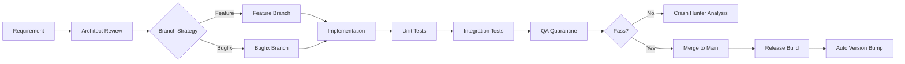

# jFindMe Project: Agent, Roles, Skills & Workflow Reference

## Project Profile
- **Namespace:** `com.jdroidx.jfindme`
- **Min SDK:** 26 (Android 8.0)
- **Target SDK:** 34 (Android 14)
- **Compile SDK:** 34
- **Architecture:** MVVM Enterprise with Engine Registry
- **Hybrid Stack:** Kotlin + Java + Python (Chaquopy)

---

## Recommended Agent Configuration

### Primary Agent: Android Enterprise Architect
**Capabilities Required:**
- Android Studio / Gradle Kotlin DSL expertise
- MVVM + Repository pattern mastery
- Firebase ecosystem integration (RTDB, Auth, Analytics, Crashlytics)
- Background service lifecycle management
- Chaquopy Python-Kotlin interop debugging
- Geofencing & location service optimization
- ProGuard/R8 shrink rules configuration

### Supporting Agent Matrix

| Agent ID | Title | Domain | Key Deliverables |
|----------|-------|--------|------------------|
| 1 | Product Architect | Schema & Identity | FirebaseSchema.md, Hardware Key validation |
| 2 | Backend Engineer | Data & Sync | FirebaseComm.kt, LocationRepository, SQLite sync |
| 3 | UI/UX Architect | Interface | Custom views, Map components, Glassmorphism UI |
| 4 | QA Engineer | Integration | Offline-online tests, Edge case validation |
| 5 | Crash Analyst | Stability | Forensic crash reports, ANR prevention |
| 6 | GIS Engineer | Spatial | Geofencing engine, Polygon math, Trajectory |
| 7 | Performance Engineer | Optimization | Battery telemetry, Query latency, Throttling |

---

## Core Skills Checklist

### Android Development
- [ ] Kotlin coroutines & Flow
- [ ] Java interop (JFindMeApplication.java)
- [ ] ViewModel + LiveData architecture
- [ ] Navigation Component (Fragment navigation)
- [ ] Material Design 3 components
- [ ] RecyclerView + ViewModel binding

### Firebase Ecosystem
- [ ] Realtime Database rules & queries
- [ ] Firebase Auth (Email/Password, Anonymous)
- [ ] Firebase Analytics events
- [ ] Firebase Crashlytics integration
- [ ] Google Services JSON configuration
- [ ] Database rule security (firestore.rules)

### Location & Mapping
- [ ] FusedLocationProviderClient
- [ ] Background location services (Android 12+ restrictions)
- [ ] Activity Recognition API
- [ ] Google Maps SDK for Android
- [ ] Maps Utils (SphericalUtil, ItemizedIconDrawable)
- [ ] Geofencing API

### Chaquopy Python Integration
- [ ] Python module import in Kotlin (`Python.getInstance()`)
- [ ] Data serialization (JSON ↔ Python dict)
- [ ] Haversine distance calculations
- [ ] Spatial filtering functions
- [ ] Path prediction algorithms

### Background Services
- [ ] ForegroundService with notification channel
- [ ] Service types: LOCATION, DATA_SYNC
- [ ] WorkManager for deferrable tasks
- [ ] BroadcastReceiver (BootCompleted, NetworkChange)
- [ ] Doze mode optimization (`REQUEST_IGNORE_BATTERY_OPTIMIZATIONS`)

### Security & Privacy
- [ ] Runtime permission handling (dangerous permissions)
- [ ] Keystore signing (v1 + v2)
- [ ] ProGuard rules (`proguard-rules.pro`)
- [ ] Data encryption at rest (SQLite)
- [ ] Firebase Security Rules

---

## Workflow Patterns

### Development Workflow


### Issue Resolution Flow
1. **Trigger:** Crash event or performance metric breach
2. **Diagnosis:** Re-route to Agent 5 (Crash) & Agent 7 (Performance)
3. **Remediation:** Execute patch via Agent 2 (Logic) or Agent 6 (GIS)
4. **Validation:** Verify through Agent 4 (QA)
5. **Sign-off:** Architect approval (Agent 1)

### Branch Naming Convention
| Pattern | Example | Purpose |
|---------|---------|---------|
| `feat/<feature>` | `feat/geofence-alerts` | New features |
| `fix/<issue>` | `fix/crash-on-boot` | Bug fixes |
| `refactor/<module>` | `refactor/firebase-comm` | Code cleanup |
| `chore/<task>` | `chore/proguard-rules` | Maintenance |

---

## Key Files & Responsibilities

| File | Owner | Responsibility |
|------|-------|----------------|
| `app/build.gradle.kts` | Agent 2 | Dependencies, Signing, Build Types |
| `gradle/libs.versions.toml` | Agent 2 | Version Catalog Management |
| `ARCHITECTURE_ASSIGNMENTS.md` | Agent 1 | Agent Role Definitions |
| `FIREBASE_SCHEMA_ARCHITECT.md` | Agent 1 | Database Schema Governance |
| `ENGINE_HLD_DESIGN.md` | Agent 2 | High-Level Design |
| `app/src/main/python/data_processor.py` | Agent 6 | Python GIS Functions |
| `app/src/main/java/com/jdroidx/jfindme/engine/` | Agent 2 | Core Engine Modules |
| `app/src/main/java/com/jdroidx/jfindme/ui/` | Agent 3 | UI Components |
| `app/src/main/java/com/jdroidx/jfindme/service/` | Agent 5 | Background Services |

---

## Build Commands

```bash
# Debug build
./gradlew assembleDebug

# Release build (auto-increments VERSION_CODE)
./gradlew assembleRelease

# Clean build
./gradlew clean

# Run tests
./gradlew test

# Generate APK
./gradlew app:assembleDebug
```

---

## Version Management

The project uses an auto-incrementing version system:
- **version.properties** tracks: `VERSION_MAJOR`, `VERSION_MINOR`, `VERSION_PATCH`, `VERSION_CODE`
- `VERSION_CODE` auto-increments on release builds
- Current: `1.0.1` → `versionCode: 2` (after first release build)

---

*Generated by Agnes AI Assistant for jFindMe Project*
