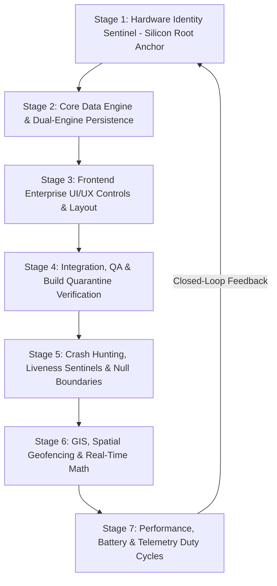

# Database Sync Setting - Master Field Synchronization Matrix & Chronological Enterprise Architecture
> **jFindMe Enterprise Location Tracking Ecosystem**  
> *Dynamic OOPS-based MVC/MVVM Closed-Loop Waterfall Standard*  
> Document Version: 3.1.0 (Enterprise Gold Master - Full Operational Portfolio & UiArchitect Matrix)  
> Scope: Complete 20-Screen Portfolio: 178 Master Parameters, Dual-Engine Mappings & 8 UiArchitect Controls  
> Author: jDroid-X (Issued by JEET)

---

## 1. Executive Summary & Master Chronological Waterfall Architecture

The `jFindMe` location tracking application operates on a strict **7-Stage Closed-Loop Waterfall Sequence**, executed through an OOPS-based Model-View-Controller / Model-View-ViewModel (MVC/MVVM) architecture with dynamic call-by-reference and zero redundant code.

### Chronological Execution Order
1. **Stage 1 (Hardware Identity Sentinel - Agent 1)**: Resolves physical hardware keys (`ro.ril.oem.sno`, `ro.ril.oem.psno`, OEM serials, or Canonical Hardware Agent ID e.g., `BE5A234A`). This is the **immutable Single Source of Truth (SSOT)**. Software tokens never overwrite hardware identity.
2. **Stage 2 (Dual-Engine Database & Backend Logic - Agent 2)**: Maintains atomic closed-loop synchronization between the 17 normalized SQLite local tables and Firebase Realtime Database cloud SSOT (`/devices/{id}/...`). Zero orphaned or duplicated records.
3. **Stage 3 (Frontend UI/UX & Lightweight Viewport - Agent 3)**: Implements the 8 standardized `UiArchitect` controls (Buttons, Textboxes, Switches, Toggles, Flippers, Listboxes, Condition Dialogs, and Bottom-Right Slide-in/out Notification Banners). Enforces the Slide-Out Right Drawer standard.
4. **Stage 4 (Integration, QA & Build Quarantine - Agent 4)**: Enforces strict build quarantine: **NEVER execute Gradle builds (`./gradlew`) autonomously**. Manages offline/online transitions and ensures zero dead navigation paths.
5. **Stage 5 (Crash & Silent Failure Hunter - Agent 5)**: Audits `ForegroundService`, `LocationCallback`, and coroutine lifecycles. Guarantees strict null safety and error-boundary containment during network disconnects or database read timeouts.
6. **Stage 6 (GIS, Spatial & Geofencing - Agent 6)**: Implements low-latency spatial math (Haversine distance, Ray-Casting polygon containment for SafeZones, 2D Kalman smoothing filters).
7. **Stage 7 (Performance & Battery Optimization - Agent 7)**: Maximizes battery longevity through dynamic adaptive polling intervals (1s Extreme during movement/SOS, 15m idle heartbeat when stationary). Maintains `< 16ms` SQLite query response times.

---

## 2. Standardized Enterprise UI Controls (`UiArchitect` Matrix)

The application unifies all user interfaces across Android and Web controllers using the 8 standard components defined in `UiArchitect`:

| # | UI Control | Specification & Implementation Pattern | Visual State & Behavioral Rules |
|---|---|---|---|
| 1 | **Buttons Suite** | Primary (`.btn-primary`), Secondary (`.btn-secondary`), Accent (`.btn-accent`), Destructive (`.btn-destructive`), Outlined (`.btn-outline`), Icon (`.btn-icon`). | Distinct tactile hover states, gradient backdrops, consistent border radii, responsive icon scaling. |
| 2 | **Validated Textboxes & Search Bars** | Floating labels with real-time regex validators (`alphanumeric + underscores`, URL format, numeric range bounds). | Dynamic label float on focus/input, inline green checkmark on valid input, red border + error helper text on invalid input. |
| 3 | **Dynamic On/Off Switches** | Sliding circular knob on rounded track (`.ui-switch`). Replaces plain checkboxes. | Emerald track glow for `[Offline]` active; Sky Blue track glow for `[Online]` active; Slate gray when OFF. |
| 4 | **Segmented Left/Right Toggles** | Pill container (`.segmented-toggle-container`) with multi-state buttons. | Smooth sliding selection pill. Used for Metric/Imperial units and View Switchers (Matrix vs. Topology vs. JSON). |
| 5 | **Animated View Flipper** | Multi-view container (`.view-flipper-container`) with horizontal slide transitions. | Smooth horizontal slide-in/out between 20-Screen Matrix, Link Topology Graph, and Policy JSON stream. |
| 6 | **Dropdown List Boxes (with Details)** | Accordion-style expander (`.ui-listbox-dropdown`) with header icon, title, subtitle, and collapsible body. | Chevron rotation on expand/collapse; displays target tables, layer categories, and parameter counts. |
| 7 | **Multi-Choice Condition Dialogs** | Centered modal popup (`.modal-box`) with multiple selectable checkboxes and batch actions. | Provides batch cascade controls: Cascade Dual Sync, Propagate Linked Values, Strict Verification, Immediate Commit. |
| 8 | **Slide In/Out Notification Banners (Bottom-Right)** | Floating stack (`#notificationStack`) at bottom-right corner. | Slides in smoothly from right edge (`translateX(100%) -> translateX(0)`); colored left accent border (Emerald/Amber/Crimson/Sky); auto-dismiss timer + close button. |

---

## 3. Engineering Do's and Don'ts: Mistake Elimination Matrix

| Area / Context | ❌ Silly Mistakes / Anti-Patterns (DON'T) | ✅ Professional Standard (DO) | Root Cause & Why It Matters |
|---|---|---|---|
| **Build System** | **DO NOT** execute Gradle builds autonomously (`./gradlew`, `./gradlew.bat installDebug`). | Maintain strict code-level verification, syntax parsing, and dependency checking until explicit user command. | Autonomous builds break quarantine, lock background daemons, and consume unnecessary machine resources. |
| **Identity Anchoring** | **DO NOT** use software UUIDs or ephemeral Firebase auth tokens as immutable device keys. | Always anchor to the physical silicon hardware ID (`ro.ril.oem.sno` or Canonical Agent ID `BE5A234A`). | Auth tokens rotate upon re-login, causing orphaned records and device ghosting. |
| **Data Duplication** | **DO NOT** store duplicate columns across screens or replicate local fields in multiple tables. | Store fields in their canonical SQLite table (`USER_IDENTITY`, `USER_PROFILE`, etc.) and use bidirectional cross-screen references. | Duplication causes state desynchronization where updating on Screen A leaves Screen B stale. |
| **Popup Modals** | **DO NOT** display intrusive centered alert dialogs that freeze background navigation or lack scrolling. | Use the Agent 3 Slide-Out Right Drawer (2-column compact layout, viewport-fitted with smooth scrolling) and bottom-right slide-in banners. | Centered blocking popups trap user focus and lack room for complex multi-field configurations. |
| **Event Handlers** | **DO NOT** reference undeclared functions in markup (`onclick="exportSyncManifest()"` without implementation). | Ensure every markup action maps to an existing, validated controller method with automated pre-flight audit. | Uncaught ReferenceErrors crash execution threads and leave the user interface unresponsive. |
| **Cross-Screen Linking** | **DO NOT** display clunky multi-line metadata cards in linking selectors. | Display compact single rows (32px, 1 row: `[✓] Checkbox + Field Name`) inside expandable Screen folders. | Compact layout allows users to scan 170+ fields rapidly without overwhelming vertical scroll fatigue. |
| **Defaults & State** | **DO NOT** hardcode outdated limits or sample-only text (e.g. `Sample 3 Screens` when 20 screens exist). | Dynamically bind counters and labels to `screensData.length` and parameter counts. | Hardcoded sample strings confuse operators about the true scope of deployed configuration. |

---

## 4. Architecture Paradigm: Symmetrical Dual-Engine Matrix

Every field in the `jFindMe` architecture has an explicit synchronization policy defined by two Boolean flags: `[Offline]` and `[Online]`:

| Mode | Offline Flag | Online Flag | System Behavior & Data Location |
| :--- | :---: | :---: | :--- |
| 🟢 **DUAL SYNC** | `[x]` | `[x]` | **Closed-Loop Synchronized**: Data exists in local SQLite / SharedPreferences AND is atomically synchronized to Firebase Realtime Database cloud SSOT. |
| 🟡 **LOCAL ONLY** | `[x]` | `[ ]` | **Device-Bound / Air-Gapped**: Data remains strictly in local SQLite tables or `system_registry` SharedPreferences. No network egress. |
| 🔵 **CLOUD ONLY** | `[ ]` | `[x]` | **Ephemeral Cloud Buffer**: Handshake queues or server-side transient indicators not committed to local persistent SQLite. |
| ⚪ **DORMANT** | `[ ]` | `[ ]` | **Inactive / Deprecated**: Field is reserved but excluded from both local storage and cloud sync pipelines. |

---

## 5. Screen 1: 1. Login & Auth Gate (`AuthActivity`)

* **Architectural Layer**: L1 Auth Gate  
* **Activity Class**: `com.jdroidx.jfindme.ui.auth.AuthActivity`  
* **Screen Identifier**: `login`  

| # | Element / Field Name | Key / Identifier | Data Type | Offline | Online | Sync Screen / Link (+) | Sync Status | Local Storage Target | Online Storage Target | Purpose & Validation Constraint |
|---|---|---|---|:---:|:---:|---|---|---|---|---|
| 1.1 | **Account Email** | `email` | String | `[x]` | `[x]` | *Standalone* | 🟢 Dual Sync | `USER_IDENTITY.email` | `Firebase Auth & /devices/{id}/Identity/email` | User identity email for login & cloud token exchange. |
| 1.2 | **Auth Password** | `password` | Secure String | `[ ]` | `[x]` | *Standalone* | 🔵 Cloud Only | `Ephemeral Memory / KeyStore` | `Firebase Auth Secure Hash` | Cryptographic login credential; never stored in plaintext locally. |
| 1.3 | **Firebase Auth UID** | `auth_uid` | String (28-char) | `[x]` | `[x]` | *Standalone* | 🟢 Dual Sync | `USER_IDENTITY.auth_uid` | `/lookup_indices/auth_to_device/{uid}` | Cloud user identity key mapped to canonical agent IDs. |
| 1.4 | **Hardware Agent ID** | `agent_id` | String (8-char) | `[x]` | `[x]` | *Standalone* | 🟢 Dual Sync | `DEVICE.device_id, Prefs: agent_id` | `/devices/{agentId} (Root Key)` | Immutable Silicon/Hardware canonical root anchor (BE5A234A). |
| 1.5 | **Silicon Hardware UID** | `hardware_uid` | String (SHA-256) | `[x]` | `[x]` | *Standalone* | 🟢 Dual Sync | `DEVICE.hardware_uid` | `/devices/{agentId}/device/hardware_uid` | Physical silicon fingerprint (ro.ril.oem.sno / Android ID). |
| 1.6 | **Device Nickname** | `user_nickname` | String | `[x]` | `[x]` | 🔗 `Profile: Full Name / Nickname` | 🟢 Dual Sync | `USER_PROFILE.nickname` | `/devices/{agentId}/profile/name` | Initial display callout name entered during registration. |
| 1.7 | **Bootstrap Latitude** | `latitude` | Double | `[x]` | `[x]` | 🔗 `Live Map: Default Centroid Lat` | 🟢 Dual Sync | `LOCATION_EVENT.lat` | `/devices/{agentId}/device/live/lat` | Initial GPS latitude baseline established upon registration. |
| 1.8 | **Bootstrap Longitude** | `longitude` | Double | `[x]` | `[x]` | 🔗 `Live Map: Default Centroid Lng` | 🟢 Dual Sync | `LOCATION_EVENT.lng` | `/devices/{agentId}/device/live/lng` | Initial GPS longitude baseline established upon registration. |
| 1.9 | **Bootstrap Address** | `address` | String | `[x]` | `[x]` | 🔗 `Profile: Street Address` | 🟢 Dual Sync | `LOCATION_EVENT.address` | `/devices/{agentId}/device/live/address` | Reverse-geocoded physical address baseline at registration. |
| 1.10 | **Auto-Login State** | `auto_login_enabled` | Boolean | `[x]` | `[ ]` | 🔗 `Settings: Auto-Login` | 🟡 Local Only | `system_registry SharedPreferences` | `None (Device-Bound)` | Device-specific toggle to bypass credential inputs on boot. |
| 1.11 | **Remember Credentials** | `remember_me` | Boolean | `[x]` | `[ ]` | *Standalone* | 🟡 Local Only | `system_registry SharedPreferences` | `None (Device-Bound)` | Local preference to pre-fill username textbox on device. |

## 6. Screen 2: 2. User Profile Identity (`ProfileActivity`)

* **Architectural Layer**: L3 Demographic Dossier  
* **Activity Class**: `com.jdroidx.jfindme.ui.settings.ProfileActivity`  
* **Screen Identifier**: `profile`  

| # | Element / Field Name | Key / Identifier | Data Type | Offline | Online | Sync Screen / Link (+) | Sync Status | Local Storage Target | Online Storage Target | Purpose & Validation Constraint |
|---|---|---|---|:---:|:---:|---|---|---|---|---|
| 2.1 | **Full Name / Nickname** | `name` | String | `[x]` | `[x]` | 🔗 `Login: Device Nickname` | 🟢 Dual Sync | `USER_PROFILE.nickname, Prefs` | `/devices/{agentId}/profile/name` | Primary member display label shown on Live Map markers and roster cards. |
| 2.2 | **Mobile Phone Number** | `phone` | String | `[x]` | `[x]` | *Standalone* | 🟢 Dual Sync | `USER_PROFILE.phone` | `/devices/{agentId}/profile/phone` | Emergency telephone number for SMS beacon & telephony alerts. |
| 2.3 | **Date of Birth** | `dob` | String (YYYY-MM-DD) | `[x]` | `[x]` | *Standalone* | 🟢 Dual Sync | `USER_PROFILE.dob` | `/devices/{agentId}/profile/dob` | Age verification and dependent child-protection mode gating. |
| 2.4 | **Gender Identity** | `gender` | String | `[x]` | `[x]` | *Standalone* | 🟢 Dual Sync | `USER_PROFILE.gender` | `/devices/{agentId}/profile/gender` | Demographic identity attribute (Male, Female, Other). |
| 2.5 | **Equipped 3D Avatar** | `avatar_id` | String | `[x]` | `[x]` | *Standalone* | 🟢 Dual Sync | `USER_PROFILE.avatar_url, Prefs` | `/devices/{agentId}/profile/avatar_url & live/avatar_id` | VRM 3D model identifier (avatar_custom_1..6 or custom photo). |
| 2.6 | **Country** | `country` | String | `[x]` | `[x]` | *Standalone* | 🟢 Dual Sync | `USER_PROFILE.country` | `/devices/{agentId}/profile/country` | Country location anchor for dialing codes and compliance. |
| 2.7 | **State / Province** | `state` | String | `[x]` | `[x]` | *Standalone* | 🟢 Dual Sync | `USER_PROFILE.state` | `/devices/{agentId}/profile/state` | Administrative division for regional clustering. |
| 2.8 | **City / District** | `city` | String | `[x]` | `[x]` | *Standalone* | 🟢 Dual Sync | `USER_PROFILE.city` | `/devices/{agentId}/profile/city` | Municipal division for geofence defaults. |
| 2.9 | **Postal / Zip Code** | `pincode` | String | `[x]` | `[x]` | *Standalone* | 🟢 Dual Sync | `USER_PROFILE.pincode` | `/devices/{agentId}/profile/pincode` | Postal code verification. |
| 2.10 | **Street Address** | `address` | String | `[x]` | `[x]` | 🔗 `Login: Bootstrap Address` | 🟢 Dual Sync | `USER_PROFILE.address` | `/devices/{agentId}/profile/address` | Primary residential address safe zone anchor. |
| 2.11 | **Emergency Medical Note** | `emergency_note` | String | `[x]` | `[x]` | 🔗 `Person Details: Medical Dossier` | 🟢 Dual Sync | `USER_PROFILE.notes` | `/devices/{agentId}/profile/emergency_note` | Blood type, allergies, critical medical conditions for first responders. |
| 2.12 | **Organization Name** | `org_name` | String | `[x]` | `[x]` | *Standalone* | 🟢 Dual Sync | `ORGANIZATION.org_name` | `/devices/{agentId}/profile/org_name` | Enterprise company domain binding. |
| 2.13 | **Department Name** | `dept_name` | String | `[x]` | `[x]` | *Standalone* | 🟢 Dual Sync | `ORGANIZATION.department` | `/devices/{agentId}/profile/dept_name` | Corporate departmental division. |
| 2.14 | **Profile Nudge Bypass** | `profile_bypass_nudge` | Boolean | `[x]` | `[ ]` | *Standalone* | 🟡 Local Only | `system_registry SharedPreferences` | `None (Device-Bound)` | Local device flag to suppress the "Complete Profile" dialog on boot. |

## 7. Screen 3: 3. Universal Settings Hub (`SettingsActivity`)

* **Architectural Layer**: L4 Control Hub & Engine Parameters  
* **Activity Class**: `com.jdroidx.jfindme.ui.settings.SettingsActivity`  
* **Screen Identifier**: `settings`  

| # | Element / Field Name | Key / Identifier | Data Type | Offline | Online | Sync Screen / Link (+) | Sync Status | Local Storage Target | Online Storage Target | Purpose & Validation Constraint |
|---|---|---|---|:---:|:---:|---|---|---|---|---|
| 3.1 | **Master Theme Selector** | `theme_id` | Int (0-7) | `[x]` | `[ ]` | *Standalone* | 🟡 Local Only | `system_registry (theme_id)` | `None (Local Device Only)` | 8 UI themes (0-7). Device visual display preference. |
| 3.2 | **Battery Cadence Preset** | `pref_tracking_interval` | Long (ms) | `[x]` | `[ ]` | 🔗 `Background Jobs: GPS Tracker Cadence` | 🟡 Local Only | `system_registry (pref_tracking_interval)` | `/devices/{id}/settings/tracking_interval` | GPS interval: **Default 30s (`BALANCED`, 8-12mA)**; Presets: 1s Extreme, 7s High, 15s Active, 30s Balanced, 60s Eco. |
| 3.3 | **Manual Pulse Stepper** | `pref_manual_pulse` | Long (ms) | `[x]` | `[ ]` | *Standalone* | 🟡 Local Only | `system_registry (pref_manual_pulse)` | `/devices/{id}/settings/manual_pulse` | Background ping rate (90s to 3600s). |
| 3.4 | **Motion Co-Processor** | `pref_activity_recognition_enabled` | Boolean | `[x]` | `[ ]` | *Standalone* | 🟡 Local Only | `system_registry` | `/devices/{id}/settings/motion_enabled` | Halts GPS when stationary using hardware accelerometer co-processor. |
| 3.5 | **Motion Still Cadence** | `pref_motion_still_interval_ms` | Long (ms) | `[x]` | `[ ]` | *Standalone* | 🟡 Local Only | `system_registry` | `/devices/{id}/settings/still_cadence` | Stationary zero-motion duty cycle (60s to 900s). |
| 3.6 | **Motion Vehicle Cadence** | `pref_motion_vehicle_interval_ms` | Long (ms) | `[x]` | `[ ]` | *Standalone* | 🟡 Local Only | `system_registry` | `/devices/{id}/settings/vehicle_cadence` | High-rate sampling during vehicle movement (1s to 30s). |
| 3.7 | **Motion Walking Cadence** | `pref_motion_walking_interval_ms` | Long (ms) | `[x]` | `[ ]` | *Standalone* | 🟡 Local Only | `system_registry` | `/devices/{id}/settings/walking_cadence` | Pedestrian movement sampling rate (5s to 60s). |
| 3.8 | **Road Smoothing (Kalman)** | `pref_road_smoothing_enabled` | Boolean | `[x]` | `[ ]` | *Standalone* | 🟡 Local Only | `system_registry` | `/devices/{id}/settings/road_smoothing` | 2D Kalman filter & road heading azimuth snapping. |
| 3.9 | **Kalman Measurement Noise** | `pref_kalman_measurement_noise` | Float | `[x]` | `[ ]` | *Standalone* | 🟡 Local Only | `system_registry` | `/devices/{id}/settings/kalman_noise_r` | GPS variance tolerance (R=5.0 to 100.0). |
| 3.10 | **Heading EMA Alpha** | `pref_heading_ema_factor` | Float | `[x]` | `[ ]` | *Standalone* | 🟡 Local Only | `system_registry` | `/devices/{id}/settings/heading_ema` | Exponential moving average alpha factor (0.05 to 0.95). |
| 3.11 | **Smart Avatar Cluster** | `pref_smart_avatar_clustering` | Boolean | `[x]` | `[ ]` | 🔗 `Live Map: Cluster Spiderweb` | 🟡 Local Only | `system_registry` | `None (Local Device Only)` | Merges map avatars within 10m radius. UI rendering preference. |
| 3.12 | **Distance Unit Metric** | `pref_unit_metric` | Boolean | `[x]` | `[ ]` | *Standalone* | 🟡 Local Only | `system_registry` | `/devices/{id}/settings/unit_metric` | Metric (km/h) vs Imperial (mph). |
| 3.13 | **Perimeter Jitter Debounce** | `pref_geofence_jitter_debounce_ms` | Long (ms) | `[x]` | `[ ]` | *Standalone* | 🟡 Local Only | `system_registry` | `/devices/{id}/settings/geofence_debounce` | Anti-flutter debounce filter before firing geofence breach. |
| 3.14 | **Dormancy State Latch** | `pref_geofence_latch_enabled` | Boolean | `[x]` | `[ ]` | *Standalone* | 🟡 Local Only | `system_registry` | `/devices/{id}/settings/geofence_latch` | Prevents duplicate ENTER/EXIT alerts without boundary crossing. |
| 3.15 | **Centroid GPS Snapping** | `pref_geofence_snap_center_enabled` | Boolean | `[x]` | `[ ]` | *Standalone* | 🟡 Local Only | `system_registry` | `/devices/{id}/settings/centroid_snapping` | Snaps coords to safe zone centroid when inside. |
| 3.16 | **Default Safe Zone Radius** | `pref_default_safe_zone_radius_meters` | Int (meters) | `[x]` | `[ ]` | 🔗 `Geofence: Zone Radius` | 🟡 Local Only | `system_registry` | `/devices/{id}/settings/default_radius` | Initial radius when drawing new boundaries (10m to 5000m). |
| 3.17 | **Minimum Displacement** | `pref_min_displacement_meters` | Float | `[x]` | `[ ]` | *Standalone* | 🟡 Local Only | `system_registry` | `/devices/{id}/settings/min_displacement` | Suppresses location publishing if physical displacement < 25m. |
| 3.18 | **Strict GNSS Gate (<10m)** | `pref_strict_accuracy_wait` | Boolean | `[x]` | `[ ]` | *Standalone* | 🟡 Local Only | `system_registry` | `/devices/{id}/settings/strict_accuracy` | Suppresses coarse fixes until GNSS horizontal accuracy < 10m. |
| 3.19 | **Low Battery Alert %** | `pref_low_battery_threshold` | Int (%) | `[x]` | `[ ]` | 🔗 `Notification: Low Battery Critical Alert` | 🟡 Local Only | `system_registry` | `/devices/{id}/settings/low_battery_pct` | Triggers Amber RAG warning & remote distress push (5% to 50%). |
| 3.20 | **Stale Inactive (Amber)** | `pref_stale_inactive_minutes` | Int (mins) | `[x]` | `[ ]` | *Standalone* | 🟡 Local Only | `system_registry` | `/devices/{id}/settings/stale_inactive_min` | Switches node to Amber after X minutes of missing heartbeat. |
| 3.21 | **Critical Offline (Red)** | `pref_critical_offline_hours` | Int (hours) | `[x]` | `[ ]` | *Standalone* | 🟡 Local Only | `system_registry` | `/devices/{id}/settings/critical_offline_hr` | Switches node to Red after X hours without ping. |
| 3.22 | **Siren Duration** | `pref_siren_duration_sec` | Int (sec) | `[x]` | `[ ]` | 🔗 `Acoustic Siren: Max Duration` | 🟡 Local Only | `system_registry` | `/devices/{id}/settings/siren_duration` | Maximum acoustic horn playtime (5s to 600s). |
| 3.23 | **Child / Ward Mode Lock** | `child_ward_mode_active` | Boolean | `[x]` | `[ ]` | *Standalone* | 🟡 Local Only | `system_registry` | `/devices/{id}/settings/child_ward_mode` | Locks service cancellation behind Guardian PIN. |
| 3.24 | **Guardian Master PIN** | `guardian_pin_hash` | String (SHA-256) | `[x]` | `[ ]` | 🔗 `Acoustic Siren: PIN Guard` | 🟡 Local Only | `system_registry` | `/devices/{id}/settings/guardian_pin_hash` | Master security override PIN. |
| 3.25 | **Offline Vault Capacity** | `pref_offline_queue_max_points` | Int | `[x]` | `[ ]` | 🔗 `DB Management: Pending Queue Capacity` | 🟡 Local Only | `system_registry` | `None (Local Device Only)` | Storage capacity limit for offline SQLite breadcrumb table. |
| 3.26 | **Sync on Wi-Fi Only** | `pref_sync_wifi_only` | Boolean | `[x]` | `[ ]` | *Standalone* | 🟡 Local Only | `system_registry.pref_sync_wifi_only` | `/devices/{id}/settings/sync_wifi_only` | Restricts batch telemetry upload to unmetered Wi-Fi connections. |

## 8. Screen 4: 4. Live Tactical Map Viewport (`MapActivity`)

* **Architectural Layer**: L2 Tactical GIS Layer  
* **Activity Class**: `com.jdroidx.jfindme.ui.map.MapActivity`  
* **Screen Identifier**: `live_map`  

| # | Element / Field Name | Key / Identifier | Data Type | Offline | Online | Sync Screen / Link (+) | Sync Status | Local Storage Target | Online Storage Target | Purpose & Validation Constraint |
|---|---|---|---|:---:|:---:|---|---|---|---|---|
| 4.1 | **Google Map Layer Type** | `map_type` | String | `[x]` | `[ ]` | *Standalone* | 🟡 Local Only | `system_registry (map_type)` | `None (Local Viewport)` | Tile provider: Normal, Satellite, Hybrid, Terrain. |
| 4.2 | **Safe Zones Overlay** | `show_safe_zones_overlay` | Boolean | `[x]` | `[ ]` | *Standalone* | 🟡 Local Only | `system_registry` | `None (Local Viewport)` | Toggles rendering of translucent SafeZone perimeter rings. |
| 4.3 | **Cluster Spiderweb Mesh** | `show_cluster_spiderweb` | Boolean | `[x]` | `[ ]` | 🔗 `Settings: Smart Avatar Clustering` | 🟡 Local Only | `system_registry` | `None (Local Viewport)` | Draws dynamic geodesic connecting mesh between active nodes. |
| 4.4 | **Active Circle Filter** | `active_group_filter` | String | `[x]` | `[ ]` | 🔗 `Circle: Active Group ID` | 🟡 Local Only | `system_registry` | `None (Local Viewport)` | Filters visible marker pins by active circle group ID. |
| 4.5 | **Dual-Pane Tactical HUD** | `dual_pane_hud_active` | Boolean | `[x]` | `[ ]` | *Standalone* | 🟡 Local Only | `system_registry` | `None (Local Viewport)` | Splits viewport into 70:30 map + radar telemetry HUD. |
| 4.6 | **Live Stream Poller (sec)** | `live_stream_poll_sec` | Int | `[x]` | `[ ]` | *Standalone* | 🟡 Local Only | `system_registry` | `/devices/{id}/settings/stream_poll_sec` | Cadence for polling remote database live snapshots. |
| 4.7 | **Default Map Zoom Level** | `map_zoom_level` | Float | `[x]` | `[ ]` | *Standalone* | 🟡 Local Only | `system_registry` | `None (Local Viewport)` | Initial tactical camera zoom level (12x to 18x). |
| 4.8 | **Default Centroid Latitude** | `centroid_fallback_lat` | Double | `[x]` | `[ ]` | 🔗 `Login: Bootstrap Latitude` | 🟡 Local Only | `system_registry` | `None (Local Viewport)` | Fallback home map center latitude when GPS is searching. |
| 4.9 | **Default Centroid Longitude** | `centroid_fallback_lng` | Double | `[x]` | `[ ]` | 🔗 `Login: Bootstrap Longitude` | 🟡 Local Only | `system_registry` | `None (Local Viewport)` | Fallback home map center longitude when GPS is searching. |

## 9. Screen 5: 5. Network Gateway & Pairing Matrix (`NetworkGatewayActivity`)

* **Architectural Layer**: L2 Mesh & Circle Security  
* **Activity Class**: `com.jdroidx.jfindme.ui.group.NetworkGatewayActivity`  
* **Screen Identifier**: `network_gateway`  

| # | Element / Field Name | Key / Identifier | Data Type | Offline | Online | Sync Screen / Link (+) | Sync Status | Local Storage Target | Online Storage Target | Purpose & Validation Constraint |
|---|---|---|---|:---:|:---:|---|---|---|---|---|
| 5.1 | **Remote Cloud Pairing PIN** | `pairing_pin` | String (6-char) | `[ ]` | `[x]` | *Standalone* | 🔵 Cloud Only | `Ephemeral State` | `/pairings/{pin}` | NIST SP 800-63B compliant temporary pairing PIN for circle onboarding. |
| 5.2 | **Pairing PIN TTL (mins)** | `pairing_pin_ttl_mins` | Int | `[x]` | `[ ]` | *Standalone* | 🟡 Local Only | `system_registry` | `None (Device-Bound)` | Expiry timeout for generated 6-character cloud pairing codes (5-30m). |
| 5.3 | **QR Code Pairing Payload** | `pairing_qr_payload` | String URL | `[ ]` | `[x]` | *Standalone* | 🔵 Cloud Only | `Ephemeral QR Generator` | `/devices/{agentId}/device/pairing_token` | ZXing high-density cryptographic QR matrix string. |
| 5.4 | **Nearby P2P Mesh Discovery** | `p2p_mesh_discovery` | Boolean | `[x]` | `[ ]` | *Standalone* | 🟡 Local Only | `system_registry` | `None (Device-Bound)` | Enables Wi-Fi Direct / Local NSD pairing for offline environments. |
| 5.5 | **Default Member Role** | `selected_role` | String | `[x]` | `[x]` | 🔗 `Person Details: Node Role` | 🟢 Dual Sync | `MASTER_ROSTER.role` | `/devices/{id}/circles/{circleId}/members/{agentId}/role` | Assigned privilege tier (ADMIN, GUARDIAN, FAMILY, FRIEND, WARD). |
| 5.6 | **Auto-Accept Trusted Circle** | `auto_accept_trusted_circle` | Boolean | `[x]` | `[ ]` | *Standalone* | 🟡 Local Only | `system_registry` | `None (Device-Bound)` | Bypasses prompt for invites originating from admin accounts. |

## 10. Screen 6: 6. Family & Friends Circle Hub (`FamilyFriendsActivity`)

* **Architectural Layer**: L3 Circle Hierarchy  
* **Activity Class**: `com.jdroidx.jfindme.ui.group.FamilyFriendsActivity`  
* **Screen Identifier**: `family_friends`  

| # | Element / Field Name | Key / Identifier | Data Type | Offline | Online | Sync Screen / Link (+) | Sync Status | Local Storage Target | Online Storage Target | Purpose & Validation Constraint |
|---|---|---|---|:---:|:---:|---|---|---|---|---|
| 6.1 | **Active Circle UUID** | `circle_id` | String UUID | `[x]` | `[x]` | *Standalone* | 🟢 Dual Sync | `CIRCLES.circle_id` | `/circles/{circleId}/metadata/id` | Unique organizational circle key linking all paired member nodes. |
| 6.2 | **Circle Display Name** | `circle_name` | String | `[x]` | `[x]` | *Standalone* | 🟢 Dual Sync | `CIRCLES.circle_name` | `/circles/{circleId}/metadata/name` | Friendly group label displayed in navigation drawer. |
| 6.3 | **Circle Member Count** | `member_count` | Int | `[x]` | `[x]` | *Standalone* | 🟢 Dual Sync | `CIRCLES.member_count` | `/circles/{circleId}/metadata/member_count` | Count of actively enrolled tracking devices. |
| 6.4 | **Selected Group Partition** | `active_group_id` | String | `[x]` | `[ ]` | 🔗 `Live Map: Active Circle Filter` | 🟡 Local Only | `system_registry.active_group` | `None (Local Viewport)` | Partition filter for multi-team enterprise environments. |
| 6.5 | **Allow Member Invitations** | `allow_member_invite` | Boolean | `[x]` | `[x]` | *Standalone* | 🟢 Dual Sync | `CIRCLES.allow_invite` | `/circles/{circleId}/settings/allow_invite` | Grants non-admin members rights to generate pairing PINs. |
| 6.6 | **Circle Admin Agent ID** | `circle_admin_agent_id` | String (8-char) | `[x]` | `[x]` | *Standalone* | 🟢 Dual Sync | `CIRCLES.admin_agent_id` | `/circles/{circleId}/admin_id` | Hardware Agent ID of the circle owner / primary administrator. |

## 11. Screen 7: 7. Person Details Dossier & ACL (`PersonDetailsActivity`)

* **Architectural Layer**: L3 Access Control & Node Security  
* **Activity Class**: `com.jdroidx.jfindme.ui.group.PersonDetailsActivity`  
* **Screen Identifier**: `person_details`  

| # | Element / Field Name | Key / Identifier | Data Type | Offline | Online | Sync Screen / Link (+) | Sync Status | Local Storage Target | Online Storage Target | Purpose & Validation Constraint |
|---|---|---|---|:---:|:---:|---|---|---|---|---|
| 7.1 | **Target Node Agent ID** | `node_agent_id` | String (8-char) | `[x]` | `[x]` | *Standalone* | 🟢 Dual Sync | `MASTER_ROSTER.agent_id` | `/devices/{agentId}` | Canonical hardware ID of the circle member being inspected. |
| 7.2 | **Member Display Label** | `node_display_name` | String | `[x]` | `[x]` | 🔗 `Profile: Full Name` | 🟢 Dual Sync | `MASTER_ROSTER.name` | `/devices/{agentId}/profile/name` | Custom nickname assigned to member in local circles. |
| 7.3 | **Assigned Security Role** | `node_role` | String | `[x]` | `[x]` | 🔗 `Gateway: Default Member Role` | 🟢 Dual Sync | `MASTER_ROSTER.role` | `/devices/{id}/circles/{cId}/members/{agentId}/role` | Privilege level (ADMIN, GUARDIAN, FAMILY, FRIEND, WARD). |
| 7.4 | **Live Tracking Stream ACL** | `acl_tracking_stream` | Boolean | `[x]` | `[x]` | *Standalone* | 🟢 Dual Sync | `MASTER_ROSTER.acl_tracking` | `/devices/{agentId}/acl/tracking_stream` | Enables / disables real-time coordinate streaming for this member. |
| 7.5 | **Historical Audit ACL** | `acl_history_audit` | Boolean | `[x]` | `[x]` | 🔗 `History: Target Member UID` | 🟢 Dual Sync | `MASTER_ROSTER.acl_history` | `/devices/{agentId}/acl/history_audit` | Authorizes guardian to query historical trajectory breadcrumbs. |
| 7.6 | **Geofence Alerts ACL** | `acl_geofence_alerts` | Boolean | `[x]` | `[x]` | *Standalone* | 🟢 Dual Sync | `MASTER_ROSTER.acl_geofence` | `/devices/{agentId}/acl/geofence_alerts` | Enables or mutes perimeter breach notifications for this node. |
| 7.7 | **Ghost Mode Override ACL** | `acl_ghost_override` | Boolean | `[x]` | `[x]` | 🔗 `Privacy: Ghost Mode Toggle` | 🟢 Dual Sync | `MASTER_ROSTER.acl_ghost_override` | `/devices/{agentId}/acl/ghost_override` | Forces visibility on guardian maps even if node turns on Ghost Mode. |
| 7.8 | **Biometric Gate Lock** | `biometric_lock_enabled` | Boolean | `[x]` | `[ ]` | 🔗 `Privacy: Biometric Lock` | 🟡 Local Only | `system_registry.biometric_lock` | `None (Device-Bound)` | Requires biometric auth to open this member dossier. |
| 7.9 | **Member Medical Dossier** | `node_medical_note` | String | `[x]` | `[x]` | 🔗 `Profile: Emergency Medical Note` | 🟢 Dual Sync | `USER_PROFILE.emergency_note` | `/devices/{agentId}/profile/emergency_note` | Critical medical notes viewable by first responders. |

## 12. Screen 8: 8. SafeZone Geofence Creator (`GeofenceActivity`)

* **Architectural Layer**: L2 Geospatial Boundary Engine  
* **Activity Class**: `com.jdroidx.jfindme.ui.management.geofence.GeofenceActivity`  
* **Screen Identifier**: `geofence`  

| # | Element / Field Name | Key / Identifier | Data Type | Offline | Online | Sync Screen / Link (+) | Sync Status | Local Storage Target | Online Storage Target | Purpose & Validation Constraint |
|---|---|---|---|:---:|:---:|---|---|---|---|---|
| 8.1 | **Safe Zone Identifier** | `zone_id` | String UUID | `[x]` | `[x]` | *Standalone* | 🟢 Dual Sync | `SAFE_ZONE.zone_id` | `/geofences/{zoneId}/id` | Unique UUID key for geofence boundary registration. |
| 8.2 | **Safe Zone Label** | `zone_name` | String | `[x]` | `[x]` | *Standalone* | 🟢 Dual Sync | `SAFE_ZONE.name` | `/geofences/{zoneId}/name` | Friendly title (Home, School, HQ, Safe Harbor). |
| 8.3 | **Boundary Geometry Shape** | `zone_shape_type` | String | `[x]` | `[x]` | *Standalone* | 🟢 Dual Sync | `SAFE_ZONE.shape_type` | `/geofences/{zoneId}/shape_type` | CIRCLE (center + radius) or POLYGON (n-point convex hull). |
| 8.4 | **Perimeter Radius (meters)** | `zone_radius_meters` | Double | `[x]` | `[x]` | 🔗 `Settings: Default Safe Zone Radius` | 🟢 Dual Sync | `SAFE_ZONE.radius` | `/geofences/{zoneId}/radius` | Circular boundary radius (50m to 5000m). |
| 8.5 | **Centroid Latitude** | `zone_center_lat` | Double | `[x]` | `[x]` | *Standalone* | 🟢 Dual Sync | `SAFE_ZONE.lat` | `/geofences/{zoneId}/lat` | Geographical center latitude anchor. |
| 8.6 | **Centroid Longitude** | `zone_center_lng` | Double | `[x]` | `[x]` | *Standalone* | 🟢 Dual Sync | `SAFE_ZONE.lng` | `/geofences/{zoneId}/lng` | Geographical center longitude anchor. |
| 8.7 | **Polygon Vertices JSON** | `polygon_vertices_json` | JSON Array | `[x]` | `[x]` | *Standalone* | 🟢 Dual Sync | `SAFE_ZONE.polygon_json` | `/geofences/{zoneId}/polygon_json` | Array of LatLng coordinates for multi-point polygon fences. |
| 8.8 | **Temporal Schedule Active** | `schedule_enabled` | Boolean | `[x]` | `[x]` | *Standalone* | 🟢 Dual Sync | `SAFE_ZONE.schedule_enabled` | `/geofences/{zoneId}/schedule/enabled` | Restricts active monitoring to specific hours of the day. |
| 8.9 | **Schedule Start Window** | `schedule_start_time` | String (HH:mm) | `[x]` | `[x]` | *Standalone* | 🟢 Dual Sync | `SAFE_ZONE.schedule_start` | `/geofences/{zoneId}/schedule/start` | Daily activation hour/minute in 24h format. |
| 8.10 | **Schedule End Window** | `schedule_end_time` | String (HH:mm) | `[x]` | `[x]` | *Standalone* | 🟢 Dual Sync | `SAFE_ZONE.schedule_end` | `/geofences/{zoneId}/schedule/end` | Daily deactivation hour/minute in 24h format. |
| 8.11 | **Active Weekday Mask** | `schedule_days_mask` | String (7-bit) | `[x]` | `[x]` | *Standalone* | 🟢 Dual Sync | `SAFE_ZONE.schedule_days` | `/geofences/{zoneId}/schedule/days` | 7-character bitmask (Mon-Sun, e.g. 1111100 for weekdays only). |

## 13. Screen 9: 9. Geofence Transition Ledger (`GeofenceNotificationActivity`)

* **Architectural Layer**: L4 Forensic Spatial Alerts  
* **Activity Class**: `com.jdroidx.jfindme.ui.management.geofence.GeofenceNotificationActivity`  
* **Screen Identifier**: `geofence_notif`  

| # | Element / Field Name | Key / Identifier | Data Type | Offline | Online | Sync Screen / Link (+) | Sync Status | Local Storage Target | Online Storage Target | Purpose & Validation Constraint |
|---|---|---|---|:---:|:---:|---|---|---|---|---|
| 9.1 | **Directional Filter Mode** | `transition_filter_direction` | String | `[x]` | `[ ]` | *Standalone* | 🟡 Local Only | `system_registry.geofence_notif_filter` | `None (Local Viewport)` | Filters event ledger by ALL, ENTER, or EXIT transitions. |
| 9.2 | **Boundary Audio Chime** | `alert_sound_enabled` | Boolean | `[x]` | `[ ]` | *Standalone* | 🟡 Local Only | `system_registry.pref_geofence_local_notif_enabled` | `/devices/{id}/settings/geofence_audio` | Plays auditory chime when device crosses boundary. |
| 9.3 | **10s Persistent Haptic Pulse** | `haptic_pulse_enabled` | Boolean | `[x]` | `[ ]` | *Standalone* | 🟡 Local Only | `system_registry.pref_geofence_persistent_haptic` | `/devices/{id}/settings/geofence_haptic` | Pulses hardware vibrator continuously for 10 seconds on breach. |
| 9.4 | **Remote FCM Push Relay** | `fcm_relay_enabled` | Boolean | `[x]` | `[ ]` | 🔗 `Notification: Geofence Breach Alert` | 🟡 Local Only | `system_registry.pref_geofence_fcm_relay_enabled` | `/devices/{id}/settings/geofence_fcm` | Dispatches high-priority push notifications to circle guardians. |
| 9.5 | **Auto-Clear Acknowledged** | `auto_clear_read_events` | Boolean | `[x]` | `[ ]` | *Standalone* | 🟡 Local Only | `system_registry.geofence_auto_clear` | `None (Local Viewport)` | Dismisses entries once tapped or acknowledged by guardian. |
| 9.6 | **Log Retention Horizon** | `retention_days` | Int (days) | `[x]` | `[ ]` | 🔗 `DB Management: Auto Prune Days` | 🟡 Local Only | `system_registry.geofence_retention_days` | `None (Local DB Prune)` | Automatic SQLite purge interval for historical transitions. |

## 14. Screen 10: 10. Tracking History & Trajectory Playback (`HistoryActivity`)

* **Architectural Layer**: L4 Historical Spatial Ledger  
* **Activity Class**: `com.jdroidx.jfindme.ui.management.history.HistoryActivity`  
* **Screen Identifier**: `history`  

| # | Element / Field Name | Key / Identifier | Data Type | Offline | Online | Sync Screen / Link (+) | Sync Status | Local Storage Target | Online Storage Target | Purpose & Validation Constraint |
|---|---|---|---|:---:|:---:|---|---|---|---|---|
| 10.1 | **Target Member UID** | `history_target_uid` | String | `[x]` | `[ ]` | 🔗 `Person Details: History ACL` | 🟡 Local Only | `system_registry.history_target_uid` | `None (Query Selector)` | Roster member whose location track is loaded for replay. |
| 10.2 | **Query Duration Window** | `history_time_window_hrs` | Int (hours) | `[x]` | `[ ]` | *Standalone* | 🟡 Local Only | `system_registry.history_window_hrs` | `None (Query Filter)` | Presets: 4h, 12h, 24h, 168h (7 days). Time range for path points. |
| 10.3 | **Replay Speed Multiplier** | `playback_speed_multiplier` | Int | `[x]` | `[ ]` | *Standalone* | 🟡 Local Only | `system_registry.pref_history_replay_speed` | `None (Local Viewport)` | ValueAnimator playback rate (1x, 2x, 5x, 10x). |
| 10.4 | **Stationary Jitter Filter** | `waypoint_jitter_filter_meters` | Float (meters) | `[x]` | `[ ]` | *Standalone* | 🟡 Local Only | `system_registry.history_jitter_filter` | `None (Local Query)` | Suppresses stationary drift points where movement is < 5 meters. |
| 10.5 | **Forensic Export Format** | `export_format_choice` | String | `[x]` | `[ ]` | *Standalone* | 🟡 Local Only | `system_registry.history_export_fmt` | `None (Export Choice)` | File export format for spatial audit trail (CSV or KML). |
| 10.6 | **Auto-Play Trajectory on Load** | `auto_play_on_load` | Boolean | `[x]` | `[ ]` | *Standalone* | 🟡 Local Only | `system_registry.history_autoplay` | `None (Local Viewport)` | Automatically animates path upon screen opening. |

## 15. Screen 11: 11. System Notification & Alert Center (`NotifActivity`)

* **Architectural Layer**: L4 Telemetry Dispatch & Threat Gates  
* **Activity Class**: `com.jdroidx.jfindme.ui.management.notif.NotifActivity`  
* **Screen Identifier**: `notif`  

| # | Element / Field Name | Key / Identifier | Data Type | Offline | Online | Sync Screen / Link (+) | Sync Status | Local Storage Target | Online Storage Target | Purpose & Validation Constraint |
|---|---|---|---|:---:|:---:|---|---|---|---|---|
| 11.1 | **Panic SOS Override Alert** | `alert_sos_override` | Boolean | `[x]` | `[x]` | 🔗 `Acoustic Siren: DND Override` | 🟢 Dual Sync | `system_registry.alert_sos` | `/devices/{id}/settings/alert_sos` | Dispatches siren and notifications immediately upon SOS push. |
| 11.2 | **Geofence Breach Alert** | `alert_geofence_breach` | Boolean | `[x]` | `[x]` | 🔗 `Geofence Notif: FCM Relay` | 🟢 Dual Sync | `system_registry.alert_geofence` | `/devices/{id}/settings/alert_geofence` | Triggers notification banner when node enters or exits SafeZone. |
| 11.3 | **Low Battery Critical Alert** | `alert_battery_critical` | Boolean | `[x]` | `[x]` | 🔗 `Settings: Low Battery Threshold` | 🟢 Dual Sync | `system_registry.alert_battery` | `/devices/{id}/settings/alert_battery` | Dispatches battery distress signal when charge drops below threshold. |
| 11.4 | **Network Timeout / Drop Alert** | `alert_network_drop` | Boolean | `[x]` | `[ ]` | *Standalone* | 🟡 Local Only | `system_registry.alert_network` | `/devices/{id}/settings/alert_network` | Alerts guardians when ping is missing for > 10 minutes. |
| 11.5 | **Device Shutdown Alert** | `alert_power_shutdown` | Boolean | `[x]` | `[x]` | *Standalone* | 🟢 Dual Sync | `system_registry.alert_power` | `/devices/{id}/settings/alert_power` | Broadcasts emergency notification prior to device power off. |
| 11.6 | **GPS Disabled Warning** | `alert_gps_disabled` | Boolean | `[x]` | `[x]` | *Standalone* | 🟢 Dual Sync | `system_registry.alert_gps_off` | `/devices/{id}/settings/alert_gps_off` | Notifies circle if user turns off location provider. |
| 11.7 | **Permissions Revoked Threat** | `alert_app_perms_revoked` | Boolean | `[x]` | `[x]` | 🔗 `Privacy: Location Perms Status` | 🟢 Dual Sync | `system_registry.alert_perms` | `/devices/{id}/settings/alert_perms` | Triggers audit warning if OS background location permission revoked. |
| 11.8 | **Root / Jailbreak Detection** | `alert_root_jailbreak` | Boolean | `[x]` | `[x]` | *Standalone* | 🟢 Dual Sync | `system_registry.alert_root` | `/devices/{id}/settings/alert_root` | Forensic integrity alarm if SU binaries or mock GPS detected. |
| 11.9 | **Database Bloat Warning** | `alert_db_bloat` | Boolean | `[x]` | `[ ]` | 🔗 `DB Management: Scheduled Vacuum` | 🟡 Local Only | `system_registry.perf_db_bloat` | `None (Device-Bound)` | Warns when SQLite history points exceed 10,000 records. |

## 16. Screen 12: 12. Emergency Acoustic Siren & Panic (`AcousticSirenActivity`)

* **Architectural Layer**: L1 Critical Life Safety Gate  
* **Activity Class**: `com.jdroidx.jfindme.ui.alert.AcousticSirenActivity`  
* **Screen Identifier**: `acoustic_siren`  

| # | Element / Field Name | Key / Identifier | Data Type | Offline | Online | Sync Screen / Link (+) | Sync Status | Local Storage Target | Online Storage Target | Purpose & Validation Constraint |
|---|---|---|---|:---:|:---:|---|---|---|---|---|
| 12.1 | **Siren Acoustic Tone Pattern** | `siren_sound_pattern` | String | `[x]` | `[ ]` | *Standalone* | 🟡 Local Only | `system_registry.siren_tone` | `None (Device-Bound)` | Tone selector: WARBLE, PULSE, HIGH-LOW, INDUSTRIAL-HORN. |
| 12.2 | **Maximum Horn Playtime (sec)** | `siren_max_duration_sec` | Int | `[x]` | `[ ]` | 🔗 `Settings: Siren Duration` | 🟡 Local Only | `system_registry.pref_siren_duration_sec` | `/devices/{id}/settings/siren_duration` | Auto-silence duration (5s to 600s). |
| 12.3 | **Continuous Haptic Motor** | `siren_vibration_active` | Boolean | `[x]` | `[ ]` | *Standalone* | 🟡 Local Only | `system_registry.pref_siren_vibration_enabled` | `None (Device-Bound)` | Drives physical vibrator at maximum duty cycle during panic alarm. |
| 12.4 | **Do-Not-Disturb (DND) Bypass** | `siren_dnd_override` | Boolean | `[x]` | `[ ]` | 🔗 `Notification: SOS Override` | 🟡 Local Only | `system_registry.pref_siren_dnd_bypass_enabled` | `None (Device-Bound)` | Overrides silent profiles and drives audio stream to 100% volume. |
| 12.5 | **Camera Torch Strobe Flasher** | `siren_torch_strobe` | Boolean | `[x]` | `[ ]` | *Standalone* | 🟡 Local Only | `system_registry.siren_strobe` | `None (Device-Bound)` | Flashes LED camera strobe beacon for nocturnal visibility. |
| 12.6 | **SOS Abort Countdown (sec)** | `sos_countdown_sec` | Int | `[x]` | `[ ]` | *Standalone* | 🟡 Local Only | `system_registry.pref_sos_countdown_sec` | `/devices/{id}/settings/sos_countdown` | Abort grace period before transmitting distress signal (0s to 60s). |
| 12.7 | **SOS Cooldown Lockout (sec)** | `sos_cooldown_sec` | Int | `[x]` | `[ ]` | *Standalone* | 🟡 Local Only | `system_registry.pref_sos_cooldown_sec` | `/devices/{id}/settings/sos_cooldown` | Anti-spam delay preventing rapid repeated SOS transmissions. |
| 12.8 | **SOS Escalation Timeout (sec)** | `sos_ack_timeout_sec` | Int | `[x]` | `[ ]` | *Standalone* | 🟡 Local Only | `system_registry.pref_sos_ack_timeout_sec` | `/devices/{id}/settings/sos_ack_timeout` | Escalates to secondary contacts if unacknowledged within timeout. |
| 12.9 | **PIN Required to Dismiss SOS** | `sos_cancel_pin_required` | Boolean | `[x]` | `[ ]` | 🔗 `Settings: Guardian PIN Hash` | 🟡 Local Only | `system_registry.pref_sos_cancel_requires_pin` | `/devices/{id}/settings/sos_pin_required` | Requires Guardian PIN to silence active alarm. |

## 17. Screen 13: 13. Device Health & Telemetry Diagnostics (`HealthActivity`)

* **Architectural Layer**: L5 Hardware Diagnostic Sentinel  
* **Activity Class**: `com.jdroidx.jfindme.ui.management.device.HealthActivity`  
* **Screen Identifier**: `health`  

| # | Element / Field Name | Key / Identifier | Data Type | Offline | Online | Sync Screen / Link (+) | Sync Status | Local Storage Target | Online Storage Target | Purpose & Validation Constraint |
|---|---|---|---|:---:|:---:|---|---|---|---|---|
| 13.1 | **Battery Level (%)** | `battery_pct` | Int (%) | `[x]` | `[x]` | *Standalone* | 🟢 Dual Sync | `DEVICE_HEALTH.battery_pct` | `/devices/{agentId}/device/live/battery` | Hardware battery percentage displayed in RAG status engine. |
| 13.2 | **AC/USB Charging Status** | `charging_status` | Boolean | `[x]` | `[x]` | *Standalone* | 🟢 Dual Sync | `DEVICE_HEALTH.is_charging` | `/devices/{agentId}/device/live/charging` | Power supply connection state. |
| 13.3 | **Thermal Envelope (°C)** | `battery_temperature_c` | Float (°C) | `[x]` | `[x]` | *Standalone* | 🟢 Dual Sync | `DEVICE_HEALTH.temperature` | `/devices/{agentId}/device/live/temperature` | Battery & CPU thermal sensor monitoring. |
| 13.4 | **GNSS Constellation State** | `gnss_status` | String | `[x]` | `[x]` | *Standalone* | 🟢 Dual Sync | `DEVICE_HEALTH.gnss_state` | `/devices/{agentId}/device/live/gnss_state` | Satellite lock quality (SEARCHING, FIX_2D, FIX_3D, DGPS). |
| 13.5 | **Active Network Bearer** | `network_type` | String | `[x]` | `[x]` | *Standalone* | 🟢 Dual Sync | `DEVICE_HEALTH.network_type` | `/devices/{agentId}/device/live/network_type` | Bearer interface: 5G, 4G, 3G, 2G, WIFI, NONE. |
| 13.6 | **Firebase RTT Latency (ms)** | `network_latency_ms` | Int (ms) | `[x]` | `[ ]` | *Standalone* | 🟡 Local Only | `system_registry.latency_ms` | `None (Telemetry Indicator)` | Round-trip ping time to Firebase Realtime Database. |
| 13.7 | **App Memory Footprint (MB)** | `ram_usage_mb` | Int (MB) | `[x]` | `[ ]` | *Standalone* | 🟡 Local Only | `system_registry.ram_usage` | `None (Device Diagnostic)` | JVM runtime heap memory consumption. |
| 13.8 | **Local Storage Headroom (MB)** | `storage_free_mb` | Int (MB) | `[x]` | `[ ]` | *Standalone* | 🟡 Local Only | `system_registry.storage_free` | `None (Device Diagnostic)` | Available flash storage headroom on device. |
| 13.9 | **Android Doze / Standby Mode** | `doze_mode_status` | Boolean | `[x]` | `[ ]` | *Standalone* | 🟡 Local Only | `system_registry.doze_mode` | `None (OS Power State)` | Reflects whether Android OS has placed app in battery idle. |

## 18. Screen 14: 14. Privacy, Ghost Mode & Security Sweep (`PrivacyActivity`)

* **Architectural Layer**: L4 Cryptographic & Legal Compliance  
* **Activity Class**: `com.jdroidx.jfindme.ui.management.device.PrivacyActivity`  
* **Screen Identifier**: `privacy`  

| # | Element / Field Name | Key / Identifier | Data Type | Offline | Online | Sync Screen / Link (+) | Sync Status | Local Storage Target | Online Storage Target | Purpose & Validation Constraint |
|---|---|---|---|:---:|:---:|---|---|---|---|---|
| 14.1 | **Location Permissions Status** | `location_perms_status` | Boolean | `[x]` | `[ ]` | 🔗 `Notification: Perms Revoked Alert` | 🟡 Local Only | `OS Manifest Check` | `None (OS Status)` | Reports whether ACCESS_FINE_LOCATION and BACKGROUND granted. |
| 14.2 | **Battery Whitelist Exemption** | `battery_whitelist_status` | Boolean | `[x]` | `[ ]` | *Standalone* | 🟡 Local Only | `PowerManager Check` | `None (OS Status)` | Verifies exemption from aggressive Android OS Doze battery killing. |
| 14.3 | **Persistent Ghost Mode** | `ghost_mode_active` | Boolean | `[x]` | `[x]` | 🔗 `Person Details: Ghost Override ACL` | 🟢 Dual Sync | `system_registry.ghost_mode` | `/devices/{agentId}/device/live/ghost_mode` | Suspends coordinate cloud publication while maintaining local logs. |
| 14.4 | **Ghost Mode Duration (mins)** | `ghost_mode_duration_mins` | Int (mins) | `[x]` | `[ ]` | *Standalone* | 🟡 Local Only | `system_registry.pref_pause_duration_mins` | `None (Device-Bound)` | Temporary invisibility countdown window (15m, 30m, 60m, Indefinite). |
| 14.5 | **Two-Factor Authentication** | `two_factor_auth_active` | Boolean | `[x]` | `[x]` | *Standalone* | 🟢 Dual Sync | `system_registry.2fa_enabled` | `/devices/{agentId}/security/2fa_enabled` | Prompts TOTP OTP verification for sensitive management operations. |
| 14.6 | **Strict GNSS Hardware Only** | `strict_track_gnss_only` | Boolean | `[x]` | `[ ]` | *Standalone* | 🟡 Local Only | `system_registry.strict_track` | `None (Device-Bound)` | Rejects imprecise cellular and Wi-Fi triangulation fixes. |
| 14.7 | **Developer Forensic Logging** | `developer_forensic_logging` | Boolean | `[x]` | `[ ]` | 🔗 `System Log: Log Level Filter` | 🟡 Local Only | `system_registry.developer_logging_enabled` | `None (Local Trace)` | Enables high-verbosity tracing in SystemLogger.kt. |
| 14.8 | **Biometric Screen Gate Lock** | `biometric_app_lock` | Boolean | `[x]` | `[ ]` | 🔗 `Person Details: Biometric Gate` | 🟡 Local Only | `system_registry.biometric_app_lock` | `None (Device Security)` | Enforces fingerprint/face gate when returning from background. |

## 19. Screen 15: 15. UI / UX Config & Visual Aesthetics (`UiConfigActivity`)

* **Architectural Layer**: L5 Master Design System Architect  
* **Activity Class**: `com.jdroidx.jfindme.ui.settings.theme.UiConfigActivity`  
* **Screen Identifier**: `ui_config`  

| # | Element / Field Name | Key / Identifier | Data Type | Offline | Online | Sync Screen / Link (+) | Sync Status | Local Storage Target | Online Storage Target | Purpose & Validation Constraint |
|---|---|---|---|:---:|:---:|---|---|---|---|---|
| 15.1 | **Design Viewport Stage Override** | `stage_override` | String | `[x]` | `[ ]` | *Standalone* | 🟡 Local Only | `system_registry.stage_override` | `None (UI Render)` | AUTO, LIBERAL (800dp+), STANDARD (600dp+), COMPACT (400dp+), SLIM (320dp+). |
| 15.2 | **Forensic Borders vs Shadows** | `borders_enabled` | Boolean | `[x]` | `[ ]` | *Standalone* | 🟡 Local Only | `system_registry.borders_enabled` | `None (UI Render)` | When true, renders sharp forensic hairline borders instead of soft drop shadows. |
| 15.3 | **Shadow Elevation Intensity** | `shadow_intensity_ratio` | Float | `[x]` | `[ ]` | *Standalone* | 🟡 Local Only | `system_registry.shadow_intensity_ratio` | `None (UI Render)` | Global elevation deck multiplier for cards and popups (0.0 to 2.0). |
| 15.4 | **Corner Radius Multiplier** | `radius_multiplier` | Float | `[x]` | `[ ]` | *Standalone* | 🟡 Local Only | `system_registry.radius_multiplier` | `None (UI Render)` | Scales button, card, and modal corner radii (0.5 to 2.0). |
| 15.5 | **Component Padding Density** | `padding_density_scale` | Float | `[x]` | `[ ]` | *Standalone* | 🟡 Local Only | `system_registry.padding_density_scale` | `None (UI Render)` | Compacts layout density for maximum information throughput (0.8 to 1.5). |
| 15.6 | **Custom Widget Accent Hex Tint** | `custom_widget_tint` | String Hex | `[x]` | `[ ]` | *Standalone* | 🟡 Local Only | `system_registry.custom_widget_tint` | `None (UI Render)` | Overrides default theme primary accent with bespoke hex color. |
| 15.7 | **Typography Family Selection** | `font_family_selection` | String | `[x]` | `[ ]` | *Standalone* | 🟡 Local Only | `system_registry.font_family` | `None (UI Render)` | Active font face: Plus Jakarta Sans, JetBrains Mono, Inter, Roboto. |
| 15.8 | **High-Contrast OLED Dark Mode** | `dark_mode_contrast_boost` | Boolean | `[x]` | `[ ]` | *Standalone* | 🟡 Local Only | `system_registry.oled_contrast` | `None (UI Render)` | Deepens card backgrounds to pure #000000 for power saving on OLED displays. |

## 20. Screen 16: 16. Background Services & Engine Workers (`BackgroundJobsConfigDialog`)

* **Architectural Layer**: L5 Daemon Orchestrator  
* **Activity Class**: `com.jdroidx.jfindme.ui.settings.BackgroundJobsConfigDialog`  
* **Screen Identifier**: `background_jobs`  

| # | Element / Field Name | Key / Identifier | Data Type | Offline | Online | Sync Screen / Link (+) | Sync Status | Local Storage Target | Online Storage Target | Purpose & Validation Constraint |
|---|---|---|---|:---:|:---:|---|---|---|---|---|
| 16.1 | **Live GPS Tracking Worker** | `worker_live_tracking` | Boolean | `[x]` | `[ ]` | 🔗 `Settings: Tracking Cadence` | 🟡 Local Only | `system_registry.pref_tracking_active` | `/devices/{id}/settings/worker_tracking` | Foreground service responsible for FusedLocationProvider streaming. |
| 16.2 | **Offline Telemetry Sync Worker** | `worker_offline_sync` | Boolean | `[x]` | `[ ]` | *Standalone* | 🟡 Local Only | `system_registry.pref_offline_sync_active` | `None (Engine Daemon)` | Flushes buffered SQLite breadcrumbs to cloud when connectivity returns. |
| 16.3 | **Watchdog Liveness Sentinel** | `worker_watchdog` | Boolean | `[x]` | `[ ]` | *Standalone* | 🟡 Local Only | `system_registry.pref_watchdog_active` | `None (Engine Daemon)` | Restarts crashed foreground services using AlarmManager heartbeats. |
| 16.4 | **SIM Forensic Monitor Worker** | `worker_sim_forensic` | Boolean | `[x]` | `[ ]` | *Standalone* | 🟡 Local Only | `system_registry.pref_sim_forensic_active` | `None (Engine Daemon)` | Detects SIM swaps, IMSI alterations, and ICCID mutations. |
| 16.5 | **Silent In-Place Update Worker** | `worker_silent_update` | Boolean | `[x]` | `[ ]` | 🔗 `System Update: Silent Auto-Update` | 🟡 Local Only | `system_registry.pref_update_check_active` | `None (Engine Daemon)` | Daily 03:03 AM background sweep checking for newer APK binary hashes. |
| 16.6 | **Presence Pulse Heartbeat** | `worker_presence_pulse` | Boolean | `[x]` | `[ ]` | *Standalone* | 🟡 Local Only | `system_registry.pref_presence_pulse_active` | `/devices/{id}/settings/worker_presence` | Transmits 30-second low-power vitals ping to maintain Green RAG status. |
| 16.7 | **Geofence Transition Engine** | `worker_geofence_engine` | Boolean | `[x]` | `[ ]` | *Standalone* | 🟡 Local Only | `system_registry.pref_geofence_active` | `None (Engine Daemon)` | Continuous mathematical ray-casting and distance evaluation engine. |
| 16.8 | **Security OS Broadcast Receiver** | `worker_security_broadcast` | Boolean | `[x]` | `[ ]` | *Standalone* | 🟡 Local Only | `system_registry.pref_security_receiver_active` | `None (Engine Daemon)` | Captures BOOT_COMPLETED, AIRPLANE_MODE, and SHUTDOWN events. |

## 21. Screen 17: 17. System Update & In-Place APK Updater (`SystemUpdateActivity`)

* **Architectural Layer**: L5 Maintenance & Support  
* **Activity Class**: `com.jdroidx.jfindme.ui.settings.update.SystemUpdateActivity`  
* **Screen Identifier**: `system_update`  

| # | Element / Field Name | Key / Identifier | Data Type | Offline | Online | Sync Screen / Link (+) | Sync Status | Local Storage Target | Online Storage Target | Purpose & Validation Constraint |
|---|---|---|---|:---:|:---:|---|---|---|---|---|
| 17.1 | **Admin Support Contact Email** | `support_email` | String | `[x]` | `[ ]` | *Standalone* | 🟡 Local Only | `system_registry.pref_support_email` | `None (Device-Bound)` | Technical support address for enterprise deployment assistance. |
| 17.2 | **Enterprise Package Repository URL** | `update_channel_url` | String URL | `[x]` | `[ ]` | *Standalone* | 🟡 Local Only | `system_registry.pref_system_update_link` | `None (Device-Bound)` | Primary secure HTTPS endpoint for production APK downloads. |
| 17.3 | **GitHub Binary Release Channel** | `github_release_channel` | String URL | `[x]` | `[ ]` | *Standalone* | 🟡 Local Only | `system_registry.pref_github_update_link` | `None (Device-Bound)` | Secondary release artifact repository for fallback updates. |
| 17.4 | **Silent Auto-Installation Mode** | `silent_update_enabled` | Boolean | `[x]` | `[ ]` | 🔗 `Background Jobs: Silent Update` | 🟡 Local Only | `system_registry.silent_update_enabled` | `None (Device-Bound)` | Installs verified packages in background without user prompts. |
| 17.5 | **Update Check Cadence (hours)** | `update_check_interval_hrs` | Long (hours) | `[x]` | `[ ]` | *Standalone* | 🟡 Local Only | `system_registry.pref_update_check_interval_hours` | `None (Device-Bound)` | Frequency of automated version checks (6h, 12h, 24h). |
| 17.6 | **Last Successful Check Timestamp** | `last_update_check_timestamp` | Long (epoch) | `[x]` | `[ ]` | *Standalone* | 🟡 Local Only | `system_registry.last_update_check_time` | `None (Device-Bound)` | Unix epoch timestamp of last server handshake. |

> 📖 **Architectural Specification**: For complete deep-dive documentation on Installation vs In-Place Updating and unattended background installs without OS interference, see: [docs/design/SYSTEM_UPDATE_AND_IN_PLACE_UPGRADE.md](file:///c:/Users/jiten/jAnitGravity/jFindMe/docs/design/SYSTEM_UPDATE_AND_IN_PLACE_UPGRADE.md).

## 22. Screen 18: 18. Factory Reset & System Purge (`FactoryResetActivity`)

* **Architectural Layer**: L5 Security Destruction Console  
* **Activity Class**: `com.jdroidx.jfindme.ui.management.device.FactoryResetActivity`  
* **Screen Identifier**: `factory_reset`  

| # | Element / Field Name | Key / Identifier | Data Type | Offline | Online | Sync Screen / Link (+) | Sync Status | Local Storage Target | Online Storage Target | Purpose & Validation Constraint |
|---|---|---|---|:---:|:---:|---|---|---|---|---|
| 18.1 | **Master Purge Safety Phrase** | `purge_safety_phrase_hash` | String (SHA-256) | `[x]` | `[ ]` | *Standalone* | 🟡 Local Only | `system_registry.purge_phrase_hash` | `None (Security Guard)` | Must match SHA-256 hash of "jbutterfly@123" to authorize full wipe. |
| 18.2 | **Purge Location History Tables** | `purge_tracking_history` | Boolean | `[x]` | `[ ]` | *Standalone* | 🟡 Local Only | `Interactive Purge Flag` | `None (Local Wipe)` | TRUNCATES LOCATION_EVENT and TRACKING_HISTORY tables. |
| 18.3 | **Purge Registered Safe Zones** | `purge_safe_zones` | Boolean | `[x]` | `[ ]` | *Standalone* | 🟡 Local Only | `Interactive Purge Flag` | `None (Local Wipe)` | Deletes all entries in SAFE_ZONE and boundary tables. |
| 18.4 | **Purge Circle Roster & Pairings** | `purge_master_roster` | Boolean | `[x]` | `[ ]` | *Standalone* | 🟡 Local Only | `Interactive Purge Flag` | `None (Local Wipe)` | Clears MASTER_ROSTER and unlinks all paired circles. |
| 18.5 | **Purge System Registry Settings** | `purge_system_registry` | Boolean | `[x]` | `[ ]` | *Standalone* | 🟡 Local Only | `Interactive Purge Flag` | `None (Local Wipe)` | Wipes all SharedPreferences entries back to factory defaults. |
| 18.6 | **Pre-Uninstall Daemon Teardown** | `auto_teardown_services` | Boolean | `[x]` | `[ ]` | *Standalone* | 🟡 Local Only | `Interactive Purge Flag` | `None (Local Wipe)` | Halts all 12 background workers and unregisters broadcast receivers. |

## 23. Screen 19: 19. SQLite Database Management & Vacuum (`DatabaseManagementActivity`)

* **Architectural Layer**: L5 Storage & Performance Optimization  
* **Activity Class**: `com.jdroidx.jfindme.ui.management.forensic.DatabaseManagementActivity`  
* **Screen Identifier**: `database_mgmt`  

| # | Element / Field Name | Key / Identifier | Data Type | Offline | Online | Sync Screen / Link (+) | Sync Status | Local Storage Target | Online Storage Target | Purpose & Validation Constraint |
|---|---|---|---|:---:|:---:|---|---|---|---|---|
| 19.1 | **Scheduled SQLite VACUUM** | `vacuum_scheduled` | Boolean | `[x]` | `[ ]` | 🔗 `Notification: DB Bloat Warning` | 🟡 Local Only | `system_registry.db_vacuum_scheduled` | `None (Device-Bound)` | Executes PRAGMA vacuum during overnight idle charging to reclaim space. |
| 19.2 | **Spatial Index Rebuild Flag** | `index_rebuild_needed` | Boolean | `[x]` | `[ ]` | *Standalone* | 🟡 Local Only | `system_registry.db_reindex_needed` | `None (Device-Bound)` | Reconstructs B-Tree indices on LOCATION_EVENT timestamp columns. |
| 19.3 | **Auto-Prune Horizon (Days)** | `auto_prune_older_than_days` | Int (days) | `[x]` | `[ ]` | 🔗 `Geofence Notif: Retention Horizon` | 🟡 Local Only | `system_registry.db_prune_days` | `None (Device-Bound)` | Deletes breadcrumb points older than specified retention limit. |
| 19.4 | **Pending Offline Queue Capacity** | `pending_queue_max_records` | Int | `[x]` | `[ ]` | 🔗 `Settings: Offline Queue Capacity` | 🟡 Local Only | `system_registry.pref_offline_queue_max_points` | `None (Device-Bound)` | Maximum pending sync points buffered before circular purge. |
| 19.5 | **Integrity Check Status (PRAGMA)** | `db_integrity_status` | String | `[x]` | `[ ]` | *Standalone* | 🟡 Local Only | `DatabaseHelper.quickCheck()` | `None (Diagnostic)` | Returns PRAGMA quick_check result indicating SQLite health. |
| 19.6 | **Last Database Archive Backup** | `last_backup_timestamp` | Long (epoch) | `[x]` | `[ ]` | *Standalone* | 🟡 Local Only | `system_registry.last_db_backup` | `None (Diagnostic)` | Timestamp of last encrypted SQLite database snapshot export. |

## 24. Screen 20: 20. Forensic System Event Log & Telemetry (`SystemLogActivity`)

* **Architectural Layer**: L5 Diagnostic Sentinel & Audit  
* **Activity Class**: `com.jdroidx.jfindme.ui.management.forensic.SystemLogActivity`  
* **Screen Identifier**: `system_log`  

| # | Element / Field Name | Key / Identifier | Data Type | Offline | Online | Sync Screen / Link (+) | Sync Status | Local Storage Target | Online Storage Target | Purpose & Validation Constraint |
|---|---|---|---|:---:|:---:|---|---|---|---|---|
| 20.1 | **Active Log Verbosity Level** | `log_level_filter` | String | `[x]` | `[ ]` | 🔗 `Privacy: Forensic Logging` | 🟡 Local Only | `system_registry.log_level` | `None (Trace Filter)` | Severity threshold: VERBOSE, DEBUG, INFO, WARN, ERROR. |
| 20.2 | **Ring Buffer Capacity (entries)** | `max_memory_log_entries` | Int | `[x]` | `[ ]` | *Standalone* | 🟡 Local Only | `system_registry.max_log_entries` | `None (Trace Buffer)` | Maximum entries maintained in memory before oldest overwritten. |
| 20.3 | **Export Log Serialization** | `export_log_format` | String | `[x]` | `[ ]` | *Standalone* | 🟡 Local Only | `system_registry.log_export_format` | `None (Export Choice)` | File format for forensic export (PLAIN_TEXT .log or JSON). |
| 20.4 | **Remote Telemetry Streaming** | `remote_telemetry_stream` | Boolean | `[x]` | `[x]` | *Standalone* | 🟢 Dual Sync | `system_registry.telemetry_enabled` | `/devices/{agentId}/telemetry/live_stream` | Streams real-time diagnostic logs to enterprise telemetry collector. |
| 20.5 | **Crash Stacktrace Capture** | `crash_stacktrace_logging` | Boolean | `[x]` | `[ ]` | *Standalone* | 🟡 Local Only | `system_registry.crash_capture_enabled` | `None (Crash Sentinel)` | Captures unhandled thread exceptions and writes panic crash report. |

---

## 25. Master Cross-Screen Relational Link Topology

The following table summarizes the master cross-screen auto-population connections established across the 20-screen ecosystem:

| Primary Source Screen & Field | Linked Target Screen & Field | Relational Coupling Type | Operational Effect |
|---|---|---|---|
| **1. Login**: Device Nickname (`user_nickname`) | **2. Profile**: Full Name (`name`) | Bidirectional Identity | Auto-populates profile name upon user registration |
| **1. Login**: Bootstrap Latitude (`latitude`) | **4. Live Map**: Centroid Latitude (`centroid_fallback_lat`) | Spatial Bootstrap | Seeds initial map camera anchor |
| **1. Login**: Bootstrap Longitude (`longitude`) | **4. Live Map**: Centroid Longitude (`centroid_fallback_lng`) | Spatial Bootstrap | Seeds initial map camera anchor |
| **1. Login**: Bootstrap Address (`address`) | **2. Profile**: Street Address (`address`) | Reverse-Geocoded Address | Inherits initial residential address baseline |
| **1. Login**: Auto-Login (`auto_login_enabled`) | **3. Settings**: Auto-Login State | Credential Persistence | Bypasses splash auth gate on boot |
| **2. Profile**: Full Name (`name`) | **7. Person Details**: Member Display Label (`node_display_name`) | Roster Callout | Ensures marker names match dossier profile |
| **2. Profile**: Emergency Medical Note (`emergency_note`) | **7. Person Details**: Medical Dossier (`node_medical_note`) | Medical Life-Safety | Surfaced to emergency responders |
| **3. Settings**: Tracking Cadence (`pref_tracking_interval`) | **16. Background Jobs**: GPS Tracker (`worker_live_tracking`) | Engine Duty Cycle | Dynamically reprograms FusedLocationProvider cadence |
| **3. Settings**: Smart Avatar Cluster (`pref_smart_avatar_clustering`) | **4. Live Map**: Cluster Spiderweb (`show_cluster_spiderweb`) | Tactical Viewport HUD | Triggers spiderweb mesh rendering on map |
| **3. Settings**: Default Safe Zone Radius (`pref_default_safe_zone_radius_meters`) | **8. Geofence**: Zone Radius (`zone_radius_meters`) | Spatial Boundary | Seeds default circular perimeter radius |
| **3. Settings**: Low Battery Alert % (`pref_low_battery_threshold`) | **11. Notification**: Low Battery Alert (`alert_battery_critical`) | Power Sentinel | Triggers amber alert & remote push on battery drain |
| **3. Settings**: Siren Duration (`pref_siren_duration_sec`) | **12. Acoustic Siren**: Max Horn Playtime (`siren_max_duration_sec`) | Life-Safety Alarm | Auto-silences acoustic siren after configured seconds |
| **3. Settings**: Guardian Master PIN (`guardian_pin_hash`) | **12. Acoustic Siren**: PIN Required to Dismiss (`sos_cancel_pin_required`) | Security PIN Guard | Requires guardian authorization to dismiss distress |
| **3. Settings**: Offline Vault Capacity (`pref_offline_queue_max_points`) | **19. DB Management**: Pending Queue Capacity (`pending_queue_max_records`) | Storage Capacity | Enforces circular breadcrumb purge limit |
| **4. Live Map**: Active Circle Filter (`active_group_filter`) | **6. Circle Hub**: Group Partition (`active_group_id`) | Multi-Tenancy Filter | Partitions visible pins by tactical team |
| **5. Gateway**: Default Member Role (`selected_role`) | **7. Person Details**: Assigned Security Role (`node_role`) | Circle RBAC Matrix | Assigns member access control tier upon pairing |
| **7. Person Details**: History Audit ACL (`acl_history_audit`) | **10. History**: Target Member UID (`history_target_uid`) | Audit Permission Gate | Verifies query authorization before playback |
| **7. Person Details**: Ghost Override ACL (`acl_ghost_override`) | **14. Privacy**: Persistent Ghost Mode (`ghost_mode_active`) | Privacy Override | Maintains guardian visibility during covert ops |
| **7. Person Details**: Biometric Lock (`biometric_lock_enabled`) | **14. Privacy**: Biometric Screen Gate (`biometric_app_lock`) | Biometric Guard | Enforces fingerprint check to view dossier |
| **9. Geofence Notif**: FCM Relay (`fcm_relay_enabled`) | **11. Notification**: Geofence Breach Alert (`alert_geofence_breach`) | Cloud Messaging Dispatch | Relays boundary crossing to remote circle devices |
| **9. Geofence Notif**: Retention Horizon (`retention_days`) | **19. DB Management**: Auto-Prune Horizon (`auto_prune_older_than_days`) | Storage Governance | Prunes stale boundary transition records |
| **11. Notification**: Panic SOS Override (`alert_sos_override`) | **12. Acoustic Siren**: DND Bypass (`siren_dnd_override`) | Alarm Escalation | Forces audio stream to 100% volume |
| **11. Notification**: Permissions Revoked (`alert_app_perms_revoked`) | **14. Privacy**: Location Perms (`location_perms_status`) | Threat Sentinel | Alerts guardians if background location is killed |
| **11. Notification**: Database Bloat (`alert_db_bloat`) | **19. DB Management**: Scheduled VACUUM (`vacuum_scheduled`) | Storage Health | Triggers maintenance when SQLite exceeds 10k rows |
| **14. Privacy**: Forensic Logging (`developer_forensic_logging`) | **20. System Log**: Log Verbosity (`log_level_filter`) | Diagnostic Tracing | Elevates log capture to VERBOSE for bug triage |
| **16. Background Jobs**: Silent Update (`worker_silent_update`) | **17. System Update**: Silent Auto-Install (`silent_update_enabled`) | Maintenance Sentinel | Executes daily 03:03 AM APK hash synchronization |

---

## 26. Master System Statistics & KPI Breakdown

| Metric Dimension | Value | Percentage of Total Portfolio | Architectural Significance |
|---|:---:|:---:|---|
| **Total Operational Screens** | **20** | 100.0% | Complete enterprise screen surface coverage |
| **Total Master Parameters** | **178** | 100.0% | Unified schema parameters managed by sync engine |
| 🟢 **Dual Sync Elements** | **61** | **34%** | Synchronized across SQLite local tables & Firebase Cloud RTDB |
| 🟡 **Local-Only Elements** | **114** | **64%** | Air-Gapped device settings stored in SQLite / `system_registry` |
| 🔵 **Cloud-Only Elements** | **3** | **2%** | Ephemeral handshake queues & tokens (e.g. Auth passwords, pairing PINs) |
| ⚪ **Dormant Elements** | **0** | **0%** | Inactive or deprecated parameters |
| 🔗 **Cross-Screen Link Pairs** | **50** | **28%** | Reactive bidirectional links preventing duplicate manual input |

---

## 27. Cross-Document Architectural Reference: Telemetry & Lifecycle Strategy

For the complete 7-Tier Cascade Waterfall (`🛰️ GPS` vs `📡 SIM`) and the comprehensive lifecycle & device activity analysis (Foreground, Background, Inactive >6H, App Closed + Mobile Active, App Active + Mobile Closed), refer to the authoritative specification:
👉 [docs/design/DEVICE_LOCATION_TRACKING.md](file:///c:/Users/jiten/jAnitGravity/jFindMe/docs/design/DEVICE_LOCATION_TRACKING.md#8-master-priority-decision-engine-the-7-tier-cascade-waterfall-🛰️-gps-vs-📡-sim)

---
*Generated by jDroid-X for JEET under OOPS-based MVC/MVVM Enterprise Protocol.*

