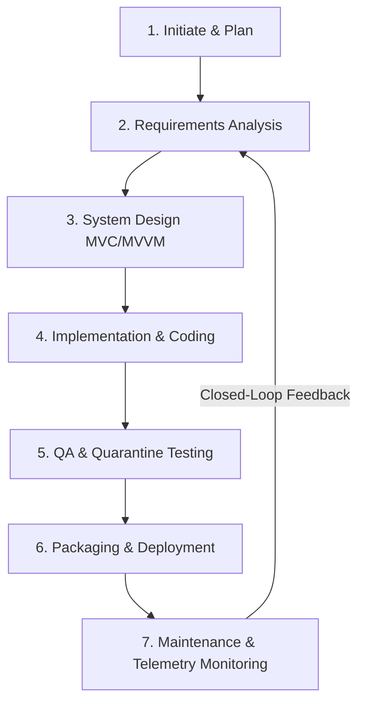

# 🏛️ Enterprise High-Level Design (HLD) Document
## jFindMe / jButterfly Real-Time Tracking & Family Mesh Platform

---

## 1. Executive Summary & Architectural Vision
**jFindMe (jButterfly)** is an enterprise-grade, OOPS-based MVVM real-time location telemetry, safe zone geofencing, and forensic spatial synchronization application. The system operates on a **Closed-Loop Waterfall Architecture** that strictly maintains 1-to-1 data parity between local device storage (**SQLite Database**) and cloud telemetry (**Firebase Realtime Database**).

```
┌────────────────────────────────────────────────────────────────────────────────────────┐
│                              HIGH-LEVEL SYSTEM CONTEXT                                 │
└────────────────────────────────────────────────────────────────────────────────────────┘
                    
       [ Host / Admin Node ]                   [ Member / Child / Friend Nodes ]
          (e.g., Redmi N7)                        (Redmi 5, Riddhi, Pushpa)
                 │                                            │
                 ├───────────────────────┬────────────────────┤
                 │                       │                    │
                 ▼                       ▼                    ▼
     ┌───────────────────────┐ ┌───────────────────┐ ┌───────────────────┐
     │  Native UI Layer      │ │ Background Engine │ │ Local Storage     │
     │  (Map, Panels, Radar) │ │ (TrackingService) │ │ (SQLite Database) │
     └───────────┬───────────┘ └─────────┬─────────┘ └─────────┬─────────┘
                 │                       │                     │
                 └───────────────────────┼─────────────────────┘
                                         │
                                         ▼
                 ┌───────────────────────────────────────────────┐
                 │       Firebase Cloud Realtime Database        │
                 │   • /devices/{id}/ (Telemetry, Profile)       │
                 │   • /relationships/{group_id}/ (Circle Mesh)  │
                 │   • /safe_zones/{group_id}/ (Geofencing)      │
                 └───────────────────────────────────────────────┘
```

---

## 2. Core Architectural Pillars

### 2.1. Physical Silicon Hardware Key (Immutable SSOT)
- Device identity is rooted in the physical hardware serial (`ro.ril.oem.sno`, `ro.ril.oem.psno`, or 8-character canonical agent ID e.g., `2T929153`, `2C811042`).
- Temporary auth tokens or software UUIDs must never overwrite or destroy physical hardware agent identities.

### 2.2. Standardized Dual-Engine Database Schema

#### A. Cloud Realtime Database (`relationships/`)
All circle hierarchies are standardized into an atomic, 2-tier tree structure:
```
relationships/
└── GRP_{HOST_DEVICE_ID}/               <-- Top-Level Circle Anchor (e.g. GRP_2T929153)
    │
    ├── group_info/                     <-- Circle Metadata & Host SSOT Pointer
    │   ├── host_device_id: "2T929153"  <-- Explicit Host Pointer
    │   ├── group_name: "Primary Circle"
    │   └── created_at: 1725440000000
    │
    └── devices/                        <-- UNIFORM FLAT DEVICE ROSTER
        ├── {DEVICE_ID_1}/              <-- Host Node (2T929153)
        │   ├── identity/ (name, full_name, avatar_id)
        │   ├── membership/ (role: "ADMIN", role_family: "Parent", role_friend: "None")
        │   └── paired_with/ ({DEVICE_ID_2}: true, {DEVICE_ID_3}: true)
        │
        └── {DEVICE_ID_2}/              <-- Member Node (2C811042)
            ├── identity/ (name, full_name, avatar_id)
            ├── membership/ (role: "MEMBER", role_family: "None", role_friend: "Friend")
            └── paired_with/ ({DEVICE_ID_1}: true)
```

#### B. Local Device SQLite Database
- `user_identity`: Tracks hardware UID, full name, avatar reference, and verification flags.
- `device_pairings`: Records cryptographic pairing handshakes between local and remote nodes.
- `user_profile`: Stores cached nicknames, avatars, and contact attributes.
- `safe_zones`: Caches geofence boundaries (circular radius and ray-casting polygon points).
- `tracking_history`: Indexed time-series breadcrumbs (`< 16ms` query response time).

---

## 3. 7-Stage Closed-Loop Waterfall Lifecycle



1. **Initiate & Plan**: Define scope, hardware identity anchoring, and power consumption constraints.
2. **Requirements Analysis**: SRS sign-off, RBAC authorization matrix, and topology definition.
3. **System Design (MVVM/MVC)**: Unified SQLite and Firebase schemas, low-power state machines, and clean UI/UX layouts.
4. **Implementation**: Native Android (Kotlin/Java) with zero external dependency bloat, adaptive polling intervals, and O(1) indexing.
5. **Testing & QA**: Strict quarantine checks, zero Gradle build execution without explicit direction, and hardware ADB verification.
6. **Deployment**: Release artifact compilation with Git LFS binary media distribution.
7. **Maintenance & Monitoring (Closed-Loop)**: Real-time telemetry monitoring, RAG status evaluations, and proactive failure recovery.

---

## 4. Power & Battery Duty Cycle Protocol (Ultra-Low Drain Standard)

To guarantee battery consumption remains strictly comparable to WhatsApp/Google Maps:

| System State | Location Engine Priority | Polling Interval | Min Displacement | CPU WakeLock Policy |
| :--- | :--- | :--- | :--- | :--- |
| **Map Screen Active (Foreground)** | `PRIORITY_HIGH_ACCURACY` | 15s – 30s | 0 meters | Transient (Screen On) |
| **App Minimized (Background)** | `PRIORITY_BALANCED_POWER_ACCURACY` | 300s (5 min) | 25 meters | **NO WakeLock** (OS Managed) |
| **Stationary (Device at Rest)** | `PRIORITY_BALANCED_POWER_ACCURACY` | 900s (15 min) | 50 meters | **NO WakeLock** (Deep Doze) |
| **Emergency SOS Active** | `PRIORITY_HIGH_ACCURACY` | 5s – 10s | 0 meters | Transient 3-second beacon |

---

## 5. Standardized Centralized RAG Status Engine

The status of all circle devices is governed by the centralized RAG Engine:

- 🟢 **ACTIVE (LIVE)**: Heartbeat / location update `< 15 minutes` (`#22C55E` Emerald Green).
- 🟡 **INACTIVE (< 6H)**: Last seen between `15m – 6 hours` OR Battery `≤ 20%` (`#F59E0B` Amber Orange).
- 🔴 **INACTIVE (> 6H)**: Last seen `> 6 hours` (`#EF4444` Rose Red).
- 🚨 **EMERGENCY SOS**: `isSosActive == true` (`#EF4444` Pulsing Crimson).
- ⚪ **UNLINKED / GHOST**: Deleted, unlinked, or Ghost Mode (`#64748B` Slate Gray).
