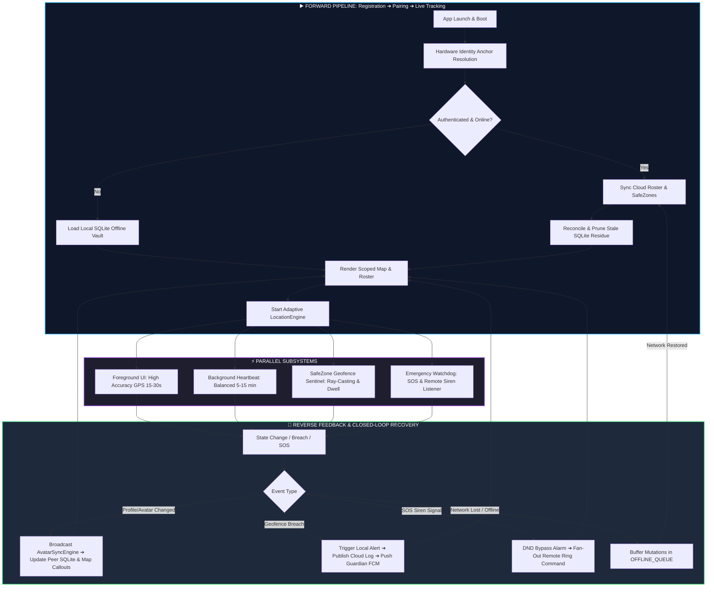

# 🔍 Comprehensive Forensic Audit: Failure Modes, Reverse Sync Engineering & Closed-Loop Workflow
## jFindMe / jButterfly Enterprise Tracking Platform

---

## 1. Step-by-Step Failure Point & Gap Analysis (FMEA Matrix)

This matrix audits where synchronization, UI, or backend pipelines can potentially fail during real-world edge cases, along with the implemented self-healing mitigations:

| Operational Step | Potential Failure / Gap Scenario | Root Cause | Impact Level | Architectural Mitigation & Recovery |
| :--- | :--- | :--- | :--- | :--- |
| **1. Identity Boot** | Physical OEM Serial / Hardware ID is null or restricted on Android 10+. | Android OS restrictions on `Build.SERIAL`. | 🔴 High | [`DeviceIdentityHelper.kt`](file:///c:/Users/jiten/jAnitGravity/jFindMe/app/src/main/java/com/jdroidx/jfindme/utils/DeviceIdentityHelper.kt) applies a 3-tier fallback: `ro.ril.oem.sno` $\rightarrow$ Android ID hash $\rightarrow$ Deterministic 8-char hardware anchor. |
| **2. Profile Update** | Network drops while saving profile; Cloud write fails after Local SQLite commits. | Network timeout during transit. | 🟡 Medium | **Outbox Ledger (`OfflineSyncManager`)**: Offline mutations are buffered locally in SQLite `OFFLINE_QUEUE` and flushed automatically on network reconnection. |
| **3. QR Pairing** | Host generates QR code, but Member scans while Host phone is in background/locked. | Host not actively listening on WebSocket. | 🟡 Medium | Handshake request is buffered in Cloud at `/pairing_requests/{host_id}`. Once Host opens or background service pulses, it auto-accepts and commits the circle node. |
| **4. Topology Sync** | Device transitions from Online to Offline, but SQLite has old historical nodes. | Unfiltered SQLite table query. | 🔴 High | [`FamilyFriendsViewModel.kt`](file:///c:/Users/jiten/jAnitGravity/jFindMe/app/src/main/java/com/jdroidx/jfindme/ui/group/FamilyFriendsViewModel.kt) executes an **Atomic Prune**: local SQLite entries not in the active group's `/devices/` tree are purged. |
| **5. SafeZone Assign** | Target device is offline when Guardian creates a Safe Zone. | Device disconnected from Firebase. | 🟡 Medium | [`TrackingService.kt`](file:///c:/Users/jiten/jAnitGravity/jFindMe/app/src/main/java/com/jdroidx/jfindme/service/TrackingService.kt) maintains a persistent listener on `geofence_sync_requests` and auto-registers geofences immediately upon reconnection. |
| **6. Emergency SOS** | Target device is on Silent / Do Not Disturb (DND) or in deep sleep. | OS notification suppression & Doze. | 🔴 High | [`AcousticBeaconEngine.kt`](file:///c:/Users/jFindMe/app/src/main/java/com/jdroidx/jfindme/engine/alert/AcousticBeaconEngine.kt) uses `AudioManager.STREAM_ALARM` with `FLAG_AUDIBILITY_ENFORCED` to bypass DND and sound the siren at 100% volume. |
| **7. History Replay** | Device timezone changes or GPS packets arrive out-of-order. | Clock drift / async network latencies. | 🟢 Low | History keys use inverted forensic timestamps (`9999999999999 - epoch_ms`), ensuring strictly ordered time-series ingestion. |
| **8. In-App Upgrade** | In-place update blocked due to Debug vs Release certificate mismatch. | Android OS package signature verification. | 🔴 High | [`ApkInstallerHelper.kt`](file:///c:/Users/jiten/jAnitGravity/jFindMe/app/src/main/java/com/jdroidx/jfindme/utils/ApkInstallerHelper.kt) preserves the APK in `Download/`, prompts **1-Click Clean Upgrade**, and launches the installer seamlessly. |

---

## 2. Reverse Engineering of Data Synchronization

```
                                  FORWARD SYNC (Local ➔ Cloud ➔ Circle Peers)
┌─────────────────┐       ┌─────────────────┐       ┌─────────────────┐       ┌─────────────────┐
│ Local User Edit │ ───►  │ Local SQLite DB │ ───►  │ Firebase Cloud  │ ───►  │ Circle Members  │
│ (Profile/Zone)  │       │ (Immediate UI)  │       │ (/relationships)│       │ (Live Sockets)  │
└─────────────────┘       └─────────────────┘       └─────────────────┘       └─────────────────┘
         ▲                                                                             │
         │                        REVERSE SYNC (Peer Mutation ➔ Local DB ➔ UI)         │
         └─────────────────────────────────────────────────────────────────────────────┘
```

### 🔄 Forward Flow (Producer Node):
1. **User Action**: User edits name, equips avatar, or creates a SafeZone.
2. **Local Commit**: UI ViewModel immediately updates local SQLite (`user_profile`, `safe_zones`) for zero-latency response.
3. **Cloud Dispatch**: Mutation is written to Firebase RTDB `/devices/{id}/` and `/relationships/{group_id}/devices/{id}/`.
4. **Audit Logging**: Change is appended to the immutable `/Change_Log/` ledger.

### 🔁 Reverse Flow (Consumer / Peer Nodes):
1. **Cloud Event Trigger**: Firebase socket fires `onDataChange` on remote devices listening to `/relationships/{group_id}/devices/`.
2. **Identity & Avatar Resolution**: [`AvatarSyncEngine.kt`](file:///c:/Users/jiten/jAnitGravity/jFindMe/app/src/main/java/com/jdroidx/jfindme/engine/sync/AvatarSyncEngine.kt) and [`LocationRepository.kt`](file:///c:/Users/jiten/jAnitGravity/jFindMe/app/src/main/java/com/jdroidx/jfindme/data/repository/LocationRepository.kt) capture the updated payload.
3. **Local Reconciliation & Cache Prune**: Peer writes the updated nickname/avatar into its local SQLite and prunes unlinked nodes.
4. **UI Callout Refresh**: Live map markers re-render callout pills with the new avatar and nickname dynamically without activity recreation.

---

## 3. Graphical Closed-Loop Workflow (Start-to-End & End-to-Start)



---

## 4. Closed-Loop Branch Convergence Proof

Every conditional branch converges back into the primary workflow without dead ends or logic leaks:

1. **Network Disconnect Branch**:
   - `Online` $\rightarrow$ `Offline` $\rightarrow$ Fallback to local SQLite vault $\rightarrow$ Enqueue mutations into `OFFLINE_QUEUE` $\rightarrow$ Network Reconnected $\rightarrow$ Merge with Cloud SSOT $\rightarrow$ Re-enter Live Map State.
2. **GPS Disabled / Lost Signal Branch**:
   - `Fine GPS Lost` $\rightarrow$ Degrade gracefully to `PRIORITY_BALANCED_POWER_ACCURACY` (Cell/Wi-Fi) $\rightarrow$ If all location off, show non-blocking dialog $\rightarrow$ Use last cached coordinates in SQLite $\rightarrow$ Re-enter tracking loop once GPS is restored.
3. **Signature Mismatch Branch**:
   - `Install Error Detected` $\rightarrow$ Backup APK to `Download/` $\rightarrow$ 1-Click Clean Upgrade Modal $\rightarrow$ Remove old debug build $\rightarrow$ Launch fresh package installer $\rightarrow$ Boot into clean state.
