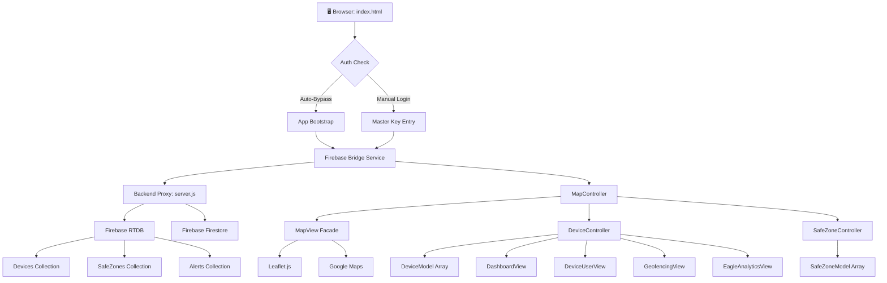
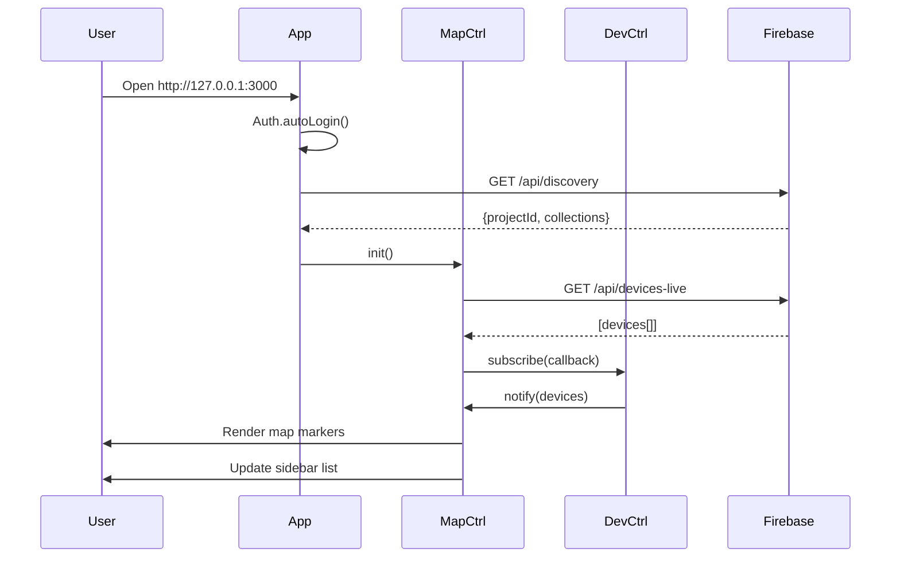
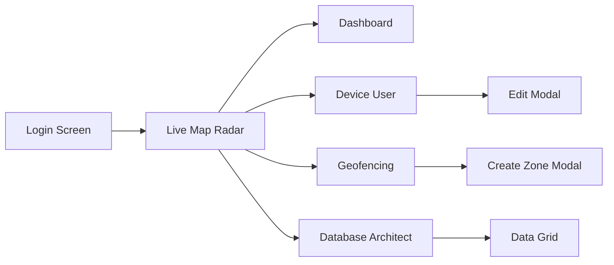
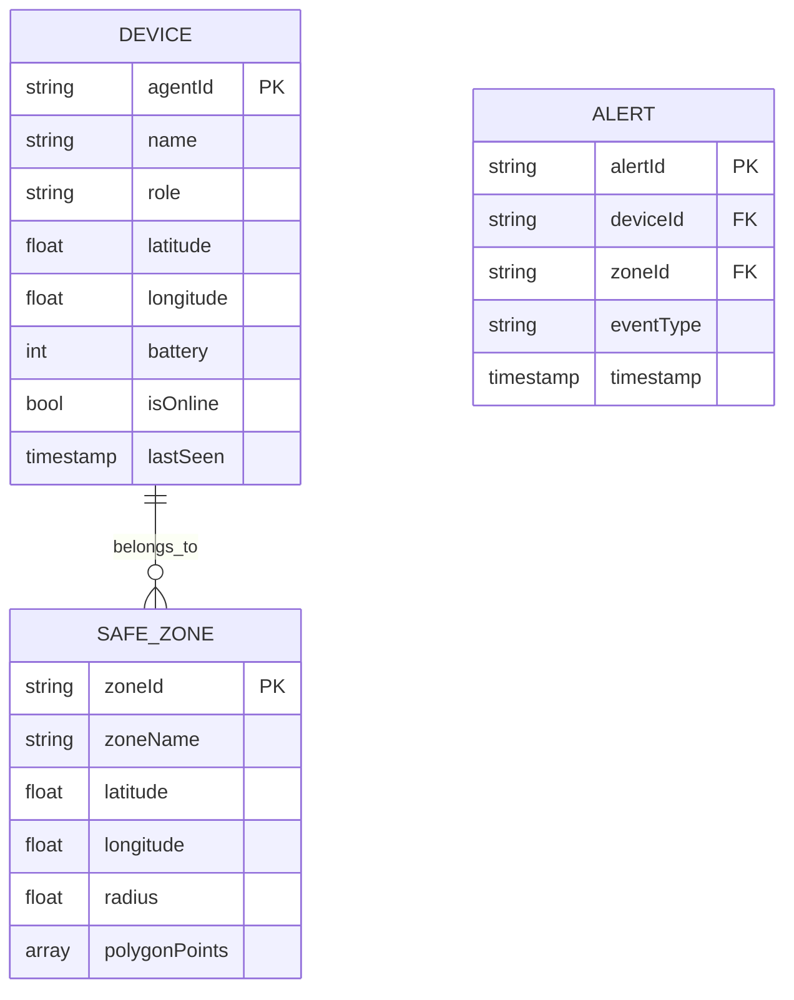
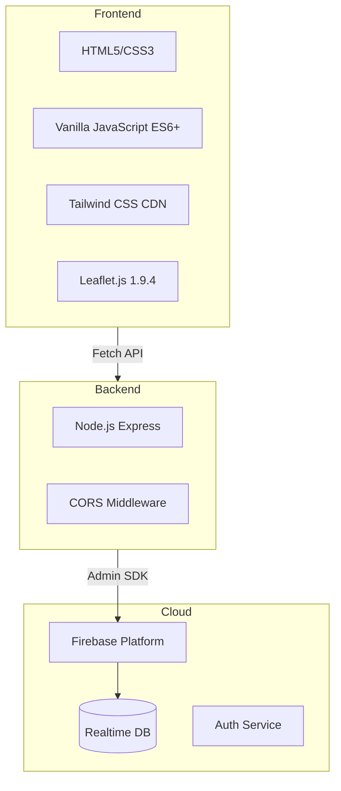
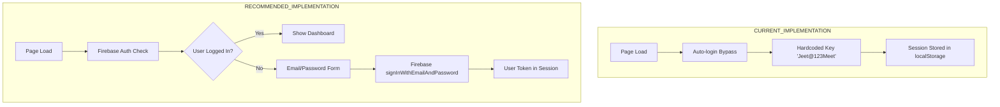
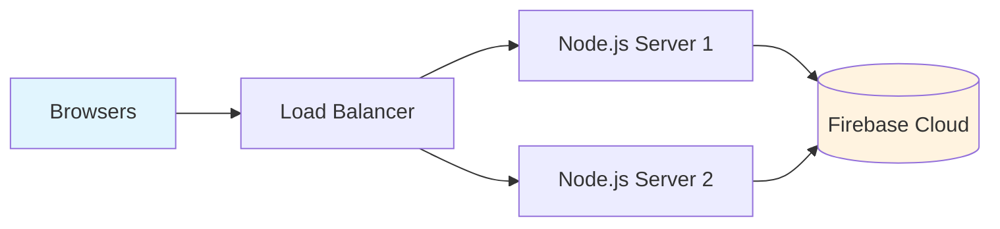
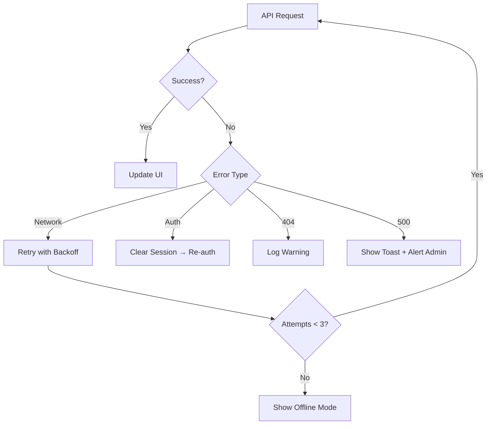

# jButterfly - Visual Architecture Map

## System Data Flow

---

## Component Interaction Map

---

## Navigation Flow

---

## Data Entities

---

## Technology Stack

---

## View Responsibilities

| View | Controller | Data Source | Updates Via |
|------|-----------|-------------|-------------|
| LiveMap | MapController | DeviceController | Polling (5s) |
| Dashboard | App | DeviceController | Subscribe |
| DeviceUser | App | DeviceController + SafeZoneController | Subscribe |
| Geofencing | App | SafeZoneController + DeviceController | Subscribe |
| EagleAnalytics | App | DeviceController | Subscribe |

---

## Authentication Flow (Current vs Recommended)

---

## Deployment Architecture

---

## Error Handling Cascade

