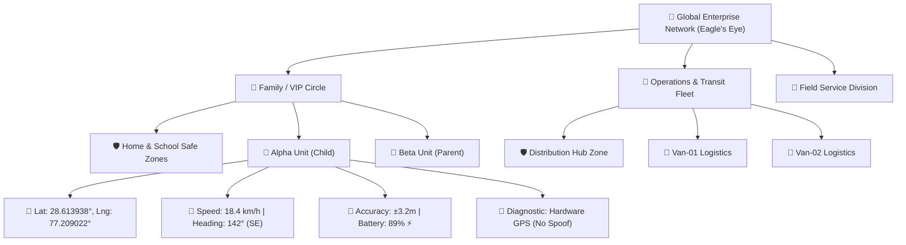

# jFindMe - Business Analytics & Explorer Tree Architecture (Eagle-to-Ant Monitoring)
Framework Anchor: `C:\Users\jiten\jAnitGravity\.kit`

## 🦅 1. CORE BUSINESS ANALYTICAL METAPHOR
> **"Like an Eagle flying at high altitude that can clearly see the Ant on the ground."**

This app is built exclusively as an **Executive & Business Analytical Monitoring Tool**. It enables stakeholders, managers, and circle guardians to view aggregated macro intelligence from a 30,000-foot perspective while possessing instantaneous drill-down capability into sub-meter micro telemetry for any individual unit.

```
========================================================================================
LEVEL 1: EAGLE'S EYE (MACRO FLEET / ENTERPRISE LEVEL)
• Total Monitored Units, Online/Offline Ratios, Moving vs Idle Breakdown
• Enterprise-Wide Speed & Battery Health Averages
• Global Heatmaps, Geofence Compliance %, Mock GPS Anomaly Alerts
   │
   ▼
LEVEL 2: FLOCK / REGIONAL HUB / CIRCLE LEVEL
• Grouped by Department, Family Circle, Regional Sector, or Fleet Branch
• Average Group Velocity, Sector Safety Index, Active Vehicle/Person count
   │
   ▼
LEVEL 3: INDIVIDUAL UNIT / DEVICE LEVEL
• Device Identity (Avatar, Name, Role, Relationship, Hardware ID)
• Dynamic Status Badges (Speed, Battery %, Charging, Precision Radius)
• 1-Click Reverse Breadcrumbs & Map Trajectory Lock
   │
   ▼
LEVEL 4: "THE ANT" (MICRO SENSOR GROUND TRUTH LEVEL)
• Exact Raw GPS Coordinates (Latitude, Longitude to 6 decimal places: sub-meter precision)
• Altitude (AMSL in meters), Bearing/Heading (0-360° with compass direction)
• Horizontal Accuracy Radius (± meters buffer)
• Checksum Integrity, Mock GPS Detection Flag, Timestamped Diagnostic Logs
========================================================================================
```

---

## 🌳 2. BEHIND-THE-SCENES EXPLORER TREE ARCHITECTURE

The Explorer Tree works behind the scenes as a **reactive relational graph**:



### Key Functional Capabilities:
1. **Dynamic Drill-Down & Roll-Up:**
   - Selecting the **Root Node** surfaces macro KPI cards across all units.
   - Selecting a **Group Node** filters metrics and map bounds to that cluster.
   - Selecting a **Device Node** unveils deep micro sensor telemetry ("The Ant").
2. **Deterministic Single Source of Truth:**
   - When an Avatar, Name, Safe Zone assignment, or Relationship changes at any node, the entire tree and the map synchronize instantaneously without page reloads.
3. **High-Performance Viewport Virtualization:**
   - Large fleet trees with 1,000+ units render smoothly using DOM virtualization and lightweight reactive state stores.
