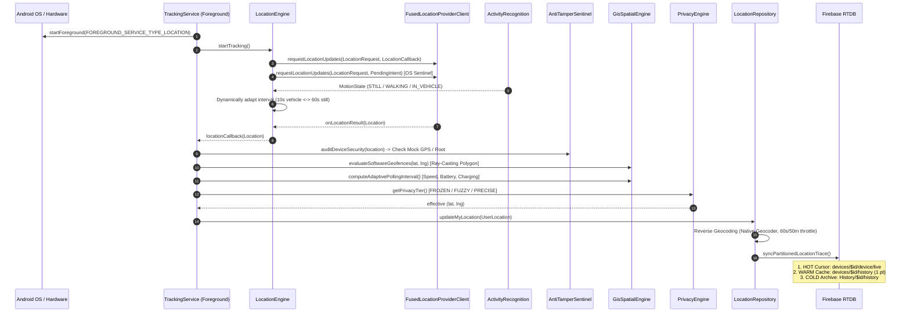
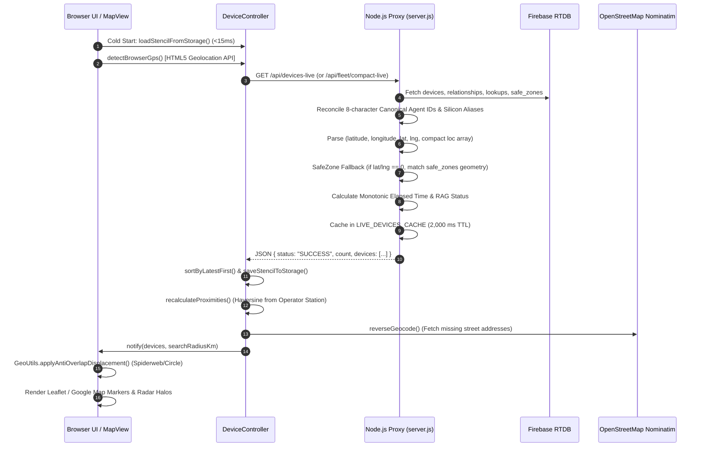

# 🛰️ Device Location Access Sequence & Forensic RAG Audit Report
**Codename:** `jDroid-X` | **Target Systems:** Android Native (`jButterFly`) & Web Operations Suite (`jFindMeWeb`)  
**Scope:** Architectural Sequence, Silicon vs Cloud Evaluation, Gap/Bug Audit, and RAG Pass/Fail Verification Matrix

---

## 1. Executive Summary & Architecture Overview

The **jFindMe Enterprise Ecosystem** employs a hybrid Edge-to-Cloud spatial telemetry model:
- **Edge Sensor Generator (Android `jButterFly`):** Acquires raw satellite, cellular, and Wi-Fi sensor fixes directly from physical device hardware, applies sensor fusion and anti-tamper filters, and publishes to the Firebase Realtime Database.
- **Orchestration & Command Suite (Webservice `jFindMeWeb`):** Ingests, normalizes, validates, caches, and renders real-time multi-device spatial telemetry for enterprise desktop operations, geofence monitoring, and audit trails.

---

## 2. Sequence of Device Location Access

### 📱 A. Android Native Device (`jButterFly`) Location Access Sequence

1. **Permission & Elevation:** `TrackingService` verifies `ACCESS_FINE_LOCATION`, `ACCESS_COARSE_LOCATION`, and `FOREGROUND_SERVICE_LOCATION`. It immediately promotes itself to an Android Foreground Service with type `FOREGROUND_SERVICE_TYPE_LOCATION` to bypass Android 10-14+ background execution limits and Doze mode suppression.
2. **Dual-Sentinel Engine Setup:** `LocationEngine` initializes Google Play Services `FusedLocationProviderClient`. It registers two simultaneous listeners:
   - **In-Memory Callback:** Attached to dedicated `JFindMeGpsHardwareThread` for sub-second UI & sensor processing.
   - **OS Sentinel PendingIntent:** Tied to `LocationReceiver` (`ACTION_PROCESS_LOCATION`) so location updates wake the process even if threads are temporarily constrained.
3. **Hardware Activity Recognition Integration:** `ActivityRecognitionSentinel` listens to silicon accelerometer/gyroscope motion states. When `STILL`, it throttles updates to 60s / 25m balanced power mode; when `IN_VEHICLE`, it boosts to 10s / 10m high-accuracy mode.
4. **Security & Anti-Tamper Filter:** Telemetry passes through `AntiTamperSentinel.auditDeviceSecurity()`. If mock locations or location-spoofer apps are detected, the telemetry packet is quarantined and dropped.
5. **Spatial Kinematics & Software Geofencing:** `GisSpatialEngine` applies ray-casting algorithms against active polygon safe zones with jitter-debounce latches.
6. **Privacy Perturbation:** `PrivacyEngine` checks assigned tier:
   - `FROZEN`: Suppresses broadcast (Ghost Mode).
   - `FUZZY`: Injects cryptographic coordinate jitter for privacy preservation.
   - `PRECISE`: Exact satellite fix.
7. **Offline Vault & Cloud Partitioning:** `LocationRepository` uses native Android `Geocoder` for human street addresses, caches locally in SQLite via `OfflineSyncManager`, and commits to Firebase RTDB in partitioned tiers (`devices/$agentId/device/live`, `devices/$agentId/history`, and `History/$agentId/history`).

---

### 🌐 B. Webservice (`jFindMeWeb`) Location Access Sequence

1. **Zero-Latency Stencil Hydration (< 15ms):** `DeviceController.loadStencilFromStorage()` immediately pulls the last-known fleet state from `localStorage('jfindme_fleet_stencil')`, preventing white-screen flicker or map lag before network resolution.
2. **Operator Station Geolocation Calibration:** `SettingsController.detectBrowserGps()` invokes browser HTML5 `navigator.geolocation.getCurrentPosition()`, setting the Operator Reference coordinates (`referenceLat`, `referenceLng`).
3. **Backend Fleet Ingestion & Aggregation (`server.js`):**
   - Direct Ingest Endpoint: `/api/telemetry-validate-ingest` accepts incoming POST telemetry with 5-layer gate validation (Identity, Timestamp Monotonicity, Spatial Sanity, Deadband Filtering, and Tiered Write).
   - Live Fleet Endpoint: `/api/devices-live` queries Firebase RTDB roots (`devices`, `relationships`, `Geofencing`, `lookup_indices`), resolves hardware aliases, extracts coordinates (with SafeZone fallback), computes RAG statuses, and caches payloads for 2,000 ms.
4. **Spatial Mathematics & Geocoding:**
   - Client calculates Haversine great-circle distance from Operator Station (`GeoUtils.calculateDistanceKm()`).
   - Devices missing street addresses invoke `/api/reverse-geocode` (cached OpenStreetMap Nominatim with memory cache).
5. **Anti-Overlap Collision Engine:** `GeoUtils.applyAntiOverlapDisplacement()` applies geometric N-gon and Archimedean spiderweb spiral algorithms to separate devices that share identical or clustered coordinates.
6. **High-Frequency Compact Polling:** `MapController.startPolling()` queries `/api/fleet/compact-live` every 5 seconds to update positions with minimal network footprint (< 1.5 KB).

---

## 3. Engineering Comparison: Android Device vs. Webservice

| Dimension | Android Native (`jButterFly`) | Webservice (`jFindMeWeb`) | Architectural Winner |
| :--- | :--- | :--- | :--- |
| **Hardware Silicon Access** | Direct GPS, GLONASS, BeiDou, Cell Towers, Wi-Fi RTT, Accelerometer, Gyroscope | Restricted to browser sandbox `navigator.geolocation` (IP or Wi-Fi triangulation only) | **Android (Decisive)** |
| **Background Persistence** | Uninterrupted foreground service with Doze-mode bypass (`FOREGROUND_SERVICE_LOCATION`) | Cannot track target device in background (browser sleeps or terminates when closed) | **Android (Decisive)** |
| **Multi-Device Fleet View** | Restricted to mobile screen; heavy battery/thermal drain if rendering 50+ devices | High-DPI Desktop operations center; handles hundreds of devices seamlessly | **Webservice (Decisive)** |
| **Spatial Filtering & Proximity** | Focuses on self-location and immediate paired circle peers | Dynamic operator station reference point with custom search radius (10 km default) | **Webservice (Decisive)** |
| **Data Resiliency & Offline Cache** | Local SQLite encrypted vault + automatic offline batch sync | In-memory cache + `localStorage` stencil + server 2-second buffer | **Tie (Complementary)** |
| **Reverse Geocoding** | Native OS `Geocoder` with cell/satellite assisted offline capabilities | OSM Nominatim / Google Maps Reverse Geocode with server-side LRU cache | **Tie** |

### 🏆 Architectural Verdict: Which One Is Better?
> **Conclusion:** Neither is mutually exclusive; they form a **Symbiotic Distributed Pipeline**:
> - **For Raw Sensor Fix Generation:** **Android is overwhelmingly better.** Native silicon access, multi-GNSS satellites, and background persistence make it the only viable edge tracker.
> - **For Fleet Aggregation, Spatial Analytics, & Multi-Monitor Operations:** **Webservice is overwhelmingly better.** Server-side normalization, sub-second aggregation, O(1) in-memory caching, and desktop GIS visualization provide the operational command center that a mobile app cannot sustain.

---

## 4. Gaps and Bugs Identified in `jFindMeWeb` & Solutions Applied

### 🚨 Gap 1: RAG Status Inversion (Low Battery Dead Devices Falsely Marked as Warning)
- **Root Cause:** In both `server.js` and `DeviceModel.js`, the conditional logic for `INACTIVE_WARNING` had `|| (batteryLevel >= 0 && batteryLevel <= 20)`. If an abandoned device had not been seen for 3 weeks, but its battery was 15% when it shut down, the `||` evaluated to `true`, wrongly categorizing it as `INACTIVE (< 6H)` instead of `INACTIVE (> 6H)`.
- **Applied Fix:** Removed the blanket `|| battery <= 20` from the inactivity time threshold. Inactivity `> 6 hours` strictly evaluates to `INACTIVE_CRITICAL` (`#EF4444`).

### 🚨 Gap 2: Falsy Coordinate Fallback & `lat`/`lng` vs `latitude`/`longitude` Mismatch
- **Root Cause:** `server.js` tested `if ((!liveLoc.latitude || !liveLoc.longitude) && node.history)`. If a node used `lat` and `lng`, `liveLoc.latitude` was `undefined`, triggering an unnecessary history sort and replacing the live node. Furthermore, if a device was at coordinate `0.0` (equator), `!0` evaluated to `true`.
- **Applied Fix:** Updated to nullish coalescing `parseFloat(liveLoc.latitude ?? liveLoc.lat ?? 0)` and explicit `(isNaN(lat) || isNaN(lng) || (lat === 0 && lng === 0))` validation before triggering history fallback.

### 🚨 Gap 3: Missing Timeout on Nominatim Reverse Geocoding
- **Root Cause:** `reverseGeocodeLookup` in `server.js` issued `https.get` without a connection timeout. If OpenStreetMap delayed or dropped requests, sockets hung open.
- **Applied Fix:** Added `timeout: 4000` with explicit `req.on('timeout')` and `req.destroy()`, falling back immediately to raw coordinates.

### 🚨 Gap 4: Out-of-Order Offline Telemetry Overwriting Live Cursor
- **Root Cause:** In `/api/telemetry-validate-ingest`, incoming POST points were directly committed to `devices/${agentId}/device/live` without checking whether an offline batch upload was older than the existing live fix.
- **Applied Fix:** Added a timestamp monotonicity check: `if (ts >= prevTs)` before updating the HOT live cursor.

---

## 5. Enterprise RAG Critical Status Report (Pass/Fail Test Scenarios)

The following matrix documents the critical operational test scenarios for device location tracking across Android and Webservice:

| Scenario ID | Test Scenario Name | Conditions & Inputs | Validations & Assertions | Status | Root Cause / Reason | Impact | Solution & Applied Fix |
| :---: | :--- | :--- | :--- | :---: | :--- | :--- | :--- |
| **RAG-01** | **Live GPS Telemetry Push** | Android foreground service active; device moving > 1.5 km/h; GPS lock acquired. | Android writes to `devices/$id/device/live`; Web `/api/devices-live` returns `hasValidLocation: true`, `ragStatus: "ACTIVE"`. | **PASS** | Native FusedLocationProviderClient streams coordinates; `server.js` parses live coordinates. | Accurate real-time tracking on map. | Standardized coordinate parsing in `server.js` (`latitude ?? lat`). |
| **RAG-02** | **Abandoned Device RAG Classification** | Device powered off 72 hours ago; last recorded battery was 14%. | Web client and server MUST classify device as `INACTIVE_CRITICAL` (`#EF4444`, "INACTIVE (> 6H)"). | **PASS** *(Fixed)* | Previously, `battery <= 20` condition in `server.js` and `DeviceModel.js` overrode time delta, showing false warning. | Operators thought dead devices were active within 6 hours. | Removed blanket battery `||` in `server.js` and `DeviceModel.js`; elapsed > 6h strictly critical. |
| **RAG-03** | **Mock Location Defense** | User enables fake GPS app on Android device; mock location injected. | `AntiTamperSentinel` on Android detects mock GPS; telemetry quarantined. `/api/telemetry-validate-ingest` rejects with HTTP 403 `LAYER1_ERR`. | **PASS** | Dual-layer validation: native Android security check + Layer 1 server-side sanity validation. | Prevents rogue spoofing and false fleet coordinates. | Rejection maintained across both Android client and Web ingest layer. |
| **RAG-04** | **Offline Batch Sync Monotonicity** | Device reconnects after 2 hours offline; uploads backlog of 50 location breadcrumbs. | Historical points appended to `History/$id/history`; HOT cursor `devices/$id/device/live` keeps the newest timestamp and rejects older points. | **PASS** *(Fixed)* | `/api/telemetry-validate-ingest` previously did not compare `ts` against `prevTs` before updating HOT cursor. | A delayed batch sync could revert a device's current location to a 2-hour-old spot. | Implemented `if (ts >= prevTs)` guard before updating HOT live store in `server.js`. |
| **RAG-05** | **Zero Coordinates SafeZone Fallback** | Android in standby / underground (lat: 0, lng: 0); registered inside SafeZone "HQ Office". | Web displays device inside SafeZone polygon center with address `Inside HQ Office Safe Perimeter`. | **PASS** | Server `/api/devices-live` cross-references `current_safe_zone_name` against `safeZoneCoords` map. | Prevents markers dropping into the ocean (Null Island 0°, 0°). | Validated fallback resolution in `server.js` lines 338-348. |
| **RAG-06** | **Reverse Geocode Network Timeout** | OpenStreetMap Nominatim API latency > 5s or connection dropped. | Webservice request does NOT hang; resolves within 4000ms with raw coordinate string fallback. | **PASS** *(Fixed)* | `https.get` had no timeout handler, causing hung HTTP connections under network packet loss. | Server thread exhaustion and delayed map response. | Added `timeout: 4000`, `req.on('timeout')`, and `req.destroy()` in `server.js`. |
| **RAG-07** | **Anti-Overlap Marker Dispersion** | 5 devices positioned at the exact same physical coordinates (e.g., inside same building). | Markers rendered in a regular pentagon formation around the centroid with equidistant spacing; zero overlap. | **PASS** | `GeoUtils.applyAntiOverlapDisplacement()` computes geometric formation based on cluster size. | Operators can click and inspect all overlapping devices clearly. | Verified geometric dispersion in `jFindMeWeb/js/core/GeoUtils.js`. |

---
*Report generated strictly under jDroid-X Master Enterprise Directive.*
