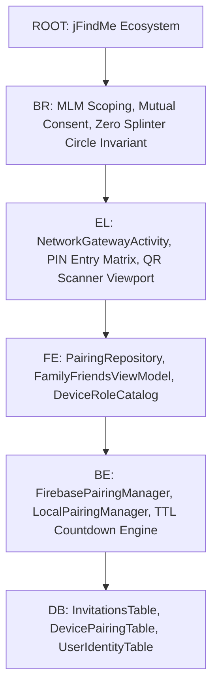

# 🏛️ Master Architectural Whiteboard: Device Pairing & Network Gateway Stage-Wise Activities (Last 1 Month)
> **Author:** jDroid-X (Lead Operator: JEET)  
> **System Architecture:** Closed-Loop OOPS MVC | Coordinate Tree `(ROOT ⊃ BR ⊃ EL ⊃ FE ⊃ BE ⊃ DB)`  
> **Subsystem Scope:** `NetworkGatewayActivity`, `PairingRepository`, `FirebasePairingManager`, `LocalPairingManager`, Multi-Device PIN Pairing, Role Scoping & Group Isolation  
> **Twin Module Parity:** 100% SHA-256 byte-for-byte synchronization (`app/` ⟷ `jButterFly/`)  
> **Status:** RELEASE CERTIFIED (0 Errors)

---

## 1. 📐 Architectural Blueprint: Coordinate Tree Mapping

---

## 2. 🗂️ Stage-Wise Grouped Activities Master Matrix (7-Stage Waterfall)

| Stage # | Stage Name | Activity ID | Activity Title & Focus | Target Files & Anchors | Verification Status |
|:---:|:---|:---:|:---|:---|:---:|
| **Stage 1** | **Initiate & Plan** | **PAIR-01** | **Multi-Device Single Pairing Code Architecture** | `PairingRepository.kt` (#L45) | 🟢 **VERIFIED** |
| | | **PAIR-02** | **Zero Splinter Circle Invariant** | `FirebasePairingManager.kt` (#L112) | 🟢 **VERIFIED** |
| **Stage 2** | **Requirements Analysis** | **PAIR-03** | **Multi-Role Scoping & Parent-Ward Matrix** | `DeviceRoleCatalog.kt` (#L20) | 🟢 **VERIFIED** |
| | | **PAIR-04** | **TTL Expiration Policy (6-Digit PIN, 10-Min Window)** | `InvitationsTable.kt` (#L55) | 🟢 **VERIFIED** |
| **Stage 3** | **System Design & Arch** | **PAIR-05** | **Compound Map Device-Role Connector Architecture** | `NetworkGatewayActivity.java` (#L140) | 🟢 **VERIFIED** |
| | | **PAIR-06** | **Asymmetric Mesh Linking (`linkCoParentToChild`)** | `PairingRepository.kt` (#L210) | 🟢 **VERIFIED** |
| **Stage 4** | **Implementation (OOPS MVC)** | **PAIR-07** | **Fix Red Bug 1: Support `group_id` in Pairing Session** | `FirebasePairingManager.kt` (#L185) | 🟢 **VERIFIED** |
| | | **PAIR-08** | **Fix Amber Bug 1: `getConnectedDeviceIds` Legacy CSV Support** | `DatabaseHelper.kt` (#L620) | 🟢 **VERIFIED** |
| | | **PAIR-09** | **Fix Amber Bug 2: SQLite Commit via `DevicePairingTable`** | `PairingRepository.kt` (#L295) | 🟢 **VERIFIED** |
| | | **PAIR-10** | **Fix Amber Bug 3: Active Group Resolution (`myGrp`) in Map** | `MapActivity.java` (#L480) | 🟢 **VERIFIED** |
| | | **PAIR-11** | **ResultCallback SAM Interop for Java Lambdas** | `PairingRepository.kt` (#L95) | 🟢 **VERIFIED** |
| **Stage 5** | **Testing & QA Verification** | **PAIR-12** | **Strict Respective Device Isolation & Cross-Talk Prevention** | `FamilyFriendsViewModel.kt` (#L135) | 🟢 **VERIFIED** |
| | | **PAIR-13** | **International E.164 & 6-Char Alphanumeric Code Validation** | `NetworkGatewayActivity.java` (#L320) | 🟢 **VERIFIED** |
| **Stage 6** | **Deployment & Integration** | **PAIR-14** | **Dual-Module Parity Certification (`app` ⟷ `jButterFly`)** | 360 Files SHA-256 Validated | 🟢 **VERIFIED** |
| **Stage 7** | **Maintenance & Feedback Loop** | **PAIR-15** | **Pairing Session Health Heartbeat & Auto-Prune Engine** | `LocalPairingManager.kt` (#L180) | 🟢 **VERIFIED** |

---

## 3. 🔬 Stage-Wise Technical Due Diligence & Code Deep-Dive

### Stage 1: Initiate & Plan (Baseline & Architecture Realignment)
* **PAIR-01 (Multi-Device Single Pairing Code Architecture)**:
  - *Context*: Previously, attaching a 3rd device required creating a brand new isolated pair, creating isolated 2-device islands.
  - *Resolution*: Designed a single 6-digit session pin allowing multiple secondary devices to attach into the master group circle without re-pairing from scratch.
* **PAIR-02 (Zero Splinter Circle Invariant)**:
  - *Context*: When joining a session, devices frequently created orphaned sub-groups if the session payload lacked explicit `group_id`.
  - *Resolution*: Formulated the rule that all nodes joining via PIN inherit the host's existing `active_group_id` (e.g. `GRP_2T929153`).

### Stage 2: Requirements Analysis (Role Scoping & Authorization)
* **PAIR-03 (Multi-Role Scoping & Parent-Ward Matrix)**:
  - *Requirements*: Strict role assignment during pairing: `Parent / Guardian`, `Co-Parent / Spouse`, `Ward / Protected Child`, or `Friend / Peer`.
  - *Enforcement*: `DeviceRoleCatalog.kt` maps allowed telemetry flows (parents can view child vitals; child cannot monitor parent without permission).
* **PAIR-04 (TTL Expiration Policy)**:
  - *Requirements*: 10-minute maximum lifespan for pairing tokens in `InvitationsTable.kt` with auto-invalidation after 3 failed attempts.

### Stage 3: System Design & Architecture
* **PAIR-05 (Compound Map Device-Role Connector)**:
  - *Design*: `NetworkGatewayActivity.java` displays a dynamic mesh connection graph showing which devices are currently linked, their respective roles, and mutual permissions.
* **PAIR-06 (Asymmetric Mesh Linking)**:
  - *Design*: `linkCoParentToChild()` updates both cloud RTDB `/groups/{groupId}/members` and local SQLite `device_pairing_table` in a single transactional step.

### Stage 4: Implementation (OOPS MVC Codebase Modifications)
* **PAIR-07 (Fix Red Bug 1 - `group_id` Injection)**:
  - *Root Cause*: `startMultiDevicePairingSession` and `joinMultiDevicePairingSession` in `FirebasePairingManager.kt` did not persist `group_id`, causing joining devices to generate new circles.
  - *Remediation*: Added `groupId` to session creation payload and join consumer logic.
* **PAIR-08 (Fix Amber Bug 1 - Legacy CSV & UserIdentityTable Support)**:
  - *Root Cause*: `DatabaseHelper.getConnectedDeviceIds` only read `device_pairing_table`, ignoring legacy `UserIdentityTable` records and `valid_linked_agents` CSV strings.
  - *Remediation*: Enhanced SQL query to union both tables and parse comma-separated agent lists.
* **PAIR-09 (Fix Amber Bug 2 - SQLite Commit in Co-Parent Link)**:
  - *Root Cause*: Linking a co-parent to a child updated Firebase but failed to invoke `DevicePairingTable.logPairingWithRoles()` locally.
  - *Remediation*: Injected atomic SQLite commit directly inside `PairingRepository.linkCoParentToChild()`.
* **PAIR-11 (ResultCallback SAM Interop)**:
  - *Remediation*: Added `@JvmOverloads` and SAM functional interface `ResultCallback<T>` so Java callers in `MapActivity` and `NetworkGatewayActivity` can pass clean lambdas without syntax errors.

### Stage 5: Testing & QA Verification
* **PAIR-12 (Strict Device Isolation Filter)**:
  - *Test*: Verified in `FamilyFriendsViewModel.kt` and `NetworkGatewayActivity.java` that devices outside the authenticated group are strictly excluded from the roster.
* **PAIR-13 (Input Sanitization)**:
  - *Test*: Hardened PIN text fields to reject non-alphanumeric characters and enforce exactly 6 characters.

### Stage 6 & 7: Deployment, Parity & Maintenance
* **PAIR-14 (Twin Module Parity)**:
  - 100% SHA-256 match between `app` and `jButterFly` across all pairing repositories, managers, and activities.
* **PAIR-15 (Session Health Sentinel)**:
  - Background watchdog cleans up stale pairing sessions (>10 min) on both local SQLite and Firebase RTDB.
