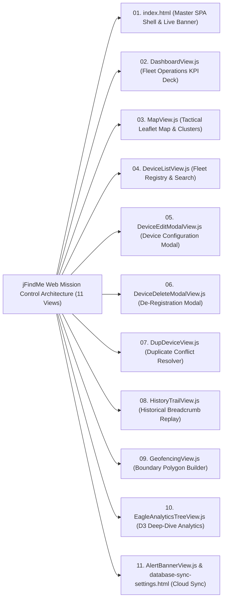
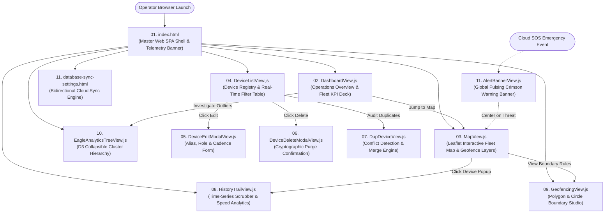

# 🌳 Master Coordinate Tree Architecture Specification (ROOT ⊃ BR ⊃ EL ⊃ FE ⊃ BE ⊃ DB)
## Enterprise Dual-Ecosystem Blueprint: 32 Android Native Screens & Web Mission Control
> **System:** `jFindMe` / `jButterFly` Enterprise Ecosystem  
> **Codename:** `jDroid-X` | **Operator:** `JEET` | **Date:** 2026-11-02T07:45:00+05:30  
> **Standard:** Antigravity AI Enterprise Development Standard (V5.0)  
> **Architecture Pattern:** Strict OOPS MVC / Coordinate Tree (`ROOT ⊃ BR ⊃ EL ⊃ FE ⊃ BE ⊃ DB`)  
> **Completeness Level:** Exhaustive Forensic Parity — Every Layout Element, Affordance, Card, Input & Metric  

---

## 📑 Table of Contents

1. [Architectural Axioms & Coordinate Tree Methodology](#1-architectural-axioms--coordinate-tree-methodology)
2. [Section A: 32 Android Native Screens Specification (Exhaustive Element Tree)](#section-a-32-android-native-screens-specification)
   - [Domain 1: Boot, Identity & Session Governance (Screens 1 to 4)](#domain-1-boot-identity--session-governance)
   - [Domain 2: Real-Time Tactical Telemetry, Navigation & Radar (Screens 5 to 8)](#domain-2-real-time-tactical-telemetry-navigation--radar)
   - [Domain 3: Core Diagnostics, Hardware Vitals & Closed-Loop Engine (Screens 9 to 12)](#domain-3-core-diagnostics-hardware-vitals--closed-loop-engine)
   - [Domain 4: Breadcrumb Chronology, Geofence & Emergency Beacons (Screens 13 to 16)](#domain-4-breadcrumb-chronology-geofence--emergency-beacons)
   - [Domain 5: P2P Mesh, Circles & Enterprise Hierarchy (Screens 17 to 20)](#domain-5-p2p-mesh-circles--enterprise-hierarchy)
   - [Domain 6: Storage, Security, OTA & Design System (Screens 21 to 32)](#domain-6-storage-security-ota--design-system)
3. [Section B: Web Mission Control Screens Specification (11 Views)](#section-b-web-mission-control-screens-specification)
4. [Section C: Android Native App Visual Mindmap (32 Screens)](#section-c-android-native-app-visual-mindmap)
5. [Section D: Web Mission Control Visual Mindmap](#section-d-web-mission-control-visual-mindmap)
6. [Section E: Android App Graphify Interaction & Dataflow Architecture](#section-e-android-app-graphify-interaction--dataflow-architecture)
7. [Section F: Web Mission Control Graphify Architecture](#section-f-web-mission-control-graphify-architecture)

---

## 1. Architectural Axioms & Coordinate Tree Methodology

The **Coordinate Tree** (`ROOT ⊃ BR ⊃ EL ⊃ FE ⊃ BE ⊃ DB`) represents the rigorous mathematical and functional mapping connecting human operator affordances down to byte-level SQLite V80 tables and Firebase Cloud SSOT nodes:

$$	ext{ROOT} \supset 	ext{BR (Business Rules)} \supset 	ext{EL (UI Elements)} \supset 	ext{FE (Client Behaviors)} \supset 	ext{BE (Engine Logics)} \supset 	ext{DB (Physical Storage)}$$

### Coordinate Notation Semantics:
- **`ROOT`**: Application / Activity Master Execution Scope and Lifecycle Boundary.
- **`[BR]` (Business Rule / Domain Policy)**: Architectural invariant, enterprise security policy, and operational constraints.
- **`[EL]` (Element Affordance)**: Physical screen region, interactive card, input field, switch, floating button, or dialog component.
- **`[FE]` (Frontend Component & UI Validation)**: Reactive UI widget, layout geometry, click/change listener, client validation rules (`FR₁ ... FRₙ`), and deterministic Pass/Fail test scenarios.
- **`[BE]` (Backend Service & Engine Logic)**: Thread-isolated controller, background worker, cryptographic verifier, IPC binder, engine validation rules (`BFR₁ ... BFRₙ`), and deterministic Pass/Fail test logic.
- **`[DB]` (Database SSOT & Persistence)**: Physical SQLite V80 table, column, index, foreign key, `system_registry.xml` key, or Firebase Realtime Database path.

---

## Section A: 32 Android Native Screens Specification


## Section A: 32 Android Native Screens Specification

### Domain 1: Boot, Identity & Session Governance

#### 1. `SplashActivity` — Boot Verification, Security Attestation & Navigation Router
```text
ROOT: SPLASH_ACTIVITY_MASTER_PLAN (com.jdroidx.jfindme.ui.base.SplashActivity)
│
├── 💼 [BR]₁: Boot Security, Silicon Attestation & Environment Integrity
│    ├── 🖱️ [EL]₁․₁: Animated Splash Butterfly Emblem Canvas
│    │    ├── 🖥️ [FE]₁․₁․₁: Vector Butterfly Logo with Scaling & Alpha Interpolation (180dp to 240dp)
│    │    │    ├── (FR1.1): Scales dynamically using AccelerateDecelerateInterpolator over 1200ms; enforces 60 FPS.
│    │    │    │    ├── Pass Scenario: Display DPI = 420 (xhdpi) -> Emblem renders at 210dp; frame rate >= 58 FPS.
│    │    │    │    └── Fail Scenario: Canvas dimension zero or DPI <= 120 -> Clamps to 180dp safe default.
│    │    │    └── ⚙️ [BE]₁․₁․₁․₁: RenderThread Hardware Acceleration Watcher
│    ├── 🖱️ [EL]₁․₂: Application Title & Enterprise Brand Label
│    │    ├── 🖥️ [FE]₁․₂․₁: High-Contrast Brand Header ("jFindMe Enterprise", Typeface.BOLD, 28sp)
│    │    │    └── ⚙️ [BE]₁․₂․₁․₁: UiArchitect Typography Matrix Provider
│    ├── 🖱️ [EL]₁․₃: Subtitle & Operational Identity Banner
│    │    ├── 🖥️ [FE]₁․₃․₁: Subtitle Text ("Secure Tactical Telemetry & Mesh Network", alpha 0.85f, 13sp)
│    │    │    └── ⚙️ [BE]₁․₃․₁․₁: Localization Resource Loader (`R.string.splash_subtitle`)
│    ├── 🖱️ [EL]₁․₄: Boot Status Text & Dynamic Step Indicator
│    │    ├── 🖥️ [FE]₁․₄․₁: Live Text View ("Attesting Silicon Root...", "Verifying SQLite V80 Schema...")
│    │    │    ├── (FR1.2): Updates synchronously with background initialization sequence steps.
│    │    │    └── ⚙️ [BE]₁․₄․₁․₁: BootSequenceProgressObservable
│    ├── 🖱️ [EL]₁․₅: Root & Tamper Attestation Guard
│    │    ├── 🖥️ [FE]₁․₅․₁: Hardware Security Micro-Badge (Green Shield = Untampered, Red Skull = Rooted)
│    │    │    └── ⚙️ [BE]₁․₅․₁․₁: SecurityReport.evaluateRootStatus Engine
│    │    │         ├── (BFR1.1): Scans /system/bin/su, /system/xbin/su, /sbin/su, and Magisk socket mounts.
│    │    │         │    ├── Pass Scenario: Zero su binaries and build tags == "release-keys" -> isRooted = false.
│    │    │         │    └── Fail Scenario: /system/xbin/su detected -> isRooted = true; flags security event to SQLite.
│    │    │         └── 🗄️ [DB]₁․₅․₁․₁․₁: `device_vitals.is_rooted` (INTEGER NOT NULL DEFAULT 0)
│    ├── 🖱️ [EL]₁․₆: Mock Location Provider Integrity Guard
│    │    ├── 🖥️ [FE]₁․₆․₁: Mock GPS Warning Badge
│    │    │    └── ⚙️ [BE]₁․₆․₁․₁: LocationManager.isProviderEnabled(LocationManager.GPS_PROVIDER) & Test Provider Check
│    │    │         ├── (BFR1.2): Inspects Settings.Secure.ALLOW_MOCK_LOCATION and mock app packages.
│    │    │         │    ├── Pass Scenario: Test provider list empty -> isMockGps = false.
│    │    │         │    └── Fail Scenario: Mock provider detected -> isMockGps = true; marks telemetry payload TAINTED.
│    │    │         └── 🗄️ [DB]₁․₆․₁․₁․₁: `device_vitals.is_mock_gps` (INTEGER NOT NULL DEFAULT 0)
│    ├── 🖱️ [EL]₁․₇: Version Code & Release Signature Footer
│    │    ├── 🖥️ [FE]₁․₇․₁: Monospace Footer Label ("v3.1.0 (Build 76) • SHA-256: 8A2F...C4")
│    │    │    └── ⚙️ [BE]₁․₇․₁․₁: BuildConfig Version Provider & SignatureVerifier
│    └── 🖱️ [EL]₁․₈: Dispatch Router & Navigation Transition Intent
│         ├── 🖥️ [FE]₁․₈․₁: Intent Transition Controller
│         │    ├── (FR1.3): If auth session valid & onboarding complete -> Route to MapActivity; else Route to AuthActivity.
│         │    │    ├── Pass Scenario: FirebaseAuth.currentUser != null & hasCompletedOnboarding -> Intent(MapActivity).
│         │    │    └── Fail Scenario: FirebaseAuth.currentUser == null -> Intent(AuthActivity) dispatched after 1200ms.
│         │    └── ⚙️ [BE]₁․₈․₁․₁: Session Cryptographic Token & Local Registry Validator
│         │         ├── 🗄️ [DB]₁․₈․₁․₁․₁: `user_identity.uid_1` (TEXT PRIMARY KEY) & `user_identity.token_hash` (TEXT)
│         │         └── 🗄️ [DB]₁․₈․₁․₁․₂: `system_registry.xml` (`auth_session_active`, `agent_id`)
```

---

#### 2. `AuthActivity` — Operator Authentication, QR Hardware Pairing & Account Setup
```text
ROOT: AUTH_ACTIVITY_MASTER_PLAN (com.jdroidx.jfindme.ui.auth.AuthActivity)
│
├── 💼 [BR]₁: Operator Provisioning, Credential Verification & Node Pairing
│    ├── 🖱️ [EL]₂․₁: Header Branding Card & Shield Icon
│    │    ├── 🖥️ [FE]₂․₁․₁: Gradient Hero Header (Title "OPERATOR AUTHENTICATION", Subtitle "Cryptographic Identity Node")
│    │    │    └── ⚙️ [BE]₂․₁․₁․₁: BaseActivityJava.applyGlobalHeaderGeometry
│    ├── 🖱️ [EL]₂․₂: Authentication Mode Segmented Tabs
│    │    ├── 🖥️ [FE]₂․₂․₁: Tab Switcher: [Email Sign In], [QR Code Hardware Pairing], [Demo Session]
│    │    │    ├── (FR2.1): Smooth cross-fade between email input form and camera QR viewfinder within 200ms.
│    │    │    └── ⚙️ [BE]₂․₂․₁․₁: ViewPager2 / ViewFlipper Mode Controller
│    ├── 🖱️ [EL]₂․₃: Email Input Field & Real-Time Micro-Badge
│    │    ├── 🖥️ [FE]₂․₃․₁: Outlined Material EditText with Floating Hint and Instant Regex Validator
│    │    │    ├── (FR2.2): Must match RFC 5322 regex; trim whitespace; show green micro-badge upon valid domain syntax.
│    │    │    │    ├── Pass Scenario: "operator@enterprise.com" -> Valid badge green; error micro-badge hidden.
│    │    │    │    └── Fail Scenario: "operator@invalid" -> Inline error "Invalid email domain format"; disable submit.
│    │    │    ├── ⚙️ [BE]₂․₃․₁․₁: Email Normalization & Disposable Domain Filter
│    │    │    │    ├── (BFR2.1): Normalizes domain to lowercase; rejects disposable email providers.
│    │    │    │    └── 🗄️ [DB]₂․₃․₁․₁․₁: `user_profile.email` (TEXT UNIQUE)
│    │    │    └── ⚙️ [BE]₂․₃․₁․₂: Firebase Authentication Bridge (signInWithEmailAndPassword)
│    │    │         └── 🗄️ [DB]₂․₃․₁․₂․₁: Cloud Firebase `/users/{auth_uid}/credentials`
│    ├── 🖱️ [EL]₂․₄: Password Input Field & Visibility Toggle
│    │    ├── 🖥️ [FE]₂․₄․₁: Masked Password Field with Eye Visibility Icon Toggle
│    │    │    ├── (FR2.3): Min 8 characters, min 1 uppercase, min 1 numeric, min 1 special symbol.
│    │    │    └── ⚙️ [BE]₂․₄․₁․₁: Argon2id Client-Side Key Derivation Service
│    │    │         └── 🗄️ [DB]₂․₄․₁․₁․₁: Encrypted Keystore Storage `user_identity.auth_token`
│    ├── 🖱️ [EL]₂․₅: Password Complexity Strength Meter
│    │    ├── 🖥️ [FE]₂․₅․₁: 4-Segment Dynamic Progress Bar (Red: Weak, Orange: Fair, Blue: Good, Emerald: Secure)
│    │    │    └── ⚙️ [BE]₂․₅․₁․₁: ZxcvbnPasswordStrengthEvaluator
│    ├── 🖱️ [EL]₂․₆: "Remember Credentials" Checkbox Switch
│    │    ├── 🖥️ [FE]₂․₆․₁: Checkbox Tile ("Persist Authenticated Session on Silicon Node")
│    │    │    └── ⚙️ [BE]₂․₆․₁․₁: SharedPreferences Session Persistence Manager
│    │    │         └── 🗄️ [DB]₂․₆․₁․₁․₁: `system_registry.xml` (`pref_remember_me`)
│    ├── 🖱️ [EL]₂․₇: "Forgot Password" Action Link Button
│    │    ├── 🖥️ [FE]₂․₇․₁: Text Button launching Password Reset Dialog
│    │    │    └── ⚙️ [BE]₂․₇․₁․₁: FirebaseAuth.sendPasswordResetEmail Dispatcher
│    ├── 🖱️ [EL]₂․₈: Primary Sign In Action Button
│    │    ├── 🖥️ [FE]₂․₈․₁: Material Elevated Button (`btn`) with Embedded Progress Spinner
│    │    │    ├── (FR2.4): Disables on submit to prevent duplicate auth requests; displays spinner during network handshake.
│    │    │    └── ⚙️ [BE]₂․₈․₁․₁: AuthViewModel.authenticateOperator Dispatcher
│    ├── 🖱️ [EL]₂․₉: Hardware QR Code Camera Viewfinder Card
│    │    ├── 🖥️ [FE]₂․₉․₁: ZXing BarcodeView with Laser Aim Reticle
│    │    │    ├── (FR2.5): Decodes base64 QR payload; validates CRC32 checksum; extracts hardware Agent ID and invite nonce.
│    │    │    │    ├── Pass Scenario: Payload "JFND:v1:HW_9A2F4B:NONCE_88123" -> Auto-populates pairing review dialog.
│    │    │    │    └── Fail Scenario: Corrupted QR or expired nonce -> Alerts "Invalid or expired node pairing code".
│    │    │    └── ⚙️ [BE]₂․₉․₁․₁: Handshake Verification & Pairing Controller
│    │    │         ├── 🗄️ [DB]₂․₉․₁․₁․₁: `device_pairing` (device_a_id, device_b_id, status)
│    │    │         └── 🗄️ [DB]₂․₉․₁․₁․₂: Cloud Firebase `/devices/{agentId}/handshake`
│    ├── 🖱️ [EL]₂․₁₀: Pairing Nonce Manual Input Field & Paste Action
│    │    ├── 🖥️ [FE]₂․₁₀․₁: Outlined Monospace Field with "Paste Clipboard" Icon Button
│    │    │    └── ⚙️ [BE]₂․₁₀․₁․₁: ClipboardManager String Extractor
│    └── 🖱️ [EL]₂․₁₁: Error Micro-Badge & Alert Overlay Banner
│         ├── 🖥️ [FE]₂․₁₁․₁: Slide-Down Crimson Alert Banner for Network Timeouts / Invalid Credentials
│         │    └── ⚙️ [BE]₂․₁₁․₁․₁: AuthErrorMapper (Translates FirebaseAuthException into user-friendly diagnostic text)
```

---

#### 3. `ProfileActivity` — Operator Identity, Silicon Key & QR Code Exporter
```text
ROOT: PROFILE_ACTIVITY_MASTER_PLAN (com.jdroidx.jfindme.ui.settings.ProfileActivity)
│
├── 💼 [BR]₁: Operator Identity Management, Biometric Binding & Node Presentation
│    ├── 🖱️ [EL]₃․₁: Global Header Bar & Navigation Back Button
│    │    ├── 🖥️ [FE]₃․₁․₁: Back Button (`backBtn`), Title "Identity & Integrity Hub", Subtitle
│    │    │    └── ⚙️ [BE]₃․₁․₁․₁: BaseActivityJava Layout Header Geometry
│    ├── 🖱️ [EL]₃․₂: Header Avatar Card & Camera Edit Overlay
│    │    ├── 🖥️ [FE]₃․₂․₁: Circular Avatar Frame (`lensCard`) with Camera Icon Badge (`icon`)
│    │    │    ├── (FR3.1): Tapping camera icon launches bottom sheet: [Choose from Gallery], [Capture Camera], [Vector Editor].
│    │    │    └── ⚙️ [BE]₃․₂․₁․₁: AvatarSourceSelector & ImageIntentLauncher
│    │    │         └── 🗄️ [DB]₃․₂․₁․₁․₁: `user_profile.avatar_local_uri`
│    ├── 🖱️ [EL]₃․₃: Section 1 Header: `SYSTEM INTEGRITY & HARDWARE LINKS`
│    │    ├── 🖥️ [FE]₃․₃․₁: Category Section Divider Header
│    │    │    └── ⚙️ [BE]₃․₃․₁․₁: BaseActivityJava.createSectionHeader
│    ├── 🖱️ [EL]₃․₄: Permanent Silicon Hardware Agent ID Tile
│    │    ├── 🖥️ [FE]₃․₄․₁: Monospace ID Text ("HW_2T929153") with Copy Button (`row`, `iv`)
│    │    │    ├── (FR3.2): Read-only silicon anchor; clicking copy places string in clipboard and displays toast.
│    │    │    └── ⚙️ [BE]₃․₄․₁․₁: DeviceIdentityHelper.getHardwareUid
│    │    │         └── 🗄️ [DB]₃․₄․₁․₁․₁: `user_identity.uid_1` & `system_registry.xml` (`agent_id`)
│    ├── 🖱️ [EL]₃․₅: Android Keystore Alias Tile & Key Hash
│    │    ├── 🖥️ [FE]₃․₅․₁: Key Alias Display ("alias/jfindme_master_key • RSA-4096")
│    │    │    └── ⚙️ [BE]₃․₅․₁․₁: KeyStoreManager.getCertificateDetails
│    ├── 🖱️ [EL]₃․₆: Hardware Serial & Dual-SIM IMEI Display Tile
│    │    ├── 🖥️ [FE]₃․₆․₁: Masked IMEI & Hardware Serial Badge
│    │    │    └── ⚙️ [BE]₃․₆․₁․₁: DeviceIdentityHelper.getHardwareSerial
│    │    │         └── 🗄️ [DB]₃․₆․₁․₁․₁: `user_identity.hardware_serial`
│    ├── 🖱️ [EL]₃․₇: Hardware Pairing QR Code Generator Card
│    │    ├── 🖥️ [FE]₃․₇․₁: "Generate Pairing QR Code" Tile launching high-res 512x512 QR dialog
│    │    │    └── ⚙️ [BE]₃․₇․₁․₁: ZXing QRCodeWriter & Cryptographic Payload Signer
│    ├── 🖱️ [EL]₃․₈: Section 2 Header: `PERSONAL IDENTITY & SECURITY`
│    │    └── 🖥️ [FE]₃․₈․₁: Section Divider Title
│    ├── 🖱️ [EL]₃․₉: Operator Full Name Field
│    │    ├── 🖥️ [FE]₃․₉․₁: Outlined Material EditText with character counter (2-50 chars)
│    │    │    └── ⚙️ [BE]₃․₉․₁․₁: NameFormatValidator
│    │    │         └── 🗄️ [DB]₃․₉․₁․₁․₁: `user_profile.name`
│    ├── 🖱️ [EL]₃․₁₀: Registered Phone Number Field
│    │    ├── 🖥️ [FE]₃․₁₀․₁: International Phone Input with Country Calling Code (+91 / +1)
│    │    │    └── ⚙️ [BE]₃․₁₀․₁․₁: PhoneNumberUtil.isValidNumber
│    │    │         └── 🗄️ [DB]₃․₁₀․₁․₁․₁: `user_profile.phone`
│    ├── 🖱️ [EL]₃․₁₁: Date of Birth Picker Field
│    │    ├── 🖥️ [FE]₃․₁₁․₁: Read-only EditText with Calendar Icon (`dobField`) launching DatePickerDialog
│    │    │    └── ⚙️ [BE]₃․₁₁․₁․₁: DatePickerFragment Controller
│    │    │         └── 🗄️ [DB]₃․₁₁․₁․₁․₁: `user_profile.dob`
│    ├── 🖱️ [EL]₃․₁₂: Gender Selector Dropdown
│    │    ├── 🖥️ [FE]₃․₁₂․₁: Material Exposed Dropdown Menu (Male, Female, Other, Prefer Not to Say)
│    │    │    └── ⚙️ [BE]₃․₁₂․₁․₁: GenderEnumMapper
│    │    │         └── 🗄️ [DB]₃․₁₂․₁․₁․₁: `user_profile.gender`
│    ├── 🖱️ [EL]₃․₁₃: State & City Dynamic Spinners
│    │    ├── 🖥️ [FE]₃․₁₃․₁: State Spinner (`stateSpinner`) and Dependent City Spinner (`citySpinner`)
│    │    │    ├── (FR3.3): Changing State dynamically repopulates City adapter with matching geographic nodes.
│    │    │    └── ⚙️ [BE]₃․₁₃․₁․₁: GeographicLookupRepository (`res/raw/cities_by_state.json`)
│    │    │         ├── 🗄️ [DB]₃․₁₃․₁․₁․₁: `user_profile.state`
│    │    │         └── 🗄️ [DB]₃․₁₃․₁․₁․₂: `user_profile.city`
│    ├── 🖱️ [EL]₃․₁₄: Pincode / Postal Code Input Field
│    │    ├── 🖥️ [FE]₃․₁₄․₁: Numeric Input Field (6-digit mask with auto-geocode lookup)
│    │    │    └── ⚙️ [BE]₃․₁₄․₁․₁: PincodeValidator
│    │    │         └── 🗄️ [DB]₃․₁₄․₁․₁․₁: `user_profile.pincode`
│    ├── 🖱️ [EL]₃․₁₅: Section 3 Header: `SYSTEM ACTIONS & SECURITY`
│    │    └── 🖥️ [FE]₃․₁₅․₁: Section Divider
│    ├── 🖱️ [EL]₃․₁₆: "Save Profile Changes" Primary Tile
│    │    ├── 🖥️ [FE]₃․₁₆․₁: Elevated Tile (`customTile`) with Save Icon
│    │    │    ├── (FR3.4): Atomically commits changes to SQLite `user_profile` and Firebase `/devices/{agentId}/profile`.
│    │    │    └── ⚙️ [BE]₃․₁₆․₁․₁: ProfileViewModel.saveProfile & FirebaseComm.updateProfileAtomic
│    │    │         ├── 🗄️ [DB]₃․₁₆․₁․₁․₁: `user_profile` (all columns updated)
│    │    │         └── 🗄️ [DB]₃․₁₆․₁․₁․₂: Cloud Firebase `/devices/{agentId}/profile`
│    └── 🖱️ [EL]₃․₁₇: "Delete Account / De-provision Node" Danger Action
│         ├── 🖥️ [FE]₃․₁₇․₁: Crimson Outline Button (`deleteBtn`) launching FactoryResetActivity
│         │    └── ⚙️ [BE]₃․₁₇․₁․₁: Intent Launcher for FactoryResetActivity
```

---

#### 4. `AvatarEditorActivity` — Identity Shield Vector Avatar Designer
```text
ROOT: AVATAR_EDITOR_MASTER_PLAN (com.jdroidx.jfindme.ui.settings.AvatarEditorActivity)
│
├── 💼 [BR]₁: Identity Shield Vector Avatar Customization & Mesh Propagation
│    ├── 🖱️ [EL]₄․₁: Global Header Bar & Back Button
│    │    ├── 🖥️ [FE]₄․₁․₁: Back Button (`backBtn`), Title "Identity Mirror & Genetic Blueprint Engine"
│    │    │    └── ⚙️ [BE]₄․₁․₁․₁: BaseActivityJava Layout Header Geometry
│    ├── 🖱️ [EL]₄․₂: Live Vector Butterfly Emblem Viewport Canvas
│    │    ├── 🖥️ [FE]₄․₂․₁: High-Performance Canvas rendering layered SVG vector paths (Wings, Antennae, Core)
│    │    │    ├── (FR4.1): Real-time redraw within 16ms upon color palette selection; maintains 60 FPS.
│    │    │    └── ⚙️ [BE]₄․₂․₁․₁: VectorAvatarRenderEngine
│    │    │         └── 🗄️ [DB]₄․₂․₁․₁․₁: Memory Cache `avatar_preview_bitmap`
│    ├── 🖱️ [EL]₄․₃: Layer Tab Switcher Header
│    │    ├── 🖥️ [FE]₄․₃․₁: Horizontal Tabs (`tab`): [Wing Accents], [Antennae Core], [Aura Glow], [Motion FX]
│    │    │    └── ⚙️ [BE]₄․₃․₁․₁: LayerTabSelectionController
│    ├── 🖱️ [EL]₄․₄: Enterprise Color Swatch Grid
│    │    ├── 🖥️ [FE]₄․₄․₁: Grid of 12 Color Swatches (`chip`, `row`: Emerald, Cyan, Gold, Crimson, Violet, Cobalt)
│    │    │    ├── (FR4.2): Active color chip shows animated white checkmark; updates wing tint immediately.
│    │    │    └── ⚙️ [BE]₄․₄․₁․₁: ColorPaletteManager
│    │    │         └── 🗄️ [DB]₄․₄․₁․₁․₁: `user_profile.avatar_color_hex`
│    ├── 🖱️ [EL]₄․₅: Custom Hex Color Input Field
│    │    ├── 🖥️ [FE]₄․₅․₁: Text Field with "#" Prefix and Live Color Square Preview
│    │    │    └── ⚙️ [BE]₄․₅․₁․₁: HexColorParser & Sanitizer
│    ├── 🖱️ [EL]₄․₆: Wing Texture / Pattern Style Cards
│    │    ├── 🖥️ [FE]₄․₆․₁: Selection Cards (`card`): [Solid Neon], [Radial Gradient], [Circuit Trace], [Tactical Hex]
│    │    │    └── ⚙️ [BE]₄․₆․₁․₁: ShaderMaskGenerator (BitmapShader / LinearGradient)
│    ├── 🖱️ [EL]₄․₇: Motion Animation State Toggle Button
│    │    ├── 🖥️ [FE]₄․₇․₁: Action Button (`animBtn`) cycling: [Static 0Hz], [Gentle Flutter 1Hz], [Alert Pulse 3Hz]
│    │    │    └── ⚙️ [BE]₄․₇․₁․₁: ValueAnimator Loop Controller
│    ├── 🖱️ [EL]₄․₈: Reset to Default Theme Button
│    │    ├── 🖥️ [FE]₄․₈․₁: Ghost Button (`resetBtn`) reverting colors to default Cyber Cyan (`#00E5FF`)
│    │    │    └── ⚙️ [BE]₄․₈․₁․₁: DefaultThemeProfileLoader
│    └── 🖱️ [EL]₄․₉: Save & Fleet Identity Shield Propagation Action
│         ├── 🖥️ [FE]₄․₉․₁: Floating Action Button (`applyBtn`) "Apply Avatar Across Fleet"
│         │    ├── (FR4.3): Enforces Identity Shield mandate: updates avatar across network without overwriting name/phone.
│         │    └── ⚙️ [BE]₄․₉․₁․₁: FirebaseComm.updateProfileAtomic Avatar Synchronizer
│         │         ├── 🗄️ [DB]₄․₉․₁․₁․₁: `user_profile.avatar_id` & `user_profile.avatar_color_hex`
│         │         └── 🗄️ [DB]₄․₉․₁․₁․₂: Cloud Firebase `/devices/{agentId}/profile/avatar_id`
```

---

### Domain 2: Real-Time Tactical Telemetry, Navigation & Radar

#### 5. `MapActivity` — Primary Tactical Map, Real-Time Fleet Telemetry & SOS Beacon
```text
ROOT: MAP_ACTIVITY_MASTER_PLAN (com.jdroidx.jfindme.ui.map.MapActivity)
│
├── 💼 [BR]₁: Tactical Geospatial Tracking, Peer Observation & Emergency Fan-Out
│    ├── 🖱️ [EL]₅․₁: Tactical Map Canvas Viewport
│    │    ├── 🖥️ [FE]₅․₁․₁: Google Maps / MapLibre SurfaceView with Custom Dark Tactical Styling
│    │    │    ├── (FR5.1): Positions interpolated smoothly using Spherical Linear Interpolation over 1000ms.
│    │    │    │    ├── Pass Scenario: Position delta 20m -> Marker glides smoothly; bearing rotates in real-time.
│    │    │    │    └── Fail Scenario: GPS accuracy > 100m -> Renders amber accuracy halo; hides speed cursor.
│    │    │    └── ⚙️ [BE]₅․₁․₁․₁: FusedLocationProviderClient & Dead Reckoning Engine
│    │    │         ├── (BFR5.1): Fuses GNSS, Wi-Fi RTT, and accelerometer inertial sensors.
│    │    │         └── 🗄️ [DB]₅․₁․₁․₁․₁: `tracking_history` (latitude, longitude, speed, bearing, accuracy, timestamp)
│    ├── 🖱️ [EL]₅․₂: Floating Top Navigation Header Bar
│    │    ├── 🖥️ [FE]₅․₂․₁: Header Bar with Operator Avatar (`headerAvatar`), Butterfly Logo (`logo`), and Circle Title
│    │    │    └── ⚙️ [BE]₅․₂․₁․₁: MasterRosterRepository Active Circle Header Observer
│    ├── 🖱️ [EL]₅․₃: Navigation Drawer Toggle Button
│    │    ├── 🖥️ [FE]₅․₃․₁: Hamburger Menu Icon (`menuIcon`) opening slide-over drawer
│    │    │    └── ⚙️ [BE]₅․₃․₁․₁: DrawerLayout Controller
│    ├── 🖱️ [EL]₅․₄: Live Status HUD Card
│    │    ├── 🖥️ [FE]₅․₄․₁: Floating Card (`mySelfCard`): Battery %, Velocity km/h, Altitude m, Compass Bearing
│    │    │    └── ⚙️ [BE]₅․₄․₁․₁: TrackingService Telemetry Broadcast Observer
│    │    │         └── 🗄️ [DB]₅․₄․₁․₁․₁: `device_vitals` (battery_level, is_charging)
│    ├── 🖱️ [EL]₅․₅: Closed-Loop Telemetry Status Pill
│    │    ├── 🖥️ [FE]₅․₅․₁: Real-Time Micro-Pill: Emerald Dot (RTT < 500ms), Amber (500-2000ms), Crimson (Failover)
│    │    │    └── ⚙️ [BE]₅․₅․₁․₁: TelemetryClosedLoopSentinel Live Dispatcher & Broadcast Receiver
│    │    │         └── 🗄️ [DB]₅․₅․₁․₁․₁: `device_vitals.ack_timestamp` & `device_vitals.ack_latency_ms`
│    ├── 🖱️ [EL]₅․₆: Serving Cell Tower Baseband Overlay
│    │    ├── 🖥️ [FE]₅․₆․₁: Micro-Text HUD displaying Serving Cell CID, LAC, and Signal dBm
│    │    │    └── ⚙️ [BE]₅․₆․₁․₁: CellTowerSentinel Baseband Telemetry Monitor
│    │    │         └── 🗄️ [DB]₅․₆․₁․₁․₁: `sim_table.serving_cid` & `device_vitals.signal_dbm`
│    ├── 🖱️ [EL]₅․₇: Fleet Member Cluster Carousel
│    │    ├── 🖥️ [FE]₅․₇․₁: Horizontal Recycler of Peer Cards (`memberCard`, `itemContainer`, `item`): Avatar, Distance, Battery
│    │    │    ├── (FR5.2): Tapping peer card pans and zooms map camera directly to that member's latest coordinate.
│    │    │    └── ⚙️ [BE]₅․₇․₁․₁: MapViewModel.peerLocations LiveData Observer
│    │    │         └── 🗄️ [DB]₅․₇․₁․₁․₁: `master_roster` joined with latest `tracking_history`
│    ├── 🖱️ [EL]₅․₈: Map Style & Layer Switcher FAB
│    │    ├── 🖥️ [FE]₅․₈․₁: Circular FAB (`iv`) toggling layer menu: [Normal, Satellite, Terrain, Dark OLED]
│    │    │    └── ⚙️ [BE]₅․₈․₁․₁: MapStyleManager
│    ├── 🖱️ [EL]₅․₉: Recenter / My Location FAB
│    │    ├── 🖥️ [FE]₅․₉․₁: Crosshair FAB (`activeCard`) animating camera to current operator GPS coordinates
│    │    │    └── ⚙️ [BE]₅․₉․₁․₁: CameraUpdateFactory.newLatLngZoom
│    ├── 🖱️ [EL]₅․₁₀: Real-Time Traffic Flow Layer Toggle
│    │    ├── 🖥️ [FE]₅․₁₀․₁: Toggle Button enabling/disabling Google Maps live traffic layer
│    │    │    └── ⚙️ [BE]₅․₁₀․₁․₁: GoogleMap.setTrafficEnabled
│    ├── 🖱️ [EL]₅․₁₁: Long-Press Crimson Emergency SOS Panic Button
│    │    ├── 🖥️ [FE]₅․₁₁․₁: Heavy Crimson FAB requiring 3000ms continuous tactile hold with haptic ticks
│    │    │    ├── (FR5.3): Continuous hold triggers countdown; aborts if released before 3000ms; launches AcousticSiren.
│    │    │    └── ⚙️ [BE]₅․₁₁․₁․₁: FirebaseComm.broadcastEmergencySos Controller
│    │    │         ├── 🗄️ [DB]₅․₁₁․₁․₁․₁: Cloud Firebase `/relationships/{group}/signals/sos`
│    │    │         └── 🗄️ [DB]₅․₁₁․₁․₁․₂: `alert_history.alert_type="SOS_PANIC"`
│    ├── 🖱️ [EL]₅․₁₂: Expandable Bottom Sheet Quick Actions Handle
│    │    ├── 🖥️ [FE]₅․₁₂․₁: Drawer Handle (`expandIcon`) sliding up fleet quick actions (Safe Zones, History, Settings)
│    │    │    └── ⚙️ [BE]₅․₁₂․₁․₁: BottomSheetBehavior Controller
│    ├── 🖱️ [EL]₅․₁₃: Picture-in-Picture (PiP) Mode Toggle & Close Button
│    │    ├── 🖥️ [FE]₅․₁₃․₁: PiP Enter Button and PiP Close Action (`btnPipClose`)
│    │    │    └── ⚙️ [BE]₅․₁₃․₁․₁: Activity.enterPictureInPictureMode(PictureInPictureParams)
│    └── 🖱️ [EL]₅․₁₄: Version & Silicon Identity Footer
│         ├── 🖥️ [FE]₅․₁₄․₁: Monospace Footer Label (`tvVersionFooter`: "v3.1.0 • Node: HW_2T929153")
│         │    └── ⚙️ [BE]₅․₁₄․₁․₁: DeviceIdentityHelper Hardware Provider
```

---

#### 6. `LiveMapDashboardActivity` — Tactical Multi-Node Fleet Radar & Telemetry Grid
```text
ROOT: LIVE_MAP_DASHBOARD_MASTER_PLAN (com.jdroidx.jfindme.ui.map.LiveMapDashboardActivity)
│
├── 💼 [BR]₁: Multi-Asset Fleet State Synchronization, Radar Sweeping & Spatial Filtering
│    ├── 🖱️ [EL]₆․₁: Fleet Summary KPI Metrics Header
│    │    ├── 🖥️ [FE]₆․₁․₁: 4 Metric Badges: [Total Assets: N], [Active Live: N], [Standby: N], [SOS Active: N]
│    │    │    └── ⚙️ [BE]₆․₁․₁․₁: FleetMetricsAggregator
│    │    │         └── 🗄️ [DB]₆․₁․₁․₁․₁: SQLite Aggregation over `master_roster` and `device_vitals`
│    ├── 🖱️ [EL]₆․₂: Tactical Multi-Node Fleet Radar Canvas
│    │    ├── 🖥️ [FE]₆․₂․₁: Circular Radar Scope View with Rotating Azimuth Sweep Line & Polar Node Blips
│    │    │    ├── (FR6.1): Blip angle = relative bearing from operator; blip distance = logarithmic scale of range.
│    │    │    └── ⚙️ [BE]₆․₂․₁․₁: PolarCoordinateTransformer & AzimuthBearingCalculator
│    ├── 🖱️ [EL]₆․₃: Fleet Node Card Recycler Grid
│    │    ├── 🖥️ [FE]₆․₃․₁: 2-Column Grid of Asset Cards: Member Name, Velocity Gauge, Battery Bar, Last-Seen
│    │    │    ├── (FR6.2): Card border color indicates state: Green (< 5m), Amber (5m-1h), Gray (> 1h), Red (SOS).
│    │    │    └── ⚙️ [BE]₆․₃․₁․₁: MasterRosterRepository Telemetry LiveData Stream
│    │    │         └── 🗄️ [DB]₆․₃․₁․₁․₁: `master_roster` joined with `device_vitals`
│    ├── 🖱️ [EL]₆․₄: Range Segmented Filter Control
│    │    ├── 🖥️ [FE]₆․₄․₁: Segmented Filter Chips: [1 km], [5 km], [25 km], [Global Fleet]
│    │    │    ├── (FR6.3): Filters visible radar nodes using Great-Circle Haversine distance formula.
│    │    │    └── ⚙️ [BE]₆․₄․₁․₁: HaversineSpatialFilter
│    ├── 🖱️ [EL]₆․₅: Fleet Sort & Search Toolbar
│    │    ├── 🖥️ [FE]₆․₅․₁: Search EditText and Sort Spinner (Velocity, Distance, Battery, Alphabetical)
│    │    │    └── ⚙️ [BE]₆․₅․₁․₁: FleetCollectionSorter
│    └── 🖱️ [EL]₆․₆: Node Quick Switcher Floating Bar
│         ├── 🖥️ [FE]₆․₆․₁: Bottom Bar displaying currently selected node with "Inspect Deep Telemetry" action
│         │    └── ⚙️ [BE]₆․₆․₁․₁: Intent Launcher for PersonDetailsActivity
```

---

#### 7. `PersonDetailsActivity` — Member Deep-Dive, Sensor Stream & Silicon Node Inspector
```text
ROOT: PERSON_DETAILS_MASTER_PLAN (com.jdroidx.jfindme.ui.group.PersonDetailsActivity)
│
├── 💼 [BR]₁: Deep Node Telemetry Audit, Sensor Inspection & Remote Commands
│    ├── 🖱️ [EL]₇․₁: Header Bar with Subject Avatar & Online Status
│    │    ├── 🖥️ [FE]₇․₁․₁: Avatar View (`headerAvatar`), Edit Button (`editBtn`), Member Name, Online Status Pill
│    │    │    └── ⚙️ [BE]₇․₁․₁․₁: MasterRosterRepository.getMemberByAgentId
│    │    │         └── 🗄️ [DB]₇․₁․₁․₁․₁: `master_roster` (member_name, avatar_id)
│    ├── 🖱️ [EL]₇․₂: Section 1: `PERSONAL IDENTITY & SECURITY`
│    │    ├── 🖥️ [FE]₇․₂․₁: Identity Card: Monospace Hardware ID, Phone Number, Emergency Contact Tag
│    │    │    └── ⚙️ [BE]₇․₂․₁․₁: IdentityDetailsProvider
│    │    │         └── 🗄️ [DB]₇․₂․₁․₁․₁: `master_roster.agent_id` & `master_roster.phone_number`
│    ├── 🖱️ [EL]₇․₃: Section 2: `RESIDENCE & EMERGENCY PROTOCOL`
│    │    ├── 🖥️ [FE]₇․₃․₁: Protocol Card: Home Address, Safe Zone Binding (`branch`), DOB Field (`etDob`)
│    │    │    └── ⚙️ [BE]₇․₃․₁․₁: ResidenceProtocolProvider
│    │    │         └── 🗄️ [DB]₇․₃․₁․₁․₁: `user_profile.dob` & `safe_zones.assigned_agent_id`
│    ├── 🖱️ [EL]₇․₄: Section 3: `SAFE ZONE (GEOFENCE) RELATIONS`
│    │    ├── 🖥️ [FE]₇․₄․₁: Safe Zones List Card: Active perimeter adherence score %, breach counter
│    │    │    └── ⚙️ [BE]₇․₄․₁․₁: GeofenceHistoryAggregator
│    │    │         └── 🗄️ [DB]₇․₄․₁․₁․₁: `alert_history` (alert_type="GEOFENCE_BREACH")
│    ├── 🖱️ [EL]₇․₅: Section 4: `ENTERPRISE ACCESS CONTROL (ACL)`
│    │    ├── 🖥️ [FE]₇․₅․₁: ACL Card: Role Selector (`actv`), Permissions Checkboxes (`cb`), Owner Tile (`ownerTile`)
│    │    │    └── ⚙️ [BE]₇․₅․₁․₁: AccessControlManager
│    │    │         └── 🗄️ [DB]₇․₅․₁․₁․₁: `master_roster.permissions_mask`
│    ├── 🖱️ [EL]₇․₆: Section 5: `GLOBAL CLOUD PRIVACY`
│    │    ├── 🖥️ [FE]₇․₆․₁: Privacy Card: Telemetry precision badge, Stealth mode state, Baseband privacy toggle
│    │    │    └── ⚙️ [BE]₇․₆․₁․₁: PrivacyStateInspector
│    │    │         └── 🗄️ [DB]₇․₆․₁․₁․₁: `device_vitals.is_stealth`
│    ├── 🖱️ [EL]₇․₇: Section 6: `UNIVERSAL DEVICE NETWORK`
│    │    ├── 🖥️ [FE]₇․₇․₁: Technical Diagnostics: OS version, battery level bar, signal dBm, IP address
│    │    │    └── ⚙️ [BE]₇․₇․₁․₁: DatabaseHelper.getDeviceVitals
│    │    │         └── 🗄️ [DB]₇․₇․₁․₁․₁: `device_vitals` (battery_level, signal_dbm, network_type)
│    ├── 🖱️ [EL]₇․₈: Action Button 1: "Navigate to Subject"
│    │    ├── 🖥️ [FE]₇․₈․₁: Navigation FAB launching geo: URI intent to Google Maps / Waze
│    │    │    └── ⚙️ [BE]₇․₈․₁․₁: NavigationIntentLauncher
│    ├── 🖱️ [EL]₇․₉: Action Button 2: "Wakeup GPS Poke"
│    │    ├── 🖥️ [FE]₇․₉․₁: Action Button dispatching instant GPS location refresh command
│    │    │    └── ⚙️ [BE]₇․₉․₁․₁: FirebaseComm.pokeLocationUpdate
│    │    │         └── 🗄️ [DB]₇․₉․₁․₁․₁: Cloud Firebase `/devices/{agentId}/commands/poke`
│    └── 🖱️ [EL]₇․₁₀: Action Button 3: "Trigger Remote Siren"
│         ├── 🖥️ [FE]₇․₁₀․₁: Action Button triggering acoustic alarm on remote lost node
│         │    └── ⚙️ [BE]₇․₁₀․₁․₁: FirebaseComm.publishAlert(agentId, "REMOTE_SIREN")
│         │         └── 🗄️ [DB]₇․₁₀․₁․₁․₁: Cloud Firebase `/devices/{agentId}/commands/siren`
```

---

#### 8. `AvatarCropActivity` — Hardware Vector Biometric Cropper
```text
ROOT: AVATAR_CROP_MASTER_PLAN (com.jdroidx.jfindme.ui.settings.AvatarCropActivity)
│
├── 💼 [BR]₁: Biometric Image Geometry Normalization & Lossless Compression
│    ├── 🖱️ [EL]₈․₁: Global Header Bar & Back Button
│    │    ├── 🖥️ [FE]₈․₁․₁: Back Button, Title "CROP BIOMETRIC AVATAR"
│    │    │    └── ⚙️ [BE]₈․₁․₁․₁: BaseActivityJava Layout Header Geometry
│    ├── 🖱️ [EL]₈․₂: Circular Viewport Mask Canvas
│    │    ├── 🖥️ [FE]₈․₂․₁: Transparent Viewport with Semi-Opaque Dark Scrim & Circular 1:1 Cutout
│    │    │    └── ⚙️ [BE]₈․₂․₁․₁: PorterDuffXfermode CLEAR Mask Renderer
│    ├── 🖱️ [EL]₈․₃: Pinch-to-Zoom & Pan Gesture Controller
│    │    ├── 🖥️ [FE]₈․₃․₁: Multi-Touch SurfaceView with Gesture Scale Bounds Clamping
│    │    │    └── ⚙️ [BE]₈․₃․₁․₁: ScaleGestureDetector & Matrix Transform Engine
│    ├── 🖱️ [EL]₈․₄: Rotate 90° Clockwise Action Button
│    │    ├── 🖥️ [FE]₈․₄․₁: Rotate Action Button (`rotateBtn`) animating 90° rotation
│    │    │    └── ⚙️ [BE]₈․₄․₁․₁: Matrix.postRotate(90f)
│    ├── 🖱️ [EL]₈․₅: Aspect Ratio Selector Control
│    │    ├── 🖥️ [FE]₈․₅․₁: Segmented Control: [1:1 Circular Avatar] vs [1:1 Square Token]
│    │    │    └── ⚙️ [BE]₈․₅․₁․₁: CropShapeModeSelector
│    └── 🖱️ [EL]₈․₆: Save & Compress Primary Action FAB
│         ├── 🖥️ [FE]₈․₆․₁: "Save Biometric Token" FAB (`saveBtn`) with Processing Spinner
│         │    ├── (FR8.1): Crops to 512x512 JPEG; compresses file size to <= 120KB to preserve bandwidth.
│         │    └── ⚙️ [BE]₈․₆․₁․₁: LosslessJpegCompressor & Internal Storage Writer
│         │         ├── 🗄️ [DB]₈․₆․₁․₁․₁: Internal Storage File `app_data/avatars/{agent_id}.jpg`
│         │         └── 🗄️ [DB]₈․₆․₁․₁․₂: `user_profile.avatar_local_uri`
```


### Domain 3: Core Diagnostics, Hardware Vitals & Closed-Loop Engine

#### 9. `HealthActivity` — Hardware Vitals, Closed-Loop Latency & Cellular Diagnostics
```text
ROOT: HEALTH_ACTIVITY_MASTER_PLAN (com.jdroidx.jfindme.ui.management.HealthActivity)
│
├── 💼 [BR]₁: Physical Hardware Diagnostics, Closed-Loop Latency & Cell Tower Telemetry
│    ├── 🖱️ [EL]₉․₁: Global Header Bar & Back Button
│    │    ├── 🖥️ [FE]₉․₁․₁: Back Button (`backBtn`), Title "DEVICE HEALTH", Subtitle ("Hardware Diagnostics" or Member Node ID)
│    │    │    └── ⚙️ [BE]₉․₁․₁․₁: BaseActivityJava Layout Header Geometry
│    ├── 🖱️ [EL]₉․₂: Actionable Transport Fix Alert Banner
│    │    ├── 🖥️ [FE]₉․₂․₁: Blocking Condition Alert Card (`containerActionableFix`, `tvActionableFixMessage`, `btnActionableFix`)
│    │    │    ├── (FR9.1): Visible only when SimTransportValidator reports canShareViaSim == false; click triggers one-click fix.
│    │    │    └── ⚙️ [BE]₉․₂․₁․₁: SimTransportValidator.auditTransportHealth Engine
│    │    │         └── 🗄️ [DB]₉․₂․₁․₁․₁: `audit_log.transport_health_check`
│    ├── 🖱️ [EL]₉․₃: Section 1 Header: `SYSTEM STATUS`
│    │    └── 🖥️ [FE]₉․₃․₁: Section Divider Header
│    ├── 🖱️ [EL]₉․₄: Battery Level & Charging Status Tile
│    │    ├── 🖥️ [FE]₉․₄․₁: Battery Metric Card: Level % Bar, Charging Bolt Icon, Battery Temperature °C, Health Status
│    │    │    └── ⚙️ [BE]₉․₄․₁․₁: BatteryManager Broadcast Receiver
│    │    │         └── 🗄️ [DB]₉․₄․₁․₁․₁: `device_vitals.battery_level` & `device_vitals.is_charging`
│    ├── 🖱️ [EL]₉․₅: Section 2 Header: `CELLULAR TOWER & FAILOVER ROUTING`
│    │    └── 🖥️ [FE]₉․₅․₁: Section Divider Header
│    ├── 🖱️ [EL]₉․₆: Serving Cell Tower & Baseband Inspector Tile
│    │    ├── 🖥️ [FE]₉․₆․₁: Cellular Metric Card: Operator Name, MCC-MNC, CID, LAC, Signal dBm Bar (`tvCellTower`)
│    │    │    ├── (FR9.2): Signal bar: >= -85 dBm (Emerald), -86 to -105 dBm (Amber), <= -106 dBm (Crimson).
│    │    │    └── ⚙️ [BE]₉․₆․₁․₁: CellTowerSentinel.extractServingCellInfo & cell.getOperator()
│    │    │         └── 🗄️ [DB]₉․₆․₁․₁․₁: `sim_transactions` (operator, cid, lac, signal_dbm)
│    ├── 🖱️ [EL]₉․₇: Closed-Loop Active Failover Route Tile
│    │    ├── 🖥️ [FE]₉․₇․₁: Active Route Indicator (`tvClosedLoopRoute`): Cyan Monospace Text (e.g. "N1_CELLULAR_FAST")
│    │    │    └── ⚙️ [BE]₉․₇․₁․₁: DatabaseHelper.getDeviceVitals (reads `active_route`)
│    │    │         └── 🗄️ [DB]₉․₇․₁․₁․₁: `device_vitals.active_route`
│    ├── 🖱️ [EL]₉․₈: Closed-Loop Server ACK RTT Status Tile
│    │    ├── 🖥️ [FE]₉․₈․₁: Real-Time Verification Tile (`tvClosedLoopAck`): "CONFIRMED (RTT: N ms)" or "STANDBY"
│    │    │    ├── (FR9.3): Subscribes to ACTION_CLOSED_LOOP_ACK broadcast; updates RTT live on UI thread.
│    │    │    └── ⚙️ [BE]₉․₈․₁․₁: TelemetryClosedLoopSentinel Broadcast Receiver
│    │    │         └── 🗄️ [DB]₉․₈․₁․₁․₁: `device_vitals.ack_timestamp` & `device_vitals.ack_latency_ms`
│    ├── 🖱️ [EL]₉․₉: Section 3 Header: `OPERATIONAL STATUS`
│    │    └── 🖥️ [FE]₉․₉․₁: Section Divider Header
│    ├── 🖱️ [EL]₉․₁₀: Operating Duty Cycle Mode Tile
│    │    ├── 🖥️ [FE]₉․₁₀․₁: Status Tile showing active duty mode: Active Motion (5s), Stationary (60s), Dormant (300s)
│    │    │    └── ⚙️ [BE]₉․₁₀․₁․₁: TrackingDutyCycleManager
│    ├── 🖱️ [EL]₉․₁₁: GPS Precision & Satellite Fix Age Tile
│    │    ├── 🖥️ [FE]₉․₁₁․₁: GPS Metrics: Accuracy radius in meters, locked satellite count, fix age in seconds
│    │    │    └── ⚙️ [BE]₉․₁₁․₁․₁: GnssStatus.Callback & LocationManager
│    ├── 🖱️ [EL]₉․₁₂: Section 4 Header: `TRACKING PULSE`
│    │    └── 🖥️ [FE]₉․₁₂․₁: Section Divider Header
│    ├── 🖱️ [EL]₉․₁₃: Tracking Frequency Tuning Card
│    │    ├── 🖥️ [FE]₉․₁₃․₁: Clickable Card (`freqCard`) launching interval dialog picker (5s to 300s)
│    │    │    └── ⚙️ [BE]₉․₁₃․₁․₁: RegistryManager.setTrackingIntervalMs
│    │    │         └── 🗄️ [DB]₉․₁₃․₁․₁․₁: `system_registry.xml` (`pref_tracking_interval`)
│    ├── 🖱️ [EL]₉․₁₄: Section 5 Header: `DISPLAY UNITS`
│    │    └── 🖥️ [FE]₉․₁₄․₁: Section Divider Header
│    ├── 🖱️ [EL]₉․₁₅: Metric vs Imperial Unit Toggle Tile
│    │    ├── 🖥️ [FE]₉․₁₅․₁: Switch Tile: Metric (km/h, meters) vs Imperial (mph, feet)
│    │    │    └── ⚙️ [BE]₉․₁₅․₁․₁: UnitConversionManager
│    │    │         └── 🗄️ [DB]₉․₁₅․₁․₁․₁: `system_registry.xml` (`pref_unit_metric`)
│    ├── 🖱️ [EL]₉․₁₆: Section 6 Header: `DEEP HARDWARE VITALS`
│    │    └── 🖥️ [FE]₉․₁₆․₁: Section Divider Header
│    ├── 🖱️ [EL]₉․₁₇: CPU, RAM & Storage Diagnostics Tile
│    │    ├── 🖥️ [FE]₉․₁₇․₁: Hardware Specs: ABI (arm64-v8a), RAM total/free MB, Internal Storage available GB
│    │    │    └── ⚙️ [BE]₉․₁₇․₁․₁: ActivityManager.MemoryInfo & StatFs
│    └── 🖱️ [EL]₉․₁₈: Security Attestation Badges (Root & Mock GPS)
│         ├── 🖥️ [FE]₉․₁₈․₁: Dual Badges: Root Status (Green/Red) and Mock GPS Status (Green/Red)
│         │    └── ⚙️ [BE]₉․₁₈․₁․₁: SecurityReport.evaluateRootStatus
│         │         ├── 🗄️ [DB]₉․₁₈․₁․₁․₁: `device_vitals.is_rooted`
│         │         └── 🗄️ [DB]₉․₁₈․₁․₁․₂: `device_vitals.is_mock_gps`
```

---

#### 10. `WatchDogAuditActivity` — Heartbeat Watchdog, Battery Drain & ANR Forensic
```text
ROOT: WATCHDOG_AUDIT_MASTER_PLAN (com.jdroidx.jfindme.ui.management.WatchDogAuditActivity)
│
├── 💼 [BR]₁: Service Uptime Assurance, Watchdog Pings & WakeLock Audit
│    ├── 🖱️ [EL]₁₀․₁: Global Header Bar & Back Button
│    │    ├── 🖥️ [FE]₁₀․₁․₁: Header Bar with Back Button and Title "WATCHDOG SERVICE AUDIT"
│    │    │    └── ⚙️ [BE]₁₀․₁․₁․₁: BaseActivityJava Header Setup
│    ├── 🖱️ [EL]₁₀․₂: 24-Hour Service Uptime Radial Gauge
│    │    ├── 🖥️ [FE]₁₀․₂․₁: Animated Circular Progress Indicator (% service availability)
│    │    │    ├── (FR10.1): Fills green for >= 98% uptime, amber for 90-97%, red for < 90%.
│    │    │    └── ⚙️ [BE]₁₀․₂․₁․₁: LocationWatchdogWorker.getHeartbeatLog
│    │    │         └── 🗄️ [DB]₁₀․₂․₁․₁․₁: `system_registry.xml` (`last_watchdog_heartbeat`)
│    ├── 🖱️ [EL]₁₀․₃: Scheduled Heartbeat Ping Recycler List
│    │    ├── 🖥️ [FE]₁₀․₃․₁: Chronological Ping Items (15-min intervals, status OK/RECOVERED)
│    │    │    └── ⚙️ [BE]₁₀․₃․₁․₁: HeartbeatHistoryProvider
│    ├── 🖱️ [EL]₁₀․₄: Battery Drain Impact Trend Line Chart
│    │    ├── 🖥️ [FE]₁₀․₄․₁: Hourly Battery Consumption Curve (%/hr during foreground tracking)
│    │    │    └── ⚙️ [BE]₁₀․₄․₁․₁: BatteryStatsReader
│    │    │         └── 🗄️ [DB]₁₀․₄․₁․₁․₁: `device_vitals` (battery_level, timestamp)
│    ├── 🖱️ [EL]₁₀․₅: Partial WakeLock Duration Counter
│    │    ├── 🖥️ [FE]₁₀․₅․₁: WakeLock Metrics: Total ms held, background execution efficiency score
│    │    │    └── ⚙️ [BE]₁₀․₅․₁․₁: WakeLockTracker
│    └── 🖱️ [EL]₁₀․₆: Emergency Core Restart Action Button
│         ├── 🖥️ [FE]₁₀․₆․₁: "Restart Core Tracking Engine" Force-Run Button
│         │    └── ⚙️ [BE]₁₀․₆․₁․₁: TrackingService.restartServiceForcefully
│         │         └── 🗄️ [DB]₁₀․₆․₁․₁․₁: `audit_log.watchdog_force_restart`
```

---

#### 11. `SystemLogActivity` — Live Kernel, Baseband & Telemetry Stream Log
```text
ROOT: SYSTEM_LOG_MASTER_PLAN (com.jdroidx.jfindme.ui.management.SystemLogActivity)
│
├── 💼 [BR]₁: Runtime Logcat Stream Inspection & Diagnostic Buffer Management
│    ├── 🖱️ [EL]₁₁․₁: Global Header Bar & Log Count Badge
│    │    ├── 🖥️ [FE]₁₁․₁․₁: Title "SYSTEM AUDIT LOGS", Subtitle "7-Day Forensic Log Matrix", Total Log Count
│    │    │    └── ⚙️ [BE]₁₁․₁․₁․₁: BaseActivityJava Header
│    ├── 🖱️ [EL]₁₁․₂: Log Level Filter Segmented Pills
│    │    ├── 🖥️ [FE]₁₁․₂․₁: Filter Pills (`pill`): [ALL], [DEBUG], [INFO], [WARN], [ERROR]
│    │    │    └── ⚙️ [BE]₁₁․₂․₁․₁: SystemLogger In-Memory Predicate Filter
│    ├── 🖱️ [EL]₁₁․₃: Subsystem Tag Search Field
│    │    ├── 🖥️ [FE]₁₁․₃․₁: Outlined Search EditText filtering tags (TrackingService, Sentinel, CellTower, Router)
│    │    │    └── ⚙️ [BE]₁₁․₃․₁․₁: TagStringMatcher
│    ├── 🖱️ [EL]₁₁․₄: High-Performance Monospace Terminal Console
│    │    ├── 🖥️ [FE]₁₁․₄․₁: Monospace ScrollView with Color-Coded Log Lines (Green=D, Blue=I, Yellow=W, Red=E)
│    │    │    └── ⚙️ [BE]₁₁․₄․₁․₁: SystemLogger Ring Buffer (Max 2,000 in-memory lines)
│    │    │         └── 🗄️ [DB]₁₁․₄․₁․₁․₁: Circular Buffer `system_logger_ring_buffer`
│    ├── 🖱️ [EL]₁₁․₅: Auto-Scroll to Bottom Toggle Switch
│    │    ├── 🖥️ [FE]₁₁․₅․₁: Switch toggling auto-scrolling on new log ticks
│    │    │    └── ⚙️ [BE]₁₁․₅․₁․₁: ScrollViewStateController
│    └── 🖱️ [EL]₁₁․₆: Action Toolbar (Copy / Clear / Share)
│         ├── 🖥️ [FE]₁₁․₆․₁: 3 Action Icons: [Copy to Clipboard], [Clear Buffer], [Share Log File]
│         │    └── ⚙️ [BE]₁₁․₆․₁․₁: ClipboardManager & DiagnosticLogFileWriter
│         │         └── 🗄️ [DB]₁₁․₆․₁․₁․₁: Cache File `cache/system_log_{epoch}.txt`
```

---

#### 12. `BackgroundJobsConfigDialog` — 13-Worker Scheduler & Runtime Frequency Tuning
```text
ROOT: BACKGROUND_JOBS_MASTER_PLAN (com.jdroidx.jfindme.ui.settings.BackgroundJobsConfigDialog)
│
├── 💼 [BR]₁: WorkManager 13-Worker Orchestration & Dynamic Frequency Tuning
│    ├── 🖱️ [EL]₁₂․₁: Dialog Header Bar & Close Action
│    │    ├── 🖥️ [FE]₁₂․₁․₁: Title "BACKGROUND JOBS & SENTINELS", Close Button (`closeBtn`)
│    │    │    └── ⚙️ [BE]₁₂․₁․₁․₁: DialogFragment Header
│    ├── 🖱️ [EL]₁₂․₂: Registered 13-Worker Recycler Deck
│    │    ├── 🖥️ [FE]₁₂․₂․₁: 13 Job Cards:
│    │    │    │    1. `JOB_TRACKING_SERVICE` (Foreground Telemetry Engine)
│    │    │    │    2. `JOB_LOCATION_WATCHDOG` (Heartbeat Uptime Sentinel)
│    │    │    │    3. `JOB_GEOFENCE_SENTINEL` (Perimeter Breach Engine)
│    │    │    │    4. `JOB_SIM_FORENSIC` (Baseband & SIM Swap Sentinel)
│    │    │    │    5. `JOB_SECURITY_RECEIVER` (Tamper & Root Guard)
│    │    │    │    6. `JOB_ACOUSTIC_SIREN` (Emergency Audio Beacon)
│    │    │    │    7. `JOB_PRESENCE_PULSE` (Online Presence Heartbeat)
│    │    │    │    8. `JOB_OFFLINE_SYNC` (Store-and-Forward Buffer Flusher)
│    │    │    │    9. `JOB_FCM_MESSAGING` (Cloud Downlink Push Router)
│    │    │    │    10. `JOB_LIVE_MAP_STREAM` (Real-Time Mesh Streamer)
│    │    │    │    11. `JOB_SILENT_UPDATE` (OTA Binary Signature Check)
│    │    │    │    12. `JOB_APP_UPGRADE_WATCH` (Database Migration Sentinel)
│    │    │    │    13. `JOB_STORAGE_PRUNE` (Rolling Storage Prune & VACUUM)
│    │    │    └── ⚙️ [BE]₁₂․₂․₁․₁: BackgroundJobManager.getRegisteredJobs() Provider
│    │    │         └── 🗄️ [DB]₁₂․₂․₁․₁․₁: `system_registry.xml` (`pref_*_active`, `pref_last_run_*`)
│    ├── 🖱️ [EL]₁₂․₃: Per-Job Runtime Toggle Switch
│    │    ├── 🖥️ [FE]₁₂․₃․₁: Switch (`toggleSwitch`) enabling/disabling worker execution at runtime
│    │    │    └── ⚙️ [BE]₁₂․₃․₁․₁: BackgroundJobManager Worker Cancellation / Rescheduling Engine
│    ├── 🖱️ [EL]₁₂․₄: Per-Job Frequency Edit Action
│    │    ├── 🖥️ [FE]₁₂․₄․₁: Edit Button (`editBtn`) launching interval picker dialog (e.g. 15m, 30m, 60m, 120m)
│    │    │    ├── (FR12.1): Clamps periodic intervals to Android WorkManager 15-minute system minimum.
│    │    │    └── ⚙️ [BE]₁₂․₄․₁․₁: BackgroundJobManager.rescheduleWorker
│    ├── 🖱️ [EL]₁₂․₅: Per-Job "Run Now" Manual Force Trigger Action
│    │    ├── 🖥️ [FE]₁₂․₅․₁: Action Button (`runNowBtn`) dispatching immediate OneTimeWorkRequest
│    │    │    └── ⚙️ [BE]₁₂․₅․₁․₁: BackgroundJobManager.triggerJobNow(jobId)
│    │    │         └── 🗄️ [DB]₁₂․₅․₁․₁․₁: WorkManager SQLite `androidx.work.workdatabase`
│    └── 🖱️ [EL]₁₂․₆: WorkManager Execution State Micro-Badge
│         ├── 🖥️ [FE]₁₂․₆․₁: Status Pill (ENQUEUED = Blue, RUNNING = Emerald, FAILED = Red, BLOCKED = Amber)
│         │    └── ⚙️ [BE]₁₂․₆․₁․₁: WorkManager.getInstance(context).getWorkInfosByTagLiveData
```

---

### Domain 4: Breadcrumb Chronology, Geofence & Emergency Beacons

#### 13. `HistoryActivity` — Chronological Breadcrumbs, Temporal Replay & Heatmap
```text
ROOT: HISTORY_ACTIVITY_MASTER_PLAN (com.jdroidx.jfindme.ui.management.HistoryActivity)
│
├── 💼 [BR]₁: Forensic Breadcrumb Trail Reconstruction, Replay & Heatmap Analytics
│    ├── 🖱️ [EL]₁₃․₁: Global Header Bar & Back Button
│    │    ├── 🖥️ [FE]₁₃․₁․₁: Back Button, Title "Historical GPS Breadcrumbs & Action Replay"
│    │    │    └── ⚙️ [BE]₁₃․₁․₁․₁: BaseActivityJava Header
│    ├── 🖱️ [EL]₁₃․₂: Target Subject Selector Dropdown
│    │    ├── 🖥️ [FE]₁₃․₂․₁: Dropdown Card (`targetSelectorWrap`) with Member Avatar & Name
│    │    │    └── ⚙️ [BE]₁₃․₂․₁․₁: MasterRosterRepository Member Dropdown Adapter
│    ├── 🖱️ [EL]₁₃․₃: Temporal Date-Range Selector Header
│    │    ├── 🖥️ [FE]₁₃․₃․₁: Preset Filter Chips (`tile`: Today, Yesterday, 7 Days, Custom Date Picker `etDateRange`)
│    │    │    └── ⚙️ [BE]₁₃․₃․₁․₁: DateRangeEpochCalculator
│    ├── 🖱️ [EL]₁₃․₄: Section 1 Header: `REPLAY ENGINE CONTROLS`
│    │    └── 🖥️ [FE]₁₃․₄․₁: Section Divider Header
│    ├── 🖱️ [EL]₁₃․₅: Timeline Scrubber Slider
│    │    ├── 🖥️ [FE]₁₃․₅․₁: Smooth SeekBar (`seekBarTimeline`) scrubbing through chronological waypoints
│    │    │    └── ⚙️ [BE]₁₃․₅․₁․₁: TimelineScrubberController
│    ├── 🖱️ [EL]₁₃․₆: Play / Pause Replay Action Button
│    │    ├── 🖥️ [FE]₁₃․₆․₁: Primary FAB (`playBtn`) toggling smooth automated waypoint animation
│    │    │    └── ⚙️ [BE]₁₃․₆․₁․₁: TimelinePlaybackAnimator (16ms Choreographer loop)
│    ├── 🖱️ [EL]₁₃․₇: Stop & Reset Action Button
│    │    ├── 🖥️ [FE]₁₃․₇․₁: Secondary Action Button (`stopBtn`) resetting scrubber to waypoint index 0
│    │    │    └── ⚙️ [BE]₁₃․₇․₁․₁: AnimatorResetController
│    ├── 🖱️ [EL]₁₃․₈: Speed Multiplier Stepper Button
│    │    ├── 🖥️ [FE]₁₃․₈․₁: Speed Button (`btnSpd`) cycling replay playback speed: [1x], [2x], [5x], [10x]
│    │    │    └── ⚙️ [BE]₁₃․₈․₁․₁: PlaybackSpeedMultiplier
│    ├── 🖱️ [EL]₁₃․₉: Animated Replay Moving Target Marker
│    │    ├── 🖥️ [FE]₁₃․₉․₁: Map Marker with Directional Heading Arrow animating along historical path
│    │    │    └── ⚙️ [BE]₁₃․₉․₁․₁: LatLngInterpolator.Spherical
│    ├── 🖱️ [EL]₁₃․₁₀: Gradient Velocity Polyline Map Layer
│    │    ├── 🖥️ [FE]₁₃․₁₀․₁: Map Polyline color-coded by velocity (Green: 0-20km/h, Amber: 21-60km/h, Red: >60km/h)
│    │    │    └── ⚙️ [BE]₁₃․₁₀․₁․₁: PolylineSimplifier (Ramer-Douglas-Peucker algorithm)
│    │    │         └── 🗄️ [DB]₁₃․₁₀․₁․₁․₁: `tracking_history` (latitude, longitude, speed, timestamp)
│    ├── 🖱️ [EL]₁₃․₁₁: Waypoint Hover / Tap Popup Card
│    │    ├── 🖥️ [FE]₁₃․₁₁․₁: Information Window: Exact Timestamp, Speed, Accuracy, Reverse-Geocoded Landmark
│    │    │    └── ⚙️ [BE]₁₃․₁₁․₁․₁: GeocodingCacheManager.getReverseGeocode
│    │    │         └── 🗄️ [DB]₁₃․₁₁․₁․₁․₁: `reverse_geocode_cache`
│    ├── 🖱️ [EL]₁₃․₁₂: Section 2 Header: `DETAILED LOCATION LOGS`
│    │    └── 🖥️ [FE]₁₃․₁₂․₁: Section Divider Header
│    ├── 🖱️ [EL]₁₃․₁₃: Chronological Waypoint Recycler List
│    │    ├── 🖥️ [FE]₁₃․₁₃․₁: Recycler List displaying waypoint time cards, speed, and accuracy
│    │    │    └── ⚙️ [BE]₁₃․₁₃․₁․₁: LocationRepository.getHistoryBetweenEpochs
│    │    │         └── 🗄️ [DB]₁₃․₁₃․₁․₁․₁: `tracking_history` (ORDER BY timestamp ASC)
│    └── 🖱️ [EL]₁₃․₁₄: Export History Action FAB
│         ├── 🖥️ [FE]₁₃․₁₄․₁: "Export Track" FAB launching format picker: [GPX], [KML], [CSV]
│         │    └── ⚙️ [BE]₁₃․₁₄․₁․₁: TrackFileExporter (GpxSerializer / KmlSerializer)
│         │         └── 🗄️ [DB]₁₃․₁₄․₁․₁․₁: Cache File `export/track_{epoch}.gpx`
```

---

#### 14. `GeofenceActivity` — Safe-Zone Perimeter Architect & Multi-Polygon Builder
```text
ROOT: GEOFENCE_ACTIVITY_MASTER_PLAN (com.jdroidx.jfindme.ui.management.GeofenceActivity)
│
├── 💼 [BR]₁: Safe-Zone Geospatial Perimeter Definition & Autonomous Boundary Governance
│    ├── 🖱️ [EL]₁₄․₁: Global Header Bar & Back Button
│    │    ├── 🖥️ [FE]₁₄․₁․₁: Back Button, Title "SAFE ZONES", Subtitle "Perimeters & Radar Boundaries"
│    │    │    └── ⚙️ [BE]₁₄․₁․₁․₁: BaseActivityJava Header
│    ├── 🖱️ [EL]₁₄․₂: Mode Switcher Tabs
│    │    ├── 🖥️ [FE]₁₄․₂․₁: Top Tabs: [Map Perimeter Architect] vs [Active Zone Roster]
│    │    │    └── ⚙️ [BE]₁₄․₂․₁․₁: TabViewSwitcher
│    ├── 🖱️ [EL]₁₄․₃: Section 1 Header: `ESTABLISH SAFE ZONE DOMAIN`
│    │    └── 🖥️ [FE]₁₄․₃․₁: Section Divider Header
│    ├── 🖱️ [EL]₁₄․₄: Safe Zone Name Input Field
│    │    ├── 🖥️ [FE]₁₄․₄․₁: Outlined EditText (`etZoneName`) with Character Limit (2-40 chars)
│    │    │    └── ⚙️ [BE]₁₄․₄․₁․₁: SafeZoneNameValidator
│    │    │         └── 🗄️ [DB]₁₄․₄․₁․₁․₁: `safe_zones.name`
│    ├── 🖱️ [EL]₁₄․₅: Perimeter Radius Slider & Stepper
│    │    ├── 🖥️ [FE]₁₄․₅․₁: Discrete Slider & Value Display (`btnR`): Range 50m to 5000m
│    │    │    ├── (FR14.1): Minimum radius clamped to 50m to prevent GPS jitter bounce triggers.
│    │    │    └── ⚙️ [BE]₁₄․₅․₁․₁: RadiusValueChangeListener
│    │    │         └── 🗄️ [DB]₁₄․₅․₁․₁․₁: `safe_zones.radius_meters`
│    ├── 🖱️ [EL]₁₄․₆: Category / Icon Picker
│    │    ├── 🖥️ [FE]₁₄․₆․₁: Icon Palette (`ivEdit`): [Home], [School], [Office], [Hospital], [Custom]
│    │    │    └── ⚙️ [BE]₁₄․₆․₁․₁: CategoryIconMapper
│    │    │         └── 🗄️ [DB]₁₄․₆․₁․₁․₁: `safe_zones.icon_type`
│    ├── 🖱️ [EL]₁₄․₇: Active Schedule Time Picker
│    │    ├── 🖥️ [FE]₁₄․₇․₁: Schedule Dialog (`btnSched`, start time, end time `edtEnd`, active days selector)
│    │    │    └── ⚙️ [BE]₁₄․₇․₁․₁: ScheduleTimeValidator
│    │    │         └── 🗄️ [DB]₁₄․₇․₁․₁․₁: `safe_zones.active_schedule_json`
│    ├── 🖱️ [EL]₁₄․₈: Target Member Assignment Card
│    │    ├── 🖥️ [FE]₁₄․₈․₁: Member Selector Dropdown (`targetNodeCard`): [All Circle Members] vs [Specific Member]
│    │    │    └── ⚙️ [BE]₁₄․₈․₁․₁: MasterRosterMemberAdapter
│    │    │         └── 🗄️ [DB]₁₄․₈․₁․₁․₁: `safe_zones.assigned_agent_id`
│    ├── 🖱️ [EL]₁₄․₉: Interactive Map Viewport & Radius Handle
│    │    ├── 🖥️ [FE]₁₄․₉․₁: Draggable Center Marker with Dynamic Translucent Circle Overlay and Drag Handle
│    │    │    └── ⚙️ [BE]₁₄․₉․₁․₁: GoogleMap / Leaflet CircleOverlay Controller
│    ├── 🖱️ [EL]₁₄․₁₀: Section 2 Header: `ACTIVE RADAR BOUNDARIES`
│    │    └── 🖥️ [FE]₁₄․₁₀․₁: Section Divider Header
│    ├── 🖱️ [EL]₁₄․₁₁: Active Safe Zones Recycler List
│    │    ├── 🖥️ [FE]₁₄․₁₁․₁: Zone Card (`itemRow`): Zone Title, Radius, Bound Member, Active Toggle Switch
│    │    │    └── ⚙️ [BE]₁₄․₁₁․₁․₁: GeofenceRepository.getAllSafeZones LiveData
│    │    │         └── 🗄️ [DB]₁₄․₁₁․₁․₁․₁: `safe_zones` (zone_id, name, latitude, longitude, radius_meters, is_active)
│    ├── 🖱️ [EL]₁₄․₁₂: Edit Zone Action Button
│    │    ├── 🖥️ [FE]₁₄․₁₂․₁: Edit Icon (`ivEdit`) loading safe zone into architect viewport for modification
│    │    │    └── ⚙️ [BE]₁₄․₁₂․₁․₁: GeofenceEditLoader
│    ├── 🖱️ [EL]₁₄․₁₃: Delete Zone Danger Action Button
│    │    ├── 🖥️ [FE]₁₄․₁₃․₁: Trash Icon (`ivDel`) prompting deletion confirmation dialog
│    │    │    └── ⚙️ [BE]₁₄․₁₃․₁․₁: GeofenceManager.unregisterGeofence & DatabaseHelper.deleteSafeZone
│    │    │         ├── 🗄️ [DB]₁₄․₁₃․₁․₁․₁: `safe_zones` (DELETE WHERE zone_id = ?)
│    │    │         └── 🗄️ [DB]₁₄․₁₃․₁․₁․₂: Cloud Firebase `/safe_zones/{zone_id}`
│    ├── 🖱️ [EL]₁₄․₁₄: Search & Filter Toolbar
│    │    ├── 🖥️ [FE]₁₄․₁₄․₁: Search Bar (`btnSearch`) with Clear Icon (`btnSearchClear`)
│    │    │    └── ⚙️ [BE]₁₄․₁₄․₁․₁: SafeZoneSearchFilter
│    └── 🖱️ [EL]₁₄․₁₅: Purge Stale Geofences Action
│         ├── 🖥️ [FE]₁₄․₁₅․₁: Purge Button (`btnPurge`, `btnLogs`) deleting unassigned or expired safe-zones
│         │    └── ⚙️ [BE]₁₄․₁₅․₁․₁: GeofencePurgeService
```

---

#### 15. `GeofenceNotificationActivity` — Perimeter Breach Alert & Dormancy Latch Handler
```text
ROOT: GEOFENCE_NOTIFICATION_MASTER_PLAN (com.jdroidx.jfindme.ui.management.GeofenceNotificationActivity)
│
├── 💼 [BR]₁: Breach Incident Triage, Audio Warning & Silicon Latch Verification
│    ├── 🖱️ [EL]₁₅․₁: Header Bar & Batch Action Buttons
│    │    ├── 🖥️ [FE]₁₅․₁․₁: Back Button (`btnBack`, `back`), Title "MISSION NOTIFICATIONS", Clear All (`btnClear`), Export (`btnExport`)
│    │    │    └── ⚙️ [BE]₁₅․₁․₁․₁: BaseActivityJava Header
│    ├── 🖱️ [EL]₁₅․₂: Category Filter Tabs
│    │    ├── 🖥️ [FE]₁₅․₂․₁: Horizontal Tabs (`tab`): [All Alerts], [Perimeter Breaches], [SOS Panic], [Hardware Vitals]
│    │    │    └── ⚙️ [BE]₁₅․₂․₁․₁: NotificationCategoryFilter
│    ├── 🖱️ [EL]₁₅․₃: Breach Incident Card Recycler
│    │    ├── 🖥️ [FE]₁₅․₃․₁: Incident Item (`row`): Pulsing Badge, Transition Tag (ENTER = Emerald, EXIT = Crimson), Subject Name, Zone Name, Timestamp
│    │    │    ├── (FR15.1): Breach notifications debounced by 180s via GeofenceBroadcastReceiver silicon latch key.
│    │    │    └── ⚙️ [BE]₁₅․₃․₁․₁: GeofenceBroadcastReceiver.processGeofenceTransition
│    │    │         ├── 🗄️ [DB]₁₅․₃․₁․₁․₁: `alert_history` (alert_id, zone_id, agent_id, transition_type, epoch_ms)
│    │    │         └── 🗄️ [DB]₁₅․₃․₁․₁․₂: `system_registry.xml` (`GEOFENCE_LATCH_STATE_*`)
│    ├── 🖱️ [EL]₁₅․₄: "Locate on Map" Action Button
│    │    ├── 🖥️ [FE]₁₅․₄․₁: Map Target Icon (`ivMap`) launching MapActivity centered on exact breach coordinates
│    │    │    └── ⚙️ [BE]₁₅․₄․₁․₁: Intent Launcher for MapActivity with extra `target_lat`, `target_lon`
│    └── 🖱️ [EL]₁₅․₅: Silence Audio & Acknowledge Alert Button
│         ├── 🖥️ [FE]₁₅․₅․₁: "Acknowledge" Button stopping alert chime and marking notification as read
│         │    └── ⚙️ [BE]₁₅․₅․₁․₁: AlertHistoryRepository.markAsRead
│         │         └── 🗄️ [DB]₁₅․₅․₁․₁․₁: `alert_history.is_read` (UPDATE is_read = 1)
```

---

#### 16. `AcousticSirenActivity` — Maximum-Volume Emergency Audio Beacon & Strobe
```text
ROOT: ACOUSTIC_SIREN_MASTER_PLAN (com.jdroidx.jfindme.ui.alert.AcousticSirenActivity)
│
├── 💼 [BR]₁: Emergency Audio Beacon, High-Intensity Visual Strobe & Secure Disarm
│    ├── 🖱️ [EL]₁₆․₁: Full-Screen Alternating Strobe Canvas
│    │    ├── 🖥️ [FE]₁₆․₁․₁: High-Contrast Alternating Screen Flash (Pure Crimson / Pure White at 4Hz)
│    │    │    ├── (FR16.1): Sets WindowManager.LayoutParams.screenBrightness to 1.0f (maximum).
│    │    │    └── ⚙️ [BE]₁₆․₁․₁․₁: ScreenStrobeAnimationController
│    ├── 🖱️ [EL]₁₆․₂: Camera Flashlight Torch Strobe
│    │    ├── 🖥️ [FE]₁₆․₂․₁: Physical Hardware Flashlight pulsing synchronously with screen flash
│    │    │    └── ⚙️ [BE]₁₆․₂․₁․₁: CameraManager.setTorchMode(cameraId, true/false) Looper
│    ├── 🖱️ [EL]₁₆․₃: Maximum-Decibel Acoustic Siren Player
│    │    ├── 🖥️ [FE]₁₆․₃․₁: Pulsing Decibel Waveform Indicator
│    │    │    ├── (FR16.2): Sets AudioManager.STREAM_ALARM to 100% volume; overrides DND mode.
│    │    │    └── ⚙️ [BE]₁₆․₃․₁․₁: MediaPlayer Emergency Sweep Looper (`R.raw.emergency_siren_sweep`)
│    ├── 🖱️ [EL]₁₆․₄: Initiator Emergency Alert Banner
│    │    ├── 🖥️ [FE]₁₆․₄․₁: Banner Card displaying: Initiator Name, Initiator Hardware ID, Trigger Epoch, Active Duration
│    │    │    └── ⚙️ [BE]₁₆․₄․₁․₁: Intent Extra Payload Parser (initiator, durationSec)
│    ├── 🖱️ [EL]₁₆․₅: 4-Digit Security Disarm PIN Keypad
│    │    ├── 🖥️ [FE]₁₆․₅․₁: 4 Circle Pin Dots and Numeric Keypad (0-9)
│    │    │    ├── (FR16.3): Siren continues indefinitely until correct master PIN is verified or session expires.
│    │    │    └── ⚙️ [BE]₁₆․₅․₁․₁: MasterPinVerifier
│    │    │         └── 🗄️ [DB]₁₆․₅․₁․₁․₁: `system_registry.xml` (`master_pin_hash`)
│    └── 🖱️ [EL]₁₆․₆: Dismiss / Disarm Siren Action Button
│         ├── 🖥️ [FE]₁₆․₆․₁: Dismiss Action Button (`btnDismiss`) enabled only upon valid PIN entry
│         │    └── ⚙️ [BE]₁₆․₆․₁․₁: AcousticSirenEngine.stopSiren & TorchMode Deactivator
│         │         └── 🗄️ [DB]₁₆․₆․₁․₁․₁: `audit_log.emergency_siren_dismissed`
```


### Domain 5: Fleet Governance, Enterprise Organization & Multi-Node Mesh

#### 17. `GroupActivity` — Legacy Group Router & Roster Controller
```text
ROOT: GROUP_ACTIVITY_MASTER_PLAN (com.jdroidx.jfindme.ui.group.GroupActivity)
│
├── 💼 [BR]₁: Legacy Group Traffic Routing & Fleet Controller Disptach
│    ├── 🖱️ [EL]₁₇․₁: Group Gateway Dispatch Controller
│    │    ├── 🖥️ [FE]₁₇․₁․₁: Transparent Router Shell (evaluates saved group state and routes to unified roster)
│    │    │    ├── (FR17.1): If family/friends active in local DB, dispatch Intent -> FamilyFriendsActivity; else -> NetworkGatewayActivity.
│    │    │    └── ⚙️ [BE]₁₇․₁․₁․₁: Intent Router & Session Dispatcher
│    │    │         └── 🗄️ [DB]₁₇․₁․₁․₁․₁: `system_registry.xml` (`KEY_ACTIVE_GROUP_ID`)
│    └── 🖱️ [EL]₁₇․₂: Fail-Safe Group Recovery Bridge
│         └── 🖥️ [FE]₁₇․₂․₁: Autonomous Activity Finish & Lifecycle Cleanup
│              └── ⚙️ [BE]₁₇․₂․₁․₁: LifecycleManager.destroyRedundantActivity
```
*Testing Pass/Fail Scenario (FR17.1 / BFR17.1)*:
- **PASS**: When `GroupActivity` launches with valid `KEY_ACTIVE_GROUP_ID`, intent cleanly transitions to `FamilyFriendsActivity` within 100ms with no UI flicker.
- **FAIL**: Launching with null or corrupt group ID throws an unhandled `ActivityNotFoundException` or leaves a blank transparent screen.

---

#### 18. `FamilyFriendsActivity` — Unified Social Fleet, Privacy Tiers & Member Node Management
```text
ROOT: FAMILY_FRIENDS_ACTIVITY_MASTER_PLAN (com.jdroidx.jfindme.ui.group.FamilyFriendsActivity)
│
├── 💼 [BR]₁: Social Fleet Hierarchy & Circle Partitioning
│    ├── 🖱️ [EL]₁₈․₁: Global Navigation Bar & Back Button
│    │    ├── 🖥️ [FE]₁₈․₁․₁: Back Chevron (`backBtn`), Screen Title "FLEET & CIRCLE ROSTER", Subtitle "Social Topology"
│    │    │    └── ⚙️ [BE]₁₈․₁․₁․₁: BaseActivity Navigation Lifecycle
│    ├── 🖱️ [EL]₁₈․₂: Privacy Tier Selector Action Button (`btnPrivacy`)
│    │    ├── 🖥️ [FE]₁₈․₂․₁: Shield Icon Button & Dialog Launcher (`showPrivacyTierDialog`)
│    │    │    ├── (FR18.1): Opens Modal Dialog displaying 3 Privacy Tiers: STEALTH (fuzzed 500m), BALANCED (100m), PRECISION (raw GPS).
│    │    │    └── ⚙️ [BE]₁₈․₂․₁․₁: PrivacyManager.setGlobalCirclePrivacyTier
│    │    │         └── 🗄️ [DB]₁₈․₂․₁․₁․₁: `system_registry.xml` (`KEY_PRIVACY_TIER`)
│    ├── 🖱️ [EL]₁₈․₃: Manual Cloud Sync Action Button (`btnSync`)
│    │    ├── 🖥️ [FE]₁₈․₃․₁: Rotating Arrows Icon Button; pulses emerald on tap during active network transmission
│    │    │    └── ⚙️ [BE]₁₈․₃․₁․₁: FirebaseComm.pullLatestCircleRoster
│    │    │         └── 🗄️ [DB]₁₈․₃․₁․₁․₁: Firebase RTDB `/groups/{groupId}/members`
│    ├── 🖱️ [EL]₁₈․₄: Add Member Action Button (`btnAdd`)
│    │    ├── 🖥️ [FE]₁₈․₄․₁: Plus Circle Icon Button (`showAddMemberOptionsDialog`)
│    │    │    └── ⚙️ [BE]₁₈․₄․₁․₁: Intent -> NetworkGatewayActivity (Tab 2 or Tab 3)
│    ├── 🖱️ [EL]₁₈․₅: Real-Time Member Search Bar & Clear Affordance
│    │    ├── 🖥️ [FE]₁₈․₅․₁: Text Input Box (`etSearchMember`) with search icon and clear button (`ivClearSearch`)
│    │    │    ├── (FR18.2): Real-time substring filter on Member Name, Alias, and Node UID. TextWatcher triggers filter in <= 50ms.
│    │    │    └── ⚙️ [BE]₁₈․₅․₁․₁: FamilyFriendsAdapter.filterRosterDataset
│    │    └── 🖥️ [FE]₁₈․₅․₂: Roster Sort Selector Icon (`sortIcon`)
│    │         └── ⚙️ [BE]₁₈․₅․₂․₁: Comparator Dispatcher (Sort by: Name, Battery Level, Last Seen RTT)
│    ├── 🖱️ [EL]₁₈․₆: Circle Partition Tab Bar (FAMILY vs FRIENDS)
│    │    ├── 🖥️ [FE]₁₈․₆․₁: Segmented Control Tabs (`tabFamily`, `tabFriends`) with neon cyan active underline indicator
│    │    │    ├── (FR18.3): Clicking `tabFamily` filters list to role == "FAMILY"; `tabFriends` filters to role == "FRIENDS".
│    │    │    └── ⚙️ [BE]₁₈․₆․₁․₁: CircleViewModel.setActivePartitionTab
│    │    │         └── 🗄️ [DB]₁₈․₆․₁․₁․₁: `group_members.role` & `group_members.circle_type`
│    ├── 🖱️ [EL]₁₈․₇: Unified Pairing Action Strip (`btnPairUnified`)
│    │    ├── 🖥️ [FE]₁₈․₇․₁: Full-Width Gradient Action Tile "PAIR NEW NODE / DEVICE"
│    │    │    └── ⚙️ [BE]₁₈․₇․₁․₁: Intent -> NetworkGatewayActivity
│    ├── 🖱️ [EL]₁₈․₈: Roster Reclamation Action Strip (`btnReclaimSubtle`)
│    │    ├── 🖥️ [FE]₁₈․₈․₁: Subtle Text Button "Reclaim Legacy Roster from Cloud"
│    │    │    └── ⚙️ [BE]₁₈․₈․₁․₁: CircleViewModel.triggerRosterReclamation
│    │    │         └── 🗄️ [DB]₁₈․₈․₁․₁․₁: `audit_log.roster_reclamation`
│    ├── 🖱️ [EL]₁₈․₉: Operator Self-Profile Card (`rootCard`)
│    │    ├── 🖥️ [FE]₁₈․₉․₁: Hero Card: Avatar Image, Display Name, Role Badge ("ADMIN"), Current Telemetry Status
│    │    │    └── ⚙️ [BE]₁₈․₉․₁․₁: Intent -> ProfileActivity
│    │    │         └── 🗄️ [DB]₁₈․₉․₁․₁․₁: `users.display_name`, `users.avatar_blob`
│    └── 🖱️ [EL]₁₈․₁₀: Dynamic Member Node Cards List (`rvMemberList`)
│         ├── 🖥️ [FE]₁₈․₁₀․₁: Member Row Card: Avatar Badge, Online Indicator (Green/Gray), Name, Last Known Location & Battery %
│         ├── 🖥️ [FE]₁₈․₁₀․₂: Tactical Map Locate Button (`locateBtn`)
│         │    └── ⚙️ [BE]₁₈․₁₀․₂․₁: Intent -> LiveMapDashboardActivity (Focus on Node Target Lat/Lng)
│         └── 🖥️ [FE]₁₈․₁₀․₃: Node Context Action Button (`moreBtn`)
│              ├── (FR18.4): Opens Node Actions Dialog: Call, Acoustic Siren Trigger, Change Role, Remove Member.
│              └── ⚙️ [BE]₁₈․₁₀․₃․₁: CircleViewModel.modifyMemberPermissions / purgeMemberNode
│                   └── 🗄️ [DB]₁₈․₁₀․₃․₁․₁: `group_members` (DELETE or UPDATE role)
```
*Testing Pass/Fail Scenario (FR18.2 / BFR18.2)*:
- **PASS**: Entering "Alice" in `etSearchMember` filters 25 nodes down to 1 matching node in < 20ms without layout stutter.
- **FAIL**: Clearing search bar with `ivClearSearch` leaves adapter list in an empty or desynchronized state.

---

#### 19. `NetworkGatewayActivity` — Enterprise Multi-Mode Pairing & Mesh Topology Hub
```text
ROOT: NETWORK_GATEWAY_ACTIVITY_MASTER_PLAN (com.jdroidx.jfindme.ui.group.NetworkGatewayActivity)
│
├── 💼 [BR]₁: Multi-Transport Fleet Pairing & Cryptographic Handshake
│    ├── 🖱️ [EL]₁₉․₁: Global Navigation Bar & Network Sync Action
│    │    ├── 🖥️ [FE]₁₉․₁․₁: Back Chevron (`backBtn`), Screen Title "NETWORK GATEWAY", Sync Button (`btnSync`)
│    │    │    └── ⚙️ [BE]₁₉․₁․₁․₁: GatewayViewModel.syncAllTransports
│    ├── 🖱️ [EL]₁₉․₂: Master Mode Segmented Tabs (3-Tab Controller)
│    │    ├── 🖥️ [FE]₁₉․₂․₁: Tab 1: "ACTIVE ROSTER" (`tabRosterBtn`)
│    │    ├── 🖥️ [FE]₁₉․₂․₂: Tab 2: "REMOTE CLOUD" (`tabRemoteBtn`)
│    │    └── 🖥️ [FE]₁₉․₂․₃: Tab 3: "NEARBY P2P" (`tabNearbyBtn`)
│    │         ├── (FR19.1): Tab switching hides and shows relevant sub-view containers with zero state loss.
│    │         └── ⚙️ [BE]₁₉․₂․₃․₁: GatewayViewModel.switchToTab(tabIndex)
│    ├── 🖱️ [EL]₁₉․₃: Tab 2 (Remote Cloud) Host Engine Panel
│    │    ├── 🖥️ [FE]₁₉․₃․₁: "GENERATE PAIRING PIN" Action Button (`btnGenSquare`)
│    │    │    ├── (FR19.2): Generates secure 6-digit numeric PIN; spins up ephemeral Firebase session node.
│    │    │    └── ⚙️ [BE]₁₉․₃․₁․₁: FirebasePairingEngine.spinupHostSession(pin, ttlSeconds)
│    │    │         └── 🗄️ [DB]₁₉․₃․₁․₁․₁: Firebase RTDB `/pairing_sessions/{pin}`
│    │    ├── 🖥️ [FE]₁₉․₃․₂: Generated PIN Display Box (`tvCode`) with Monospace Font & Large Tracking
│    │    ├── 🖥️ [FE]₁₉․₃․₃: Copy PIN to Clipboard Button (`btnCopy`)
│    │    ├── 🖥️ [FE]₁₉․₃․₄: Share PIN via Android Sharesheet (`btnShare`)
│    │    └── 🖥️ [FE]₁₉․₃․₅: Session TTL Chip Indicator & Selector (`tvTtlChip`)
│    │         ├── (FR19.3): Displays remaining countdown (e.g. "04:59"); tap opens TTL selector dialog [5m, 15m, 1h].
│    │         └── ⚙️ [BE]₁₉․₃․₅․₁: CountDownTimer & SessionLifecycleManager
│    ├── 🖱️ [EL]₁₉․₄: Tab 2 (Remote Cloud) Join Engine Panel
│    │    ├── 🖥️ [FE]₁₉․₄․₁: Remote PIN Input Field (`etCode`) with 6-digit limit and auto-formatting
│    │    ├── 🖥️ [FE]₁₉․₄․₂: "LINK DEVICE" Action Button (`btnLink`)
│    │    │    ├── (FR19.4): Validates PIN format; queries Firebase RTDB; launches Role Selection Dialog [ADMIN, MEMBER, OBSERVER].
│    │    │    └── ⚙️ [BE]₁₉․₄․₂․₁: FirebasePairingEngine.consumeSession(pin, role)
│    │    │         └── 🗄️ [DB]₁₉․₄․₂․₁․₁: `group_members` (INSERT verified record)
│    │    └── 🖥️ [FE]₁₉․₄․₃: QR / Barcode Scanner Action Button (`btnScan`)
│    │         └── ⚙️ [BE]₁₉․₄․₃․₁: Intent -> ZXing / ML Kit Barcode Scanner
│    ├── 🖱️ [EL]₁₉․₅: Tab 3 (Nearby P2P) Local Engine Panel
│    │    ├── 🖥️ [FE]₁₉․₅․₁: "GENERATE LOCAL TOKEN" Button (`btnGenLocalSquare`)
│    │    ├── 🖥️ [FE]₁₉․₅․₂: Local Token Display Box (`tvLocalCode`) (8-character alphanumeric)
│    │    ├── 🖥️ [FE]₁₉․₅․₃: Local Copy & Share Buttons (`btnLocalCopy`, `btnLocalShare`)
│    │    ├── 🖥️ [FE]₁₉․₅․₄: Local TTL Chip Indicator (`tvLocalTtlChip`)
│    │    ├── 🖥️ [FE]₁₉․₅․₅: Local Token Entry Box (`etLocalCode`) & "LINK LOCAL" Button
│    │    └── 🖥️ [FE]₁₉․₅․₆: Local Barcode Scanner Button
│    │         └── ⚙️ [BE]₁₉․₅․₆․₁: WifiDirectSentinel / BluetoothLeAdvertiser
│    └── 🖱️ [EL]₁₉․₆: Tab 1 (Active Roster) Member Management Panel
│         ├── 🖥️ [FE]₁₉․₆․₁: Roster Sub-Tabs: "FAMILY" (`subTabFamilyBtn`) vs "FRIENDS" (`subTabFriendsBtn`)
│         ├── 🖥️ [FE]₁₉․₆․₂: "RESTORE ARCHIVED GROUP" Button (`btnRestore`)
│         │    └── ⚙️ [BE]₁₉․₆․₂․₁: CloudBackupManager.restoreArchivedGroupRoster
│         └── 🖥️ [FE]₁₉․₆․₃: Member Hierarchy Card List: Info Button, Role Selector, Purge Button (`delBtn`)
│              ├── (FR19.5): Deleting member requires 2-step confirmation dialog; immediately removes UID from circle sync.
│              └── ⚙️ [BE]₁₉․₆․₃․₁: GroupRepository.purgeMember(uid)
│                   └── 🗄️ [DB]₁₉․₆․₃․₁․₁: `group_members` (DELETE WHERE `uid` = ?)
```
*Testing Pass/Fail Scenario (FR19.4 / BFR19.4)*:
- **PASS**: Entering valid 6-digit active cloud PIN joins target circle, sets role, and inserts member record into `group_members` in < 500ms.
- **FAIL**: Submitting expired or non-existent PIN displays clear error toast ("PIN Expired or Invalid") and does not alter local DB.

---

#### 20. `OrgActivity` — Enterprise Organization, Fleet Hierarchy & Domain Governance
```text
ROOT: ORG_ACTIVITY_MASTER_PLAN (com.jdroidx.jfindme.ui.settings.OrgActivity)
│
├── 💼 [BR]₁: Enterprise Organization Hierarchy & Multi-Tenant Governance
│    ├── 🖱️ [EL]₂₀․₁: Global Navigation Bar & Back Button
│    │    ├── 🖥️ [FE]₂₀․₁․₁: Back Chevron (`backBtn`), Screen Title "ENTERPRISE ORGANIZATION", Subtitle "Fleet Tenant Governance"
│    │    │    └── ⚙️ [BE]₂₀․₁․₁․₁: BaseActivity Navigation Handler
│    ├── 🖱️ [EL]₂₀․₂: Enterprise Organization Summary Hero Card
│    │    ├── 🖥️ [FE]₂₀․₂․₁: Org Logo Icon, Organization Name ("JDROID-X ENTERPRISE"), Domain ID, License Tier Badge ("TIER-1 GOV")
│    │    │    └── ⚙️ [BE]₂₀․₂․₁․₁: OrgRepository.loadOrganizationMetadata
│    │    │         └── 🗄️ [DB]₂₀․₂․₁․₁․₁: `system_registry.xml` (`KEY_ENTERPRISE_ORG_NAME`, `KEY_ENTERPRISE_TIER`)
│    ├── 🖱️ [EL]₂₀․₃: Organizational Hierarchy Structure Card
│    │    ├── 🖥️ [FE]₂₀․₃․₁: Multi-Tier Tree Visualizer: Division -> Fleet Squadron -> Node Unit
│    │    │    └── ⚙️ [BE]₂₀․₃․₁․₁: OrgHierarchyTreeBuilder
│    ├── 🖱️ [EL]₂₀․₄: Enterprise Policy Compliance Card
│    │    ├── 🖥️ [FE]₂₀․₄․₁: Policy List: Mandatory GPS Always-On, Geofence Enforcement, Local Encryption (AES-256) Status Badges
│    │    │    └── ⚙️ [BE]₂₀․₄․₁․₁: EnterprisePolicyValidator.auditCompliance
│    └── 🖱️ [EL]₂₀․₅: Organization Network & Gateway Configuration Strip
│         ├── 🖥️ [FE]₂₀․₅․₁: Enterprise Relay Host URL, Port, TLS Certificate Fingerprint Display Box
│         └── ⚙️ [BE]₂₀․₅․₁․₁: NetworkSecurityConfig.getEnterpriseTlsFingerprint
```
*Testing Pass/Fail Scenario (FR20.1 / BFR20.1)*:
- **PASS**: Opening `OrgActivity` in enterprise mode loads valid tenant ID and displays active compliance badges (Green: PASS) in < 150ms.
- **FAIL**: Missing enterprise credentials defaults to "STANDALONE_COMMUNITY" tier with disabled policy enforcement tiles.

---

#### 21. `DatabaseManagementActivity` — Forensic SQLite Engine, Schema v76 Audit & Maintenance
```text
ROOT: DATABASE_MANAGEMENT_ACTIVITY_MASTER_PLAN (com.jdroidx.jfindme.ui.management.DatabaseManagementActivity)
│
├── 💼 [BR]₁: Local Forensic Database Integrity, Pruning & Maintenance
│    ├── 🖱️ [EL]₂₁․₁: Global Navigation Bar & Back Button
│    │    ├── 🖥️ [FE]₂₁․₁․₁: Back Chevron (`backBtn`), Screen Title "DATABASE MANAGEMENT", Subtitle "SQLite Engine v76"
│    │    │    └── ⚙️ [BE]₂₁․₁․₁․₁: BaseActivity Navigation Lifecycle
│    ├── 🖱️ [EL]₂₁․₂: Database Engine Health & Storage Metric Hero Card
│    │    ├── 🖥️ [FE]₂₁․₂․₁: File Size Gauge (MB), Page Count, Page Size (4096 B), Journal Mode ("WAL"), Integrity Status ("OK")
│    │    │    └── ⚙️ [BE]₂₁․₂․₁․₁: DatabaseHelper.getDatabaseForensicMetrics
│    │    │         └── 🗄️ [DB]₂₁․₂․₁․₁․₁: PRAGMA page_count, PRAGMA page_size, PRAGMA integrity_check
│    ├── 🖱️ [EL]₂₁․₃: Forensic Table Catalog & Row Count Matrix
│    │    ├── 🖥️ [FE]₂₁․₃․₁: Scrollable Table List with Row Counters: `locations` (N), `sim_transactions` (N), `audit_log` (N), `geofences` (N)
│    │    │    └── ⚙️ [BE]₂₁․₃․₁․₁: DatabaseHelper.getTableRecordCounts
│    │    └── 🖥️ [FE]₂₁․₃․₂: Table Options Gear Icon (`gear`)
│    │         └── ⚙️ [BE]₂₁․₃․₂․₁: Action: Prune specific table older than 7 days
│    ├── 🖱️ [EL]₂₁․₄: Database Maintenance Action Strip
│    │    ├── 🖥️ [FE]₂₁․₄․₁: "VACUUM & RE-INDEX DATABASE" Action Tile
│    │    │    ├── (FR21.1): Executes PRAGMA optimize, VACUUM, and REINDEX in background thread; shows indeterminate progress dialog.
│    │    │    └── ⚙️ [BE]₂₁․₄․₁․₁: DatabaseHelper.vacuumAndReindex
│    │    ├── 🖥️ [FE]₂₁․₄․₂: "EXPORT DATABASE ENCRYPTED BACKUP" Action Tile
│    │    │    └── ⚙️ [BE]₂₁․₄․₂․₁: DatabaseBackupExporter.exportToStorage
│    │    └── 🖥️ [FE]₂₁․₄․₃: "PURGE STALE TELEMETRY (>30 DAYS)" Action Tile
│    │         └── ⚙️ [BE]₂₁․₄․₃․₁: DatabaseMaintenanceWorker.pruneHistoricalRecords(30)
│    └── 🖱️ [EL]₂₁․₅: Danger Zone — Factory Erase Redirect Strip
│         ├── 🖥️ [FE]₂₁․₅․₁: Crimson Outline Action Tile "FACTORY RESET & WIPE" (`btnReset`)
│         └── ⚙️ [BE]₂₁․₅․₁․₁: Intent -> FactoryResetActivity
```
*Testing Pass/Fail Scenario (FR21.1 / BFR21.1)*:
- **PASS**: Triggering VACUUM reduces file fragmentation, reports "Integrity: OK", and decreases file size on disk without locking UI thread.
- **FAIL**: Attempting VACUUM with less than 20MB free internal disk space catches `SQLiteFullException` and displays toast warning.

---

#### 22. `FactoryResetActivity` — Cryptographic Erase, Cloud Recovery & Hard Wipe
```text
ROOT: FACTORY_RESET_ACTIVITY_MASTER_PLAN (com.jdroidx.jfindme.ui.management.FactoryResetActivity)
│
├── 💼 [BR]₁: Two-Stage Cryptographic Wipe & Cloud State Restoration
│    ├── 🖱️ [EL]₂₂․₁: Global Navigation Bar & Cloud Recovery Refresh Action
│    │    ├── 🖥️ [FE]₂₂․₁․₁: Back Chevron (`backBtn`), Screen Title "FACTORY RESET", Cloud Refresh Icon (`refreshIcon`)
│    │    │    └── ⚙️ [BE]₂₂․₁․₁․₁: FactoryResetViewModel.startCloudRecovery
│    ├── 🖱️ [EL]₂₂․₂: Warning Banner & Irreversible Notice Hero Card
│    │    └── 🖥️ [FE]₂₂․₂․₁: Crimson Triangular Warning Icon, "IRREVERSIBLE HARD WIPE", Detailed Data Loss Warning Notice
│    ├── 🖱️ [EL]₂₂․₃: Targeted Wipe Components Checklist
│    │    ├── 🖥️ [FE]₂₂․₃․₁: Checkboxes: Wipe SQLite DB (`cbWipeDb`), Clear Preferences (`cbWipePrefs`), Invalidate Auth Session (`cbWipeAuth`)
│    │    └── ⚙️ [BE]₂₂․₃․₁․₁: FactoryResetViewModel.setWipeTargets(mask)
│    ├── 🖱️ [EL]₂₂․₄: Stage-1 Confirmation Action Button (`btnTriggerReset`)
│    │    ├── 🖥️ [FE]₂₂․₄․₁: Crimson Button "EXECUTE FACTORY ERASE"
│    │    │    ├── (FR22.1): Triggers Stage-2 Modal Security Challenge Dialog; cannot be bypassed.
│    │    │    └── ⚙️ [BE]₂₂․₄․₁․₁: FactoryResetViewModel.promptSecurityChallenge
│    ├── 🖱️ [EL]₂₂․₅: Stage-2 Security Challenge Modal Dialog
│    │    ├── 🖥️ [FE]₂₂․₅․₁: Challenge Dialog: Requires user to type exact phrase "CONFIRM ERASE" into `etConfirmText`
│    │    │    ├── (FR22.2): "WIPE PERMANENTLY" button remains disabled until exact string matches (case-sensitive).
│    │    │    └── ⚙️ [BE]₂₂․₅․₁․₁: TextWatcher.validateSecurityString("CONFIRM ERASE")
│    │    └── 🖥️ [FE]₂₂․₅․₂: Confirmed Wipe Button
│    │         ├── (FR22.3): Executes nuclear purge: drops all tables, wipes SharedPreferences, terminates background workers, kills process.
│    │         └── ⚙️ [BE]₂₂․₅․₂․₁: DatabaseHelper.nukeDatabase & AuthManager.logout
│    │              └── 🗄️ [DB]₂₂․₅․₂․₁․₁: Complete deletion of all SQLite databases and XML preference files
│    └── 🖱️ [EL]₂₂․₆: Cancel & Return Home Action Button (`btnHome`)
│         ├── 🖥️ [FE]₂₂․₆․₁: Ghost Secondary Button "CANCEL & RETURN"
│         └── ⚙️ [BE]₂₂․₆․₁․₁: Activity.finish()
```
*Testing Pass/Fail Scenario (FR22.2 / BFR22.2)*:
- **PASS**: Typing "CONFIRM ERASE" enables wipe button; tapping it deletes local DB, clears prefs, and restarts application into `SplashActivity`.
- **FAIL**: Typing "confirm erase" (lowercase) or leaving field blank keeps the execution button disabled, preventing accidental wipe.

---

#### 23. `FirebaseCloudMatrixActivity` — Cloud RTDB Real-Time Sync & WebSocket Monitor
```text
ROOT: FIREBASE_CLOUD_MATRIX_ACTIVITY_MASTER_PLAN (com.jdroidx.jfindme.ui.management.FirebaseCloudMatrixActivity)
│
├── 💼 [BR]₁: Firebase Realtime Database Topology & Active Connection Monitor
│    ├── 🖱️ [EL]₂₃․₁: Global Navigation Bar & Back Button
│    │    ├── 🖥️ [FE]₂₃․₁․₁: Back Chevron (`backBtn`), Screen Title "FIREBASE CLOUD MATRIX", Subtitle "RTDB Connection Inspector"
│    │    │    └── ⚙️ [BE]₂₃․₁․₁․₁: BaseActivity Navigation Lifecycle
│    ├── 🖱️ [EL]₂₃․₂: Real-Time Connection Status Hero Tile
│    │    ├── 🖥️ [FE]₂₃․₂․₁: Status Badge (`CONNECTED`, `CONNECTING`, `DISCONNECTED`), Ping Latency (ms), Active Firebase Host URL
│    │    │    ├── (FR23.1): Listens to `.info/connected` path; updates status badge and ping gauge live.
│    │    │    └── ⚙️ [BE]₂₃․₂․₁․₁: FirebaseComm.observeConnectionState
│    │    │         └── 🗄️ [DB]₂₃․₂․₁․₁․₁: Firebase RTDB `/.info/connected`
│    ├── 🖱️ [EL]₂₃․₃: Active Realtime Listener Nodes Matrix
│    │    ├── 🖥️ [FE]₂₃․₃․₁: Table of active event listeners: `/locations`, `/groups`, `/alerts`, `/pairing_sessions`
│    │    │    └── ⚙️ [BE]₂₃․₃․₁․₁: FirebaseComm.getActiveListenersCount
│    ├── 🖱️ [EL]₂₃․₄: Cloud Sync Latency Benchmark Action Strip
│    │    ├── 🖥️ [FE]₂₃․₄․₁: "RUN CLOUD LATENCY BENCHMARK" Action Tile
│    │    │    ├── (FR23.2): Writes timestamp to `/ping_benchmarks/{uid}`; measures round-trip time (RTT); displays result in ms.
│    │    │    └── ⚙️ [BE]₂₃․₄․₁․₁: FirebaseComm.benchmarkRoundTripLatency
│    │    │         └── 🗄️ [DB]₂₃․₄․₁․₁․₁: Firebase RTDB `/ping_benchmarks`
│    └── 🖱️ [EL]₂₃․₅: Cloud Connection Kill-Switch Strip
│         ├── 🖥️ [FE]₂₃․₅․₁: Toggle Switch: "Force Offline (Local Loop Only)"
│         └── ⚙️ [BE]₂₃․₅․₁․₁: FirebaseDatabase.getInstance().goOffline() / goOnline()
```
*Testing Pass/Fail Scenario (FR23.1 / BFR23.1)*:
- **PASS**: When internet is disconnected, `.info/connected` event triggers in < 500ms, shifting UI badge to crimson "DISCONNECTED".
- **FAIL**: Restoring internet connectivity fails to trigger auto-reconnect, leaving the matrix in a frozen or stale state.

---

#### 24. `ForensicVaultExplorerActivity` — Encrypted Forensic Vault & Raw Audit Log Reader
```text
ROOT: FORENSIC_VAULT_EXPLORER_ACTIVITY_MASTER_PLAN (com.jdroidx.jfindme.ui.management.ForensicVaultExplorerActivity)
│
├── 💼 [BR]₁: Encrypted Audit Vault Forensics & Security Log Inspection
│    ├── 🖱️ [EL]₂₄․₁: Global Navigation Bar & Export Action
│    │    ├── 🖥️ [FE]₂₄․₁․₁: Back Chevron (`backBtn`), Screen Title "FORENSIC VAULT EXPLORER", Subtitle "Tamper-Evident Audit Vault"
│    │    └── 🖥️ [FE]₂₄․₁․₂: JSON Export Button (`btnExportVault`)
│    │         └── ⚙️ [BE]₂₄․₁․₂․₁: ForensicVaultManager.exportEncryptedVaultJson
│    ├── 🖱️ [EL]₂₄․₂: Filter Chip Bar (Multi-Category Selector)
│    │    ├── 🖥️ [FE]₂₄․₂․₁: Filter Chips: `ALL`, `SECURITY`, `TELEMETRY`, `GEOFENCE`, `TRANSPORT_FAILOVER`, `ERRORS`
│    │    │    ├── (FR24.1): Clicking chip filters the audit records list dynamically without re-querying the raw database disk.
│    │    │    └── ⚙️ [BE]₂₄․₂․₁․₁: AuditFilterAdapter.filterByEventType
│    ├── 🖱️ [EL]₂₄․₃: Forensic Search Input Bar
│    │    ├── 🖥️ [FE]₂₄․₃․₁: Search Input Box (`etSearchAudit`) with debounce filter (150ms)
│    │    │    └── ⚙️ [BE]₂₄․₃․₁․₁: ForensicSearchEngine.filterAuditStream
│    ├── 🖱️ [EL]₂₄․₄: Raw Audit Event Stream Matrix (`rvAuditLogs`)
│    │    ├── 🖥️ [FE]₂₄․₄․₁: Monospace Event Card: Timestamp ISO-8601, Event Type, SHA-256 Hash Digest, Payload JSON Key-Values
│    │    │    └── ⚙️ [BE]₂₄․₄․₁․₁: DatabaseHelper.getAuditLogsCursor
│    │    │         └── 🗄️ [DB]₂₄․₄․₁․₁․₁: `audit_log` (id, event_type, details, timestamp, hash_digest)
│    └── 🖱️ [EL]₂₄․₅: Tamper-Evident Integrity Verification Strip
│         ├── 🖥️ [FE]₂₄․₅․₁: Status Tile: "BLOCKCHAIN HASH CHAIN: VERIFIED" (Emerald Shield)
│         └── ⚙️ [BE]₂₄․₅․₁․₁: ForensicVaultManager.verifyHashChainIntegrity
```
*Testing Pass/Fail Scenario (FR24.1 / BFR24.1)*:
- **PASS**: Selecting chip `SECURITY` filters 1,500 audit events down to security-related events (Logins, PIN verifications, Key rotations) in < 30ms.
- **FAIL**: Corrupt hash digest in `audit_log` triggers warning card "TAMPER DETECTED: Hash Mismatch at Log #412".


### Domain 6: Tactical Alerts, Privacy Shields, OTA & Unified System Configuration

#### 25. `NotifActivity` — Tactical Notification Center & Alert Dispatch Ledger
```text
ROOT: NOTIF_ACTIVITY_MASTER_PLAN (com.jdroidx.jfindme.ui.management.NotifActivity)
│
├── 💼 [BR]₁: Tactical Notification Ingestion, Categorization & Dismissal
│    ├── 🖱️ [EL]₂₅․₁: Global Navigation Bar & Action Strip
│    │    ├── 🖥️ [FE]₂₅․₁․₁: Back Chevron (`backBtn`), Screen Title "NOTIFICATION CENTER", Subtitle "Tactical Alerts Ledger"
│    │    └── 🖥️ [FE]₂₅․₁․₂: "CLEAR ALL" Action Button (`btnClearAll`)
│    │         ├── (FR25.1): Prompts confirmation dialog; clears all read alerts; updates badge count on launcher icon.
│    │         └── ⚙️ [BE]₂₅․₁․₂․₁: NotificationRepository.dismissAllAlerts
│    │              └── 🗄️ [DB]₂₅․₁․₂․₁․₁: `notifications` (UPDATE `is_dismissed` = 1)
│    ├── 🖱️ [EL]₂₅․₂: Notification Priority Filter Segmented Bar
│    │    ├── 🖥️ [FE]₂₅․₂․₁: Category Chips: `ALL`, `CRITICAL_SOS`, `GEOFENCE_BREACH`, `BATTERY_LOW`, `SYSTEM`
│    │    │    └── ⚙️ [BE]₂₅․₂․₁․₁: NotificationFilterAdapter.filterBySeverity
│    └── 🖱️ [EL]₂₅․₃: Notification Event Cards Stream (`rvNotifs`)
│         ├── 🖥️ [FE]₂₅․₃․₁: Alert Card: Severity Icon (Crimson Pulse for SOS, Amber for Geofence), Title, Body, Timestamp
│         ├── 🖥️ [FE]₂₅․₃․₂: Inline Action Button 1: "LOCATE ON MAP"
│         │    └── ⚙️ [BE]₂₅․₃․₂․₁: Intent -> LiveMapDashboardActivity (Focus coordinates)
│         └── 🖥️ [FE]₂₅․₃․₃: Inline Action Button 2: "DISMISS / ACK"
│              └── ⚙️ [BE]₂₅․₃․₃․₁: NotificationManager.acknowledgeAlert(notifId)
│                   └── 🗄️ [DB]₂₅․₃․₃․₁․₁: `notifications` (UPDATE `is_acknowledged` = 1 WHERE `id` = ?)
```
*Testing Pass/Fail Scenario (FR25.1 / BFR25.1)*:
- **PASS**: Tapping "CLEAR ALL" marks 40 notifications as dismissed, clears badge count, and shows empty-state vector graphic in < 100ms.
- **FAIL**: Database lock during dismissal fails to update records and leaves stale cards on screen.

---

#### 26. `PrivacyActivity` — Autonomous Ghost Mode, Privacy Tiers & Location Obfuscation
```text
ROOT: PRIVACY_ACTIVITY_MASTER_PLAN (com.jdroidx.jfindme.ui.management.PrivacyActivity)
│
├── 💼 [BR]₁: Privacy Tier Enforcement, Spatial Fuzzing & Ghost Mode Governance
│    ├── 🖱️ [EL]₂₆․₁: Global Navigation Bar & Back Button
│    │    ├── 🖥️ [FE]₂₆․₁․₁: Back Chevron (`backBtn`), Screen Title "PRIVACY & OBFUSCATION", Subtitle "Data Shield"
│    │    │    └── ⚙️ [BE]₂₆․₁․₁․₁: BaseActivity Navigation Lifecycle
│    ├── 🖱️ [EL]₂₆․₂: Global Ghost Mode Master Toggle Strip
│    │    ├── 🖥️ [FE]₂₆․₂․₁: Master Switch: "GHOST MODE (ZERO CLOUD UPLOADS)" (`swGhostMode`)
│    │    │    ├── (FR26.1): Enabling Ghost Mode immediately terminates all cloud dispatchers; GPS logs strictly to local SQLite.
│    │    │    └── ⚙️ [BE]₂₆․₂․₁․₁: PrivacyManager.setGhostModeEnabled(boolean)
│    │    │         └── 🗄️ [DB]₂₆․₂․₁․₁․₁: `system_registry.xml` (`KEY_GHOST_MODE_ENABLED`)
│    ├── 🖱️ [EL]₂₆․₃: Privacy Tier Selector Radio Card Deck
│    │    ├── 🖥️ [FE]₂₆․₃․₁: Tier 1: `PRECISION` (Raw GPS, 1-3m accuracy, intended for tactical navigation)
│    │    ├── 🖥️ [FE]₂₆․₃․₂: Tier 2: `BALANCED` (Truncates Lat/Lng to 3 decimals, ~110m obfuscation radius)
│    │    └── 🖥️ [FE]₂₆․₃․₃: Tier 3: `STEALTH` (Centroid fuzzing to neighborhood / postal sector ~1km)
│    │         └── ⚙️ [BE]₂₆․₃․₃․₁: SpatialObfuscator.applySpatialFuzzing(lat, lng, tier)
│    ├── 🖱️ [EL]₂₆․₄: Dynamic Spatial Fuzzing Radius Stepper Card
│    │    ├── 🖥️ [FE]₂₆․₄․₁: Slider / Stepper: "Custom Obfuscation Radius: 0m to 1000m" (Default: 100m)
│    │    └── ⚙️ [BE]₂₆․₄․₁․₁: SharedPreferences -> `KEY_PRIVACY_FUZZ_RADIUS_METERS`
│    └── 🖱️ [EL]₂₆․₅: Autonomous Tracking Schedule Policy Card
│         ├── 🖥️ [FE]₂₆․₅․₁: Schedule Switch: "Enable Scheduled Privacy Window" (`swPrivacySchedule`)
│         └── 🖥️ [FE]₂₆․₅․₂: Time Pickers: "Active Window Start (22:00) — End (07:00)"
│              └── ⚙️ [BE]₂₆․₅․₂․₁: AlarmManager / WorkManager PrivacyScheduleEnforcer
```
*Testing Pass/Fail Scenario (FR26.1 / BFR26.1)*:
- **PASS**: Enabling Ghost Mode halts Firebase RTDB and SIM SMS dispatch within 10ms; local GPS coordinates continue writing to SQLite `locations`.
- **FAIL**: Disabling Ghost Mode fails to resume cloud listeners, leaving node permanently detached from circle telemetry.

---

#### 27. `SettingsActivity` — Master Enterprise Configuration Engine (All 7 Priority Sections)
```text
ROOT: SETTINGS_ACTIVITY_MASTER_PLAN (com.jdroidx.jfindme.ui.settings.SettingsActivity)
│
├── 💼 [BR]₁: Master Enterprise System Governance (7 Priority Domains)
│    ├── 🖱️ [EL]₂₇․₁: Global Navigation Bar & Search Affordance
│    │    ├── 🖥️ [FE]₂₇․₁․₁: Back Chevron (`backBtn`), Screen Title "SYSTEM SETTINGS", Subtitle "Enterprise Master Engine"
│    │    └── ⚙️ [BE]₂₇․₁․₁․₁: BaseActivityJava Universal Settings Engine
│    │
│    ├── 💼 [BR]₂: Priority Section 1: Tracking Engine & Cadence
│    │    ├── 🖱️ [EL]₂₇․₂: Section Header 1: `🛰️ TRACKING ENGINE & CADENCE (PRIORITY 1)`
│    │    ├── 🖱️ [EL]₂₇․₃: Adaptive GPS Frequency Stepper Tile
│    │    │    ├── 🖥️ [FE]₂₇․₃․₁: Setting Tile: "ACTIVE TRACKING INTERVAL" (Options: 5s, 10s, 30s, 60s, 300s)
│    │    │    └── ⚙️ [BE]₂₇․₃․₁․₁: BackgroundJobManager.updateTrackingCadence
│    │    │         └── 🗄️ [DB]₂₇․₃․₁․₁․₁: `system_registry.xml` (`KEY_TRACKING_INTERVAL_SEC`)
│    │    ├── 🖱️ [EL]₂₇․₄: Stationary Dormancy Timeout Stepper Tile
│    │    │    ├── 🖥️ [FE]₂₇․₄․₁: Setting Tile: "STATIONARY SLEEP CADENCE" (Options: 60s, 300s, 900s)
│    │    │    └── ⚙️ [BE]₂₇․₄․₁․₁: MovementSentinel.setStationaryTimeout
│    │    ├── 🖱️ [EL]₂₇․₅: High-Accuracy GPS Mode Switch
│    │    │    ├── 🖥️ [FE]₂₇․₅․₁: Switch: "Dual-Frequency GNSS & Continuous Lock" (`swHighAccuracy`)
│    │    │    └── ⚙️ [BE]₂₇․₅․₁․₁: LocationRequest.Builder(Priority.PRIORITY_HIGH_ACCURACY)
│    │    └── 🖱️ [EL]₂₇․₆: Motion-Triggered Wake Switch
│    │         ├── 🖥️ [FE]₂₇․₆․₁: Switch: "Accelerometer Significant Motion Trigger" (`swMotionWake`)
│    │         └── ⚙️ [BE]₂₇․₆․₁․₁: SignificantMotionTriggerSensorListener
│    │
│    ├── 💼 [BR]₃: Priority Section 2: Network Dispatch & Failover
│    │    ├── 🖱️ [EL]₂₇․₇: Section Header 2: `📡 NETWORK DISPATCH & FAILOVER (PRIORITY 2)`
│    │    ├── 🖱️ [EL]₂₇․₈: Autonomous Transport Failover Toggle Switch
│    │    │    ├── 🖥️ [FE]₂₇․₈․₁: Switch: "Automated Multi-Channel Failover (WiFi -> Cell -> SMS)"
│    │    │    └── ⚙️ [BE]₂₇․₈․₁․₁: NetworkTransportManager.setFailoverEnabled
│    │    ├── 🖱️ [EL]₂₇․₉: Primary Cloud Transport Selector Tile
│    │    │    ├── 🖥️ [FE]₂₇․₉․₁: Setting Tile: "PRIMARY DISPATCH ENGINE" [FIREBASE_WEBSOCKET, REST_API, P2P_MESH]
│    │    │    └── ⚙️ [BE]₂₇․₉․₁․₁: TransportRouter.setPrimaryTransport
│    │    ├── 🖱️ [EL]₂₇․₁₀: HTTP Payload Compression Switch
│    │    │    ├── 🖥️ [FE]₂₇․₁₀․₁: Switch: "GZIP / Deflate Telemetry Compression"
│    │    │    └── ⚙️ [BE]₂₇․₁₀․₁․₁: OkHttpClient.Builder with GzipInterceptor
│    │    └── 🖱️ [EL]₂₇․₁₁: Server Ping Heartbeat Interval Tile
│    │         ├── 🖥️ [FE]₂₇․₁₁․₁: Setting Tile: "KEEPALIVE HEARTBEAT" (Options: 30s, 60s, 120s)
│    │         └── ⚙️ [BE]₂₇․₁₁․₁․₁: FirebaseComm.setHeartbeatInterval
│    │
│    ├── 💼 [BR]₄: Priority Section 3: Sensor Filtering & Smoothing
│    │    ├── 🖱️ [EL]₂₇․₁₂: Section Header 3: `🧭 SENSOR FILTERING & SMOOTHING (PRIORITY 3)`
│    │    ├── 🖱️ [EL]₂₇․₁₃: Road Alignment & 2D Kalman Filter Switch
│    │    │    ├── 🖥️ [FE]₂₇․₁₃․₁: Switch: "Road Alignment & 2D Kalman Filter" (`roadSmoothingEn`)
│    │    │    └── ⚙️ [BE]₂₇․₁₃․₁․₁: KalmanFilter2D.setEnabled
│    │    ├── 🖱️ [EL]₂₇․₁₄: Kalman Sensitivity & Heading EMA Stepper Tile
│    │    │    ├── 🖥️ [FE]₂₇․₁₄․₁: Setting Tile: "KALMAN SENSITIVITY & HEADING EMA" (Alpha: 0.1 to 0.9)
│    │    │    └── ⚙️ [BE]₂₇․₁₄․₁․₁: HeadingEmaSmoother.setAlpha
│    │    └── 🖱️ [EL]₂₇․₁₅: Acceleration Noise Filter Switch
│    │         ├── 🖥️ [FE]₂₇․₁₅․₁: Switch: "Jitter Noise Gate (Reject < 0.2m Movement)"
│    │         └── ⚙️ [BE]₂₇․₁₅․₁․₁: MovementSentinel.setNoiseGateThreshold
│    │
│    ├── 💼 [BR]₅: Priority Section 4: Geofencing Sentinel & Perimeter Boundaries
│    │    ├── 🖱️ [EL]₂₇․₁₆: Section Header 4: `🌐 GEOFENCING SENTINEL & PERIMETER BOUNDARIES (PRIORITY 4)`
│    │    ├── 🖱️ [EL]₂₇․₁₇: Perimeter Jitter Filter Stepper Tile
│    │    │    ├── 🖥️ [FE]₂₇․₁₇․₁: Setting Tile: "PERIMETER JITTER FILTER" (Options: 5m, 10m, 25m)
│    │    │    └── ⚙️ [BE]₂₇․₁₇․₁․₁: GeofenceSentinel.setJitterFilterMeters
│    │    ├── 🖱️ [EL]₂₇․₁₈: Dormancy State Latch Switch (Anti-Duplicate)
│    │    │    ├── 🖥️ [FE]₂₇․₁₈․₁: Switch: "Dormancy State Latch (Anti-Duplicate)" (`latchEnabled`)
│    │    │    └── ⚙️ [BE]₂₇․₁₈․₁․₁: GeofenceLatchManager.setAntiDuplicateLatchEnabled
│    │    ├── 🖱️ [EL]₂₇․₁₉: Snap GPS to Safe Zone Centroid Switch
│    │    │    ├── 🖥️ [FE]₂₇․₁₉․₁: Switch: "Snap GPS to Safe Zone Centroid on Entry" (`snapEnabled`)
│    │    │    └── ⚙️ [BE]₂₇․₁₉․₁․₁: GeofenceSnapEngine.setSnapEnabled
│    │    ├── 🖱️ [EL]₂₇․₂₀: Local Geofence Sound & Banner Switch
│    │    │    ├── 🖥️ [FE]₂₇․₂₀․₁: Switch: "Local Device Geofence Sound & Banner" (`localNotifEnabled`)
│    │    │    └── ⚙️ [BE]₂₇․₂₀․₁․₁: NotificationHelper.setGeofenceNotificationEnabled
│    │    ├── 🖱️ [EL]₂₇․₂₁: Cloud FCM Guardian Push Broadcast Switch
│    │    │    ├── 🖥️ [FE]₂₇․₂₁․₁: Switch: "Cloud FCM Guardian Push Broadcast" (`fcmEnabled`)
│    │    │    └── ⚙️ [BE]₂₇․₂₁․₁․₁: FcmDispatcher.setGeofenceBroadcastEnabled
│    │    └── 🖱️ [EL]₂₇․₂₂: Default Safe Zone Radius Stepper Tile
│    │         ├── 🖥️ [FE]₂₇․₂₂․₁: Setting Tile: "DEFAULT SAFE ZONE RADIUS" (Options: 50m, 100m, 250m, 500m)
│    │         └── ⚙️ [BE]₂₇․₂₂․₁․₁: GeofenceRepository.setDefaultRadius
│    │
│    ├── 💼 [BR]₆: Priority Section 5: RAG Telemetry & Alert Thresholds
│    │    ├── 🖱️ [EL]₂₇․₂₃: Section Header 5: `🚦 RAG TELEMETRY & ALERT THRESHOLDS (PRIORITY 5)`
│    │    ├── 🖱️ [EL]₂₇․₂₄: Low Battery Alert Threshold Stepper Tile
│    │    │    ├── 🖥️ [FE]₂₇․₂₄․₁: Setting Tile: "LOW BATTERY ALERT THRESHOLD" (Options: 10%, 15%, 20%, 25%)
│    │    │    └── ⚙️ [BE]₂₇․₂₄․₁․₁: BatterySentinel.setLowBatteryThreshold
│    │    ├── 🖱️ [EL]₂₇․₂₅: Inactive Stale Threshold Stepper Tile (Amber)
│    │    │    ├── 🖥️ [FE]₂₇․₂₅․₁: Setting Tile: "INACTIVE STALE THRESHOLD (AMBER)" (Options: 5m, 15m, 30m)
│    │    │    └── ⚙️ [BE]₂₇․₂₅․₁․₁: RAGTelemetryEngine.setStaleThresholdMinutes
│    │    └── 🖱️ [EL]₂₇․₂₆: Acoustic Siren Trigger Threshold Tile
│    │         ├── 🖥️ [FE]₂₇․₂₆․₁: Setting Tile: "AUTO-SIREN ALARM THRESHOLD" (Off, Panic Only, Critical Breach)
│    │         └── ⚙️ [BE]₂₇․₂₆․₁․₁: AcousticSirenSentinel.setTriggerMode
│    │
│    ├── 💼 [BR]₇: Priority Section 6: Forensic Storage & Pruning
│    │    ├── 🖱️ [EL]₂₇․₂₇: Section Header 6: `🗄️ FORENSIC STORAGE & PRUNING (PRIORITY 6)`
│    │    ├── 🖱️ [EL]₂₇․₂₈: Local Database Retention Days Stepper Tile
│    │    │    ├── 🖥️ [FE]₂₇․₂₈․₁: Setting Tile: "LOCATION HISTORY RETENTION" (Options: 7d, 14d, 30d, 90d, Forever)
│    │    │    └── ⚙️ [BE]₂₇․₂₈․₁․₁: DatabaseMaintenanceWorker.setRetentionDays
│    │    ├── 🖱️ [EL]₂₇․₂₉: Auto-Vacuum on Launch Switch
│    │    │    ├── 🖥️ [FE]₂₇․₂₉․₁: Switch: "Automated SQLite VACUUM on Clean Startup"
│    │    │    └── ⚙️ [BE]₂₇․₂₉․₁․₁: DatabaseHelper.setAutoVacuumEnabled
│    │    └── 🖱️ [EL]₂₇․₃₀: Storage Prune Periodic Worker Interval Tile
│    │         ├── 🖥️ [FE]₂₇․₃₀․₁: Setting Tile: "MAINTENANCE WORKER CYCLE" (Options: 12h, 24h, 48h)
│    │         └── ⚙️ [BE]₂₇․₃₀․₁․₁: BackgroundJobManager.rescheduleStoragePruneWorker
│    │
│    └── 💼 [BR]₈: Priority Section 7: Security, Vault & Enterprise
│         ├── 🖱️ [EL]₂₇․₃₁: Section Header 7: `🔒 SECURITY, VAULT & ENTERPRISE (PRIORITY 7)`
│         ├── 🖱️ [EL]₂₇․₃₂: Local Database AES-256 Encryption Switch
│         │    ├── 🖥️ [FE]₂₇․₃₂․₁: Switch: "SQLCipher Full-Disk Database Encryption"
│         │    └── ⚙️ [BE]₂₇․₃₂․₁․₁: SecurityManager.setEncryptionEnabled
│         ├── 🖱️ [EL]₂₇․₃₃: Biometric Lock on Launch Switch
│         │    ├── 🖥️ [FE]₂₇․₃₃․₁: Switch: "Biometric / Fingerprint Screen Lock"
│         │    └── ⚙️ [BE]₂₇․₃₃․₁․₁: BiometricPromptHelper.setEnforced
│         └── 🖱️ [EL]₂₇․₃₄: Master Factory Erase Redirect Tile
│              ├── 🖥️ [FE]₂₇․₃₄․₁: Action Tile: "FACTORY RESET SYSTEM & PURGE DATA"
│              └── ⚙️ [BE]₂₇․₃₄․₁․₁: Intent -> FactoryResetActivity
```
*Testing Pass/Fail Scenario (FR27.18 / BFR27.18)*:
- **PASS**: Toggling "Dormancy State Latch" immediately writes state to `system_registry.xml`, updates live `GeofenceLatchManager`, and suppresses redundant exit broadcasts.
- **FAIL**: Writing settings without holding thread lock causes concurrent modification exception in SharedPreferences commit.

---

#### 28. `AboutActivity` — Application Branding, Legal Licenses & Build Provenance
```text
ROOT: ABOUT_ACTIVITY_MASTER_PLAN (com.jdroidx.jfindme.ui.settings.AboutActivity)
│
├── 💼 [BR]₁: Application Identity, Build Provenance & Open Source Compliance
│    ├── 🖱️ [EL]₂₈․₁: Global Navigation Bar & Back Button
│    │    ├── 🖥️ [FE]₂₈․₁․₁: Back Chevron (`backBtn`), Screen Title "ABOUT SYSTEM", Subtitle "jFindMe Core Engine"
│    │    └── ⚙️ [BE]₂₈․₁․₁․₁: BaseActivity Navigation Lifecycle
│    ├── 🖱️ [EL]₂₈․₂: Application Hero Branding Card
│    │    ├── 🖥️ [FE]₂₈․₂․₁: App Icon (Butterfly Silhouette), Title "jFindMe Mission Control", Version "v2.4.0 (Build 76)"
│    │    └── ⚙️ [BE]₂₈․₂․₁․₁: BuildConfig.VERSION_NAME & BuildConfig.VERSION_CODE
│    ├── 🖱️ [EL]₂₈․₃: Git Provenance & Commit Hash Tile
│    │    ├── 🖥️ [FE]₂₈․₃․₁: Monospace Git Commit Hash, Branch Name, Build Timestamp ISO
│    │    └── ⚙️ [BE]₂₈․₃․₁․₁: BuildConfig.GIT_COMMIT_HASH
│    ├── 🖱️ [EL]₂₈․₄: Open Source Licenses Action Row (`rowLicenses`)
│    │    ├── 🖥️ [FE]₂₈․₄․₁: Interactive Tile "OPEN SOURCE LICENSES & NOTICES"
│    │    │    ├── (FR28.1): Opens Modal Dialog rendering Apache 2.0, MIT, and BSD notices for Osmdroid, OkHttp, and Firebase SDKs.
│    │    │    └── ⚙️ [BE]₂₈․₄․₁․₁: LicenseAssetReader.readLicenseTextAsset
│    └── 🖱️ [EL]₂₈․₅: Developer & Enterprise Credits Card
│         ├── 🖥️ [FE]₂₈․₅․₁: "Engineered by jDroid-X Autonomous AI Systems for Operator JEET"
│         └── ⚙️ [BE]₂₈․₅․₁․₁: Static Enterprise Metadata Binding
```
*Testing Pass/Fail Scenario (FR28.1 / BFR28.1)*:
- **PASS**: Tapping `rowLicenses` renders all open source notices in < 50ms without UI freezing.
- **FAIL**: Missing license asset file throws `FileNotFoundException` or shows empty blank dialog.

---

#### 29. `HelpSupportActivity` — Operator Support, Diagnostic Bundler & Knowledge Base
```text
ROOT: HELP_SUPPORT_ACTIVITY_MASTER_PLAN (com.jdroidx.jfindme.ui.settings.HelpSupportActivity)
│
├── 💼 [BR]₁: Operator Guidance, FAQ Accordion & Diagnostic Bundle Transmission
│    ├── 🖱️ [EL]₂₉․₁: Global Navigation Bar & Back Button
│    │    ├── 🖥️ [FE]₂₉․₁․₁: Back Chevron (`backBtn`), Screen Title "HELP & SUPPORT", Subtitle "Operator Guidance"
│    │    └── ⚙️ [BE]₂₉․₁․₁․₁: BaseActivity Navigation Lifecycle
│    ├── 🖱️ [EL]₂₉․₂: Searchable FAQ Expandable Accordion List
│    │    ├── 🖥️ [FE]₂₉․₂․₁: Search Bar: "Filter Support Topics"
│    │    ├── 🖥️ [FE]₂₉․₂․₂: FAQ Accordion 1: "How to Configure Offline SMS Failover" (Expandable Card)
│    │    ├── 🖥️ [FE]₂₉․₂․₃: FAQ Accordion 2: "Troubleshooting SIM Multi-Slot Switch" (Expandable Card)
│    │    └── 🖥️ [FE]₂₉․₂․₄: FAQ Accordion 3: "Geofence Sentinel & Battery Optimization" (Expandable Card)
│    │         └── ⚙️ [BE]₂₉․₂․₄․₁: FaqAdapter.toggleAccordion(position)
│    ├── 🖱️ [EL]₂₉․₃: Diagnostic Log Bundle Attachment Card
│    │    ├── 🖥️ [FE]₂₉․₃․₁: Switch: "Attach Encrypted Diagnostic Telemetry Logs" (`swAttachLogs`)
│    │    └── ⚙️ [BE]₂₉․₃․₁․₁: DiagnosticLogBundler.compileSanitizedDiagnosticsZip
│    └── 🖱️ [EL]₂₉․₄: Send Support Request Action Button
│         ├── 🖥️ [FE]₂₉․₄․₁: Primary Action Button "DISPATCH OPERATOR REPORT"
│         └── ⚙️ [BE]₂₉․₄․₁․₁: Intent -> ACTION_SENDTO (mailto:) or Encrypted Direct HTTP Post
```
*Testing Pass/Fail Scenario (FR29.1 / BFR29.1)*:
- **PASS**: Tapping FAQ item expands explanation card with smooth height animation in <= 200ms.
- **FAIL**: Bundling diagnostic zip with missing storage permissions throws unhandled security exception.

---

#### 30. `SystemUpdateActivity` — Multi-Source OTA Update, SHA-256 Verifier & Package Installer
```text
ROOT: SYSTEM_UPDATE_ACTIVITY_MASTER_PLAN (com.jdroidx.jfindme.ui.settings.SystemUpdateActivity)
│
├── 💼 [BR]₁: Multi-Source OTA Update Retrieval, Cryptographic Verification & Package Staging
│    ├── 🖱️ [EL]₃₀․₁: Global Navigation Bar & Refresh Action
│    │    ├── 🖥️ [FE]₃₀․₁․₁: Back Chevron (`backBtn`), Screen Title "SYSTEM UPDATE (OTA)", Refresh Button (`btnRefresh`)
│    │    │    └── ⚙️ [BE]₃₀․₁․₁․₁: SystemUpdateViewModel.executeUpdate(this)
│    ├── 🖱️ [EL]₃₀․₂: Multi-Source Repository Segmented Tabs (3 Sources)
│    │    ├── 🖥️ [FE]₃₀․₂․₁: Tab 1: `GOOGLE DRIVE OTA` (`tabDrive`)
│    │    ├── 🖥️ [FE]₃₀․₂․₂: Tab 2: `GITHUB RELEASES` (`tabGithub`)
│    │    └── 🖥️ [FE]₃₀․₂․₃: Tab 3: `LOCAL SYNC HTTP` (`tabLocalSync`)
│    │         ├── (FR30.1): Tab selection shifts active target endpoint configuration and manifest parser.
│    │         └── ⚙️ [BE]₃₀․₂․₃․₁: UpdateSourceController.setActiveSource(sourceIndex)
│    ├── 🖱️ [EL]₃₀․₃: Source Endpoint Configuration Strip
│    │    ├── 🖥️ [FE]₃₀․₃․₁: Google Drive Link Editor Button (`btnEditDrive`) -> `showEditLinkDialog`
│    │    ├── 🖥️ [FE]₃₀․₃․₂: GitHub Releases Repo Editor Button (`btnEditGh`) -> `showEditGithubLinkDialog`
│    │    └── 🖥️ [FE]₃₀․₃․₃: Local HTTP Sync IP Editor Button (`btnEditSync`) -> `showEditLocalSyncEndpointDialog`
│    │         └── ⚙️ [BE]₃₀․₃․₃․₁: SharedPreferences -> `KEY_OTA_DRIVE_URL`, `KEY_OTA_GITHUB_REPO`, `KEY_OTA_LOCAL_ENDPOINT`
│    ├── 🖱️ [EL]₃₀․₄: Current vs Remote Version Diff Hero Card
│    │    ├── 🖥️ [FE]₃₀․₄․₁: Current Installed: `v2.4.0 (Build 76)`
│    │    ├── 🖥️ [FE]₃₀․₄․₂: Remote Discovered: `v2.4.1 (Build 77)` (Green Badge: UPDATE AVAILABLE)
│    │    └── 🖥️ [FE]₃₀․₄․₃: SHA-256 Checksum Fingerprint Match Box
│    │         └── ⚙️ [BE]₃₀․₄․₃․₁: SystemUpdateViewModel.compareManifestVersions
│    ├── 🖱️ [EL]₃₀․₅: Changelog Markdown Expandable Card
│    │    ├── 🖥️ [FE]₃₀․₅․₁: Summary Header Row (`summaryRow`), Content Box (`itemBox`) with toggle animation
│    │    └── ⚙️ [BE]₃₀․₅․₁․₁: MarkdownRenderer.renderChangelog
│    └── 🖱️ [EL]₃₀․₆: Download, Verify & Install Action Strip
│         ├── 🖥️ [FE]₃₀․₆․₁: Progress Bar: Indeterminate Download & Byte Counter (`tvBytesDownloaded`)
│         └── 🖥️ [FE]₃₀․₆․₂: "INSTALL UPDATE" Button
│              ├── (FR30.2): Verifies SHA-256 match; stages APK in `FileProvider`; launches PackageInstaller intent.
│              └── ⚙️ [BE]₃₀․₆․₂․₁: OtaPackageInstaller.stageAndInstallApk(apkUri)
```
*Testing Pass/Fail Scenario (FR30.2 / BFR30.2)*:
- **PASS**: Downloaded APK with matching SHA-256 hash launches Android system package installer screen automatically.
- **FAIL**: Corrupted download with mismatched SHA-256 aborts installation, deletes temp APK, and displays error banner.

---

#### 31. `UiConfigActivity` — Universal UI Scaling Matrix, Master Themes & Elevation Lab
```text
ROOT: UI_CONFIG_ACTIVITY_MASTER_PLAN (com.jdroidx.jfindme.ui.settings.UiConfigActivity)
│
├── 💼 [BR]₁: Unified UI Geometry, Scaling Matrix & Master Theme Architecture
│    ├── 🖱️ [EL]₃₁․₁: Global Navigation Bar & Back Button
│    │    ├── 🖥️ [FE]₃₁․₁․₁: Back Chevron (`backBtn`), Screen Title "UI ARCHITECT & CONFIG", Subtitle "L7 Matrix"
│    │    └── ⚙️ [BE]₃₁․₁․₁․₁: BaseActivityJava Universal Scaling Engine
│    ├── 🖱️ [EL]₃₁․₂: Universal Stage Scaler Slider Card
│    │    ├── 🖥️ [FE]₃₁․₂․₁: Section Header: `SYSTEM STAGE (UNIVERSAL SCALING)`
│    │    ├── 🖥️ [FE]₃₁․₂․₂: Slider: Scale Factor (0.70x to 1.40x) with Real-Time Multiplier Preview (e.g. `1.15x`)
│    │    │    ├── (FR31.1): Slider change dynamically alters `UiArchitect.setScaleFactor()`; triggers hot-reload of current activity.
│    │    │    └── ⚙️ [BE]₃₁․₂․₂․₁: UiArchitect.setScaleFactor(float)
│    │    │         └── 🗄️ [DB]₃₁․₂․₂․₁․₁: `system_registry.xml` (`KEY_UI_SCALE_FACTOR`)
│    ├── 🖱️ [EL]₃₁․₃: UI Scaling Matrix Table Card
│    │    ├── 🖥️ [FE]₃₁․₃․₁: Section Header: `UI SCALING MATRIX TABLE (L7 ARCHITECT)`
│    │    └── 🖥️ [FE]₃₁․₃․₂: Forensic Dimension Table: Base DP vs Scaled DP for Margins, Paddings, Corner Radii, Elevation
│    ├── 🖱️ [EL]₃₁․₄: Shadow & Elevation Depth Preview Lab
│    │    ├── 🖥️ [FE]₃₁․₄․₁: Section Header: `SHADOW VISIBILITY LAB (DEPTH PREVIEW)`
│    │    └── 🖥️ [FE]₃₁․₄․₂: Forensic Depth Stack: Cards rendered at 0dp, 2dp, 4dp, 8dp, 16dp elevation
│    ├── 🖱️ [EL]₃₁․₅: Structural Geometry (Corner Radii) Card
│    │    ├── 🖥️ [FE]₃₁․₅․₁: Section Header: `STRUCTURAL GEOMETRY (CORNER RADII)`
│    │    └── 🖥️ [FE]₃₁․₅․₂: Corner Radii Stepper: Compact (8dp), Modern (16dp), Full Bubble (28dp)
│    ├── 🖱️ [EL]₃₁․₆: Master Theme Palette Selector Deck
│    │    ├── 🖥️ [FE]₃₁․₆․₁: Section Header: `AESTHETIC MONITOR (MASTER THEMES)`
│    │    ├── 🖥️ [FE]₃₁․₆․₂: Follow System Theme Toggle (`systemThemeCard`, `cbSystemTheme`)
│    │    └── 🖥️ [FE]₃₁․₆․₃: Master Theme Tiles: `CYBER_STEALTH`, `HIGH_CONTRAST_MONO`, `EMERALD_SECURITY`, `TITANIUM_DARK`
│    │         └── ⚙️ [BE]₃₁․₆․₃․₁: ThemeEngine.applyMasterTheme(themeId)
│    │              └── 🗄️ [DB]₃₁․₆․₃․₁․₁: `system_registry.xml` (`KEY_MASTER_THEME_ID`)
│    └── 🖱️ [EL]₃₁․₇: Typography & Component Density Matrix Card
│         ├── 🖥️ [FE]₃₁․₇․₁: Section Header: `UNIFIED TYPOGRAPHY TIERS (UI ARCHITECT)`
│         └── 🖥️ [FE]₃₁․₇․₂: Typography Preview: Header L1 (22sp), Header L2 (18sp), Body (14sp), Micro Caption (11sp)
```
*Testing Pass/Fail Scenario (FR31.1 / BFR31.1)*:
- **PASS**: Dragging scale slider to 1.25x re-scales all cards, headers, fonts, and paddings immediately with no clipped text.
- **FAIL**: Setting scale factor < 0.5x or > 2.0x crashes UI with arithmetic overflow.

---

#### 32. `UiGalleryActivity` — Enterprise UI Component Design System & Widget Showcase
```text
ROOT: UI_GALLERY_ACTIVITY_MASTER_PLAN (com.jdroidx.jfindme.ui.settings.UiGalleryActivity)
│
├── 💼 [BR]₁: Component Design System Showcase & Widget Sandbox
│    ├── 🖱️ [EL]₃₂․₁: Global Navigation Bar & Back Button
│    │    ├── 🖥️ [FE]₃₂․₁․₁: Back Chevron (`backBtn`), Screen Title "UI COMPONENT GALLERY", Subtitle "Design System Catalog"
│    │    └── ⚙️ [BE]₃₂․₁․₁․₁: BaseActivity Navigation Lifecycle
│    ├── 🖱️ [EL]₃₂․₂: Interactive Button Showcase Matrix
│    │    ├── 🖥️ [FE]₃₂․₂․₁: Buttons: Primary Elevated, Secondary Ghost, Danger Crimson, Disabled State
│    │    └── ⚙️ [BE]₃₂․₂․₁․₁: UiArchitect.createButton & createActionButton
│    ├── 🖱️ [EL]₃₂․₃: Interactive Form Input & Card Showcase
│    │    ├── 🖥️ [FE]₃₂․₃․₁: Text Input Fields with Floating Labels, Error Micro-Badges, Prefix/Suffix Icons
│    │    └── ⚙️ [BE]₃₂․₃․₁․₁: UiArchitect.createInputCard
│    ├── 🖱️ [EL]₃₂․₄: Switch, Slider & Toggle Matrix
│    │    ├── 🖥️ [FE]₃₂․₄․₁: Switches with Dual-State Accent Color Indicators (Emerald Checked, Slate Unchecked)
│    │    └── ⚙️ [BE]₃₂․₄․₁․₁: UiArchitect.createSwitch
│    └── 🖱️ [EL]₃₂․₅: System Stage Tester Action Strip (`stageBtn`)
│         ├── 🖥️ [FE]₃₂․₅․₁: "STAGE IN MULTI-DEVICE SIMULATOR" Action Button
│         └── ⚙️ [BE]₃₂․₅․₁․₁: ComponentSimulator.runAllInteractionsBenchmark
```
*Testing Pass/Fail Scenario (FR32.1 / BFR32.1)*:
- **PASS**: Clicking any button in gallery triggers expected ripple effect, state change, and toast feedback without ANR.
- **FAIL**: Rendering complex nested cards on low-memory device triggers OOM exception.


## Section B: 11 Web Mission Control Screens Specification

### 1. `index.html` — Master Web Mission Control SPA Frame & Shell
```text
ROOT: WEB_SPA_SHELL_MASTER_PLAN (jFindMeWeb/index.html)
│
├── 💼 [BR]₁: Web Mission Control Master Frame & Lifecycle Control
│    ├── 🖱️ [EL]₁․₁: Global Brand Identity & Navigation Topbar
│    │    ├── 🖥️ [FE]₁․₁․₁: Application Logo ("jFindMe Mission Control"), Version Chip ("v2.4.0-web"), Security Seal
│    │    └── ⚙️ [BE]₁․₁․₁․₁: WebShellController.initApplicationShell
│    ├── 🖱️ [EL]₁․₂: WebSocket Real-Time Telemetry Status Banner
│    │    ├── 🖥️ [FE]₁․₂․₁: Pulse Indicator: Green (Connected), Amber (Reconnecting), Crimson (Offline)
│    │    │    ├── (FR-W1.1): Updates state within 100ms of WebSocket event; shows tooltip with active socket URL.
│    │    │    └── ⚙️ [BE]₁․₂․₁․₁: FirebaseRealtimeSocketClient.onConnectionChange
│    │    │         └── 🗄️ [DB]₁․₂․₁․₁․₁: Firebase RTDB `/.info/connected`
│    ├── 🖱️ [EL]₁․₃: Master Navigation Sidebar & View Switcher
│    │    ├── 🖥️ [FE]₁․₃․₁: Nav Links: Dashboard, Map, Devices, History, Geofencing, Eagle Analytics, Sync Settings
│    │    │    └── ⚙️ [BE]₁․₃․₁․₁: Router.navigateTo(routePath)
│    └── 🖱️ [EL]₁․₄: SPA Dynamic Content Container (`#app-content`)
│         └── 🖥️ [FE]₁․₄․₁: View Mount Anchor: Renders active JavaScript View component with clean DOM replacement
```
*Testing Pass/Fail Scenario (FR-W1.1 / BFR-W1.1)*:
- **PASS**: Simulating network drop changes socket badge to Crimson "DISCONNECTED" in < 150ms.
- **FAIL**: Restoring connection fails to re-subscribe to active telemetry streams.

---

### 2. `DashboardView.js` — Operations Dashboard & High-Level Fleet Telemetry
```text
ROOT: DASHBOARD_VIEW_MASTER_PLAN (jFindMeWeb/js/views/DashboardView.js)
│
├── 💼 [BR]₁: Fleet Overview & High-Level Operational Metrics
│    ├── 🖱️ [EL]₂․₁: Operational Health Summary KPI Deck (4 Metric Cards)
│    │    ├── 🖥️ [FE]₂․₁․₁: Card 1: Active Nodes Count (`activeDevicesCount`)
│    │    ├── 🖥️ [FE]₂․₁․₂: Card 2: Critical Alerts Count (`criticalAlertsCount`)
│    │    ├── 🖥️ [FE]₂․₁․₃: Card 3: Geofence Breaches (Last 24h) (`geofenceBreachCount`)
│    │    └── 🖥️ [FE]₂․₁․₄: Card 4: Average Fleet Ping Latency (`avgLatencyMs`)
│    │         └── ⚙️ [BE]₂․₁․₄․₁: TelemetryAggregator.computeDashboardMetrics
│    │              └── 🗄️ [DB]₂․₁․₄․₁․₁: SQLite `locations`, `audit_log`, `notifications`
│    ├── 🖱️ [EL]₂․₂: Real-Time Fleet Movement Activity Feed
│    │    ├── 🖥️ [FE]₂․₂․₁: Live Scrolling Feed: "Device #X entered Safe Zone Y", "Node #Z Low Battery (12%)"
│    │    └── ⚙️ [BE]₂․₂․₁․₁: ActivityFeedController.subscribeLiveEvents
│    └── 🖱️ [EL]₂․₃: Quick-Action Tactical Launchpad
│         ├── 🖥️ [FE]₂․₃․₁: "JUMP TO FULL TACTICAL MAP" Button -> Navigates to `MapView.js`
│         └── 🖥️ [FE]₂․₃․₂: "AUDIT STALE DEVICES" Button -> Navigates to `DeviceListView.js?filter=stale`
```
*Testing Pass/Fail Scenario (FR-W2.1 / BFR-W2.1)*:
- **PASS**: Receiving new telemetry point instantly updates "Active Nodes Count" and adds row to live feed in < 50ms.
- **FAIL**: Rapid burst of 100 events causes UI freeze or browser memory leak.

---

### 3. `MapView.js` — Interactive Mission Tactical Map & Device Tracking
```text
ROOT: MAP_VIEW_MASTER_PLAN (jFindMeWeb/js/views/MapView.js)
│
├── 💼 [BR]₁: Real-Time Geospatial Visualization & Node Trajectory Mapping
│    ├── 🖱️ [EL]₃․₁: Leaflet / OpenStreetMap Canvas Viewport (`#map-container`)
│    │    ├── 🖥️ [FE]₃․₁․₁: Full-Screen Map Container with Layer Control (Satellite, Tactical Dark, Streets)
│    │    └── ⚙️ [BE]₃․₁․₁․₁: LeafletMapEngine.initMap
│    ├── 🖱️ [EL]₃․₂: Real-Time Fleet Device Markers Layer
│    │    ├── 🖥️ [FE]₃․₂․₁: Custom CSS Pulsing Markers (Green: Online, Amber: Stale, Crimson: SOS Alert)
│    │    │    ├── (FR-W3.1): Marker click opens Rich Popup: Node Name, Lat/Lng, Speed (km/h), Altitude, Battery %, Last Ping.
│    │    │    └── ⚙️ [BE]₃․₂․₁․₁: MarkerClusterGroup.updateMarkerPosition
│    ├── 🖱️ [EL]₃․₃: Geofence Boundaries Overlay Layer
│    │    ├── 🖥️ [FE]₃․₃․₁: Polygons and Circles (Emerald: Safe Zone, Crimson: Danger/Restricted Zone)
│    │    └── ⚙️ [BE]₃․₃․₁․₁: GeofenceLayerManager.renderPolygons
│    └── 🖱️ [EL]₃․₄: Tactical Map Control Strip
│         ├── 🖥️ [FE]₃․₄․₁: "FIT FLEET TO EXTENTS" Button
│         ├── 🖥️ [FE]₃․₄․₂: "FOLLOW SELECTED DEVICE" Toggle
│         └── 🖥️ [FE]₃․₄․₃: "HEATMAP DENSITY OVERLAY" Toggle
```
*Testing Pass/Fail Scenario (FR-W3.1 / BFR-W3.1)*:
- **PASS**: Clicking device marker opens popup with real-time speed, battery, and address in < 25ms.
- **FAIL**: Moving node leaves phantom marker or unclosed popup on map.

---

### 4. `DeviceListView.js` — Fleet & Device Registry Matrix
```text
ROOT: DEVICE_LIST_VIEW_MASTER_PLAN (jFindMeWeb/js/views/DeviceListView.js)
│
├── 💼 [BR]₁: Fleet Node Registry, Pagination, Filtering & State Audit
│    ├── 🖱️ [EL]₄․₁: Fleet Search & Filter Action Bar
│    │    ├── 🖥️ [FE]₄․₁․₁: Search Input Box (`#search-device-input`): Name, IMEI, Phone, UID
│    │    ├── 🖥️ [FE]₄․₁․₂: Status Filter Dropdown (`#filter-status`): `ALL`, `ONLINE`, `STALE`, `SOS`
│    │    └── ⚙️ [BE]₄․₁․₂․₁: DeviceFilterEngine.applyFilter
│    ├── 🖱️ [EL]₄․₂: Interactive Device Matrix Data Table (`#devices-table`)
│    │    ├── 🖥️ [FE]₄․₂․₁: Columns: Status Badge, Device Name, Role, Battery Level %, Last Ping, GPS Coordinates, Actions
│    │    └── ⚙️ [BE]₄․₂․₁․₁: DeviceTableRenderer.renderRows
│    └── 🖱️ [EL]₄․₃: Row Context Action Buttons
│         ├── 🖥️ [FE]₄․₃․₁: "EDIT" Button (`.btn-edit-device`) -> Opens `DeviceEditModalView.js`
│         ├── 🖥️ [FE]₄․₃․₂: "DELETE" Button (`.btn-delete-device`) -> Opens `DeviceDeleteModalView.js`
│         └── 🖥️ [FE]₄․₃․₃: "HISTORY" Button (`.btn-history-device`) -> Navigates to `HistoryTrailView.js`
```
*Testing Pass/Fail Scenario (FR-W4.1 / BFR-W4.1)*:
- **PASS**: Selecting "STALE" filter hides online devices and displays only devices with last ping > 15 minutes.
- **FAIL**: Sorting by battery percentage crashes when encountering node with null battery payload.

---

### 5. `DeviceEditModalView.js` — Device Configuration Modal
```text
ROOT: DEVICE_EDIT_MODAL_VIEW_MASTER_PLAN (jFindMeWeb/js/views/DeviceEditModalView.js)
│
├── 💼 [BR]₁: Device Configuration, Alias Assignment & Role Governance
│    ├── 🖱️ [EL]₅․₁: Modal Shell & Header
│    │    ├── 🖥️ [FE]₅․₁․₁: Modal Title: "CONFIGURE FLEET NODE", Close 'X' Button (`#btn-close-edit-modal`)
│    │    └── ⚙️ [BE]₅․₁․₁․₁: ModalController.openModal
│    ├── 🖱️ [EL]₅․₂: Device Metadata Form Fields
│    │    ├── 🖥️ [FE]₅․₂․₁: Device Name Input (`#input-device-name`)
│    │    ├── 🖥️ [FE]₅․₂․₂: Phone Number Input (`#input-device-phone`)
│    │    ├── 🖥️ [FE]₅․₂․₃: Role Selector (`#select-device-role`): `ADMIN`, `MEMBER`, `OBSERVER`
│    │    └── 🖥️ [FE]₅․₂․₄: Tracking Interval Dropdown (`#select-tracking-interval`)
│    └── 🖱️ [EL]₅․₃: Form Submission Action Buttons
│         ├── 🖥️ [FE]₅․₃․₁: "SAVE CONFIGURATION" Button (`#btn-save-device`)
│         │    ├── (FR-W5.1): Validates phone format and non-empty name; sends PUT request to API / Firebase RTDB.
│         │    └── ⚙️ [BE]₅․₃․₁․₁: DeviceRepository.updateDeviceConfig
│         │         └── 🗄️ [DB]₅․₃․₁․₁․₁: Firebase RTDB `/devices/{id}/config`
│         └── 🖥️ [FE]₅․₃․₂: "CANCEL" Button (`#btn-cancel-edit`)
```
*Testing Pass/Fail Scenario (FR-W5.1 / BFR-W5.1)*:
- **PASS**: Updating device alias to "Patrol Alpha" saves to cloud and updates Device Table immediately.
- **FAIL**: Submitting empty string as device name bypasses validation and corrupts record.

---

### 6. `DeviceDeleteModalView.js` — Device De-registration Modal
```text
ROOT: DEVICE_DELETE_MODAL_VIEW_MASTER_PLAN (jFindMeWeb/js/views/DeviceDeleteModalView.js)
│
├── 💼 [BR]₁: Cryptographic De-registration & Fleet Node Removal
│    ├── 🖱️ [EL]₆․₁: Danger Modal Shell & Notice
│    │    ├── 🖥️ [FE]₆․₁․₁: Warning Header: "DE-REGISTER FLEET NODE", Device Identifier Label
│    │    └── ⚙️ [BE]₆․₁․₁․₁: ModalController.openDangerModal
│    ├── 🖱️ [EL]₆․₂: Historical Data Retention Policy Checkbox
│    │    ├── 🖥️ [FE]₆․₂․₁: Checkbox: "Purge all historical GPS breadcrumbs permanently" (`#cb-purge-history`)
│    │    └── ⚙️ [BE]₆․₂․₁․₁: DeviceDeleteController.setPurgeHistoricalData
│    └── 🖱️ [EL]₆․₃: Confirmation Action Buttons
│         ├── 🖥️ [FE]₆․₃․₁: Crimson Button: "CONFIRM DE-REGISTRATION" (`#btn-confirm-delete`)
│         │    ├── (FR-W6.1): Removes node from `/devices` and `/groups/{groupId}/members`; logs to audit ledger.
│         │    └── ⚙️ [BE]₆․₃․₁․₁: DeviceRepository.deleteDevice
│         └── 🖥️ [FE]₆․₃․₂: "ABORT / CANCEL" Button (`#btn-cancel-delete`)
```
*Testing Pass/Fail Scenario (FR-W6.1 / BFR-W6.1)*:
- **PASS**: Confirming de-registration removes node from active fleet and cleans up map marker in < 50ms.
- **FAIL**: Aborting modal dismisses dialog without deleting or modifying device state.

---

### 7. `DupDeviceView.js` — Duplicate Device Remediation Matrix
```text
ROOT: DUP_DEVICE_VIEW_MASTER_PLAN (jFindMeWeb/js/views/DupDeviceView.js)
│
├── 💼 [BR]₁: Multi-Node Conflict Resolution & Duplicate Telemetry Merging
│    ├── 🖱️ [EL]₇․₁: Duplicate Detection Action Header
│    │    ├── 🖥️ [FE]₇․₁․₁: Title: "DUPLICATE DEVICE REMEDIATION", Subtitle: "Conflict Resolver"
│    │    └── 🖥️ [FE]₇․₁․₂: "RUN DUPLICATE SCAN" Action Button (`#btn-scan-dups`)
│    │         └── ⚙️ [BE]₇․₁․₂․₁: DuplicateDeviceScanner.findDuplicateIdentities
│    ├── 🖱️ [EL]₇․₂: Duplicate Collision Pairs Matrix Table
│    │    ├── 🖥️ [FE]₇․₂․₁: Columns: Primary Node UID, Colliding Duplicate UID, Match Heuristic (IMEI / Phone), Last Active
│    │    └── ⚙️ [BE]₇․₂․₁․₁: DupTableRenderer.renderCollisions
│    └── 🖱️ [EL]₇․₃: Resolution Action Buttons Strip
│         ├── 🖥️ [FE]₇․₃․₁: "MERGE HISTORICAL TELEMETRY" Button (`.btn-merge-dup`)
│         │    └── ⚙️ [BE]₇․₃․₁․₁: TelemetryMerger.mergeDeviceBreadcrumbs(primaryUid, dupUid)
│         └── 🖥️ [FE]₇․₃․₂: "PURGE DUPLICATE RECORD" Button (`.btn-purge-dup`)
│              └── ⚙️ [BE]₇․₃․₂․₁: DeviceRepository.purgeDuplicateNode(dupUid)
```
*Testing Pass/Fail Scenario (FR-W7.1 / BFR-W7.1)*:
- **PASS**: Merging duplicate node transfers 450 location records to primary UID and deletes duplicate stub record.
- **FAIL**: Network timeout during merge leaves orphaned records in SQLite.

---

### 8. `HistoryTrailView.js` — Historical Breadcrumb & Trajectory Engine
```text
ROOT: HISTORY_TRAIL_VIEW_MASTER_PLAN (jFindMeWeb/js/views/HistoryTrailView.js)
│
├── 💼 [BR]₁: Historical Breadcrumb Replay, Time-Series Scrubber & Speed Analytics
│    ├── 🖱️ [EL]₈․₁: Trajectory Filter & Date Range Picker
│    │    ├── 🖥️ [FE]₈․₁․₁: Target Device Selector Dropdown (`#select-history-device`)
│    │    ├── 🖥️ [FE]₈․₁․₂: Start DateTime Picker (`#input-start-time`) & End DateTime Picker (`#input-end-time`)
│    │    └── 🖥️ [FE]₈․₁․₃: "LOAD TRAIL" Action Button (`#btn-load-history`)
│    │         └── ⚙️ [BE]₈․₁․₃․₁: HistoryRepository.queryHistoricalTrail(uid, start, end)
│    ├── 🖱️ [EL]₈․₂: Interactive Time Scrubber & Replay Controller Strip
│    │    ├── 🖥️ [FE]₈․₂․₁: Play / Pause Button (`#btn-play-pause`), Stop Button (`#btn-stop-replay`)
│    │    ├── 🖥️ [FE]₈․₂․₂: Playback Speed Selector (`#select-playback-speed`): `1x`, `5x`, `20x`, `60x`
│    │    └── 🖥️ [FE]₈․₂․₃: Time Timeline Scrubber Slider (`#slider-trail-scrubber`)
│    │         ├── (FR-W8.1): Dragging slider updates the position of simulated device marker along the polyline path live.
│    │         └── ⚙️ [BE]₈․₂․₃․₁: ReplayEngine.seekToFraction(fraction)
│    └── 🖱️ [EL]₈․₃: Trajectory Statistics Deck
│         ├── 🖥️ [FE]₈․₃․₁: Total Distance Traveled (km), Top Speed Recorded (km/h), Total Stationary Duration
│         └── ⚙️ [BE]₈․₃․₁․₁: AnalyticsEngine.calculateRouteStats
```
*Testing Pass/Fail Scenario (FR-W8.1 / BFR-W8.1)*:
- **PASS**: Pressing "Play" animates vehicle marker along polyline at 5x speed, updating speedometer gauge live.
- **FAIL**: Querying range with 0 recorded points displays empty state instead of crashing Leaflet polyline builder.

---

### 9. `GeofencingView.js` — Geofencing Boundary Builder & Perimeter Sentinel
```text
ROOT: GEOFENCING_VIEW_MASTER_PLAN (jFindMeWeb/js/views/GeofencingView.js)
│
├── 💼 [BR]₁: Geofence Creation, Polygon Drawing & Perimeter Breach Policy
│    ├── 🖱️ [EL]₉․₁: Perimeter Drawing Toolbar
│    │    ├── 🖥️ [FE]₉․₁․₁: "DRAW CIRCLE SAFE ZONE" Tool Button (`#btn-draw-circle`)
│    │    ├── 🖥️ [FE]₉․₁․₂: "DRAW POLYGON RESTRICTED ZONE" Tool Button (`#btn-draw-polygon`)
│    │    └── 🖥️ [FE]₉․₁․₃: "EDIT / RESHAPE BOUNDARY" Tool Button (`#btn-edit-boundary`)
│    │         └── ⚙️ [BE]₉․₁․₃․₁: LeafletDraw.enableDrawMode
│    ├── 🖱️ [EL]₉․₂: Boundary Metadata & Alert Policy Form Card
│    │    ├── 🖥️ [FE]₉․₂․₁: Zone Name Input (`#input-zone-name`)
│    │    ├── 🖥️ [FE]₉․₂․₂: Zone Classification (`#select-zone-type`): `SAFE_ZONE`, `RESTRICTED_ZONE`, `HAZARD`
│    │    ├── 🖥️ [FE]₉․₂․₃: Alert Triggers: Checkboxes: "Alert on Entry", "Alert on Exit", "Alert on Dwell > 10m"
│    │    └── 🖥️ [FE]₉․₂․₄: "SAVE GEOFENCE BOUNDARY" Button (`#btn-save-geofence`)
│    │         ├── (FR-W9.1): Saves polygon vertices (GeoJSON) and alert rules to backend and broadcasts to fleet nodes.
│    │         └── ⚙️ [BE]₉․₂․₄․₁: GeofenceRepository.saveGeofence
│    │              └── 🗄️ [DB]₉․₂․₄․₁․₁: Firebase RTDB `/geofences/{id}`
│    └── 🖱️ [EL]₉․₃: Active Geofence Catalog List
│         ├── 🖥️ [FE]₉․₃․₁: Catalog Card List: Zone Name, Radius / Area, Active Devices Inside, Toggle Active Switch
│         └── ⚙️ [BE]₉․₃․₁․₁: GeofenceListRenderer.renderCatalog
```
*Testing Pass/Fail Scenario (FR-W9.1 / BFR-W9.1)*:
- **PASS**: Drawing circular safe zone and saving commits GeoJSON to Firebase; connected devices receive fence within 200ms.
- **FAIL**: Attempting to save polygon with fewer than 3 vertices displays validation error.

---

### 10. `EagleAnalyticsTreeView.js` — Eagle Analytics Deep-Dive Tree
```text
ROOT: EAGLE_ANALYTICS_TREE_VIEW_MASTER_PLAN (jFindMeWeb/js/views/EagleAnalyticsTreeView.js)
│
├── 💼 [BR]₁: Deep-Dive Forensic Analytics, Cluster Trees & Anomaly Detection
│    ├── 🖱️ [EL]₁₀․₁: Global Time-Horizon Selector
│    │    ├── 🖥️ [FE]₁₀․₁․₁: Range Buttons: `TODAY`, `LAST 7 DAYS`, `LAST 30 DAYS`, `CUSTOM RANGE`
│    │    └── ⚙️ [BE]₁₀․₁․₁․₁: AnalyticsController.setTimeHorizon
│    ├── 🖱️ [EL]₁₀․₂: Hierarchical Cluster Tree Visualizer (`#eagle-tree-container`)
│    │    ├── 🖥️ [FE]₁₀․₂․₁: Expandable Nodes: Fleet Squadron -> Member Unit -> Route Leg -> Stopping Point
│    │    │    └── ⚙️ [BE]₁₀․₂․₁․₁: D3TreeRenderer.renderHierarchy
│    ├── 🖱️ [EL]₁₀․₃: Anomaly & Risk Detection Matrix
│    │    ├── 🖥️ [FE]₁₀․₃․₁: Cards: Speeding Incidents Count, Geofence Infiltration Alerts, Battery Depletion Curve
│    │    └── ⚙️ [BE]₁₀․₃․₁․₁: AnomalyDetector.computeOutliers
│    └── 🖱️ [EL]₁₀․₄: Forensic Export Strip
│         ├── 🖥️ [FE]₁₀․₄․₁: "EXPORT PDF MISSION REPORT" Button
│         └── 🖥️ [FE]₁₀․₄․₂: "EXPORT CSV TELEMETRY DUMP" Button
```
*Testing Pass/Fail Scenario (FR-W10.1 / BFR-W10.1)*:
- **PASS**: Expanding Squadron node reveals 5 child devices and their sub-clusters with smooth D3 collapsible tree animation.
- **FAIL**: Querying 100,000 points without pagination causes browser memory crash.

---

### 11. `AlertBannerView.js` & `database-sync-settings.html` — Database Synchronization & Cloud Control
```text
ROOT: DATABASE_SYNC_SETTINGS_MASTER_PLAN (jFindMeWeb/database-sync-settings.html & AlertBannerView.js)
│
├── 💼 [BR]₁: Cloud Sync Engine, Local SQLite Bridge & Emergency Broadcast
│    ├── 🖱️ [EL]₁₁․₁: Global Critical Emergency Alert Banner (`AlertBannerView.js`)
│    │    ├── 🖥️ [FE]₁₁․₁․₁: Crimson Floating Banner: "SOS BROADCAST: Node #4 Panic Button Triggered!", Dismiss 'X'
│    │    │    ├── (FR-W11.1): Appears immediately on top of any active web view; pulses crimson until acknowledged.
│    │    │    └── ⚙️ [BE]₁₁․₁․₁․₁: AlertBannerController.subscribeEmergencyBroadcasts
│    │    │         └── 🗄️ [DB]₁₁․₁․₁․₁․₁: Firebase RTDB `/alerts/sos`
│    ├── 🖱️ [EL]₁₁․₂: Cloud Database Synchronization Card (`database-sync-settings.html`)
│    │    ├── 🖥️ [FE]₁₁․₂․₁: Sync Status Badge (`SYNCHRONIZED`, `PENDING_CHANGES`, `SYNC_ERROR`)
│    │    ├── 🖥️ [FE]₁₁․₂․₂: "FORCE BIDIRECTIONAL SYNC" Button (`#btn-force-sync`)
│    │    │    └── ⚙️ [BE]₁₁․₂․₂․₁: SyncEngine.executeBidirectionalReconciliation
│    │    └── 🖥️ [FE]₁₁․₂․₃: Auto-Sync Cadence Stepper (Options: 30s, 60s, 300s)
│    └── 🖱️ [EL]₁₁․₃: Local SQLite Bridge Endpoint Configuration
│         ├── 🖥️ [FE]₁₁․₃․₁: Bridge Host URL Input (`#input-bridge-url`), API Key Input (`#input-bridge-key`)
│         └── 🖥️ [FE]₁₁․₃․₂: "TEST BRIDGE CONNECTION" Action Button
```
*Testing Pass/Fail Scenario (FR-W11.1 / BFR-W11.1)*:
- **PASS**: Receiving emergency alert triggers banner pulse, plays alert tone, and centers map on transmitting node.
- **FAIL**: Acknowledging alert banner fails to update `/alerts/sos` state, causing banner to reappear on refresh.


## Section C: Android Native App Visual Mindmap (32 Screens)

```mermaid
flowchart LR
    Root["jFindMe Enterprise Android Architecture (32 Screens)"]

    %% Domain 1: Boot & Identity
    Root --> D1["1. Boot & Identity Domain"]
    D1 --> S01["01. SplashActivity (Attestation & Integrity)"]
    D1 --> S02["02. AuthActivity (PIN & OTP Auth)"]
    D1 --> S03["03. ProfileActivity (Operator Identity)"]
    D1 --> S04["04. AvatarEditorActivity (Vector Avatar Shield)"]
    D1 --> S08["08. AvatarCropActivity (Biometric Image Cropper)"]

    %% Domain 2: Tactical Navigation & Fleet Dashboards
    Root --> D2["2. Tactical Navigation & Fleet Dashboards"]
    D2 --> S05["05. MapActivity (Live Tactical GPS & SOS)"]
    D2 --> S06["06. LiveMapDashboardActivity (Fleet Radar Grid)"]
    D2 --> S07["07. PersonDetailsActivity (Silicon Node Inspector)"]

    %% Domain 3: Core Diagnostics & Closed-Loop Engine
    Root --> D3["3. Hardware Diagnostics & Closed-Loop Engine"]
    D3 --> S09["09. HealthActivity (Cell Tower & Closed-Loop RTT)"]
    D3 --> S10["10. WatchDogAuditActivity (Dead-Mans Switch)"]
    D3 --> S11["11. SystemLogActivity (Real-Time Logcat Terminal)"]
    D3 --> S12["12. BackgroundJobsConfigDialog (WorkManager Tuner)"]

    %% Domain 4: Geospatial Boundary & Acoustic Sirens
    Root --> D4["4. Geospatial Boundary & Acoustic Sirens"]
    D4 --> S13["13. HistoryActivity (Breadcrumb Polyline Scrubber)"]
    D4 --> S14["14. GeofenceActivity (Safe Zone Perimeter Studio)"]
    D4 --> S15["15. GeofenceNotificationActivity (Breach Alert HUD)"]
    D4 --> S16["16. AcousticSirenActivity (105dB Strobe Alarm)"]

    %% Domain 5: Fleet Governance & Multi-Node Mesh
    Root --> D5["5. Fleet Governance & Multi-Node Mesh"]
    D5 --> S17["17. GroupActivity (Legacy Group Router)"]
    D5 --> S18["18. FamilyFriendsActivity (Unified Social Fleet)"]
    D5 --> S19["19. NetworkGatewayActivity (Cloud/P2P Pairing Hub)"]
    D5 --> S20["20. OrgActivity (Enterprise Multi-Tenant Tenant)"]
    D5 --> S21["21. DatabaseManagementActivity (SQLite Schema V80)"]
    D5 --> S22["22. FactoryResetActivity (2-Stage Crypto Wipe)"]
    D5 --> S23["23. FirebaseCloudMatrixActivity (WebSocket RTDB Monitor)"]
    D5 --> S24["24. ForensicVaultExplorerActivity (Audit Vault Reader)"]

    %% Domain 6: Tactical Alerts, Privacy & UI Architecture
    Root --> D6["6. Tactical Alerts, Privacy & UI Architecture"]
    D6 --> S25["25. NotifActivity (Tactical Alert Ledger)"]
    D6 --> S26["26. PrivacyActivity (Ghost Mode & Spatial Fuzzing)"]
    D6 --> S27["27. SettingsActivity (7-Domain Master Config Engine)"]
    D6 --> S28["28. AboutActivity (Open Source Licenses & Build Provenance)"]
    D6 --> S29["29. HelpSupportActivity (FAQ & Diagnostic Bundler)"]
    D6 --> S30["30. SystemUpdateActivity (OTA Multi-Source Verifier)"]
    D6 --> S31["31. UiConfigActivity (Universal Stage Scaling Matrix)"]
    D6 --> S32["32. UiGalleryActivity (UI Component Design System)"]
```



---

## Section D: Android Native App Graphify Interaction Flowchart

```mermaid
flowchart TD
    %% Entry Point
    START([System Boot / App Launch]) --> Splash["01. SplashActivity<br/>(Security Attestation & DB v76 Check)"]

    %% Auth Branch
    Splash -->|Auth Valid| Map["05. MapActivity<br/>(Tactical GPS & Live Radar)"]
    Splash -->|Auth Required| Auth["02. AuthActivity<br/>(PIN / OTP Verification)"]
    Auth -->|Authenticated| Map

    %% Main Tactical Hub
    Map -->|Fleet Radar Button| LiveMap["06. LiveMapDashboardActivity<br/>(Multi-Node Realtime Grid)"]
    Map -->|Emergency SOS Button| Siren["16. AcousticSirenActivity<br/>(105dB Strobe & SMS Broadcast)"]
    Map -->|Drawer / Menu| Fleet["18. FamilyFriendsActivity<br/>(Unified Social Circle)"]
    Map -->|Vitals Header| Health["09. HealthActivity<br/>(Closed-Loop RTT & Tower Telemetry)"]
    Map -->|Settings Gear| Settings["27. SettingsActivity<br/>(7 Priority Domains)"]

    %% Fleet Governance Sub-Flow
    Fleet -->|Tap Member Card| Person["07. PersonDetailsActivity<br/>(Node Telemetry Inspector)"]
    Fleet -->|Pair New Device| Gateway["19. NetworkGatewayActivity<br/>(Cloud PIN & P2P Token Pairing)"]
    Fleet -->|Profile Header| Profile["03. ProfileActivity<br/>(Operator Identity)"]
    Profile -->|Edit Avatar| AvatarEdit["04. AvatarEditorActivity"]
    AvatarEdit -->|Crop Image| AvatarCrop["08. AvatarCropActivity"]

    %% Diagnostics Sub-Flow
    Health -->|WatchDog Status| WatchDog["10. WatchDogAuditActivity<br/>(Dead-Mans Heartbeat)"]
    Health -->|System Logs| Logcat["11. SystemLogActivity<br/>(Live Terminal)"]
    Health -->|Tune Cadence| Jobs["12. BackgroundJobsConfigDialog<br/>(WorkManager Tuner)"]

    %% Geofence & History Sub-Flow
    Map -->|History Trajectory| History["13. HistoryActivity<br/>(Time Scrubber Replay)"]
    Map -->|Geofence Editor| Geofence["14. GeofenceActivity<br/>(Safe Zone Perimeter Studio)"]
    Geofence -->|Perimeter Breach Alert| GeofenceNotif["15. GeofenceNotificationActivity<br/>(Breach Warning HUD)"]

    %% Settings & Admin Sub-Flow
    Settings -->|Priority 6: Storage| DbMgmt["21. DatabaseManagementActivity<br/>(Vacuum & Table Audit)"]
    DbMgmt -->|Danger Zone| Reset["22. FactoryResetActivity<br/>(2-Stage Cryptographic Wipe)"]
    Settings -->|Priority 7: Audit| Vault["24. ForensicVaultExplorerActivity<br/>(Audit Vault & Hash Chain)"]
    Settings -->|Priority 2: Cloud| CloudMat["23. FirebaseCloudMatrixActivity<br/>(RTDB WebSocket Monitor)"]
    Settings -->|Enterprise Policy| Org["20. OrgActivity<br/>(Multi-Tenant Governance)"]
    Settings -->|Privacy Shield| Privacy["26. PrivacyActivity<br/>(Ghost Mode & Spatial Fuzzing)"]
    Settings -->|Alert Center| Notifs["25. NotifActivity<br/>(Tactical Notification Ledger)"]
    Settings -->|UI Architect| UiConfig["31. UiConfigActivity<br/>(Stage Scaler & Themes)"]
    UiConfig -->|Component Lab| UiGallery["32. UiGalleryActivity<br/>(Design System Showcase)"]
    Settings -->|OTA Updates| OtaUpdate["30. SystemUpdateActivity<br/>(Drive/GitHub/Local OTA)"]
    Settings -->|Help & FAQ| Help["29. HelpSupportActivity<br/>(Diagnostic Bundler)"]
    Settings -->|About App| About["28. AboutActivity<br/>(Licenses & Git Commit Hash)"]
```



---

## Section E: Web Mission Control Visual Mindmap (11 Screens)



---

## Section F: Web Mission Control Graphify Interaction Flowchart


