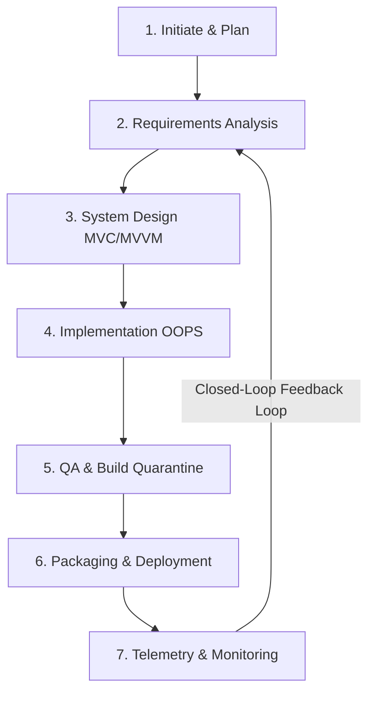

# 🌐 Coordinate Tree (ROOT ⊃ BR ⊃ EL ⊃ FE ⊃ BE ⊃ DB) Master Architecture & REA Specification
## jFindMe / jButterFly Enterprise Ecosystem & Subsystems
> **Confidential & Proprietary — Antigravity AI Enterprise Development Standard**  
> **Codename:** `jDroid-X` | **Operator:** `JEET` | **Version:** 5.0.0 (Enterprise Gold Master)  
> **Target Subsystem:** Android (`jButterFly`) & Web Mission Control (`jFindMeWeb`)  
> **Methodology:** Dynamic OOPS-based MVC/MVVM Closed-Loop Waterfall Sequence  

---

## 📑 Master Table of Contents
1. **[Coordinate ROOT] System Architecture & Multi-Repository REA Topology**
   - 1.1 Enterprise System Landscape & High-Level Context
   - 1.2 Multi-Repository & Directory Topology
   - 1.3 Folder-by-Folder REA (Reverse Engineering Analysis) for Every Subdirectory
2. **[Coordinate BR] Business Rules & Domain Layer (Functional & Technical)**
   - 2.1 22 Enterprise AI Agents across 5 Workforce Domains
   - 2.2 Master 7-Stage Closed-Loop Waterfall Sequence & Adaptive 3-Lane Matrix
   - 2.3 Physical Silicon Root Key & Immutable Hardware SSOT
   - 2.4 Centralized RAG Status Engine & Telemetry Rules
   - 2.5 GIS, Spatial & Geofencing Business Logic (Polygons, Ray-Casting, Kalman)
   - 2.6 Multi-Tier Circle & Symmetrical Pairing Protocols
   - 2.7 5-Tier Telemetry Failover Router & Closed-Loop Sentinel Circuit Breaker
3. **[Coordinate EL] Element Layer & UI Design System**
   - 3.1 UiArchitect L7 Architecture & Design Stages
   - 3.2 5-Stage Universal Sizing Matrix & Viewport Scaling
   - 3.3 Geometric Tokens, Shadows, Elevation & Radii
   - 3.4 10 Atomic UI Component Tables
   - 3.5 ThemeManager & Dynamic Color Palettes
   - 3.6 Slide-Out Right Drawer Mandate (2-Column Smart-Fit)
   - 3.7 Custom Visual Components & Visualizers
4. **[Coordinate FE] Frontend Presentation Layer (Functional & Technical)**
   - 4.1 OOPS-based MVC / MVVM Architecture & Lifecycle Resilience
   - 4.2 Comprehensive 32-Screen Inventory across 6 Functional Clusters
   - 4.3 Deep Functional & Technical Specifications for Every Screen
   - 4.4 XML Layout Hierarchy & Gravity Models
5. **[Coordinate BE] Backend Logic & Operating Engine Layer**
   - 5.1 Operating Engine Hierarchy & EngineRegistry
   - 5.2 Foreground Services (`TrackingService`, `SIMTrackingService`, `FCMService`)
   - 5.3 4-Tier Chronological Background Job Waterfall (13 Engine Workers)
   - 5.4 14-Condition SimTransportValidator & Baseband Forensic Audit
   - 5.5 Broadcast Receivers & Interceptors
   - 5.6 Embedded Python Micro-Engine (`data_processor.py`)
6. **[Coordinate DB] Dual-Engine Database Architecture (SQLite & Firebase)**
   - 6.1 Dual-Engine Closed-Loop Architecture Overview
   - 6.2 17 Normalized SQLite Tables (Schemas, Keys, Indexes & VACUUM)
   - 6.3 Firebase Realtime Database Cloud SSOT Schema & Security Rules
   - 6.4 Atomic 1-Click Synchronization Protocol & Conflict Resolution

---

# 1. 🌐 Coordinate ROOT: System Architecture & Multi-Repository REA Topology

### 1.1 Enterprise System Landscape & High-Level Context
The `jFindMe` platform is a mission-critical, enterprise-grade spatial intelligence, real-time telemetry, SafeZone geofencing, and forensic device synchronization ecosystem. It provides continuous tracking, emergency SOS acoustic dispatch, baseband tower triangulation, and dual-SIM audit trails.

The overall ecosystem is structured as a dual-engine architecture:
- **Edge Native Client (`jButterFly`)**: Native Android client (Java/Kotlin) engineered with zero unmanaged external dependencies, optimized for battery longevity, resistant to aggressive OS background process termination (Doze mode, App Standby Buckets), and backed by a local SQLite ledger (17 normalized tables).
- **Web Mission Control (`jFindMeWeb`)**: High-performance tactical tracking console (HTML5/ES6/Node.js) featuring Leaflet/Google Maps radar view, 178-parameter dual-engine synchronization matrix, and real-time Server-Sent Events (SSE) telemetry bridging.
- **Continuous Deployment & Release Bridge (`apk/sync_service.py`, `tools/`)**: Automated release daemon managing version code increments, binary SHA-256 integrity verification, and binary delta patching (`jdelta_generator.py`).

```
┌────────────────────────────────────────────────────────────────────────────────────────────────┐
│                             ROOT ⊃ BR ⊃ EL ⊃ FE ⊃ BE ⊃ DB COORDINATE TREE                       │
└────────────────────────────────────────────────────────────────────────────────────────────────┘
                                                │
                 ┌──────────────────────────────┼──────────────────────────────┐
                 ▼                              ▼                              ▼
        [ Coordinate BR ]              [ Coordinate EL ]              [ Coordinate FE ]
      Business Rules & Domain         Element Design System        Frontend Presentation
      ├── 22 Enterprise Agents        ├── UiArchitect (5 Stages)   ├── 32 Screens (6 Clusters)
      ├── Silicon Hardware SSOT       ├── 10 Component Tables      ├── MVVM / MVC Separation
      ├── Centralized RAG Status      ├── ThemeManager (Palettes)  ├── BaseActivity / ViewModels
      └── 5-Tier Failover Mesh        └── Slide-Out Right Drawer   └── Responsive Layouts
                 │                              │                              │
                 └──────────────────────────────┼──────────────────────────────┘
                                                │
                 ┌──────────────────────────────┴──────────────────────────────┐
                 ▼                                                             ▼
        [ Coordinate BE ]                                             [ Coordinate DB ]
      Backend & Operating Engines                                   Dual-Engine Storage
      ├── TrackingService (Foreground)                              ├── SQLite (17 Tables)
      ├── 4-Tier Background Job Waterfall (13 Jobs)                 ├── Firebase RTDB Cloud SSOT
      ├── 14-Condition SimTransportValidator                        ├── 1-Click Bi-directional Sync
      └── Broadcast Receivers & Python Engine                       └── Closed-Loop Latency Sentinel
```

---

### 1.2 Multi-Repository & Directory Topology

The project root `c:\Users\jiten\jAnitGravity\jFindMe` contains the following major directories:

```
c:\Users\jiten\jAnitGravity\jFindMe\
├── .agent/                      <-- Enterprise Agent Registry & Protocol Mapping
│   ├── enterprise-22-agents/    <-- Program Mapping v5.0 master relationship tables
│   └── .agents/rules/           <-- rules4agents.md & taskforce behavioral guidelines
├── apk/                         <-- Production APK output & sync_service.py release daemon
├── app/                         <-- Historical module wrapper (redirects to jButterFly)
├── docs/                        <-- Enterprise documentation suite
│   ├── design/                  <-- High-level designs, screen settings, telemetry rulebooks
│   ├── history/                 <-- Audit reports, threading validation, RAG reports
│   ├── planning/                <-- Requirements specifications and roadmaps
│   └── reference/               <-- Architecture guides and UI blueprints
├── firebase/                    <-- Cloud security rules & schema configurations
├── jButterFly/                  <-- Core Android production native application
│   ├── build/                   <-- Build caches, generated sources, and crashlytics maps
│   ├── release/                 <-- Release keystore and signed APK outputs
│   └── src/main/                <-- Production application sources (Java, Kotlin, Python, XML)
├── jFindMeWeb/                  <-- Web Mission Control, tactical radar, sync console
│   ├── assets/                  <-- Avatars, SVG icons, audio sound effects
│   ├── css/                     <-- Responsive modular stylesheets & UI themes
│   ├── js/                      <-- ES6 MVC Controllers, Models, Views, Services & Express server
│   ├── scripts/                 <-- Verification, audit, and protocol deployment scripts
│   └── secrets/                 <-- Service account JSON keys & Google Services configs
├── legacy/                      <-- Quarantined historical code under Chesterton's Fence
│   ├── archived_scratch/        <-- Quarantined test builds, scratch DBs, and avatar dumps
│   ├── archived_tools/          <-- Archived Android shells, diagnostic scripts, Unity scripts
│   └── jButterFly/              <-- Frozen baseline Android source tree
├── logs/                        <-- Crash buffer dumps, compile checks, and runtime traces
├── scratch/                     <-- Scratch scripts, test assets, temporary working files
└── tools/                       <-- Binary diff utilities (jdelta_generator.py)
```

---

### 1.3 Deep Folder-by-Folder REA (Reverse Engineering Analysis)

Below is the reverse engineering analysis of every single directory in `jButterFly` and associated subsystems:

#### A. `jButterFly/src/main/java/com/jdroidx/jfindme/`
- **Root Package (`com.jdroidx.jfindme`)**:
  - `JFindMeApplication.java`: Application entrypoint. Implements:
    1. Conscrypt / `FinalizerDaemon` SSL Socket NPE crash shield (prevents unhandled JVM crashes during GC of aborted TLS connections).
    2. Firebase offline disk persistence enablement (`setPersistenceEnabled(true)`).
    3. `SystemLogger` initialization.
    4. Synchronous Notification Channel creation (`tracking_channel` [LOW importance] and `jfindme_alerts` [HIGH importance]).
    5. Automatic foreground tracking service boot triggered upon verified permissions.

#### B. `jButterFly/src/main/java/com/jdroidx/jfindme/data/`
- **`data/local/`**:
  - `DatabaseHelper.kt`: The SQLite OpenHelper engine (`JFindMe_CitizenData.db`, Schema Version 75). Contains 3,300+ lines governing 17 normalized tables, automatic schema migration pipelines, atomic batch transactions, rolling storage hygiene, and VACUUM routines.
- **`data/local/tables/`**:
  - 17 dedicated Kotlin table specification classes: `UserIdentityTable`, `UserProfileTable`, `DeviceTable`, `DevicePairingTable`, `DeviceVitalsTable`, `LocationEventTable`, `GeofenceEventTable`, `SafeZoneTable`, `SafeZoneUserMapTable`, `GroupTable`, `GroupMemberTable`, `OrganizationTable`, `UserOrgMapTable`, `SimTable`, `SyncQueueTable`, `PendingSyncQueueTable`, `ChangeLogTable`.
- **`data/model/`**:
  - Domain entity models: `DeviceRegistry.kt` (hardware descriptors), `LiveDeviceModel.kt` (runtime telemetry entity), `PairingSession.kt` (6-character symmetric exchange protocol), `SafeZoneModel.kt` (spatial boundary definitions with Ray-Casting vertex arrays), `UserLocation.kt` (WGS-84 coordinate tuples, velocity, accuracy, battery, and heading).
- **`data/remote/`**:
  - `FirebaseComm.kt`: Direct network interface to Firebase Realtime Database. Manages query pagination, real-time value event listeners, offline queue draining, and atomic batch mutations under `/devices/` and `/locations/`.
  - `OfflineSyncManager.kt`: Persistent offline retry queue manager. Caches unsynced telemetry and profile changes in SQLite during cellular/Wi-Fi blackouts, executing serialized flushes upon network reconnection.
- **`data/repository/`**:
  - `LocationRepository.kt`: Mediates location reads/writes between `LocationEngine`, SQLite history tables, and remote Firebase streams.
  - `PairingRepository.kt`: Coordinates the 6-character PIN exchange, NFC/QR pairing payloads, and peer-to-peer verification handshakes.

#### C. `jButterFly/src/main/java/com/jdroidx/jfindme/engine/`
- **`engine/alert/`**:
  - `AcousticBeaconEngine.kt`: Generates audible emergency beacon patterns overriding Android Do-Not-Disturb (DND) modes at maximum audio stream volume.
  - `AlertManager.kt`: Orchestrates emergency state transitions, SOS triggers, and high-priority dispatch notifications.
  - `ForensicAlertDispatcher.kt`: Dispatches forensic payloads (cell tower LAC/CID, battery state, GPS accuracy) during SOS triggers.
- **`engine/avatar/`**:
  - `AvatarSmartEngine.kt`: Manages avatar state, SVG/PNG rasterization, and circular silhouette masking.
- **`engine/bridge/`**:
  - `UnityFirebaseBridge.kt`: Legacy IPC bridge interfacing Unity 3D runtime models with Firebase telemetry streams.
- **`engine/data/`**:
  - `SpatialProcessor.kt`: High-performance geospatial filter calculating distance deltas and speed thresholds.
  - `avatar/`: Accessibility and metadata entities (`AvatarEntity.kt`, `AvatarRegistry.kt`, `AvatarAccessibilityHelper.kt`).
  - `profile/`: User profile encapsulation (`UserProfile.kt`).
- **`engine/group/`**:
  - `GroupSessionEngine.kt`: Manages multi-device family circle sessions, role assignments (Admin, Member, Child, Ward), and session expiry.
- **`engine/location/`**:
  - `LocationEngine.kt`: Native GPS/FusedLocationProvider interface. Dispatches raw WGS-84 location updates.
  - `GisSpatialEngine.kt`: Geospatial math engine executing Haversine distance, bearing calculations, and polygon containment.
  - `GeofenceHelper.kt`: Native Android Geofencing API wrapper managing hardware geofence perimeters.
  - `GeohashHelper.kt`: Encodes latitude/longitude into base32 Geohash strings for geospatial indexing.
  - `CellTowerSentinel.kt`: Extracts cellular baseband metadata (MCC, MNC, LAC, CID, RSSI) via `TelephonyManager`.
  - `ActivityRecognitionEngine.kt`: Detects motion states (STILL, WALKING, RUNNING, IN_VEHICLE, ON_BICYCLE) to tune telemetry frequency.
- **`engine/map/`**:
  - `MapEngine.kt`: Map lifecycle manager controlling camera animations, tile providers, and vector overlays.
  - `MultiMarkerEngine.kt`: High-efficiency multi-device marker rendering engine on Google Maps SDK.
  - `MarkerClusterer.kt`: Clusters dense groups of nearby nodes into single aggregate markers.
  - `RoadSmoothingEngine.kt`: 2D Kalman filter smoothing jerky GPS breadcrumbs along road vectors.
  - `HeatmapEngine.kt`: Renders historical location density heatmaps.
- **`engine/security/`**:
  - `HardwareIdentitySentinel.kt`: Silicon Root Key extractor. Reads `ro.ril.oem.sno`, `ro.boot.serialno`, and manages `.silicon_anchor`.
  - `SecurityEngine.kt`: Cryptographic hashing (SHA-256), PIN verification, and encrypted preference storage.
  - `PrivacyEngine.kt`: Manages Ghost Mode (telemetry masking) and granular access control lists (ACLs).
  - `AntiTamperSentinel.kt`: Detects rooting, mock location providers, and emulator runtime environments.
  - `SimTransportValidator.kt`: Evaluates 14 distinct cellular and network conditions preventing silent data stalls.
- **`engine/sync/`**:
  - `TelemetryClosedLoopSentinel.kt`: Verifies bidirectional cloud delivery, calculates Round-Trip Time (RTT), and activates circuit breakers if RTT > 5s.
  - `TelemetryFailoverRouter.kt`: 5-tier failover switch (Cellular -> Wi-Fi -> FCM Push -> SMS -> Local SQLite Queue).
  - `MasterDataSyncSentinel.kt`: Enforces atomic parity between local SQLite tables and Firebase RTDB.
  - `DevicePairingEngine.kt`: Manages mutual cryptographic trust between paired nodes.

#### D. `jButterFly/src/main/java/com/jdroidx/jfindme/receiver/`
- `AppUpgradeReceiver.kt`: Intercepts `MY_PACKAGE_REPLACED`. Automatically triggers post-update database migration and restarts foreground tracking services without user interaction.
- `GeofenceBroadcastReceiver.kt`: Intercepts hardware geofence transitions (`GEOFENCE_TRANSITION_ENTER`, `EXIT`, `DWELL`) from Google Play Services, logging transitions to SQLite `geofence_events` and notifying the user.
- `LocationReceiver.kt`: Passive location update interceptor for pending background location intents.
- `PackageInstallStatusReceiver.kt`: Monitors silent APK update installation status from Android `PackageInstaller`.
- `SecurityReceiver.kt`: Intercepts system power disconnects, low battery, and airplane mode events, recording tamper logs.
- `WatchdogAlarmReceiver.kt`: Infallible `AlarmManager` wake-up receiver that revives `TrackingService` if killed by aggressive OS task killers.

#### E. `jButterFly/src/main/java/com/jdroidx/jfindme/service/`
- `TrackingService.kt`: Core Android Foreground Service (`FOREGROUND_SERVICE_TYPE_LOCATION`). Maintains continuous GPS acquisition, applies Kalman filtering, updates the foreground notification, and streams telemetry.
- `SIMTrackingService.kt`: Background service monitoring SIM card changes and baseband cellular tower transitions.
- `SimForensicWorker.kt`: Periodic forensic worker capturing cellular tower LAC/CID and logging to `sim_transactions`.
- `FCMService.kt`: Firebase Cloud Messaging listener handling high-priority remote push pings, emergency alerts, and silent sync triggers.
- `BackgroundJobManager.kt`: Centralized coordinator managing all 13 background workers, periodic work requests, and manual force-run triggers.

#### F. `jButterFly/src/main/java/com/jdroidx/jfindme/ui/`
- `ui/base/`: Contains `UiArchitect.java` (design system engine), `ThemeManager.java` (theme color palettes), `BaseActivity.kt`, `BaseActivityJava.java`, `BaseViewModel.kt`, `AngelLoad.java`, `MarqueeTextView.kt`, and the 10 atomic UI specification tables (`ActionButtonTable`, `BottomNavTable`, etc.).
- `ui/auth/`: `AuthActivity.java` and `AuthViewModel.kt` (identity enrollment, login, biometric verification).
- `ui/alert/`: `AcousticSirenActivity.java` (fullscreen SOS siren, torch strobe, DND bypass) and `EmergencyAlertHelper.java`.
- `ui/group/`: `NetworkGatewayActivity.java`, `FamilyFriendsActivity.java`, `GroupActivity.java`, `PersonDetailsActivity.java` (device pairing, circle management, ACL permissions).
- `ui/management/`: Database, geofencing, history, and forensic inspection consoles (`DatabaseManagementActivity`, `FactoryResetActivity`, `FirebaseCloudMatrixActivity`, `ForensicVaultExplorerActivity`, `GeofenceActivity`, `GeofenceNotificationActivity`, `HealthActivity`, `HistoryActivity`, `NotifActivity`, `PrivacyActivity`, `SystemLogActivity`, `WatchDogAuditActivity`).
- `ui/map/`: `MapActivity.java` (primary live map HUD), `MapActivity2.java` (secondary map viewport), `LiveMapDashboardActivity.java` (tactical split dashboard).
- `ui/settings/`: Master configuration interfaces (`SettingsActivity.java`, `BackgroundJobsConfigDialog.java`, `UiConfigActivity.java`, `UiGalleryActivity.java`, `ProfileActivity.java`, `AvatarEditorActivity.java`, `AvatarCropActivity.java`, `OrgActivity.java`, `SystemUpdateActivity.java`, `AboutActivity.java`, `HelpSupportActivity.java`).

#### G. `jButterFly/src/main/assets/`
- `help_database.json`: Structured knowledge base providing offline FAQs and troubleshooting guides.
- `device_features/`: Canonical hardware capability profiles.
- `models/`: Embedded 3D avatar meshes and geometry descriptors.
- `web/`: Offline HTML/JS diagnostic dashboards.

#### H. `jButterFly/src/main/python/`
- `data_processor.py`: Embedded Python micro-engine (invoked via Chaquopy) for advanced spatial analytics, complex polygon intersection checks, ChaCha20/Poly1305 forensic payload processing, and offline telemetry anomaly scoring.

#### I. `jButterFly/src/main/res/`
- `anim/`: UI transitions (slide-in, slide-out, pulse, fadeIn, fadeOut).
- `drawable/`: Vector drawables, custom state-list selectors, rounded gradient card backgrounds, map pins.
- `layout/`: Android XML layouts adhering to the responsive linear/frame gravity model.
- `values/`: Colors, strings, themes, styles, dimensions.
- `values-night/`: Dark mode theme overrides.
- `xml/`: Security configurations (`network_security_config.xml`), backup rules, and data extraction rules.

---

# 2. 📋 Coordinate BR: Business Rules & Domain Layer (Functional & Technical)

### 2.1 22 Enterprise AI Agents across 5 Workforce Domains
The project architecture strictly follows the **Antigravity Enterprise AI Agent Protocol (V3.0)**, mapping all features to 22 specialized agents across 5 Workforce Domains:

```
┌─────────────────────────────────────────────────────────────────────────────────────────────────┐
│                      WORKFORCE DOMAINS & 22 ENTERPRISE AI AGENTS SPECIFICATION                  │
├────────────────────────────────┬────────────────────────────────────────────────────────────────┤
│ Workforce Domain               │ Specialized AI Agents                                          │
├────────────────────────────────┼────────────────────────────────────────────────────────────────┤
│ 1. Orchestrator & Governance   │ Agent 1: Product Architect & Hardware Identity Sentinel        │
│                                │ Agent 8: Enterprise Security, Governance & Regulatory Sentinel │
│                                │ Agent 13: Technical Program & Roadmap Orchestrator            │
│                                │ Agent 21: Executive Strategy & Compliance Officer              │
├────────────────────────────────┼────────────────────────────────────────────────────────────────┤
│ 2. Technology & Architecture   │ Agent 2: Dual-Engine Database & Backend Logic Architect       │
│                                │ Agent 6: GIS, Spatial & Geofencing Architect                  │
│                                │ Agent 9: Network Mesh, P2P & Transport Protocol Specialist     │
│                                │ Agent 14: System Performance & Low-Power Hardware Architect    │
│                                │ Agent 22: Cloud Infrastructure & Scalability Engineer          │
├────────────────────────────────┼────────────────────────────────────────────────────────────────┤
│ 3. AI Engineering & Frontend   │ Agent 3: Frontend UI/UX & Lightweight Viewport Architect      │
│                                │ Agent 10: 3D Graphics, Avatar & Spatial Modeling Engineer     │
│                                │ Agent 15: Edge Machine Learning & Spatial Inference Engineer   │
│                                │ Agent 19: Design System & Micro-Interaction Specialist         │
├────────────────────────────────┼────────────────────────────────────────────────────────────────┤
│ 4. Quality & Reliability Ops   │ Agent 4: Integration, QA & Build Quarantine Agent              │
│                                │ Agent 5: Crash & Silent Failure Hunter (Diagnostic Sentinel)   │
│                                │ Agent 11: Security Penetration & Vulnerability Auditor         │
│                                │ Agent 16: Telemetry Reliability & Chaos Engineering Sentinel   │
│                                │ Agent 20: Disaster Recovery & Data Preservation Sentinel       │
├────────────────────────────────┼────────────────────────────────────────────────────────────────┤
│ 5. Operations & Performance    │ Agent 7: Performance & Battery Optimization Agent             │
│                                │ Agent 12: Continuous Release, Silent Updates & Version Manager │
│                                │ Agent 17: Observability, Runtime Logging & Telemetry Sentinel │
│                                │ Agent 18: Dual-Engine Data Synchronization Controller          │
└────────────────────────────────┴────────────────────────────────────────────────────────────────┘
```

---

### 2.2 Master 7-Stage Closed-Loop Waterfall Sequence & Adaptive 3-Lane Matrix

Development follows a strict closed-loop sequence to prevent regressions:


**Adaptive 3-Lane Matrix**:
1. **Lane 1 (Hotfix / Patch)**: Focuses on isolated crash fixes, memory leaks, or NPE shields. Skips architectural redesign; requires fast verification and regression validation.
2. **Lane 2 (Feature Addition)**: Full MVC/MVVM pipeline for new screens, components, or background workers. Requires UI tokens, ViewModel state, and database migration.
3. **Lane 3 (Enterprise Modernization)**: Multi-repo architectural refactoring, dual-engine sync overhauls, schema bumps, and security hardening.

---

### 2.3 Physical Silicon Root Key & Immutable Hardware SSOT
- **Mandate**: Software-generated UUIDs or unverified temporary Firebase tokens **must never** replace physical hardware identity.
- **Hardware Anchor Resolution Sequence**:
  1. Primary: Extract `ro.ril.oem.sno` from Android system properties.
  2. Secondary: Extract `ro.boot.serialno`.
  3. Tertiary: Fallback to persistent external hardware anchor `.silicon_anchor` stored in protected storage.
  4. Quaternary: User-defined 8-character canonical hardware Agent ID (e.g., `BE5A234A`, `2T929153`).
- **Zero Hardcoding**: All device references are dynamically resolved via `DeviceIdentityHelper.kt` and `RegistryManager.kt`.

---

### 2.4 Centralized RAG (Red-Amber-Green) Status Engine
Every node in the network is evaluated against a deterministic RAG state machine:

| RAG Status | Condition Criteria | UI Token & Color Hex | Operational Behavior |
|---|---|---|---|
| 🟢 **ACTIVE (LIVE)** | Last location/heartbeat `< 15 minutes` ago | `#22C55E` (Emerald Green) | Normal full-frequency telemetry tracking. |
| 🟡 **INACTIVE (< 6H)** | Last seen `15m – 6 hours` OR Battery `≤ 20%` | `#F59E0B` (Amber Orange) | Throttled polling; warning badges displayed. |
| 🔴 **INACTIVE (> 6H)** | Last seen `> 6 hours` ago | `#EF4444` (Rose Red) | Node flagged stale; offline cache active. |
| 🚨 **EMERGENCY SOS** | `isSos == true` | `#EF4444` (Pulsing Crimson) | Max frequency telemetry (3s); acoustic siren. |
| ⚪ **GHOST / UNLINKED** | Ghost Mode active or unlinked | `#64748B` (Slate Gray) | Location masked to fuzzy city center or withheld. |

---

### 2.5 GIS, Spatial & Geofencing Business Logic
- **Boundary Detection**: Uses the Ray-Casting Algorithm for arbitrary polygonal SafeZones and the Haversine formula for circular perimeters.
- **Kalman Filtering**: 2D Kalman filter smoothes raw GPS jitter, filtering out multi-path reflections and erratic velocity spikes.
- **Hysteresis & Debounce**: SafeZone entry/exit events require 2 consecutive location confirmations across 15 seconds to prevent perimeter bouncing.

---

### 2.6 Multi-Tier Circle & Symmetrical Pairing Protocols
- **Symmetrical 2x2 Matrix**: Pairing establishes mutual cryptographic trust between Node A and Node B. Both nodes write reciprocal pairing records to `device_pairings` and Firebase `/devices/{id}/paired_with/`.
- **6-Character Ephemeral PIN**: Cloud pairing generates a time-bounded (5 minutes) alphanumeric PIN.
- **P2P Fallback**: Bluetooth Low Energy (BLE) and Wi-Fi Direct Nearby Connections enable pairing during total cellular outages.

---

### 2.7 5-Tier Telemetry Failover Router & Closed-Loop Sentinel
- **Tier 1 (Cellular High-Speed Data)**: Standard HTTPS/WSS Firebase telemetry streams.
- **Tier 2 (Wi-Fi Network)**: Automatic transition to active Wi-Fi interface if cellular data is unavailable.
- **Tier 3 (High-Priority FCM Push)**: Cloud-to-device wakeup ping over Google Play Services push channel.
- **Tier 4 (Emergency Encrypted SMS)**: Encrypted baseband SMS payload dispatched directly to designated guardian phones during critical SOS events when IP data fails.
- **Tier 5 (Offline SQLite Queue)**: Encrypted local caching in `pending_sync_queue` table until data transport resumes.
- **Closed-Loop Sentinel**: Monitors Round-Trip Time (RTT). If RTT > 5 seconds for 3 consecutive telemetry packets, a circuit breaker trips, routing telemetry to the failover channel.

---

# 3. 🎨 Coordinate EL: Element Layer & UI Design System

### 3.1 UiArchitect L7 Architecture & Design Stages
`UiArchitect.java` governs the enterprise UI design system. It implements 5 deterministic Design Stages:
1. `LIBERAL`: Generous padding (24dp), large touch targets (56dp), large headers (20sp).
2. `STANDARD`: Balanced standard metrics (16dp padding, 48dp controls, 18sp headers).
3. `COMPACT` (**Default Global Standard**): Smart-fit density (10dp padding, 40dp controls, 15sp headers).
4. `SLIM`: High-density mobile viewport (8dp padding, 36dp controls, 14sp headers).
5. `ULTRA_SLIM`: Maximum data density for small screen diagnostics (4dp padding, 30dp controls, 12sp headers).

---

### 3.2 5-Stage Universal Sizing Matrix & Viewport Scaling
`UiScalingMatrixTable.java` provides mathematical scaling transformations:
```
Text Scaling Formula: Scaled_SP = Base_SP * Stage_Multiplier * Viewport_Factor
```
- Multipliers: `LIBERAL: 1.15x`, `STANDARD: 1.00x`, `COMPACT: 0.90x`, `SLIM: 0.82x`, `ULTRA_SLIM: 0.75x`.

---

### 3.3 Geometric Tokens, Shadows, Elevation & Radii
`SystemGeometryTable.java` standardizes geometric corner radii and elevation:
- Corner Radii:
  - `RADIUS_SMALL`: 6dp (Badges, Pills, Buttons)
  - `RADIUS_MEDIUM`: 10dp (Cards, Input Fields, Dialogs)
  - `RADIUS_LARGE`: 16dp (Bottom Sheets, Modal Drawers)
  - `RADIUS_FULL`: 999dp (Circular Avatars, Status Dots)
- Shadows & Elevation:
  - Layer 1 (Flat): 0dp elevation, 1dp subtle stroke border (`#E2E8F0` / `#334155`).
  - Layer 2 (Floating Card): 3dp elevation with neutral shadow.
  - Layer 3 (Dialog & Drawer): 8dp elevation with ambient occlusion.

---

### 3.4 10 Atomic UI Component Tables
The UI layer is modularized into 10 atomic component specification tables:

| # | Component Table | Responsibilities & Implementations |
|---|---|---|
| 1 | `ActionButtonTable.java` | Primary, Secondary, Destructive, Outlined, and Icon Buttons with auto-states (Normal, Pressed, Disabled). |
| 2 | `BottomNavTable.java` | Responsive 4-tab / 5-tab persistent bottom navigation bar with active state glow. |
| 3 | `DashboardTileTable.java` | Metric tiles with top icon, large KPI value, trend arrow, and subtitle. |
| 4 | `EnterpriseCardTable.java` | Standard container cards with rounded corners, padding presets, and border strokes. |
| 5 | `FormInputTable.java` | Validated textboxes, floating labels, password toggles, clear buttons, and error highlights. |
| 6 | `HeaderTable.java` | Application headers with back navigation arrow, screen title, subtitle, and action buttons. |
| 7 | `IconTable.java` | Dynamic SVG vector icon resolver with contextual tinting based on active theme. |
| 8 | `ListItemTable.java` | 2-line and 3-line list items with leading avatar/icon and trailing chevron or switch. |
| 9 | `MarqueeTable.java` | Scrolling single-line announcement tickers for system warnings and broadcast alerts. |
| 10 | `StatusPillTable.java` | Compact status badges rendering RAG colors (Active, Inactive, SOS, Ghost). |

---

### 3.5 ThemeManager & Dynamic Color Palettes
`ThemeManager.java` manages dynamic switching across 8 enterprise color themes:
1. `CLASSIC_NAVY`: Corporate deep slate and royal blue.
2. `EMERALD_NIGHT`: Dark mode forest green and cyan accents.
3. `CRIMSON_SHIELD`: High-contrast security theme with amber and red warnings.
4. `ROYAL_PURPLE`: Modern violet and lavender palette.
5. `VIBGYOR_SPECTRUM`: Dynamic rainbow accent system.
6. `HIGH_CONTRAST_DARK`: Pure black (`#000000`) AMOLED power-saving theme.
7. `SOLAR_LIGHT`: Clean white and silver high-visibility daylight theme.
8. `ANGEL_CYBER`: Futuristic neon teal and electric indigo.

---

### 3.6 Slide-Out Right Drawer Mandate (2-Column Smart-Fit)
When edit forms, detailed telemetry, or action menus are summoned:
- The dialog slides in smoothly from the **right viewport edge** (`anim/slide_in_right.xml`).
- Structure: **2-column compact smart-fit grid** maximizing vertical space.
- Height: Exact 100% viewport fit with smooth vertical momentum scrolling (`ScrollView`).
- Header: Sticky top title bar with dismiss close icon.
- Footer: Sticky bottom action bar with Primary Save and Secondary Cancel buttons.

---

### 3.7 Custom Visual Components
- `MarqueeTextView.kt`: Hardware-accelerated continuous horizontal text ticker.
- `AngelLoad.java`: Lightweight spinning vector progress indicator.
- `AvatarCalloutGenerator.kt`: Generates Google Maps bitmap markers combining direct circular avatar, role color border, and live RAG status pill.
- `RoadSmoothingEngine.kt`: Spline interpolation for historical path replay.

---

# 4. 📱 Coordinate FE: Frontend Presentation Layer (Functional & Technical)

### 4.1 OOPS-based MVC / MVVM Architecture & Lifecycle Resilience
All screens adhere strictly to the following division:
- **View (`Activity` / `Fragment`)**: Handles layout inflation, user touch events, and UI animations. Extends `BaseActivity.kt` or `BaseActivityJava.java`.
- **ViewModel (`BaseViewModel.kt`)**: Maintains observable UI state via Kotlin Coroutines and `StateFlow` / `LiveData`. Survives orientation changes.
- **Controller / Singletons**: `RegistryManager`, `DatabaseHelper`, `BackgroundJobManager`.

---

### 4.2 Comprehensive 32-Screen Inventory across 6 Functional Clusters

```
┌─────────────────────────────────────────────────────────────────────────────────────────────────┐
│                           32 ENTERPRISE SCREENS & OPERATIONAL CLUSTERS                          │
├───────────────────────────────────┬─────────────────────────────────────────────────────────────┤
│ Cluster                           │ Screens / Activities                                        │
├───────────────────────────────────┼─────────────────────────────────────────────────────────────┤
│ Cluster 1: Settings Core          │ 1. SettingsActivity.java                                    │
│                                   │ 2. BackgroundJobsConfigDialog.java                          │
├───────────────────────────────────┼─────────────────────────────────────────────────────────────┤
│ Cluster 2: Theme & Aesthetics     │ 3. UiConfigActivity.java                                    │
│                                   │ 4. UiGalleryActivity.java                                   │
├───────────────────────────────────┼─────────────────────────────────────────────────────────────┤
│ Cluster 3: Identity & Profile     │ 5. ProfileActivity.java                                     │
│                                   │ 6. AvatarEditorActivity.java                                │
│                                   │ 7. AvatarCropActivity.java                                  │
│                                   │ 8. OrgActivity.java                                         │
├───────────────────────────────────┼─────────────────────────────────────────────────────────────┤
│ Cluster 4: Maintenance & Support  │ 9. SystemUpdateActivity.java                                │
│                                   │ 10. AboutActivity.java                                      │
│                                   │ 11. HelpSupportActivity.java                                │
├───────────────────────────────────┼─────────────────────────────────────────────────────────────┤
│ Cluster 5: Forensic & Diagnostics │ 12. PrivacyActivity.java                                    │
│                                   │ 13. HealthActivity.java                                     │
│                                   │ 14. FactoryResetActivity.java                               │
│                                   │ 15. NotifActivity.java                                      │
│                                   │ 16. ForensicVaultExplorerActivity.java                      │
│                                   │ 17. WatchDogAuditActivity.kt                                │
│                                   │ 18. DatabaseManagementActivity.java                         │
│                                   │ 19. FirebaseCloudMatrixActivity.java                        │
│                                   │ 20. SystemLogActivity.java                                  │
├───────────────────────────────────┼─────────────────────────────────────────────────────────────┤
│ Cluster 6: Tactical Map & Ops     │ 21. MapActivity.java                                        │
│                                   │ 22. MapActivity2.java                                       │
│                                   │ 23. LiveMapDashboardActivity.java                           │
│                                   │ 24. NetworkGatewayActivity.java                             │
│                                   │ 25. FamilyFriendsActivity.java                              │
│                                   │ 26. GroupActivity.java                                      │
│                                   │ 27. PersonDetailsActivity.java                              │
│                                   │ 28. GeofenceActivity.java                                   │
│                                   │ 29. GeofenceNotificationActivity.java                       │
│                                   │ 30. HistoryActivity.java                                    │
│                                   │ 31. AuthActivity.java                                       │
│                                   │ 32. AcousticSirenActivity.java                              │
└───────────────────────────────────┴─────────────────────────────────────────────────────────────┘
```

---

### 4.3 Deep Functional & Technical Specifications for Every Screen

#### 1. `SettingsActivity.java` (Cluster 1: Settings Core)
- **Functional Purpose**: Master control console for the application. Divided into Dual-Tab view: Tab 1 (Universal System Settings) and Tab 2 (Operational Modules).
- **Technical Architecture**: MVVM architecture. Integrates `RegistryManager` for typed preference storage, validating all entries before writing to `system_registry`.
- **Configurable Parameters**:
  - Priority 1: Hardware Identity Sentinel (`agent_id`, `ro.ril.oem.sno`).
  - Priority 2: User Profile & Nickname (`user_nickname`, `user_gender`).
  - Priority 3: UI Design Stage Override (`stage_override` [0..4]).
  - Priority 4: Dynamic Theme Selection (`theme_id` [0..7]).
  - Priority 5: Telemetry Tracking Frequency (`pref_tracking_interval` [5s..300s]).
  - Priority 6: Offline Sync Batch Cadence (`pref_offline_sync_interval_mins` [1m..60m]).
  - Priority 7C: Closed-Loop ACK Timeout (`pref_ack_timeout_sec`), Circuit Breaker Failure Threshold, SOS SMS Emergency Phone.
  - Priority 8: Geofencing Sensitivity Radius (`pref_geofence_radius` [50m..5000m]).
- **Integration Points**: Broadcasts `ACTION_SETTINGS_CHANGED` to notify `TrackingService` and `MapActivity` without requiring process restart.

#### 2. `BackgroundJobsConfigDialog.java` (Cluster 1: Settings Core)
- **Functional Purpose**: Interactive management console for all 13 background workers, sentinels, and telemetry timers.
- **Technical Architecture**: Modal dialog loaded over `SettingsActivity`. Queries `BackgroundJobManager` for live worker execution status.
- **Features**:
  - Live on/off toggles for each worker.
  - "⚡ RUN NOW" force-execution button triggering immediate `OneTimeWorkRequest`.
  - Cadence dropdowns with battery impact warnings (High Draw, Balanced, Ultra-Low Power).
  - Telemetry badges displaying "Last Executed" timestamps and execution durations.

#### 3. `UiConfigActivity.java` (Cluster 2: Theme & Aesthetics)
- **Functional Purpose**: Visual style configuration studio for real-time preview and tuning of the `UiArchitect` engine.
- **Technical Architecture**: MVC pattern. Interacts with `ThemeManager` and `UiScalingMatrixTable`.
- **Configurable Parameters**: Primary accent tint, corner radius factor, typography scale, shadow intensity, gradient angles.

#### 4. `UiGalleryActivity.java` (Cluster 2: Theme & Aesthetics)
- **Functional Purpose**: Living component library showcasing all UI controls (buttons, cards, badges, dialogs, sliders) under the currently selected theme.
- **Technical Architecture**: Standalone demo activity rendering all 10 atomic component tables.

#### 5. `ProfileActivity.java` (Cluster 3: Identity & Profile)
- **Functional Purpose**: Self-identity management console. Configures hardware node attributes, user contact info, emergency contacts, and equipped avatar.
- **Technical Architecture**: MVVM with `ProfileViewModel.kt`. Updates both local SQLite `user_profile` table and Firebase RTDB `/devices/{id}/profile`.
- **Validation**: Strict validation on phone numbers, emergency contact numbers, and unique nicknames.

#### 6. `AvatarEditorActivity.java` (Cluster 3: Identity & Profile)
- **Functional Purpose**: Interactive 3D avatar customizer allowing users to modify avatar skins, hairstyles, eye colors, and clothing tints.
- **Technical Architecture**: Renders modular SVG/3D avatar assets via `AvatarSmartEngine.kt`.

#### 7. `AvatarCropActivity.java` (Cluster 3: Identity & Profile)
- **Functional Purpose**: High-precision photo cropper providing circular geometric masking for profile and map marker pictures.
- **Technical Architecture**: Custom touch viewport supporting multi-touch pinch-to-zoom and pan. Exports compressed WebP byte arrays.

#### 8. `OrgActivity.java` (Cluster 3: Identity & Profile)
- **Functional Purpose**: Enterprise domain and corporate organizational unit management. Binds device to corporate hierarchies.
- **Technical Architecture**: Manages relations across SQLite `organizations` and `user_org_map` tables.

#### 9. `SystemUpdateActivity.java` (Cluster 4: Maintenance & Support)
- **Functional Purpose**: In-place silent APK upgrade console. Checks GitHub release binaries, validates SHA-256 hashes, and initiates install intents.
- **Technical Architecture**: MVVM with `SystemUpdateViewModel.kt` and `ApkInstallerHelper.kt`. Communicates with `apk/sync_service.py` release daemon.

#### 10. `AboutActivity.java` (Cluster 4: Maintenance & Support)
- **Functional Purpose**: Software identity dossier displaying app version, Git commit hash, build flavor, cryptographic certificates, and EULA.
- **Technical Architecture**: Reads properties from `BuildConfig` and package signing keys.

#### 11. `HelpSupportActivity.java` (Cluster 4: Maintenance & Support)
- **Functional Purpose**: Enterprise diagnostics and helpdesk console. Provides offline searchable documentation and 1-click diagnostic log exporter.
- **Technical Architecture**: Loads `help_database.json` from assets; exports encrypted zip dossiers containing SQLite dumps and runtime logs.

#### 12. `PrivacyActivity.java` (Cluster 5: Forensic & Diagnostics)
- **Functional Purpose**: Hardware security and privacy governance console. Controls Ghost Mode, biometric app locking, and granular ACL permissions.
- **Technical Architecture**: Communicates with `PrivacyEngine.kt` and `SecurityEngine.kt`.

#### 13. `HealthActivity.java` (Cluster 5: Forensic & Diagnostics)
- **Functional Purpose**: Real-time hardware vitals monitor. Displays battery draw (mA), CPU temperature, GPS satellite constellation count, cellular baseband tower metrics (MCC, MNC, LAC, CID, RSSI), and Doze mode status.
- **Technical Architecture**: Real-time sensor polling via `HardwareStatusMonitor`, `CellTowerSentinel`, and `SimTransportValidator`.

#### 14. `FactoryResetActivity.java` (Cluster 5: Forensic & Diagnostics)
- **Functional Purpose**: Dual-stack teardown and secure data wiping console. Purges all 17 local SQLite tables and revokes Firebase pairing nodes.
- **Technical Architecture**: Requires safety phrase confirmation ("PURGE ALL DATA"). Invokes `DatabaseHelper.wipeAllTables()` followed by app shutdown.

#### 15. `NotifActivity.java` (Cluster 5: Forensic & Diagnostics)
- **Functional Purpose**: Notification channel and alert dispatcher configuration. Adjusts acoustic sirens, vibration patterns, and push priority rules.
- **Technical Architecture**: MVVM with `NotifViewModel.kt`. Interacts with Android `NotificationManager`.

#### 16. `ForensicVaultExplorerActivity.java` (Cluster 5: Forensic & Diagnostics)
- **Functional Purpose**: Encrypted SQLite table explorer for forensic auditing. Allows engineers to inspect raw rows across all 17 tables directly on the device.
- **Technical Architecture**: Direct paginated cursor reads via `DatabaseHelper.kt` with filterable column search.

#### 17. `WatchDogAuditActivity.kt` (Cluster 5: Forensic & Diagnostics)
- **Functional Purpose**: Background process liveness audit console. Tracks foreground service uptime, watchdog heartbeats, and unexpected termination events.
- **Technical Architecture**: MVVM with `WatchDogViewModel.kt`. Reads from `sys_log` where component = `Watchdog`.

#### 18. `DatabaseManagementActivity.java` (Cluster 5: Forensic & Diagnostics)
- **Functional Purpose**: SQLite maintenance studio. Executes manual `VACUUM`, index rebuilds, table row count audits, and schema integrity checks.
- **Technical Architecture**: Executes raw SQLite maintenance pragmas (`PRAGMA integrity_check`, `VACUUM`).

#### 19. `FirebaseCloudMatrixActivity.java` (Cluster 5: Forensic & Diagnostics)
- **Functional Purpose**: Real-time cloud connectivity dashboard. Measures network RTT latency, Firebase connection status (`.info/connected`), and sync backlog depth.
- **Technical Architecture**: Real-time ValueEventListener monitoring Firebase RTDB health.

#### 20. `SystemLogActivity.java` (Cluster 5: Forensic & Diagnostics)
- **Functional Purpose**: Real-time rolling runtime log viewer. Displays system warnings, GPS fixes, network events, and errors directly on-screen.
- **Technical Architecture**: Reads directly from `SystemLogger` memory buffer and SQLite `sys_log` table.

#### 21. `MapActivity.java` (Cluster 6: Tactical Map & Ops)
- **Functional Purpose**: Primary live map radar viewport. Displays real-time device pins, heading chevrons, speed indicators, RAG status pills, and SafeZone polygon boundaries.
- **Technical Architecture**: MVVM with `MapViewModel.kt`. Embeds Google Maps SDK / Leaflet WebView fallback. Uses `MultiMarkerEngine` and `RoadSmoothingEngine` for 60fps rendering.

#### 22. `MapActivity2.java` (Cluster 6: Tactical Map & Ops)
- **Functional Purpose**: Secondary alternative map viewport for dual-tracking split view or map provider redundancy.
- **Technical Architecture**: MVVM with `MapV2ViewModel.kt`.

#### 23. `LiveMapDashboardActivity.java` (Cluster 6: Tactical Map & Ops)
- **Functional Purpose**: Split-screen tactical dashboard combining live map radar on top with real-time multi-node telemetry grid below.
- **Technical Architecture**: Composite activity integrating `MapView` and `RecyclerView` telemetry streams.

#### 24. `NetworkGatewayActivity.java` (Cluster 6: Tactical Map & Ops)
- **Functional Purpose**: Device pairing hub. Facilitates 6-character cloud PIN generation/entry, QR code scanning, and P2P BLE/Wi-Fi Direct handshakes.
- **Technical Architecture**: MVVM with `PairingViewModel` and `PairingRepository.kt`.

#### 25. `FamilyFriendsActivity.java` (Cluster 6: Tactical Map & Ops)
- **Functional Purpose**: Circle roster management. Lists all paired members categorized by role (Admin, Parent, Child, Friend, Ward).
- **Technical Architecture**: MVVM with `FamilyFriendsViewModel.kt`. Reads from SQLite `MASTER_ROSTER` view.

#### 26. `GroupActivity.java` (Cluster 6: Tactical Map & Ops)
- **Functional Purpose**: Multi-group creation and circle partitioning. Allows switching active tracking circles (e.g., Family vs Office).
- **Technical Architecture**: Manages records in `groups` and `group_members` tables.

#### 27. `PersonDetailsActivity.java` (Cluster 6: Tactical Map & Ops)
- **Functional Purpose**: Granular device dossier and ACL permissions manager. Allows/denies live tracking, geofence alerts, and emergency dispatch for specific nodes.
- **Technical Architecture**: MVVM with `PersonDetailsViewModel.kt`.

#### 28. `GeofenceActivity.java` (Cluster 6: Tactical Map & Ops)
- **Functional Purpose**: SafeZone creation and editing console. Supports drawing circular perimeters or custom polygonal boundaries on the map.
- **Technical Architecture**: MVVM with `GeofenceViewModel.kt`. Serializes polygon vertices to SQLite `safe_zones` table.

#### 29. `GeofenceNotificationActivity.java` (Cluster 6: Tactical Map & Ops)
- **Functional Purpose**: Historical geofence transition audit log. Lists all boundary entries, exits, and dwell events with timestamps and member names.
- **Technical Architecture**: MVVM with `GeofenceNotificationViewModel.kt`. Reads from SQLite `geofence_events` table.

#### 30. `HistoryActivity.java` (Cluster 6: Tactical Map & Ops)
- **Functional Purpose**: Historical trajectory playback studio. Replays breadcrumb trails with adjustable playback speeds (1x, 2x, 5x, 10x) and road snapping.
- **Technical Architecture**: MVVM with `HistoryViewModel.kt`. Queries indexed `location_event` table; applies `RoadSmoothingEngine`.

#### 31. `AuthActivity.java` (Cluster 6: Tactical Map & Ops)
- **Functional Purpose**: User authentication and session gateway. Supports auto-login bypass, biometric fingerprint auth, and hardware identity binding.
- **Technical Architecture**: MVVM with `AuthViewModel.kt`. Binds authenticated session to physical hardware Agent ID.

#### 32. `AcousticSirenActivity.java` (Cluster 6: Tactical Map & Ops)
- **Functional Purpose**: High-priority emergency SOS alarm beacon. Displays flashing crimson strobe, triggers LED camera torch strobe, and plays 30-second loud acoustic siren overriding system DND.
- **Technical Architecture**: Fullscreen locked activity (`FLAG_SHOW_WHEN_LOCKED`, `FLAG_TURN_SCREEN_ON`). Invokes `AcousticBeaconEngine`.

---

# 5. ⚙️ Coordinate BE: Backend Logic & Operating Engine Layer

### 5.1 Operating Engine Hierarchy & EngineRegistry
The backend engine layer is organized into modular engine singletons coordinated by `EngineRegistry.kt`:
```
EngineRegistry
├── Alert: AcousticBeaconEngine, AlertManager, ForensicAlertDispatcher
├── Location: LocationEngine, GisSpatialEngine, GeofenceHelper, CellTowerSentinel, ActivityRecognitionEngine
├── Map: MapEngine, MultiMarkerEngine, MarkerClusterer, RoadSmoothingEngine, HeatmapEngine
├── Security: HardwareIdentitySentinel, SecurityEngine, PrivacyEngine, AntiTamperSentinel, SimTransportValidator
└── Sync: TelemetryClosedLoopSentinel, TelemetryFailoverRouter, MasterDataSyncSentinel, DevicePairingEngine
```

---

### 5.2 Foreground Services
1. **`TrackingService.kt`**:
   - Registered with Android OS as `FOREGROUND_SERVICE_TYPE_LOCATION`.
   - Acquires GPS and FusedLocation updates every `N` seconds (dynamic interval from 5s to 300s).
   - Holds a partial `WakeLock` to prevent CPU sleep during critical tracking sessions.
   - Pushes real-time location payload to `FirebaseComm` and buffers offline points to `DatabaseHelper`.
2. **`SIMTrackingService.kt`**:
   - Listens to Android `TelephonyManager` events for SIM hot-swap or baseband cell tower handover.
   - Logs ICCID, IMSI, and tower LAC/CID to `sim_transactions`.
3. **`FCMService.kt`**:
   - Extends `FirebaseMessagingService`.
   - Handles high-priority data payloads (`action = "EMERGENCY_SOS"`, `"POLL_LOCATION"`, `"CONFIG_SYNC"`).

---

### 5.3 4-Tier Chronological Background Job Waterfall (13 Engine Workers)

```
┌────────────────────────────────────────────────────────────────────────────────────────┐
│ TIER 1: 🛰️ PRIMARY TELEMETRY & CORE GPS PIPELINE (Root / Critical)                     │
│ ├── JOB_TRACKING_SERVICE      : Foreground GPS Telemetry Service (TrackingService)     │
│ ├── JOB_LOCATION_WATCHDOG     : Sentinel Process Keep-Alive Monitor (LocationWatchdog) │
│ └── JOB_GEOFENCE_SENTINEL     : Hardware Geofence Perimeter Sentinel (GeofenceHelper)  │
└───────────────────────────────────┬────────────────────────────────────────────────────┘
                                    │ (Sequential Dependency)
┌───────────────────────────────────▼────────────────────────────────────────────────────┐
│ TIER 2: ☁️ CLOUD SYNC & PEER STREAMING HUB (Network Synchronization)                   │
│ ├── JOB_LIVE_MAP_STREAM       : Peer WebSocket RTDB Stream (Ghost-Exclusion)           │
│ ├── JOB_PRESENCE_PULSE        : Real-time Presence Pulse & Vitals Ping                 │
│ ├── JOB_OFFLINE_SYNC          : Encrypted Offline SQLite Queue Flusher (OfflineSync)   │
│ └── JOB_FCM_MESSAGING         : High-Priority FCM Push Sentinel (FCMService)           │
└───────────────────────────────────┬────────────────────────────────────────────────────┘
                                    │ (Sequential Dependency)
┌───────────────────────────────────▼────────────────────────────────────────────────────┐
│ TIER 3: 📱 FORENSIC HARDWARE & SECURITY (Passive Hardware Interceptors)                │
│ ├── JOB_SECURITY_RECEIVER     : Power, Boot, Flight Mode Interceptor (SecurityReceiver)│
│ ├── JOB_ACOUSTIC_SIREN        : Emergency Beacon & Audio Bridge (AcousticBeaconEngine) │
│ └── JOB_SIM_FORENSIC          : SIM & Cellular Tower Sentinel (SimForensicWorker)      │
└───────────────────────────────────┬────────────────────────────────────────────────────┘
                                    │ (Sequential Dependency)
┌───────────────────────────────────▼────────────────────────────────────────────────────┐
│ TIER 4: ⚡ STORAGE PRUNING & SYSTEM INTEGRITY (Maintenance & Hygiene)                   │
│ ├── JOB_STORAGE_PRUNE         : Rolling Retention Purge & SQLite VACUUM (MaintWorker)  │
│ ├── JOB_SILENT_UPDATE         : Binary Hash Check & Update Sentinel (SilentUpdate)     │
│ └── JOB_APP_UPGRADE_WATCH     : Post-Install Auto-Restart Sentinel (AppUpgradeReceiver)│
└────────────────────────────────────────────────────────────────────────────────────────┘
```

---

### 5.4 14-Condition SimTransportValidator & Baseband Forensic Audit
`SimTransportValidator.kt` performs automated diagnostic sweeps validating 14 hardware conditions:
1. Airplane Mode Active
2. Dual-SIM Slot 1 Presence
3. Dual-SIM Slot 2 Presence
4. Cellular Data Enabled
5. Active Network Interface (Wi-Fi vs Mobile)
6. Data Roaming Restrictions
7. Captive Portal Detection
8. Android OS Doze Mode Active (`PowerManager.isDeviceIdleMode`)
9. Battery Optimization Exemption (`isIgnoringBatteryOptimizations`)
10. Background Data Saver Enabled
11. Telephony Baseband Service State (IN_SERVICE, OUT_OF_SERVICE)
12. Cell Tower Signal Strength (RSSI > -110 dBm)
13. DNS Resolution Latency (< 1500ms)
14. Firebase RTDB Socket Connection Status

---

### 5.5 Broadcast Receivers & Interceptors
- `AppUpgradeReceiver.kt`: Intercepts `ACTION_MY_PACKAGE_REPLACED`. Automatically triggers post-update database schema validation and restarts foreground tracking without user intervention.
- `GeofenceBroadcastReceiver.kt`: Intercepts hardware geofence transitions from Google Play Services, logging transitions to `geofence_events` and alerting user.
- `SecurityReceiver.kt`: Intercepts `ACTION_BOOT_COMPLETED`, `ACTION_SHUTDOWN`, `ACTION_POWER_DISCONNECTED`, and `ACTION_AIRPLANE_MODE_CHANGED`.
- `WatchdogAlarmReceiver.kt`: Intercepts exact repeating alarms from Android `AlarmManager` (`setExactAndAllowWhileIdle`), ensuring the foreground tracking service is alive.

---

### 5.6 Embedded Python Micro-Engine (`data_processor.py`)
Executed inside the Android runtime via Chaquopy:
- Performs high-precision geospatial calculations, polygon intersection checks using `shapely`-style ray-casting, and trajectory anomaly classification.
- Implements cryptographic verification of offline encrypted data packets (ChaCha20-Poly1305).

---

# 6. 🗄️ Coordinate DB: Dual-Engine Database Architecture (SQLite & Firebase)

### 6.1 Dual-Engine Closed-Loop Architecture Overview
The system utilizes two synchronized storage engines:
1. **Local SQLite Ledger (`JFindMe_CitizenData.db`, Schema Version 75)**: Provides offline resilience, indexed trajectory caching, and forensic audit logs.
2. **Firebase Realtime Database (Cloud SSOT)**: Cloud pub/sub hub providing sub-second peer-to-peer telemetry streaming, active roster pairing, and remote emergency notifications.

---

### 6.2 17 Normalized SQLite Tables (Schemas, Keys, Indexes & VACUUM)

```
┌────────────────────────────────────────────────────────────────────────────────────────────────┐
│                           17 NORMALIZED SQLITE TABLES SPECIFICATION                            │
├────┬──────────────────────────┬─────────────────────────────┬──────────────────────────────────┤
│ #  │ Table Name               │ Primary Key / Uniques       │ Core Purpose & Business Domain   │
├────┼──────────────────────────┼─────────────────────────────┼──────────────────────────────────┤
│ 1  │ `user_identity`          │ `uid` (Hardware Agent ID)   │ Immutable hardware anchor, certs │
│ 2  │ `user_profile`           │ `user_id`                   │ Nickname, avatar, emergency cell │
│ 3  │ `devices`                │ `device_id`                 │ Device model, OS, battery state  │
│ 4  │ `device_pairings`        │ `pairing_id` (Unique A+B)   │ Symmetrical mutual pairing trust │
│ 5  │ `device_vitals`          │ `id` (Auto-increment)       │ Battery mA, CPU temp, RAM, Doze  │
│ 6  │ `location_event`         │ `event_id` (Auto-increment) │ Breadcrumbs: lat, lng, speed, ts │
│ 7  │ `geofence_events`        │ `id` (Auto-increment)       │ SafeZone transitions (ENTER/EXIT)│
│ 8  │ `safe_zones`             │ `zone_id`                   │ Circle radius / polygon vertices │
│ 9  │ `safe_zone_user_map`     │ `id` (Unique Zone + User)   │ SafeZone member assignments      │
│ 10 │ `groups`                 │ `group_id`                  │ Circles (Family, Office, Fleet)  │
│ 11 │ `group_members`          │ `id` (Unique Group + User)  │ Circle membership & roles        │
│ 12 │ `organizations`          │ `org_id`                    │ Corporate enterprise entity      │
│ 13 │ `user_org_map`           │ `id` (Unique Org + User)    │ Department & employee mappings   │
│ 14 │ `sim_inventory`          │ `iccid`                     │ Physical SIM cards inventory     │
│ 15 │ `sim_transactions`       │ `id` (Auto-increment)       │ Tower LAC/CID handover logs      │
│ 16 │ `sync_queue`             │ `queue_id`                  │ General offline mutations queue  │
│ 17 │ `pending_sync_queue`     │ `id`                        │ Priority telemetry sync queue    │
└────┴──────────────────────────┴─────────────────────────────┴──────────────────────────────────┘
```

**Indexes & Performance Optimization**:
- Index `idx_location_event_ts`: `CREATE INDEX IF NOT EXISTS idx_location_event_ts ON location_event(timestamp DESC);` (Guarantees historical query execution `< 16ms`).
- Index `idx_pairing_nodes`: `CREATE INDEX IF NOT EXISTS idx_pairing_nodes ON device_pairings(uid_1, uid_2);`
- Pruning & VACUUM: Executed weekly by `DatabaseMaintenanceWorker.kt` to purge breadcrumbs older than 30 days and reclaim disk sectors.

---

### 6.3 Firebase Realtime Database Cloud SSOT Schema & Security Rules

The cloud hierarchy is standardized into clean, normalized paths:
```json
{
  "devices": {
    "{hardware_agent_id}": {
      "identity": {
        "agent_id": "2T929153",
        "name": "Redmi Note 7",
        "avatar_id": "avatar_04",
        "hardware_serial": "ro.ril.oem.sno_value"
      },
      "vitals": {
        "battery_pct": 84,
        "is_charging": false,
        "rag_status": "ACTIVE",
        "last_seen_ts": 1725440000000
      },
      "settings": {
        "tracking_interval_sec": 15,
        "ghost_mode": false
      }
    }
  },
  "locations": {
    "{hardware_agent_id}": {
      "latitude": 28.6139,
      "longitude": 77.2090,
      "accuracy": 4.2,
      "speed": 1.2,
      "heading": 142.5,
      "altitude": 216.0,
      "is_sos": false,
      "timestamp": 1725440000000
    }
  },
  "relationships": {
    "GRP_{host_device_id}": {
      "group_info": {
        "group_name": "Family Primary Circle",
        "created_at": 1725440000000
      },
      "devices": {
        "{device_id_1}": { "role": "ADMIN", "role_family": "Parent" },
        "{device_id_2}": { "role": "MEMBER", "role_family": "Child" }
      }
    }
  },
  "safe_zones": {
    "GRP_{host_device_id}": {
      "{zone_id}": {
        "zone_name": "Home Sanctuary",
        "latitude": 28.6139,
        "longitude": 77.2090,
        "radius_meters": 200,
        "polygon_points": "[[28.61,77.20],[28.62,77.21]]"
      }
    }
  }
}
```

---

### 6.4 Atomic 1-Click Synchronization Protocol & Conflict Resolution
- **Sync Trigger**: Profile edits, SafeZone updates, or tracking interval changes trigger `MasterDataSyncSentinel.kt`.
- **Atomic Transaction Sequence**:
  1. Record is updated locally in SQLite.
  2. Local mutation is recorded in `sync_queue`.
  3. Change is broadcast over `ACTION_PROFILE_SYNCED` to update active Activity views immediately.
  4. Remote mutation is pushed to Firebase Cloud RTDB.
  5. Upon cloud write ACK, record in `sync_queue` is marked resolved.
- **Conflict Resolution Rule**:
  - Timestamps resolve conflicts: the mutation with the highest UTC millisecond timestamp wins (`Last-Write-Wins` with Hardware Silicon ID verification).

---

# 7. 🔗 Master Cross-Repository Coordinate Tree Map

| Coordinate Tree Layer | Android Component (`jButterFly`) | Web Component (`jFindMeWeb`) | Shared SSOT Resource |
|---|---|---|---|
| **ROOT (Topology)** | `JFindMeApplication.java`, `build.gradle.kts` | `server.js`, `static_server.js`, `package.json` | Project root, Git LFS, GitHub releases |
| **BR (Rules)** | `rules4agents.md`, `PROGRAM-MAPPING.md` | `LOCATION_PERFORMANCE_RULES.md` | Hardware Silicon SSOT, RAG status standards |
| **EL (Elements)** | `UiArchitect.java`, 10 UI Tables, `ThemeManager` | `css/styles.css`, `css/theme.css`, Modal views | Color tokens, stage scaling, avatars |
| **FE (Frontend)** | 32 Activities, ViewModels, XML Layouts | `index.html`, `database-sync-settings.html` | Tactical radar, 178 sync settings |
| **BE (Backend)** | `TrackingService`, 13 Workers, Receivers | Express routes, SSE event streams | Cloud messaging, baseband cell tower audits |
| **DB (Database)** | `DatabaseHelper.kt` (17 SQLite tables) | Firebase Admin SDK, REST endpoints | `/devices/`, `/locations/`, `/safe_zones/` |

---
**Verified & Approved by `jDroid-X` Autonomous Agent under Operator `JEET` Direction.**

