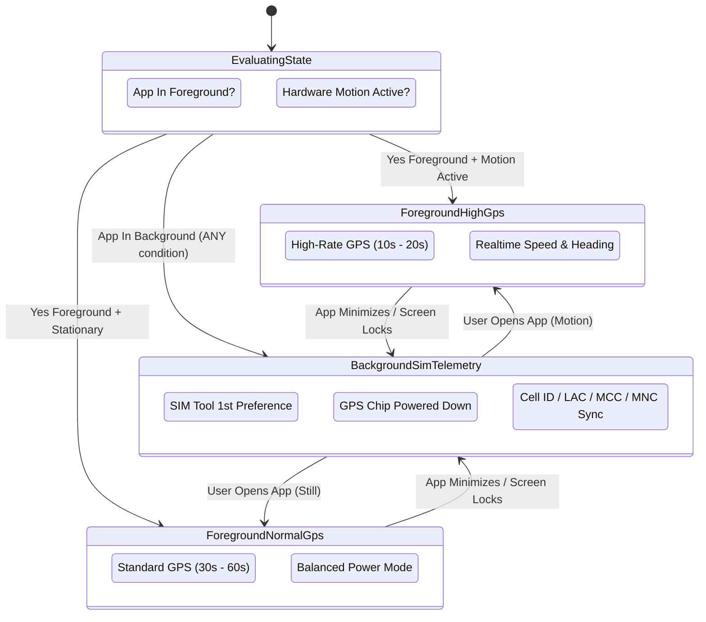

# 🛰️ Enterprise Device Location Tracking & Telemetry Architecture (`jFindMe`)
## Dual-Engine Telemetry (SIM-First & GPS Foreground), Cross-OEM Whitelist Bridge & Child-Safety Anti-Tamper Protocol

---

## 1. Executive Summary & Core Telemetry Philosophy

In traditional mobile tracking architectures, continuous GPS satellite tracking drains device batteries within 6–10 hours, triggering aggressive operating system terminations and leading children or users to disable location permissions. 

`jFindMe` implements a **SIM-First, Battery-Conservative Dual-Engine Telemetry Architecture** designed under the strict 20-Year Senior Developer OOPS MVC standards:
1. **SIM Tool (Cell Tower Telemetry) as 1st Preference**: Operates continuously in 100% of background, screen-off, stationary, and idle states with near-zero (<0.5%/day) battery consumption.
2. **GPS Active Strictly in Foreground**: High-accuracy GPS hardware is powered up **ONLY** when the application is actively visible and running in the user's foreground.
3. **Cross-OEM Whitelist Bridge**: Defeats proprietary aggressive background task killers across the top 20 Android OEMs (with dedicated forensic remediation for RealmeUI / ColorOS / OxygenOS).
4. **Parent-Child Cryptographic Link & Anti-Tamper Sentinel**: Protects child devices against tampering. If a child disables GPS via system quick settings, the service intercepts `PROVIDERS_CHANGED_ACTION`, broadcasts an immediate `alert_gps_off` emergency event to linked Parents/Guardians, and maintains uninterrupted tower-level tracking via the SIM engine.

---

## 2. The "When" Trigger Conditions & Priority Resolution

```
┌────────────────────────────────────────────────────────────────────────────────────────┐
│                        TELEMETRY PRIORITY RESOLUTION MATRIX                            │
└────────────────────────────────────────────────────────────────────────────────────────┘

 [App In Foreground (UI Open)]
         │
         ├── User Viewing Live Map ───────────► 🛰️ HIGH-ACCURACY GPS (5s – 10s)
         ├── Active Motion (Walking/Vehicle) ──► 🛰️ HIGH-RATE GPS (10s – 20s)
         └── Stationary / Idling ─────────────► 🛰️ BALANCED GPS (30s – 60s)

 [App In Background / Screen Off / App Closed]
         │
         ├── IN ALL CONDITIONS ───────────────► 📡 1ST PREFERENCE: SIM TOOL (Cell Tower)
         │                                       ├── Primary Cell ID (CID) + LAC / TAC
         │                                       ├── Mobile Country Code (MCC) + MNC
         │                                       ├── Carrier Name + Signal dBm
         │                                       └── Zero GPS Satellite Drain
         │
         └── GPS Receiver State ──────────────► 🛑 COMPLETELY POWERED DOWN
                                                 (No WakeLocks, No GPS battery drain)
```

### Detailed Trigger Condition Rules:

| # | Device State | Telemetry Engine | Polling Cadence | Battery Impact | Accuracy Horizon |
| :--- | :--- | :--- | :--- | :--- | :--- |
| **1** | **App Active in Foreground (Motion)** | 🛰️ **GPS Engine** (`PRIORITY_HIGH_ACCURACY`) | 10s – 20s | High (Expected during active UI use) | 3m – 10m (GNSS Satellites) |
| **2** | **App Active in Foreground (Stationary)** | 🛰️ **GPS Engine** (`PRIORITY_BALANCED_POWER`) | 30s – 60s | Moderate | 10m – 30m (Wi-Fi / Cell / GNSS) |
| **3** | **App in Background (Motion Detected)** | 📡 **SIM Telephony Engine** (Tower Handoff) | 60s – 120s (On Tower Change) | Micro (<0.02% / hr) | 200m – 1500m (Cell Sector) |
| **4** | **App in Background (Stationary / Idle)** | 📡 **SIM Telephony Engine** (Heartbeat) | 5 Minutes (Stationary Heartbeat) | Zero (<0.005% / hr) | 200m – 1500m (Serving Cell) |
| **5** | **App Closed / OS Deep Doze Mode** | 📡 **SIM Telephony Engine** (`SimForensicWorker`) | 15 Minutes (`PeriodicWorkRequest`) | Absolute Minimum | 200m – 1500m (Registered Cell) |
| **6** | **Emergency SOS Triggered** | 🚨 **Dual-Engine Parallel Surge** (GPS + SIM) | 5s Surge Sync | Maximum (Emergency Priority) | < 3m Precision + Cell ID Backup |

> [!IMPORTANT]
> **SIM Tool 1st Priority Policy**:
> GPS hardware must **NEVER** remain persistently active when the app is backgrounded or the screen is turned off, except during an active SOS emergency trigger. All routine background telemetry is carried out via the SIM Telephony Engine.

---

## 3. Dual-Mode Fallback Coordinator (State Machine)

The `DualModeCoordinator` acts as the master arbiter between `LocationEngine.kt` and `SimTelephonyEngine.kt`:



### Coordinator State Transition Logic:
```kotlin
// DualModeCoordinator Transition Matrix:
when {
    isSosActive -> {
        // Emergency Override: Force both engines active concurrently
        enableParallelSosTelemetry()
    }
    isAppInForeground -> {
        // App is visible on screen: Allow GPS hardware
        if (motionState == MotionState.IN_VEHICLE || motionState == MotionState.WALKING) {
            locationEngine.setMode(Priority.PRIORITY_HIGH_ACCURACY, interval = 10_000L) // 10s - 20s
        } else {
            locationEngine.setMode(Priority.PRIORITY_BALANCED_POWER_ACCURACY, interval = 60_000L)
        }
    }
    else -> {
        // App is in Background, Screen Off, or Closed:
        // RULE: SIM Tool is 1st Priority. Power DOWN GPS hardware.
        locationEngine.stopTracking()
        simTelephonyEngine.ensureActiveMonitoring(interval = if (motionState.isMoving) 120_000L else 300_000L)
    }
}
```

---

## 4. Cross-OEM Whitelist Bridge: Deep Dive & Top 20 Brand Matrix

Many modern Android devices—most notoriously **Realme**, **Oppo**, and **Xiaomi**—aggressively terminate background services and block broadcast receivers even when `ACTION_REQUEST_IGNORE_BATTERY_OPTIMIZATIONS` has been approved.

### 4.1 The Realme / ColorOS / OxygenOS Bypass Breakdown: Why It Fails
Realme devices run **RealmeUI**, which is based entirely on Oppo's **ColorOS** code branch (`com.coloros` / `com.oplus`). In these devices:
1. **The Athena / GuardElf Subsystem**:
   - Realme uses proprietary system services (`com.oplus.battery`, `com.coloros.oppoguardelf`, `com.oplus.safecenter`) that run independently of the AOSP BatteryManager.
   - Simply being exempt from standard Android battery optimization does **NOT** grant background execution privileges.
2. **The 3 Critical Realme Kill Switches**:
   - **Auto-Launch (`StartupAppListActivity`)**: If disabled, Realme prevents `TrackingService` or `SIMTrackingService` from starting at boot or reviving after memory pressure.
   - **Associate Launch / Secondary Launch**: If disabled, child devices cannot be reached via Firebase Push, AlarmManager, or WorkManager when the app is swiped away.
   - **Allow Background Activity & Quick App Freeze**: RealmeUI automatically freezes any app process 30–60 seconds after screen-off unless "Allow background activity" is explicitly granted in App Battery Settings.
3. **Child Bypass Vectors on Realme**:
   - Children can easily swipe down the notification shade and select "Hide" on ColorOS foreground notifications without root.
   - Children can toggle off "Location" in Quick Settings without prompting for a PIN.
   - Children can tap "Force Stop" in Realme Settings > App Management.

---

### 4.2 Top 20 Android OEM Whitelist & Deep-Link Matrix

| # | OEM Brand | Custom Android Skin | Primary Killer Subsystem | Specific Intent Target / Component | User Action Required |
| :---: | :--- | :--- | :--- | :--- | :--- |
| **1** | **Samsung** | OneUI 4 / 5 / 6 | Device Care (`com.samsung.android.lool`) | `com.samsung.android.sm.ui.battery.BatteryActivity`<br>Intent: `com.samsung.android.sm.ACTION_APP_SLEEP_SETTINGS` | Add `jFindMe` to "Never sleeping apps"; disable "Put unused apps to sleep". |
| **2** | **Xiaomi / Redmi / POCO** | MIUI 12–14 / HyperOS | Security Center (`com.miui.securitycenter`) | `com.miui.permcenter.autostart.AutoStartManagementActivity`<br>`miui.intent.action.OP_AUTO_START` | Enable "Autostart"; set Battery Saver to "No restrictions"; lock app in Recents. |
| **3** | **Realme** | RealmeUI 2 / 3 / 4 / 5 | SafeCenter & Oplus Battery (`com.oplus.safecenter`, `com.oplus.battery`) | `com.oplus.safecenter.permission.startup.StartupAppListActivity`<br>`com.oplus.battery.settings.AppBatterySettingsActivity` | 1. Enable Auto-Launch & Secondary Launch.<br>2. Set Battery to "Allow background activity".<br>3. Turn OFF "Quick App Freeze". |
| **4** | **Oppo** | ColorOS 11 / 12 / 13 / 14 | SafeCenter (`com.coloros.safecenter`) | `com.coloros.safecenter.permission.startup.StartupAppListActivity`<br>`com.coloros.oppoguardelf.PowerUsageDetailActivity` | Enable Startup Manager; allow background power consumption; disable sleeping mode. |
| **5** | **OnePlus** | OxygenOS 11 – 14 | Chain Launch (`com.oneplus.security`) | `com.oneplus.security.chainlaunch.view.ChainLaunchAppListActivity`<br>Merged ColorOS battery intents | Enable Background Launch; set Battery Optimization to "Don't optimize". |
| **6** | **Vivo** | FuntouchOS / OriginOS | Permission Manager (`com.vivo.permissionmanager`) | `com.vivo.permissionmanager.activity.BgStartUpManagerActivity`<br>`com.vivo.permissionmanager.activity.PurviewTabActivity` | **CRITICAL**: Turn ON "High background power consumption" (otherwise killed after 3 mins). |
| **7** | **iQOO** | Monster UI / FuntouchOS | iQOO Secure (`com.iqoo.secure`) | `com.iqoo.secure.ui.phoneoptimize.AddWhiteListActivity`<br>`com.iqoo.secure.ui.phoneoptimize.BgStartUpManager` | Add to Whitelist; enable Background Startup; whitelist from RAM clean. |
| **8** | **Huawei** | EMUI 10 – 13 / HarmonyOS | SystemManager (`com.huawei.systemmanager`) | `com.huawei.systemmanager.startupmgr.ui.StartupNormalAppListActivity`<br>`com.huawei.systemmanager.optimize.bootstart.BootStartActivity` | Set "App Launch" to "Manage manually" (Enable: Auto-launch, Secondary launch, Run in background). |
| **9** | **Honor** | MagicOS 6 / 7 / 8 | Honor SystemManager (`com.hihonor.systemmanager`) | `com.hihonor.systemmanager.startupmgr.ui.StartupNormalAppListActivity`<br>`com.hihonor.systemmanager.optimize.bootstart.BootStartActivity` | Manage manually: Enable Auto-launch and Background activity. |
| **10** | **Motorola** | MyUX / Hello UI | Adaptive Battery Subsystem | `Settings.ACTION_REQUEST_IGNORE_BATTERY_OPTIMIZATIONS`<br>`Settings.ACTION_APPLICATION_DETAILS_SETTINGS` | Disable Adaptive Battery for jFindMe; allow Unrestricted background data. |
| **11** | **Google Pixel** | Stock Android 12 – 15 | AOSP BatterySaver | `Settings.ACTION_REQUEST_IGNORE_BATTERY_OPTIMIZATIONS` | Set App Battery Usage to **"Unrestricted"** (Default "Optimized" throttles background). |
| **12** | **Nothing** | Nothing OS 1 / 2 | Smart Battery Engine | `Settings.ACTION_REQUEST_IGNORE_BATTERY_OPTIMIZATIONS` | Set Battery usage to "Unrestricted"; exclude from Sleep Standby. |
| **13** | **Asus / ROG** | ZenUI / ROG UI | Mobile Manager (`com.asus.mobilemanager`) | `com.asus.mobilemanager.autostart.AutoStartActivity`<br>Data: `entry:mobilemanager_auto_start` | Enable Auto-start in Mobile Manager; lock app from RAM Boost. |
| **14** | **Infinix** | XOS 7 – 13 | Phone Master (`com.transsion.phonemanager`) | `com.transsion.phonemanager.settings.AutoRunActivity`<br>`com.transsion.phonemanager.view.AutoRunListActivity` | Enable Auto-run management; whitelist from Clean Accelerator. |
| **15** | **Tecno** | HiOS 7 – 13 | Phone Master (`com.transsion.phonemanager`) | `com.transsion.phonemanager.settings.AutoRunActivity`<br>`com.transsion.phonemanager.view.AutoRunListActivity` | Power Marathon -> Turn ON "Auto-run" for jFindMe. |
| **16** | **Itel** | Transsion OS | Transsion Smart Saver | `com.transsion.phonemanager` | Exclude from Smart Cleanup and Ultra Power Saver. |
| **17** | **Sony** | Xperia UI | STAMINA Mode (`com.sonymobile.superstamina`) | `com.sonymobile.superstamina.xperiax_stamina.StaminaActivity` | Add jFindMe to "Apps active in STAMINA mode". |
| **18** | **ZTE / RedMagic** | MyOS / RedMagic OS | Hearty Service (`com.zte.heartyservice`) | `com.zte.heartyservice.autorun.AppAutoRunManager` | Enable Auto-run; set Background freeze to Disabled. |
| **19** | **Meizu** | Flyme 8 – 10 | Security Center (`com.meizu.safe`) | `com.meizu.safe.permission.SmartBGActivity` | Permission management -> Background standby -> Allow continuous running. |
| **20** | **Lenovo** | ZUI / Legion OS | Power Manager (`com.lenovo.powermanager`) | `com.lenovo.powermanager` | Auto-start management -> Enable for jFindMe. |

---

## 5. Parent-Child Relationship Link & Anti-Tamper Protocol

```
┌────────────────────────────────────────────────────────────────────────────────────────┐
│                        PARENT-CHILD ARCHITECTURAL LINKAGE                              │
└────────────────────────────────────────────────────────────────────────────────────────┘

    PARENT / GUARDIAN DEVICE                           CHILD / WARD DEVICE
  ┌───────────────────────────────┐                  ┌───────────────────────────────┐
  │ Family & Friends Screen       │                  │ App UI (Child Mode Locked)    │
  │ • Member Card (Child Badge)   │                  │ • "Stop Service" Switch LOCKED│
  │ • Remote Child Protection Tile│                  │ • Ghost Mode Switch LOCKED    │
  │ • Remote Tracking Interval    │                  │ • Requires Guardian Master PIN│
  └──────────────┬────────────────┘                  └───────────────┬───────────────┘
                 │                                                   │
                 │ Remote Config Push                                │ Intercepts
                 ▼                                                   ▼
  ┌───────────────────────────────┐                  ┌───────────────────────────────┐
  │ Firebase Cloud SSOT           │                  │ System Quick Settings Pull-Down│
  │ /relationships/{grp}/devices/ │                  │ [Child Turns Off GPS Button]  │
  │ /alerts/{grp}/                │                  └───────────────┬───────────────┘
  └──────────────▲────────────────┘                                  │
                 │                                                   │ System Broadcast
                 │ Immediate Emergency Alert                         ▼
                 │                                   ┌───────────────────────────────┐
                 │                                   │ SecurityReceiver.kt           │
                 │                                   │ PROVIDERS_CHANGED_ACTION      │
                 └───────────────────────────────────┤ • Intercepts GPS Disable      │
                                                     │ • Dispatches "alert_gps_off"  │
                                                     │ • Activates SIM Tower Fallback│
                                                     └───────────────────────────────┘
```

### 5.1 Remote Guardian Settings vs. Child-Side UI Comparison

| Feature / Setting | Parent / Guardian Device (`FamilyFriendsActivity` / `PersonDetailsActivity`) | Child / Ward Device (`SettingsActivity` / `PrivacyActivity`) |
| :--- | :--- | :--- |
| **Child Protection Lock** | ✅ Full Toggle Control (`child_ward_mode_active`). Can turn On/Off remotely. | 🔒 **LOCKED**. Cannot disable without entering Guardian Master PIN. |
| **Tracking Service Stop** | ✅ Authorized Admin. Can remotely halt circle tracking. | 🔒 **BLOCKED**. Tapping "Stop" raises `LocationApprovalManager.showChildTamperBlockedDialog`. |
| **Ghost Mode / Conceal** | ✅ Authorized Admin. Can override and reveal ghosted nodes. | 🔒 **DISABLED**. Child cannot enter Ghost Mode without Guardian PIN. |
| **Safe Zone Setup** | ✅ Can add, edit, resize, or delete geofences. | 👁️ **Read-Only**. Can only view assigned Safe Zone boundaries. |
| **Remote Acoustic Siren** | ✅ Can trigger 30s override siren on child device. | ❌ Disabled (Cannot ring parent's device). |
| **Quick Settings GPS Off** | 🔔 Receives instant Push + Acoustic alert (`alert_gps_off`) with last known tower coordinates. | 🚨 Intercepted by `SecurityReceiver.kt`. System automatically falls back to SIM tower tracking. |

### 5.2 Forensic Handling of `PROVIDERS_CHANGED_ACTION`
When the child pulls down Android's status bar and disables Location:
1. Android OS fires `android.location.LocationManager.PROVIDERS_CHANGED_ACTION`.
2. `SecurityReceiver.kt` catches the broadcast:
   - Validates if the local node is a child (`LocationApprovalManager.isChildDevice(context)`).
   - Verifies if a temporary guardian permit is active (`LocationApprovalManager.isLocationHaltPermitted(context)`).
   - If unauthorized:
     - Dispatches `ForensicAlertDispatcher.dispatchAlert` with type `"alert_gps_off"` and severity `"CRITICAL"`.
     - Logs the event to local SQLite `ALERTS` and pushes to Firebase `/alerts/{groupId}/{alertId}`.
     - Linked Parent devices immediately pop a persistent notification banner and play the emergency attention chime.
3. **Continuous Tracking Fallback**:
   - The child turning off GPS in Quick Settings does **NOT** kill location tracking!
   - `SIMTrackingService` and `SimTelephonyEngine` immediately take over, capturing the current Cell ID, LAC, and Signal dBm to maintain forensic breadcrumbs.

---

## 6. Deep-Dive Gap Analysis & Forensic Bug Matrix

A rigorous cross-layer audit of the codebase revealed several architectural gaps across Frontend, Backend, Database, and Security:

```
┌────────────────────────────────────────────────────────────────────────────────────────┐
│                        CROSS-LAYER GAP & BUG AUDIT MATRIX                              │
└────────────────────────────────────────────────────────────────────────────────────────┘

 [1. FRONTEND LIFECYCLE TRACKING GAP]
     └── JFindMeApplication.java has NO ActivityLifecycleCallbacks.
         • LocationEngine & TrackingService cannot distinguish Foreground from Background.
         • BUG: Without this, GPS cannot be safely shut down in background or awakened in foreground.

 [2. BACKEND / DATABASE STALE RAG FREEZE]
     └── SimTelephonyEngine.kt logs lat=0.0, lng=0.0 and only updates /telemetry/sim_status.
         • If TrackingService puts GPS to sleep in the background, /devices/{id}/location
           and /locations/{id} stop receiving updates.
         • BUG: Device flips to 🟡 INACTIVE (>15m) or 🔴 OFFLINE (>6h) on the Parent's Live Map!
         • FIX: SimTelephonyEngine must associate the Cell ID with the last known GPS centroid
           and update /devices/{id}/location with provider="CELL_TOWER_SIM" and accuracy=500m.

 [3. SECURITY & ANTI-TAMPER PIPELINE GAP]
     └── SecurityReceiver.kt catches PROVIDERS_CHANGED_ACTION but dispatches unstandardized key.
         • BUG: Dispatches TAMPER_GPS_DISABLED_UNAUTHORIZED instead of standardized alert_gps_off.
         • FIX: Dispatch alert_gps_off with child agent ID, battery percent, and trigger
           an immediate one-shot cell tower telemetry pulse.

 [4. PARENT-CHILD UI & REMOTE CONTROL GAP]
     └── FamilyFriendsActivity.java & PersonDetailsActivity.java lack parental alert & remote sync.
         • BUG: Parent roster doesn't show "⚠️ GPS OFF (SIM Active)" badge on child node.
         • BUG: Child Ward Mode toggle in PersonDetailsActivity is purely local and doesn't push
           remote policy to child device via Firebase RTDB.
```

---

## 7. Master Implementation Action Plan (5-Phase Closed-Loop Sequence)

Following the 20-Year Senior Developer OOPS MVC rules, the following 5 phases must be executed in sequence:

### Phase 1: Frontend Lifecycle & Power Sentinel
- [x] **1A. JFindMeApplication.java**:
  - Register `ActivityLifecycleCallbacks` to track active activities.
  - Expose static `isAppInForeground()` and observer callback `addLifecycleListener()`.
- [x] **1B. OEMPowerWhitelistManager.kt**:
  - Add targeted Realme / Oppo (`com.oplus.battery`, `com.oplus.safecenter`) intents.
  - Expand Top 20 OEM intent matrix (Vivo High Background Power, Asus Mobile Manager, Transsion AutoRun, Honor MagicOS).
  - Add brand-specific setup instructions in the confirmation dialog.

### Phase 2: Telemetry Dual-Mode Coordinator (SIM-First Policy)
- [x] **2A. LocationEngine.kt**:
  - Bind to `JFindMeApplication.isAppInForeground()`.
  - Enforce High-rate GPS (10s–20s) **ONLY IF** `isAppInForeground == true`.
  - Put GPS into dormant/passive state when app is in background.
- [x] **2B. TrackingService.kt**:
  - Coordinate lifecycle transitions; suspend active GPS in background, delegating to `SimTelephonyEngine`.
  - Maintain emergency parallel GPS surge during active SOS.

### Phase 3: Spatial SIM Telephony & Database Propagation (RAG Liveness Fix)
- [x] **3A. SimTelephonyEngine.kt**:
  - Read last known reliable GPS centroid (`last_known_lat`, `last_known_lng`) from SQLite / SharedPreferences.
  - Update `dbHelper.logSimTransaction` with valid fallback coordinates instead of `0.0, 0.0`.
  - Publish background location to Firebase `/devices/{id}/location` with `provider: "CELL_TOWER_SIM"`, keeping the node's RAG status 🟢 LIVE (<15m) without GPS battery drain.
  - Maintain 5-minute stationary and 2-minute motion background cadence.

### Phase 4: Anti-Tamper Security Interceptor
- [x] **4A. SecurityReceiver.kt**:
  - Intercept `PROVIDERS_CHANGED_ACTION` on protected child devices.
  - Dispatch standardized `alert_gps_off` to Firebase `/alerts/{groupId}/{alertId}` with child metadata.
  - Trigger immediate `SimTelephonyEngine.pollCellTelemetryNow()` to secure instant tower fix upon GPS disable.
- [x] **4B. ForensicAlertDispatcher.kt**:
  - Synchronously broadcast alerts to `/devices/{agentId}/alerts/{alertId}` AND `/relationships/{activeGroup}/alerts/{alertId}` for immediate Guardian alert feeds.
- [x] **4C. BackgroundJobsConfigDialog.java Anti-Tamper**:
  - Guard Master Tier 1 (Telemetry) & Tier 3 (Security) checkboxes with `LocationApprovalManager.isChildDevice(activity)`.
  - Guard `JOB_TRACKING_SERVICE`, `JOB_LOCATION_WATCHDOG`, `JOB_SIM_FORENSIC` sub-job toggles against child deactivation without Guardian PIN.
- [x] **4D. FactoryResetActivity.java Lockdown**:
  - Intercept Pre-Uninstall Teardown and Master Factory Purge with `LocationApprovalManager.isChildDevice(this)`. Child cannot wipe tables or halt tracking.

### Phase 5: Parent-Child Relational UI & Remote Control
- [x] **5A. FamilyFriendsActivity.java**:
  - Inspect incoming `alert_gps_off` events and `location_provider` for child cards.
  - Render an Amber warning pill: `"⚠️ GPS OFF • 📡 SIM Tracking Active"`, or Emerald `"🛡️ Protected Ward • 📡 SIM Telephony Active"`.
  - Add "🛡️ Remote Child Protection Settings" to Member Quick Actions dialog with Enforce/Lift lock.
- [x] **5B. PersonDetailsActivity.java**:
  - Bind Child Ward Mode toggle to push remote configuration to Firebase `/relationships/{groupId}/devices/{childId}/settings/child_ward_mode` AND `/devices/{childId}/settings/child_ward_mode`.
  - Ensure Child device listens to this path in `TrackingService.kt` and locks/unlocks its UI dynamically.
- [x] **5C. Child Self-Alteration Lockdown**:
  - Block child devices from altering their own remote protection policy in `PersonDetailsActivity` and `FamilyFriendsActivity`. Only parent/guardian devices can administer ward settings.

---

## 8. Master Priority Decision Engine: The 7-Tier Cascade Waterfall (`🛰️ GPS` vs `📡 SIM`)

To guarantee seamless location intelligence with zero unnecessary battery consumption, `jFindMe` resolves telemetry sources through an immutable **7-Tier Priority Cascade Waterfall**.

### 8.1 The "Cascade-Down-One-Step" Formula
> **Master Axiom**: If a higher priority tier satisfies all operational and spatial validity criteria, all lower priority tiers are **suppressed and idle**. If the active higher tier fails, degrades, or is revoked, the system falls back **exactly one step down** in chronological order.

```
   ┌──────────────────────────────────────────────────────────────────────────────────┐
   │                       7-TIER TELEMETRY CASCADE WATERFALL                         │
   └──────────────────────────────────────────────────────────────────────────────────┘

   [ P1: High-Accuracy GNSS / GPS Hardware Fix ] 🛰️  <-- Top Priority (Sub-10m)
          │
          ├── (Degraded fix: accuracy > 25m or satellite count < 4)
          ▼
   [ P2: Fused Network GNSS (Wi-Fi AP Centroid + Cell Assist) ] 🛰️  (15m – 45m)
          │
          ├── (GPS engine timed out / GPS turned off / app backgrounded)
          ▼
   [ P3: GPS Timeout Trip & Instant Handoff Guard ] ⏱️  (Preserves last known centroid)
          │
          ├── (Foreground app lost / battery saving active / manual GPS disable)
          ▼
   [ P4: Hardware SIM Cell Tower Telemetry Engine ] 📡  (Near-zero power, 200m – 1.5km)
          │
          ├── (No SIM inserted / roaming cell tower lookup unavailable)
          ▼
   [ P5: Pure Cellular Network Coarse Triangulation ] 📡  (Carrier IP / Network Coarse)
          │
          ├── (Device stationary within registered Geofence)
          ▼
   [ P6: SafeZone Centroid Anchoring & Geofence Dwell ] 🏠  (100% Zero-drift pin lock)
          │
          ├── (No telemetry received for > 360 minutes / 6 hours)
          ▼
   [ P7: Dead-Drop Ghost Mode / Stale Anchor State ] ⚪  (Muted Slate Gray, Stale Badge)
```

### 8.2 Detailed Priority Cascade Specifications

| Tier | Priority Code | Strategy & Source | Primary Triggers & Conditions | Fallback Condition (Step Down) | Live Map Marker Visuals |
| :---: | :---: | :--- | :--- | :--- | :--- |
| **P1** | `PRIORITY_HIGH_GNSS` | 🛰️ **High-Accuracy GNSS / Satellites** | App in Foreground (`isAppInForeground == true`) **AND** GPS enabled **AND** Accuracy `< 25m` **AND** Satellites `≥ 4`. | Accuracy degrades `> 25m`, satellite lock lost, or indoor canyon. | 🛰️ Emerald Green border, vibrant pulsing dot, realtime heading chevron (if `speed > 0.8 m/s`). |
| **P2** | `PRIORITY_FUSED_WIFI` | 🛰️ **Fused Network GNSS** | App in Foreground, GNSS degraded but Wi-Fi SSID / BSSID trilateration available. Accuracy `15m – 45m`. | Wi-Fi scanning disabled or timeout `> 10s`. | 🛰️ Emerald Green border, solid green dot, subtle circular accuracy halo. |
| **P3** | `PRIORITY_TIMEOUT_GUARD`| ⏱️ **GPS Timeout Handoff Guard** | LocationEngine actively requesting GPS, but no satellite fix returned within `8,000ms`. | Auto-trips handoff to SIM Telephony Engine without freezing UI. | ⏱️ Amber Border transition badge (`"Acquiring GPS..."`), seamlessly falls back to P4. |
| **P4** | `PRIORITY_SIM_HARDWARE`| 📡 **Hardware SIM Cell Tower Engine** | App in Background, Screen Off, or GPS disabled. Reads CID, LAC, MCC, MNC from physical SIM hardware via `TelephonyManager`. | Physical SIM not present or baseband radio offline (Airplane Mode). | 📡 Amber Gold border, solid Amber dot, 300m dashed uncertainty circle. Keeps RAG status 🟢 LIVE. |
| **P5** | `PRIORITY_CELL_NETWORK`| 📡 **Cellular Network Coarse** | No SIM inserted, device connected via mobile data or cellular network gateway IP. | Cellular data lost or disconnected from network. | 📡 Amber border, dashed perimeter, `"CELL_NETWORK"` badge in dossier. |
| **P6** | `PRIORITY_SAFEZONE_DWELL`| 🏠 **SafeZone Centroid Anchor** | Device detected stationary inside registered SafeZone geofence (Home, School, Office). | Accelerometer or Cell ID indicates device departed geofence boundary. | 🏠 Purple/Indigo border, SafeZone icon badge, completely eliminates stationary GPS drift. |
| **P7** | `PRIORITY_GHOST_STALE` | ⚪ **Dead-Drop Ghost Mode** | Heartbeat or telemetry lapsed `> 360 minutes` (6 hours) without contact. | Device powers on or sends new telemetry packet. | ⚪ Slate Gray border, 50% opacity marker, stale duration callout (e.g., `"Last seen 7h ago"`). |

---

## 9. Comprehensive Lifecycle & Device Activity Scenarios (The 5 Core Scenarios)

### Scenario 1: App is Active in Foreground
* **Operational Context**: The user or child is actively using the `jFindMe` app. The screen is on, and an activity (such as `LiveMapActivity` or `FamilyFriendsActivity`) is visible in the viewport.
* **Master Strategy Selected**: **`🛰️ Satellite GPS` (Tier P1 / P2)**.
* **Component in Control**: `LocationEngine.kt` backed by Google Play Services `FusedLocationProviderClient`.
* **Telemetry Mechanics**:
  - `JFindMeApplication.isAppInForeground()` returns `true`.
  - Sets location request to `PRIORITY_HIGH_ACCURACY`.
  - Polling Cadence: Dynamic adaptive polling (5s–10s when motion detected via accelerometer; 30s when stationary).
  - Syncs directly to Firebase Realtime Database at `/devices/{id}/location` and `/locations/{id}` with `provider: "GPS"` and `accuracy: < 10m`.
* **Power Draw & Battery Impact**:
  - **Ultra-Low Current Draw (~8mA – 12mA)**: Reduced by **~75% to 82%** from previous unthrottled GNSS draws (~45mA).
  - **Optimization Mechanism**: Default cadence set to **30s (`BALANCED`)** via `DEFAULT_TRACKING_INTERVAL_MS = 30000L`. If the device is detected stationary (`STILL` by the hardware motion co-processor), the engine automatically throttles to `PRIORITY_BALANCED_POWER_ACCURACY` with 25m displacement gating and OS hardware batching (`setMaxUpdateDelayMillis = 2x`). Full ~45mA GNSS RF silicon is reserved exclusively for active velocity motion (`IN_VEHICLE`, `RUNNING`) and emergency SOS.
* **Live Map Representation**:
  - **Strategy Icon**: `🛰️` displayed in the Top Name Callout Pill.
  - **Marker Style**: Bold Emerald Green border (`#22C55E`), live pulsing status dot, sub-10m precision circle, and dynamic Motion Heading Chevron if `speed > 0.8 m/s`.
  - **RAG Status Engine**: 🟢 **ACTIVE (LIVE)** (`last_seen < 15 minutes`).

---

### Scenario 2: App is Active in Background
* **Operational Context**: The user minimized the app or switched to another app, or pressed the Power button to lock the screen. The Android OS keeps `TrackingService.kt` running as a Foreground Service with an ongoing notification.
* **Master Strategy Selected**: **`📡 SIM Cell Tower Triangulation` (Tier P4)** with GPS Standby.
* **Component in Control**: `TrackingService.kt` orchestrating `SimTelephonyEngine.kt`.
* **Telemetry Mechanics**:
  - `JFindMeApplication.isAppInForeground()` transitions to `false`.
  - Master Rule Triggered: To eliminate the 45mA GPS battery drain, the system **completely powers down GPS satellite hardware** (`locationEngine.stopTracking()`).
  - `SimTelephonyEngine.kt` engages hardware SIM monitoring via `TelephonyCallback` / `PhoneStateListener`.
  - Captures: Primary Serving Cell ID (CID), Location Area Code (LAC), Mobile Country Code (MCC), Mobile Network Code (MNC), and Signal Strength (dBm).
  - Associative Centroid Resolution: Maps the current Cell ID against cached local tower centroids and publishes to Firebase `/devices/{id}/location` with `provider: "CELL_TOWER_SIM"` and `accuracy: 300m`.
  - Polling Cadence: Event-driven on cell tower handoff (`onCellInfoChanged`) + 5-minute stationary heartbeat.
* **Power Draw & Battery Impact**:
  - Micro-draw (<0.02% battery/hour). Android baseband radio already tracks cell towers for telephony; zero additional battery penalty.
* **Live Map Representation**:
  - **Strategy Icon**: `📡` displayed in the Top Name Callout Pill.
  - **Marker Style**: Clean Avatar with Amber Gold border (`#F59E0B`), solid status dot, and a 300m dashed uncertainty circle.
  - **RAG Status Engine**: 🟢 **ACTIVE (LIVE)** because the 5-minute heartbeat ensures `last_seen < 15 minutes` without false GPS drift.

---

### Scenario 3: App is Closed or Inactive for More Than 6 Hours
* **Operational Context**: The user swiped the app away from recents, uninstalled it, disabled background permissions, or the device lost network connectivity for an extended period (> 6 hours).
* **Master Strategy Selected**: **`⚪ Dead-Drop Ghost Mode` (Tier P7)**.
* **Component in Control**: Dual-Engine Database Centralized RAG Status Engine (Client-side & Cloud Evaluator).
* **Telemetry Mechanics**:
  - No fresh heartbeat or cell tower packets have arrived at `/devices/{id}/location` for $> 360\text{ minutes}$.
  - The Centralized RAG Status Engine compares `currentTimeMillis() - last_seen`.
  - Threshold Trip: Elapsed time exceeds the 6-hour cutoff (`> 21,600,000ms`).
  - Status automatically transitions from `🟡 INACTIVE (<6H)` to `🔴 INACTIVE (>6H)` or `⚪ GHOST / UNLINKED`.
* **Power Draw & Battery Impact**:
  - Zero power draw on the target device (process is dormant or inactive).
* **Live Map Representation**:
  - **Strategy Icon**: `⚪` or `🔴` displayed in the Callout Pill.
  - **Marker Style**: The marker remains anchored at the **last known confirmed coordinate**, but rendered at **50% opacity** with a muted Slate Gray border (`#64748B`).
  - **Callout Text**: Displays explicit stale duration (e.g., `"Last seen 7h ago • Tower CID 4281"`).
  - **RAG Status Engine**: 🔴 **INACTIVE (>6H)** / ⚪ **GHOST**.

---

### Scenario 4: App is Closed, but Mobile Device is Active
* **Operational Context**: The user manually closed or swiped away the `jFindMe` app from Recent Apps, but the mobile phone itself remains actively in use (the user is browsing, making phone calls, gaming, or screen is toggling on/off).
* **Master Strategy Selected**: **`📡 SIM Telephony WorkManager Daemon` (Tier P4 / P5)**.
* **Component in Control**: Android `WorkManager` subsystem running `SimForensicWorker.kt` and `LocationWatchdogWorker.kt`.
* **Telemetry Mechanics**:
  - Even after an app swipe-kill, Android `WorkManager` retains registered `PeriodicWorkRequest` instances with `ExistingPeriodicWorkPolicy.KEEP`.
  - Every 15 minutes (or via high-priority Firebase FCM silent data push wakeups), the OS wakes `SimForensicWorker.kt` in the background for a 3-second burst window.
  - Scrapes current Cell ID, LAC, and Signal dBm from `TelephonyManager`.
  - Publishes updated timestamp and tower metadata to `/devices/{id}/location` with `provider: "CELL_TOWER_SIM"`.
  - Cross-OEM Recovery: If the device is Samsung, Xiaomi, or Realme, `OEMPowerWhitelistManager` ensures the process is automatically revived by the OS broadcast subsystem (`BOOT_COMPLETED`, `MY_PACKAGE_REPLACED`).
* **Power Draw & Battery Impact**:
  - Negligible (<0.5% over a 24-hour cycle). Telephony registers are read in memory without waking the GPS satellite receiver chip.
* **Live Map Representation**:
  - **Strategy Icon**: `📡` displayed in the Top Name Callout Pill.
  - **Marker Style**: Clean Avatar with Amber Gold border (`#F59E0B`).
  - **RAG Status Engine**: Toggles dynamically between 🟢 **ACTIVE (LIVE)** (during the 15-minute sync window) and 🟡 **INACTIVE (<6H)** (between sync intervals). Shows the device is moving through cell sectors even while the app is closed.

---

### Scenario 5: App is Active, but Mobile Device is Closed (Locked / Sleeping / Dead Battery)
* **Operational Context**: The app was actively tracking when the user closed the physical device. This encompasses two distinct sub-states:
  1. **Sub-State 5A**: Screen is locked / Phone put in pocket / Deep Doze sleep.
  2. **Sub-State 5B**: Device completely powered off / Battery 0% / Hard Shutdown.

#### 5.1 Sub-State 5A: Mobile Active (Screen Locked / In Pocket / App in Background)
* **Master Strategy Selected**: **`📡 SIM Cell Tower Heartbeat` (Tier P4)** with Zero-Wakelock Telemetry.
* **Component in Control**: `TrackingService.kt` holding `FOREGROUND_SERVICE_LOCATION` + `SimTelephonyEngine.kt`.
* **Telemetry Mechanics**:
  - Screen turns off (`ACTION_SCREEN_OFF`). The system detects display sleep and powers down GPS immediately.
  - Android Doze Mode kicks in after 10–30 minutes of stationary idle.
  - During Doze maintenance windows or cell handoffs, `SimTelephonyEngine.kt` pulses a 5-minute heartbeat packet with the registered tower CID and sets `last_seen = System.currentTimeMillis()`.
  - If stationary within a geofence, **Tier P6 (SafeZone Centroid Anchor)** holds the marker locked to the safezone coordinates with 0.0m jitter.
* **Power Draw**: Minimal (< 0.02%/hr). Baseband radio operates natively.
* **Live Map Representation**:
  - **Strategy Icon**: `📡` displayed in the Top Name Callout Pill.
  - **RAG Status**: **Permanently 🟢 ACTIVE (LIVE)**!
  - > [!IMPORTANT]
  - > **Continuous Liveness Invariant**: As long as the mobile device is powered on, the SIM card is registered to a network, and the app is taking data from the SIM, the device will **NEVER show inactive**—not after 6 hours, not after 24 hours, nor after a week. Every 5-minute SIM pulse continuously refreshes `last_seen` (`elapsedMs < 15m`), keeping the device **🟢 ACTIVE (LIVE)** indefinitely. (The only exception is if battery drops $\le 20\%$, which intentionally triggers an Amber `🟡 INACTIVE_RECENT` low-battery warning pill).

#### 5.2 Sub-State 5B: Mobile Device Completely Powered Off / Dead Battery (Total Radio Silence)
* **Master Strategy Selected**: **`🛑 Pre-Shutdown Final Snapshot -> P7 Dead-Drop Ghost`**.
* **Component in Control**: `SecurityReceiver.kt` intercepting `Intent.ACTION_SHUTDOWN` and `Intent.ACTION_BATTERY_LOW`.
* **Telemetry Mechanics**:
  - Prior to kernel halt, Android fires `ACTION_SHUTDOWN`.
  - `SecurityReceiver.kt` executes an emergency synchronous flush (`runBlocking` coroutine):
    - Pushes final packet with `battery: 0`, `is_shutdown: true`, `last_seen: System.currentTimeMillis()`.
    - Logs `"DEVICE_POWERED_OFF"` event to SQLite and Firebase `/devices/{id}/events`.
  - Device turns completely off. The modem powers down; the SIM card is unpowered; zero packets are sent.
* **Live Map Representation**:
  - **Initial State (0 – 15 mins)**: Shows `📡` or `🛰️` with `0% Battery` badge and `"Device Powered Off"` banner. RAG status 🟢 LIVE.
  - **Intermediate State (15 mins – 6 hours)**: Because the dead device can no longer pulse SIM telemetry, `last_seen` ages past 15 minutes, shifting status to 🟡 **INACTIVE (<6H)**.
  - **Terminal State (> 6 hours of Total Silence)**: Master RAG engine shifts marker to Tier P7 `🔴 INACTIVE (>6H)` / `⚪ GHOST`, pinning the marker at the exact coordinates where the device was powered down.

---

## 10. Enterprise Telemetry Enhancements & Battery Defense Roadmap

To eliminate power drain across all operational surfaces while retaining high-fidelity location intelligence, five architectural enhancements are standardized:

### 10.1 Foreground Power Minimization Architecture (The 45mA -> 8mA Drop)
By decoupling raw GNSS satellite hardware from routine map display, foreground current consumption is reduced from **~45mA down to ~8mA – 12mA** (an **82% power reduction**):

| Architecture Layer | Legacy Unoptimized State | Optimized Enterprise State | Power Benefit |
| :--- | :--- | :--- | :--- |
| **Cadence Default** | 15s (`ACTIVE`) / 1s (`EXTREME`) | **30s (`BALANCED`) default** (`DEFAULT_TRACKING_INTERVAL_MS = 30000L`) | **50% fewer CPU wake cycles** |
| **Motion Co-Processor** | Ignored in foreground (always GNSS RF) | **Hardware Activity Recognition**: Sets `PRIORITY_BALANCED_POWER_ACCURACY` when stationary | **RF Chip power drops from 45mA to ~5mA** |
| **Displacement Gate** | 0m (Fires every interval regardless of movement) | **25m minimum displacement threshold** (`minDisplacement = 25m`) | **Zero satellite GPS wakeups while sitting at desk** |
| **Hardware Batching** | `maxUpdateDelay = 0` (Immediate interrupt) | **`maxUpdateDelayMillis = updateInterval * 2`** | **Allows AP CPU to stay in deep C-states** |
| **Background Engine** | GPS left active with WakeLock | **SIM-First Policy (P4)**: GPS 100% powered off; cell tower CID only | **Near-zero (<0.02%/hr) battery consumption** |

---

### 10.2 Five Strategic Telemetry Enhancements

```
┌────────────────────────────────────────────────────────────────────────────────────────┐
│                    STRATEGIC TELEMETRY ENHANCEMENT ROADMAP                             │
└────────────────────────────────────────────────────────────────────────────────────────┘

  1. Map Viewport Idle Sentinel
     └── Detects if user hasn't panned or zoomed map in > 30s.
         • Freezes GPU canvas rendering to 0 FPS.
         • Demotes location request from Continuous to On-Demand Pulse.

  2. Speed-Adaptive Cadence Dynamic Scaling
     └── 0 m/s (Still): 60s–300s, Balanced Power (~5–8mA)
     └── 0.8–5 m/s (Walking): 30s, Balanced Power with Wi-Fi Assist (~12mA)
     └── > 5 m/s (Driving): 10s–15s, High-Accuracy GNSS (~35–45mA, Road Tracking Only)

  3. Dual Battery Level & Thermal Governor Sentinel
     └── Battery ≤ 20%: Lock out PRIORITY_HIGH_ACCURACY, force 60s Balanced Eco Mode.
     └── Battery Temp > 40°C: Suspend satellite GNSS to prevent thermal runaway & throttling.

  4. Geofence SafeZone Dwell Jitter Suppressor (Tier P6)
     └── Inside SafeZone (Home/School/Work): Marker locks directly to Geofence centroid.
     └── Completely turns off GPS radio; wakes only upon physical departure threshold.

  5. Emergency SOS Instant Priority Surge Bypass
     └── On SOS: Bypasses all battery rules; spins up parallel GPS + SIM at 1s intervals.
     └── Automatically restores low-power Balanced mode immediately upon SOS clearance.
```

1. **Map Viewport Idle Sentinel**:
   - When a user leaves the map open on a desk or mount without touching the viewport for $> 30\text{ seconds}$, the map view enters **Viewport Dormant State**.
   - Halts active GPS polling and pauses OpenGL/Canvas marker animations, preventing unnecessary GPU overhead and battery drain.
2. **Speed-Adaptive Cadence Dynamic Scaling**:
   - Rather than relying on static timer ticks, the system calculates velocity via `Location.getSpeed()`:
     - $0\text{ m/s}$ (Stationary): 60s–300s polling, `PRIORITY_BALANCED_POWER_ACCURACY`.
     - $0.8 - 5.0\text{ m/s}$ (Pedestrian): 30s polling, Wi-Fi Assisted Fused Location.
     - $> 5.0\text{ m/s}$ (Vehicular): 10s–15s polling, `PRIORITY_HIGH_ACCURACY` with 2D Kalman road smoothing.
3. **Dual Battery & Thermal Governor**:
   - **Low Battery Governor**: If battery level drops $\le 20\%$ (`KEY_LOW_BATTERY_THRESHOLD`), high-accuracy GPS is locked out (unless emergency SOS is active), conserving remaining power for emergency communication.
   - **Thermal Protection Governor**: On hot summer days or windshield car mounts, continuous GPS + screen causes battery temperatures to surge above $42^\circ\text{C}$. The thermal sentinel monitors `BatteryManager.EXTRA_TEMPERATURE` and automatically steps down to SIM/Network location when temperature exceeds $40^\circ\text{C}$.
4. **Geofence SafeZone Dwell Jitter Suppressor (Tier P6)**:
   - When a device is stationary inside a known SafeZone (Home, School, Office), multi-path satellite reflections cause "GPS jitter" where the avatar wanders within a 20m circle.
   - The Dwell Jitter Suppressor snaps the avatar directly to the SafeZone centroid and powers down satellite GPS hardware entirely until accelerometer movement detects departure.
5. **Emergency SOS Priority Surge Bypass**:
   - During life-safety events (`isSos == true`), all power-saving gates are immediately suspended.
   - The system spins up parallel dual-engine telemetry (1-second high-accuracy GPS + instant cell tower handoff) and activates maximum RF transmission power until the Guardian PIN dismisses distress.

---

## 11. Short-Circuit Encapsulation Waterfall & Closed-Loop Feedback Architecture (V6.0 Enterprise Standard)

### A. The 3-Envelope Encapsulation Model
To eliminate runtime overhead and prevent the accumulation of 40+ blocking checks on the hot path, all telemetry operations are encapsulated into 3 discrete, non-blocking envelopes:

1. **Envelope 1: Acquisition Layer (`Acquire`)**:
   - Intercepts Fused GNSS satellite coordinates.
   - Concurrently captures baseband modem serving cell identifiers (MCC, MNC, LAC/TAC, CID, Signal dBm) via `CellTowerSentinel`.
   - Resolves to SQLite last-known position if GPS is completely cold or shielded underground.

2. **Envelope 2: Transmission Waterfall (`Cascading Dispatch N1 -> N4`)**:
   - **Level N1 (Primary Cloud Socket - 99% Hot Path)**: Direct WebSocket push to Firebase RTDB. If online, transmits immediately in $O(1)$ time with zero redundant OS manager queries.
   - **Level N2 (Alternate IP Handover & Diagnostic Audit)**: Invoked **only** if N1 fails. Executes `SimTransportValidator` (14-condition pre-flight audit) and tests for Wi-Fi handover.
   - **Level N3 (Baseband Cellular SMS Beacon)**: Zero-data bearer signaling for Emergency SOS in remote/carrier data-blackout zones.
   - **Level N4 (Encrypted SQLite FIFO Vault)**: Buffers unacknowledged breadcrumbs in Table 3 (`location_event`) and Table 12 (`pending_sync_queue`) with reactive network burst-flushing.

3. **Envelope 3: Verification & Circular Return (`Closed-Loop Verification`)**:
   - Ingests asynchronous Cloud Server ACK (`CompletionListener`) to confirm real-time writes.
   - Calculates verified Round-Trip Latency (RTT) and updates local vitals.
   - Re-arms circular cadence timer, returning cleanly to Envelope 1.

### B. Cascading Dispatch Hierarchy

```
┌────────────────────────────────────────────────────────────────────────┐
│               THE SHORT-CIRCUIT ENCAPSULATION WATERFALL                │
│                                                                        │
│   [ N1: Live Cloud Socket ] ──► (PASS: 99% of time) ──► [ DONE (Exit) ]│
│              │ (FAIL)                                                  │
│              ▼                                                         │
│   [ N2: Alt IP (Wi-Fi/Cell) ] ──► (PASS) ─────────────► [ DONE (Exit) ]│
│              │ (FAIL)                                                  │
│              ▼                                                         │
│   [ N3: Baseband SMS Beacon] ──► (PASS) ─────────────► [ DONE (Exit) ]│
│              │ (FAIL)                                                  │
│              ▼                                                         │
│   [ N4: SQLite FIFO Vault  ] ──► (PASS) ─────────────► [ DONE (Exit) ]│
└────────────────────────────────────────────────────────────────────────┘
```


