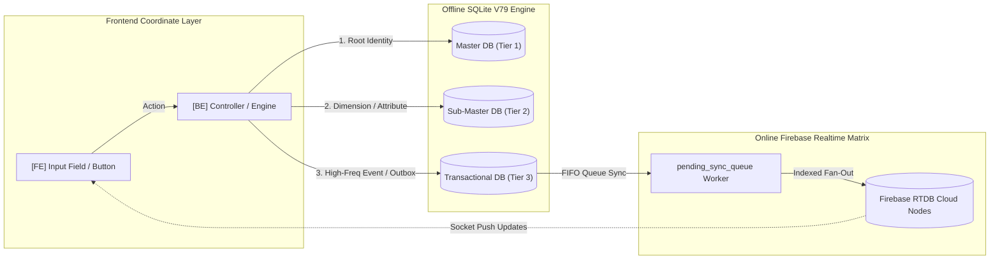

# 🌳 Master Frontend-to-Database Mapping Specification (ROOT ⊃ BR ⊃ EL ⊃ FE ⊃ BE ⊃ DB)
## Enterprise Tri-Tier Screen-by-Screen Dataflow & Forensic Audit
> **System:** `jFindMe` / `jButterFly` Enterprise Ecosystem  
> **Codename:** `jDroid-X` | **Operator:** `JEET` | **Version:** 5.0.0 (Enterprise Gold Master)  
> **Architecture Standard:** Strict OOPS MVC Coordinate Tree  
> **Database Scope:** Local SQLite V79 (`JFindMe_CitizenData.db`) & Online Firebase Cloud Matrix  
> **Taxonomy Standard:** Tri-Tier Database Hierarchy (Master DB • Sub-Master/Fact DB • Transactional DB)

---

## 📑 Core Screen Navigation Index

1. [Screen 01: Citizen Profile & Master Security PIN (`ProfileActivity`)](#screen-01-citizen-profile--master-security-pin-profileactivity)
2. [Screen 02: Device Pairing & Network Gateway (`NetworkGatewayActivity`)](#screen-02-device-pairing--network-gateway-networkgatewayactivity)
3. [Screen 03: Friends & Family Roster Governance (`FamilyFriendsActivity`)](#screen-03-friends--family-roster-governance-familyfriendsactivity)
4. [Screen 04: Live Map Tactical Radar & Real-Time Tracking (`LiveMapDashboardActivity`)](#screen-04-live-map-tactical-radar--real-time-tracking-livemapdashboardactivity)
5. [Screen 05: SafeZone & Geofence Boundary Matrix (`SafeZoneActivity`)](#screen-05-safezone--geofence-boundary-matrix-safezoneactivity)

---

### Screen 01: Citizen Profile & Master Security PIN (`ProfileActivity`)

```text
ROOT: PROFILE_ACTIVITY_MASTER_PLAN (com.jdroidx.jfindme.ui.profile.ProfileActivity)
│
├── 💼 [BR]₁: Citizen Identity Registration, Avatar Mesh Governance & Parental Lock
│    ├── 🖱️ [EL]₁․₁: Display Name & Nickname Entry Affordance
│    │    ├── 🖥️ [FE]₁․₁․₁: Input Field & Floating Label: "Full Name" & "Map Callout Nickname"
│    │    │    ├── (FR1.1): Full Name: 2-50 characters, letters, spaces, hyphens only.
│    │    │    │    ├── Pass Scenario: "Alexander Wright" -> Validated; green checkmark indicator.
│    │    │    │    └── Fail Scenario: "A" or "<script>" -> Inline red error: "Name must be 2-50 characters".
│    │    │    ├── (FR1.2): Nickname: 1-15 characters, alphanumeric only, rendered on map callout pill.
│    │    │    │    ├── Pass Scenario: "Alex" -> Validated; pill preview updates in real-time.
│    │    │    │    └── Fail Scenario: "Alex Wright The Great" -> Truncated/blocked at 15 chars.
│    │    │    └── ⚙️ [BE]₁․₁․₁․₁: ProfileSanitizer & Normalization Controller
│    │    │         ├── (BFR1.1): Strips HTML tags, trims leading/trailing spaces, enforces Title Case.
│    │    │         │    ├── Pass Scenario: "  alexander  " -> Emits normalized "Alexander".
│    │    │         │    └── Fail Scenario: Null or empty -> Throws ValidationException("NAME_REQUIRED").
│    │    │         ├── 🗄️ [Master DB [Offline]]₁․₁․₁․₁․₁: `user_identity.uid_1` (PK) & `user_identity.full_name`
│    │    │         │    ├── 🗄️ [Master DB [Online]]₁․₁․₁․₁․₂: Firebase RTDB `/devices/{agentId}/Identity/full_name`
│    │    │         │    └── 🗄️ [Sub Master/Fact DB [Offline]]₁․₁․₁․₁․₃: `user_profile.name` & `user_profile.nickname`
│    │    │         │         ├── 🗄️ [Sub Master/Fact DB [Online]]₁․₁․₁․₁․₄: Firebase RTDB `/devices/{agentId}/profile/nickname`
│    │    │         │         └── 🗄️ [Transactional DB [Offline]]₁․₁․₁․₁․₅: `change_log` (COL_CATEGORY='PROFILE', COL_ACTION='UPDATE', DETAILS_JSON)
│    │    │         │              └── 🗄️ [Transactional DB [Online]]₁․₁․₁․₁․₆: Firebase RTDB `/devices/{agentId}/audit/profile_mutations/{ts}`
│    │
│    ├── 🖱️ [EL]₁․₂: Contact Phone & Email Verification Affordance
│    │    ├── 🖥️ [FE]₁․₂․₁: Phone Input with Country Code Selector (+91 / +1) & Email Text Input
│    │    │    ├── (FR1.3): Phone: Must conform to E.164 international standard (+ followed by 10-15 digits).
│    │    │    │    ├── Pass Scenario: "+919876543210" -> Validated; carrier detection badge triggers.
│    │    │    │    └── Fail Scenario: "98765" -> Inline error: "Invalid E.164 phone format".
│    │    │    ├── (FR1.4): Email: Valid RFC 5322 regex syntax; domain MX lookup filter.
│    │    │    │    ├── Pass Scenario: "user@domain.com" -> Validated.
│    │    │    │    └── Fail Scenario: "user@tempmail.ninja" -> Blocked: "Disposable email domain rejected".
│    │    │    └── ⚙️ [BE]₁․₂․₁․₁: ContactVerificationEngine & Anti-Duplicate Verifier
│    │    │         ├── (BFR1.2): Executes de-duplication query against SQLite to prevent phone collision.
│    │    │         ├── 🗄️ [Master DB [Offline]]₁․₂․₁․₁․₁: `user_identity.id` (Master Identity Anchor)
│    │    │         │    └── 🗄️ [Sub Master/Fact DB [Offline]]₁․₂․₁․₁․₂: `user_profile.phone` & `user_profile.email` (Unique Index)
│    │    │         │         ├── 🗄️ [Sub Master/Fact DB [Online]]₁․₂․₁․₁․₃: Firebase RTDB `/lookup_indices/auth_to_device/{authUid}`
│    │    │         │         └── 🗄️ [Transactional DB [Offline]]₁․₂․₁․₁․₄: `pending_sync_queue` (payload_type='PROFILE_SYNC')
│    │    │         │              └── 🗄️ [Transactional DB [Online]]₁․₂․₁․₁․₅: `/devices/{agentId}/sync_status` ('COMMITTED')
│    │
│    ├── 🖱️ [EL]₁․₃: Master Parental Security PIN Affordance
│    │    ├── 🖥️ [FE]₁․₃․₁: 4-Digit Secure PIN Entry Matrix & Confirmation Keypad
│    │    │    ├── (FR1.5): Exactly 4 numerical digits; rejects trivial sequences (e.g., "1234", "0000").
│    │    │    │    ├── Pass Scenario: "8492" -> Accepted; prompts for confirmation.
│    │    │    │    └── Fail Scenario: "1111" -> Warning: "PIN is too weak. Choose a non-trivial code".
│    │    │    └── ⚙️ [BE]₁․₃․₁․₁: Argon2id Cryptographic Hasher & Salt Generator
│    │    │         ├── (BFR1.3): Generates 16-byte cryptographically secure salt; hashes via Argon2id (m=64MB, t=3, p=4).
│    │    │         ├── 🗄️ [Master DB [Offline]]₁․₃․₁․₁․₁: `user_identity.id` (Security Root)
│    │    │         │    └── 🗄️ [Sub Master/Fact DB [Offline]]₁․₃․₁․₁․₂: `user_profile.master_pin_hash` & `user_profile.salt`
│    │    │         │         └── 🗄️ [Transactional DB [Offline]]₁․₃․₁․₁․₃: `security_audit_log` (event_type='PIN_ESTABLISHED', severity='CRIT')
│    │    │         │              └── 🗄️ [Transactional DB [Online]]₁․₃․₁․₁․₄: (ZERO CLOUD SYNC — Master PIN hash NEVER leaves device)
```

---

### Screen 02: Device Pairing & Network Gateway (`NetworkGatewayActivity`)

```text
ROOT: NETWORK_GATEWAY_MASTER_PLAN (com.jdroidx.jfindme.ui.network.NetworkGatewayActivity)
│
├── 💼 [BR]₂: Hardware-Anchored Device Pairing, P2P Mesh Handshake & Lineage Governance
│    ├── 🖱️ [EL]₂․₁: 6-Digit Pair Code Input & QR Scanner Viewfinder
│    │    ├── 🖥️ [FE]₂․₁․₁: 6-Box Segmented Code Input & Camera Barcode Viewfinder
│    │    │    ├── (FR2.1): Auto-advances focus on digit entry; auto-submits upon 6th digit.
│    │    │    │    ├── Pass Scenario: Enters "839201" -> Triggers background pair handshake animation.
│    │    │    │    └── Fail Scenario: Enters "839A" -> Blocks non-numeric character.
│    │    │    ├── (FR2.2): Viewfinder detects JFindMe encrypted QR matrix (`jfindme://pair?id=...&code=...`).
│    │    │    │    ├── Pass Scenario: Scans QR -> Vibrates with haptic feedback (50ms); populates agent ID.
│    │    │    │    └── Fail Scenario: Scans standard URL -> Error toast: "Invalid JFindMe pairing QR".
│    │    │    └── ⚙️ [BE]₂․₁․₁․₁: DevicePairingEngine & Cryptographic Token Handshake
│    │    │         ├── (BFR2.1): Resolves peer agent ID; validates invitation TTL (< 15 mins).
│    │    │         ├── (BFR2.2): Verifies child lineage to prevent cyclic pairing loops (A -> B -> A).
│    │    │         ├── 🗄️ [Master DB [Offline]]₂․₁․₁․₁․₁: `device.device_id` (Host Device Master)
│    │    │         │    ├── 🗄️ [Master DB [Online]]₂․₁․₁․₁․₂: Firebase RTDB `/devices/{targetAgentId}/Identity/auth_uid`
│    │    │         │    └── 🗄️ [Sub Master/Fact DB [Offline]]₂․₁․₁․₁․₃: `sim.sim_serial` & `sim.serving_cid`
│    │    │         │         ├── 🗄️ [Sub Master/Fact DB [Online]]₂․₁․₁․₁․₄: Firebase RTDB `/hw_mapping/{hwId}`
│    │    │         │         └── 🗄️ [Transactional DB [Offline]]₂․₁․₁․₁․₅: `device_pairing` (pair_status='PENDING' ➔ 'ACTIVE')
│    │    │         │              └── 🗄️ [Transactional DB [Online]]₂․₁․₁․₁․₆: Firebase RTDB `/pairing_requests/{requestId}` (status='ACCEPTED')
│    │
│    ├── 🖱️ [EL]₂․₂: Zombie Node De-Duplication & Reinstall Pruner Button
│    │    ├── 🖥️ [FE]₂․₂․₁: "Prune Duplicate Devices" Action Chip & Progress Bar
│    │    │    ├── (FR2.3): Emits confirmation dialog: "Remove stale instances of this device model?".
│    │    │    │    ├── Pass Scenario: Confirms -> Executes `pruneZombieNodes`; displays count of pruned ghosts.
│    │    │    └── ⚙️ [BE]₂․₂․₁․₁: Multi-Device Zombie Node Pruner (`DatabaseHelper.pruneZombieNodes`)
│    │    │         ├── (BFR2.3): Joins `user_identity`, `user_profile`, and `device` matching `phone`, `device_model`, `name`, `nickname`.
│    │    │         ├── 🗄️ [Master DB [Offline]]₂․₂․₁․₁․₁: `user_identity.uid_1` (Current Canonical Agent ID)
│    │    │         │    └── 🗄️ [Sub Master/Fact DB [Offline]]₂․₂․₁․₁․₂: `device.device_model` & `user_profile.phone`
│    │    │         │         └── 🗄️ [Transactional DB [Offline]]₂․₂․₁․₁․₃: `change_log` (action='PRUNE_ZOMBIE', entity_id=orphanUid)
│    │    │         │              └── 🗄️ [Transactional DB [Online]]₂․₂․₁․₁․₄: Firebase RTDB `/devices/{orphanUid}` (`removeValue()`)
```

---

### Screen 03: Friends & Family Roster Governance (`FamilyFriendsActivity`)

```text
ROOT: FAMILY_FRIENDS_MASTER_PLAN (com.jdroidx.jfindme.ui.group.FamilyFriendsActivity)
│
├── 💼 [BR]₃: Circle Roster Hierarchy, Multi-Tier Permissions & Real-Time Presence
│    ├── 🖱️ [EL]₃․₁: Circle Category Filter Tabs (Family • Friends • Work • All)
│    │    ├── 🖥️ [FE]₃․₁․₁: Horizontal Scrollable Segmented Chip Group: [All (N)], [Family (N)], [Friends (N)]
│    │    │    ├── (FR3.1): Selecting chip filters roster Recycler instantly (0ms latency from memory cache).
│    │    │    └── ⚙️ [BE]₃․₁․₁․₁: RosterCategoryClassifier & In-Memory LiveData Sorter
│    │    │         ├── 🗄️ [Master DB [Offline]]₃․₁․₁․₁․₁: `groups.group_id` (PK) & `groups.group_name`
│    │    │         │    ├── 🗄️ [Master DB [Online]]₃․₁․₁․₁․₂: Firebase RTDB `/relationships/{activeGroup}/name`
│    │    │         │    └── 🗄️ [Sub Master/Fact DB [Offline]]₃․₁․₁․₁․₃: `group_members.circle_type` & `group_members.role`
│    │    │         │         └── 🗄️ [Sub Master/Fact DB [Online]]₃․₁․₁․₁․₄: Firebase RTDB `/relationships/{activeGroup}/members/{agentId}`
│    │
│    ├── 🖱️ [EL]₃․₂: Member Roster Card & Dynamic Telemetry Pill
│    │    ├── 🖥️ [FE]₃․₂․₁: Card Component: 3D Avatar, Member Name, Nickname Pill, Battery Gauge, RAG Status Badge
│    │    │    ├── (FR3.2): RAG Indicator: Green (< 5m heartbeat, > 20% bat), Amber (stale > 15m or < 15% bat), Red (SOS / offline > 24h).
│    │    │    │    ├── Pass Scenario: Battery = 85%, Last Seen = 30s ago -> RAG Status = GREEN ("Active Now").
│    │    │    │    └── Fail Scenario: SOS Active = true -> RAG Status = RED PULSING ("EMERGENCY SOS").
│    │    │    ├── (FR3.3): Tap on card navigates to `PersonDetailsActivity` passing `targetAgentId`.
│    │    │    └── ⚙️ [BE]₃․₂․₁․₁: DeviceRagEngine & Multi-Path Heartbeat Evaluator
│    │    │         ├── (BFR3.1): Evaluates direct node heartbeat, telemetry snapshot, and battery level in O(1).
│    │    │         ├── 🗄️ [Master DB [Offline]]₃․₂․₁․₁․₁: `user_identity.uid_1` (Peer Agent ID)
│    │    │         │    └── 🗄️ [Sub Master/Fact DB [Offline]]₃․₂․₁․₁․₂: `device_vitals.battery_level`, `device_vitals.motion_state`
│    │    │         │         ├── 🗄️ [Sub Master/Fact DB [Online]]₃․₂․₁․₁․₃: Firebase RTDB `/devices/{agentId}/telemetry`
│    │    │         │         └── 🗄️ [Transactional DB [Offline]]₃․₂․₁․₁․₄: `alert_history` (alert_type='SOS_PANIC', is_read=0)
│    │    │         │              └── 🗄️ [Transactional DB [Online]]₃․₂․₁․₁․₅: Firebase RTDB `/relationships/{groupId}/signals/sos`
│    │
│    ├── 🖱️ [EL]₃․₃: Permission Matrix Management Toggle (Tracking • Geofence • Remote Alert)
│    │    ├── 🖥️ [FE]₃․₃․₁: Switch Controls: [Can Track My Location], [Can Trigger SafeZone Alerts], [Is Admin]
│    │    │    ├── (FR3.4): Toggling switch calculates bitwise mask (`0x01` Track, `0x02` SafeZone, `0x04` Admin).
│    │    │    └── ⚙️ [BE]₃․₃․₁․₁: PermissionMaskBitwiseOperator
│    │    │         ├── 🗄️ [Master DB [Offline]]₃․₃․₁․₁․₁: `groups.group_id`
│    │    │         │    └── 🗄️ [Sub Master/Fact DB [Offline]]₃․₃․₁․₁․₂: `group_members.permissions_mask` (e.g., '0xFF')
│    │    │         │         ├── 🗄️ [Sub Master/Fact DB [Online]]₃․₃․₁․₁․₃: `/relationships/{grpId}/members/{agentId}/permissions`
│    │    │         │         └── 🗄️ [Transactional DB [Offline]]₃․₃․₁․₁․₄: `change_log` (action='UPDATE_PERMISSIONS', changed_by=operator)
│    │    │         │              └── 🗄️ [Transactional DB [Online]]₃․₃․₁․₁․₅: Firebase RTDB `/relationships/{grpId}/signals/refresh_roster`
```

---

### Screen 04: Live Map Tactical Radar & Real-Time Tracking (`LiveMapDashboardActivity`)

```text
ROOT: LIVE_MAP_DASHBOARD_MASTER_PLAN (com.jdroidx.jfindme.ui.map.LiveMapDashboardActivity)
│
├── 💼 [BR]₄: Tactical Radar Sweeping, Spatial Deduplication & Real-Time Breadcrumb Fan-Out
│    ├── 🖱️ [EL]₄․₁: Fleet Summary KPI Badges (Total Assets • Active Live • Standby • SOS Panic)
│    │    ├── 🖥️ [FE]₄․₁․₁: 4 Top Counter Badges displaying real-time aggregation across all paired devices.
│    │    │    ├── (FR4.1): SOS badge animates with continuous crimson pulse when count > 0.
│    │    │    └── ⚙️ [BE]₄․₁․₁․₁: FleetMetricsAggregator & PolarCoordinateTransformer
│    │    │         ├── 🗄️ [Master DB [Offline]]₄․₁․₁․₁․₁: `device.device_id` (Count of registered devices)
│    │    │         │    └── 🗄️ [Sub Master/Fact DB [Offline]]₄․₁․₁․₁․₂: `device_vitals` joined with `device`
│    │    │         │         ├── 🗄️ [Sub Master/Fact DB [Online]]₄․₁․₁․₁․₃: Firebase RTDB `/devices/{agentId}/device/live`
│    │    │         │         └── 🗄️ [Transactional DB [Offline]]₄․₁․₁․₁․₄: `alert_history` (WHERE alert_type='SOS_PANIC' AND resolved_at=0)
│    │    │         │              └── 🗄️ [Transactional DB [Online]]₄․₁․₁․₁․₅: Firebase RTDB `/devices/{agentId}/device/sos_active`
│    │
│    ├── 🖱️ [EL]₄․₂: Tactical Map Canvas & High-Frequency Multi-Marker Overlay
│    │    ├── 🖥️ [FE]₄․₂․₁: Google Maps SDK V2 Surface with Custom 3D Avatar Markers & Heading Arrows
│    │    │    ├── (FR4.2): Markers animate smoothly using Spherical LatLngInterpolator over 1000ms.
│    │    │    ├── (FR4.3): Marker callout displays member `nickname` pill, battery bar, and motion state icon.
│    │    │    └── ⚙️ [BE]₄․₂․₁․₁: SpatialProcessor & RoadSmoothingEngine
│    │    │         ├── (BFR4.1): Rejects GPS jitter (< 3m displacement) and Null Island (0.0, 0.0) coordinates.
│    │    │         ├── (BFR4.2): Queries `reverse_geocode_cache` by rounded lat/lng (0.001 deg) to avoid external API calls.
│    │    │         ├── 🗄️ [Master DB [Offline]]₄․₂․₁․₁․₁: `user_identity.uid_1` (Anchor ID)
│    │    │         │    └── 🗄️ [Sub Master/Fact DB [Offline]]₄․₂․₁․₁․₂: `reverse_geocode_cache.address` (Spatial Dimension)
│    │    │         │         ├── 🗄️ [Sub Master/Fact DB [Online]]₄․₂․₁․₁․₃: Firebase RTDB `/devices/{agentId}/device/live`
│    │    │         │         └── 🗄️ [Transactional DB [Offline]]₄․₂․₁․₁․₄: `location_event` (lat, lng, speed, bearing, accuracy, altitude, motion_state)
│    │    │         │              └── 🗄️ [Transactional DB [Online]]₄․₂․₁․₁․₅: Firebase RTDB `/History/{agentId}/history/{ts}`
│    │
│    ├── 🖱️ [EL]₄․₃: Emergency SOS Panic Broadcast Trigger Button
│    │    ├── 🖥️ [FE]₄․₃․₁: Floating Action Button (Crimson, Dual-Action: 3-Second Hold or 3 Quick Taps)
│    │    │    ├── (FR4.4): Haptic countdown: 3 vibrations over 3s before SOS payload locks and dispatches.
│    │    │    └── ⚙️ [BE]₄․₃․₁․₁: TelemetryFailoverRouter & EmergencyBroadcastEngine
│    │    │         ├── (BFR4.3): Attempts primary Firebase socket; on timeout (3000ms), triggers failover SMS gateway.
│    │    │         ├── 🗄️ [Master DB [Offline]]₄․₃․₁․₁․₁: `user_identity.uid_1` (Self Agent ID)
│    │    │         │    └── 🗄️ [Sub Master/Fact DB [Offline]]₄․₃․₁․₁․₂: `device_vitals.is_stealth`
│    │    │         │         └── 🗄️ [Transactional DB [Offline]]₄․₃․₁․₁․₃: `alert_history` (alert_type='SOS_PANIC', timestamp=nowMs)
│    │    │         │              ├── 🗄️ [Transactional DB [Offline]]₄․₃․₁․₁․₄: `pending_sync_queue` (payload_type='SOS')
│    │    │         │              └── 🗄️ [Transactional DB [Online]]₄․₃․₁․₁․₅: Firebase RTDB `/relationships/{activeGroup}/signals/sos`
```

---

### Screen 05: SafeZone & Geofence Boundary Matrix (`SafeZoneActivity`)

```text
ROOT: SAFEZONE_ACTIVITY_MASTER_PLAN (com.jdroidx.jfindme.ui.geofence.SafeZoneActivity)
│
├── 💼 [BR]₅: Spatial Geofencing, Temporal Schedule Enforcement & Dwell Detection
│    ├── 🖱️ [EL]₅․₁: Geofence Creation Map Tool & Circular/Polygon Radius Slider
│    │    ├── 🖥️ [FE]₅․₁․₁: Interactive Map with Draggable Center Pin & Radius Slider (50m to 5000m)
│    │    │    ├── (FR5.1): Slider displays explicit metric value: "Radius: 250 meters".
│    │    │    │    ├── Pass Scenario: Sets radius = 150m -> Circular polygon overlay updates with transparent green fill.
│    │    │    │    └── Fail Scenario: Radius < 30m -> Clamped to 30m minimum to avoid GPS drift false alarms.
│    │    │    └── ⚙️ [BE]₅․₁․₁․₁: GeofenceHelper & PolygonGeofenceHelper
│    │    │         ├── (BFR5.1): Registers geofence with Android OS `GeofencingClient` using `PendingIntent`.
│    │    │         ├── 🗄️ [Master DB [Offline]]₅․₁․₁․₁․₁: `safe_zone.zone_id` (PK UUID) & `safe_zone.created_by`
│    │    │         │    ├── 🗄️ [Master DB [Online]]₅․₁․₁․₁․₂: Firebase RTDB `/Geofencing/{creatorId}/safe_zones/{zoneId}`
│    │    │         │    └── 🗄️ [Sub Master/Fact DB [Offline]]₅․₁․₁․₁․₃: `safe_zone.radius_meters`, `safe_zone.is_dwell_alert_enabled`
│    │    │         │         ├── 🗄️ [Sub Master/Fact DB [Online]]₅․₁․₁․₁․₄: Firebase RTDB `/Geofencing/{creatorId}/safe_zones/{zoneId}/connected_devices`
│    │    │         │         └── 🗄️ [Transactional DB [Offline]]₅․₁․₁․₁․₅: `pending_sync_queue` (payload_type='SAFE_ZONE_ADD')
│    │    │         │              └── 🗄️ [Transactional DB [Online]]₅․₁․₁․₁․₆: Firebase RTDB `/Geofencing/{creatorId}/safe_zones/{zoneId}/notifications`
│    │
│    ├── 🖱️ [EL]₅․₂: SafeZone User Assignment & Schedule Picker
│    │    ├── 🖥️ [FE]₅․₂․₁: Checkbox List of Family Members & Active Time Window: [08:00 AM - 04:00 PM], [Mon-Fri]
│    │    │    ├── (FR5.2): Selecting a member binds their `identity_id` to the zone schedule.
│    │    │    └── ⚙️ [BE]₅․₂․₁․₁: GeofenceScheduleValidator
│    │    │         ├── (BFR5.2): Suppresses notifications outside designated active days/hours.
│    │    │         ├── 🗄️ [Master DB [Offline]]₅․₂․₁․₁․₁: `safe_zone.zone_id`
│    │    │         │    └── 🗄️ [Sub Master/Fact DB [Offline]]₅․₂․₁․₁․₂: `safe_zone_user_map` (zone_id, identity_id, schedule_start, schedule_end, active_days)
│    │    │         │         └── 🗄️ [Transactional DB [Offline]]₅․₂․₁․₁․₃: `change_log` (category='SAFEZONE', action='MAP_USER')
│    │
│    ├── 🖱️ [EL]₅․₃: Geofence Breach & Dwell Event History Feed
│    │    ├── 🖥️ [FE]₅․₃․₁: Chronological Transition Event Cards: [Child Left School at 03:45 PM], [Dwelling > 15m]
│    │    │    ├── (FR5.3): Event card renders color-coded icon: Green (Enter), Amber (Dwell), Red (Exit/Breach).
│    │    │    └── ⚙️ [BE]₅․₃․₁․₁: GeofenceBroadcastReceiver & DwellClassifier
│    │    │         ├── (BFR5.3): Ingests Android Geofence transition broadcast; writes event atomically to SQLite.
│    │    │         ├── 🗄️ [Master DB [Offline]]₅․₃․₁․₁․₁: `safe_zone.zone_id` & `user_identity.id`
│    │    │         │    └── 🗄️ [Sub Master/Fact DB [Offline]]₅․₃․₁․₁․₂: `reverse_geocode_cache.address`
│    │    │         │         └── 🗄️ [Transactional DB [Offline]]₅․₃․₁․₁․₃: `geofence_event` (event_type='ENTER'|'EXIT'|'DWELL', timestamp)
│    │    │         │              └── 🗄️ [Transactional DB [Online]]₅․₃․₁․₁․₄: Firebase RTDB `/Geofencing/{creatorId}/safe_zones/{zoneId}/target_devices/{targetId}/notifications/{date}`
```

---

## 🔁 Section 6: Closed Feedback Loop Summary Matrix


