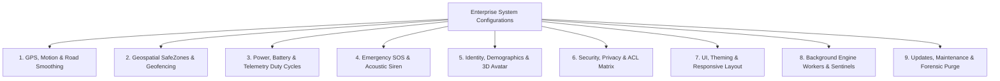

# Screen-Wise Settings, Configurations & SSOT Database Architecture

> **jFindMe Enterprise Location Tracking Ecosystem**  
> *Dynamic OOPS-based MVC/MVVM Closed-Loop Waterfall Standard*  
> Document Version: 1.0.0 (Enterprise Gold Master)  
> Target System: Android (Java / Kotlin Dual-Engine Architecture)  
> Author: jDroid-X (Issued by JEET)

---

## Executive Summary & Architecture Paradigm

This document provides the canonical specification for all screens, configurable parameters, validation constraints, and Single Source of Truth (SSOT) data synchronization in the `jFindMe` enterprise tracking ecosystem.

### Architectural Core Principles
1. **Dynamic OOPS-Based MVC/MVVM Hierarchy**: Every screen delegates UI state rendering to responsive ViewModels, with backend telemetry managed by centralized singletons (`RegistryManager`, `DatabaseHelper`, `BackgroundJobManager`).
2. **Strict Hardware Identity Sentinel**: The physical hardware anchor (`ro.ril.oem.sno` or canonical Agent ID e.g., `BE5A234A`) is the immutable root anchor. Software tokens never overwrite hardware identity.
3. **Closed-Loop SSOT Synchronization**: Any modification to a shared element (e.g., Avatar, Nickname, SafeZone, Tracking Interval, Role) updates the canonical source atomically, synchronously propagating across all observing activities and database layers without duplicate or orphaned data.
4. **Standardized Centralized RAG Status Engine**:
   - 🟢 **ACTIVE (LIVE)**: Heartbeat / location update `< 15 minutes` (`#22C55E` Emerald Green).
   - 🟡 **INACTIVE (< 6H)**: Last seen `15m – 6 hours` OR Battery `≤ 20%` (`#F59E0B` Amber Orange).
   - 🔴 **INACTIVE (> 6H)**: Last seen `> 6 hours` (`#EF4444` Rose Red).
   - 🚨 **EMERGENCY SOS**: `isSos == true` (`#EF4444` Pulsing Crimson).
   - ⚪ **UNLINKED / GHOST**: Deleted, unlinked, or Ghost Mode (`#64748B` Slate Gray).

---

## 1. Master Screen Inventory

The application encompasses **32 functional screens and management consoles** structured into 6 primary operational clusters:

| # | Screen / Activity Class | Cluster | Purpose & Architectural Role | Source File |
|---|---|---|---|---|
| 1 | `SettingsActivity` | Settings Core | Master Control Hub, UI Override & Telemetry Sentinels | [SettingsActivity.java](file:///c:/Users/jiten/jAnitGravity/jFindMe/app/src/main/java/com/jdroidx/jfindme/ui/settings/SettingsActivity.java) |
| 2 | `BackgroundJobsConfigDialog` | Settings Core | 12 Background Workers, Cadence Management & Manual Run | [BackgroundJobsConfigDialog.java](file:///c:/Users/jiten/jAnitGravity/jFindMe/app/src/main/java/com/jdroidx/jfindme/ui/settings/BackgroundJobsConfigDialog.java) |
| 3 | `UiConfigActivity` | Theme & Aesthetics | UI Architect: Typography, Gradients, Shadows & Stages | [UiConfigActivity.java](file:///c:/Users/jiten/jAnitGravity/jFindMe/app/src/main/java/com/jdroidx/jfindme/ui/settings/theme/UiConfigActivity.java) |
| 4 | `UiGalleryActivity` | Theme & Aesthetics | Live Visual Matrix Preview & Control Components Demo | [UiGalleryActivity.java](file:///c:/Users/jiten/jAnitGravity/jFindMe/app/src/main/java/com/jdroidx/jfindme/ui/settings/theme/UiGalleryActivity.java) |
| 5 | `ProfileActivity` | Identity & Profile | Self Hardware Identity, Personal Demographics & VRM Model | [ProfileActivity.java](file:///c:/Users/jiten/jAnitGravity/jFindMe/app/src/main/java/com/jdroidx/jfindme/ui/settings/ProfileActivity.java) |
| 6 | `AvatarEditorActivity` | Identity & Profile | Realtime 3D VRM Avatar Customizer, Mesh Rotation & Tint | [AvatarEditorActivity.java](file:///c:/Users/jiten/jAnitGravity/jFindMe/app/src/main/java/com/jdroidx/jfindme/ui/settings/avatar/AvatarEditorActivity.java) |
| 7 | `AvatarCropActivity` | Identity & Profile | Geometric Photo Crop, Circular Masking & Biometric Avatar | [AvatarCropActivity.java](file:///c:/Users/jiten/jAnitGravity/jFindMe/app/src/main/java/com/jdroidx/jfindme/ui/settings/avatar/AvatarCropActivity.java) |
| 8 | `OrgActivity` | Enterprise Governance | Corporate Domain, Department Hierarchies & Org Binding | [OrgActivity.java](file:///c:/Users/jiten/jAnitGravity/jFindMe/app/src/main/java/com/jdroidx/jfindme/ui/settings/OrgActivity.java) |
| 9 | `SystemUpdateActivity` | Maintenance & Support | Binary Synchronization, Silent In-Place APK Updater | [SystemUpdateActivity.java](file:///c:/Users/jiten/jAnitGravity/jFindMe/app/src/main/java/com/jdroidx/jfindme/ui/settings/update/SystemUpdateActivity.java) |
| 10 | `AboutActivity` | Maintenance & Support | Enterprise Licensing, EULA & Cryptographic Build Signatures | [AboutActivity.java](file:///c:/Users/jiten/jAnitGravity/jFindMe/app/src/main/java/com/jdroidx/jfindme/ui/settings/AboutActivity.java) |
| 11 | `HelpSupportActivity` | Maintenance & Support | Enterprise Helpdesk, Support Channels & Diagnostics Export | [HelpSupportActivity.java](file:///c:/Users/jiten/jAnitGravity/jFindMe/app/src/main/java/com/jdroidx/jfindme/ui/settings/HelpSupportActivity.java) |
| 12 | `PrivacyActivity` | Device Management | Hardware Permissions, Integrity Sweep, Ghost Mode & 2FA | [PrivacyActivity.java](file:///c:/Users/jiten/jAnitGravity/jFindMe/app/src/main/java/com/jdroidx/jfindme/ui/management/device/PrivacyActivity.java) |
| 13 | `HealthActivity` | Device Management | Hardware Vitals, Battery Draw, Doze Status & RAG Diagnostic | [HealthActivity.java](file:///c:/Users/jiten/jAnitGravity/jFindMe/app/src/main/java/com/jdroidx/jfindme/ui/management/device/HealthActivity.java) |
| 14 | `FactoryResetActivity` | Device Management | Dual-Stack Table Purge, Safety Phrase Auth & Teardown | [FactoryResetActivity.java](file:///c:/Users/jiten/jAnitGravity/jFindMe/app/src/main/java/com/jdroidx/jfindme/ui/management/device/FactoryResetActivity.java) |
| 15 | `NotifActivity` | Alerts & Dispatch | System Alert Routing, Acoustic Thresholds & Dispatch Constraints | [NotifActivity.java](file:///c:/Users/jiten/jAnitGravity/jFindMe/app/src/main/java/com/jdroidx/jfindme/ui/management/notif/NotifActivity.java) |
| 16 | `GeofenceActivity` | Geospatial Cluster | SafeZone Creator, Circular/Polygon Mapping & Schedules | [GeofenceActivity.java](file:///c:/Users/jiten/jAnitGravity/jFindMe/app/src/main/java/com/jdroidx/jfindme/ui/management/geofence/GeofenceActivity.java) |
| 17 | `GeofenceNotificationActivity` | Geospatial Cluster | Forensic Transition Ledger, Directional Filter Bar (IN/OUT) | [GeofenceNotificationActivity.java](file:///c:/Users/jiten/jAnitGravity/jFindMe/app/src/main/java/com/jdroidx/jfindme/ui/management/geofence/GeofenceNotificationActivity.java) |
| 18 | `HistoryActivity` | Geospatial Cluster | Historical Breadcrumb Replay, Speed Multiplier & Waypoints | [HistoryActivity.java](file:///c:/Users/jiten/jAnitGravity/jFindMe/app/src/main/java/com/jdroidx/jfindme/ui/management/history/HistoryActivity.java) |
| 19 | `ForensicVaultExplorerActivity` | Forensic & Audit | Encrypted Telemetry Ledger & Raw SQLite Table Inspector | [ForensicVaultExplorerActivity.java](file:///c:/Users/jiten/jAnitGravity/jFindMe/app/src/main/java/com/jdroidx/jfindme/ui/management/forensic/ForensicVaultExplorerActivity.java) |
| 20 | `WatchDogAuditActivity` | Forensic & Audit | Process Liveness, AlarmManager Heartbeats & Recovery Logs | [WatchDogAuditActivity.kt](file:///c:/Users/jiten/jAnitGravity/jFindMe/app/src/main/java/com/jdroidx/jfindme/ui/management/forensic/WatchDogAuditActivity.kt) |
| 21 | `DatabaseManagementActivity` | Forensic & Audit | SQLite Vacuum, Index Rebuild, Schema Migrations & Pruning | [DatabaseManagementActivity.java](file:///c:/Users/jiten/jAnitGravity/jFindMe/app/src/main/java/com/jdroidx/jfindme/ui/management/forensic/DatabaseManagementActivity.java) |
| 22 | `FirebaseCloudMatrixActivity` | Forensic & Audit | Realtime Database Connection Health, Latency Pings & Matrix | [FirebaseCloudMatrixActivity.java](file:///c:/Users/jiten/jAnitGravity/jFindMe/app/src/main/java/com/jdroidx/jfindme/ui/management/forensic/FirebaseCloudMatrixActivity.java) |
| 23 | `SystemLogActivity` | Forensic & Audit | Realtime Rolling System Logs, Memory Dumps & Event Traces | [SystemLogActivity.java](file:///c:/Users/jiten/jAnitGravity/jFindMe/app/src/main/java/com/jdroidx/jfindme/ui/management/forensic/SystemLogActivity.java) |
| 24 | `MapActivity` | Tactical Live Map | Primary Viewport, Vector Layers, Spiderweb & SOS Dispatch | [MapActivity.java](file:///c:/Users/jiten/jAnitGravity/jFindMe/app/src/main/java/com/jdroidx/jfindme/ui/map/MapActivity.java) |
| 25 | `MapActivity2` | Tactical Live Map | Secondary Alternative Vector Map Viewport / Prototype | [MapActivity2.java](file:///c:/Users/jiten/jAnitGravity/jFindMe/app/src/main/java/com/jdroidx/jfindme/ui/map/MapActivity2.java) |
| 26 | `LiveMapDashboardActivity` | Tactical Live Map | Split Dual-Pane Tactical Radar & Multi-Node Telemetry HUD | [LiveMapDashboardActivity.java](file:///c:/Users/jiten/jAnitGravity/jFindMe/app/src/main/java/com/jdroidx/jfindme/ui/map/LiveMapDashboardActivity.java) |
| 27 | `NetworkGatewayActivity` | Mesh & Pairing | Circle Pairing Hub (Active Roster, 6-char Cloud PIN, P2P) | [NetworkGatewayActivity.java](file:///c:/Users/jiten/jAnitGravity/jFindMe/app/src/main/java/com/jdroidx/jfindme/ui/group/NetworkGatewayActivity.java) |
| 28 | `FamilyFriendsActivity` | Circle & Roles | Circle Management, Relationship Role Categorization | [FamilyFriendsActivity.java](file:///c:/Users/jiten/jAnitGravity/jFindMe/app/src/main/java/com/jdroidx/jfindme/ui/group/FamilyFriendsActivity.java) |
| 29 | `GroupActivity` | Circle & Roles | Multi-Circle Group Creation, Team Partitioning & Active Group | [GroupActivity.java](file:///c:/Users/jiten/jAnitGravity/jFindMe/app/src/main/java/com/jdroidx/jfindme/ui/group/GroupActivity.java) |
| 30 | `PersonDetailsActivity` | Circle & Roles | Node ACL Security Matrix, Granular Permissions & Medical | [PersonDetailsActivity.java](file:///c:/Users/jiten/jAnitGravity/jFindMe/app/src/main/java/com/jdroidx/jfindme/ui/group/PersonDetailsActivity.java) |
| 31 | `AuthActivity` | Session & Access | Biometric Gate, Agent ID Resolution & Auto-Login Persistence | [AuthActivity.java](file:///c:/Users/jiten/jAnitGravity/jFindMe/app/src/main/java/com/jdroidx/jfindme/ui/auth/AuthActivity.java) |
| 32 | `AcousticSirenActivity` | Emergency Ops | Fullscreen Lockscreen SOS Beacon, DND Volume Bypass & Torch | [AcousticSirenActivity.java](file:///c:/Users/jiten/jAnitGravity/jFindMe/app/src/main/java/com/jdroidx/jfindme/ui/alert/AcousticSirenActivity.java) |

---

## 2. Group by Screen: Configurable Items & Validation Constraints

### 2.1 [SettingsActivity.java](file:///c:/Users/jiten/jAnitGravity/jFindMe/app/src/main/java/com/jdroidx/jfindme/ui/settings/SettingsActivity.java) (Master Control Hub)

| Setting Name | Registry Key | Type / Default | Allowed Values / Range | Validation Logic / Triggers |
|---|---|---|---|---|
| **Master Theme Selector** | `theme_id` | Int (`0`) | `0` to `7` (8 Themes) | Header button cycles `(current + 1) % totalThemes`. Calls `safeRecreate()`. |
| **Restore Recommended Defaults** | N/A (Master Action) | Interactive Engine Trigger | 18 Core Engine Keys | Resets Cadence, Kalman, Geofence, Health, SOS, & Queue to recommended defaults with in-place label mutation (no reload). |
| **Battery Stepper Interval** | `pref_manual_pulse` | Long (`90000`) | `90s` to `3600s` | Step ±10s. Enforces ≥90s to prevent rapid battery depletion. |
| **Battery Optimizer Preset** | `pref_tracking_interval` | Long (`15000`) | `1000` (Extreme), `7000` (High), `15000` (Active), `30000` (Balanced), `60000` (Eco) | Radio switch selection. Instantly reprograms `TrackingService` location request cadence. |
| **Hardware Motion Co-Processor** | `pref_activity_recognition_enabled` | Boolean (`false`) | `true` / `false` | Checks `ACTIVITY_RECOGNITION` OS permission. When true, GPS sleeps during detected STILL state. |
| **Motion Still Cadence** | `pref_motion_still_interval_ms` | Long (`300000`) | `60s` to `900s` | Active only when Co-Processor enabled. Duty cycle for zero-motion state. |
| **Motion Vehicle Cadence** | `pref_motion_vehicle_interval_ms` | Long (`10000`) | `1s` to `30s` | High-rate sampling triggered upon vehicle transition detection. |
| **Motion Walking Cadence** | `pref_motion_walking_interval_ms` | Long (`20000`) | `5s` to `60s` | Pedestrian balance sampling rate. |
| **Road Alignment & 2D Kalman** | `pref_road_smoothing_enabled` | Boolean (`false`) | `true` / `false` | Toggles 2D matrix state estimation for road heading smoothing. |
| **Kalman Measurement Noise ($R$)** | `pref_kalman_measurement_noise` | Float (`25.0f`) | `5.0f` to `100.0f` | Controls GNSS variance tolerance. Lower = trusts GPS; Higher = smoother. |
| **Heading EMA Factor** | `pref_heading_ema_factor` | Float (`0.35f`) | `0.05f` to `0.95f` | Exponential Moving Average alpha factor for bearing rotation. |
| **Smart Avatar Clustering** | `pref_smart_avatar_clustering` | Boolean (`false`) | `true` / `false` | Merges map avatar pins within 10-meter proximity radius. |
| **Distance Unit Metric** | `pref_unit_metric` | Boolean (`true`) | `true` (Metric: km) / `false` (Imperial: mi) | Recalculates distance and velocity indicators across all UI surfaces. |
| **Perimeter Jitter Debounce** | `pref_geofence_jitter_debounce_ms` | Long (`15000`) | Presets (`0s`, `5s`, `15s`, `30s`, `60s`) + **Custom (`0` to `300s`)** | Temporal anti-flutter filter before confirming SafeZone transition. |
| **Dormancy State Latch** | `pref_geofence_latch_enabled` | Boolean (`true`) | `true` / `false` | Prevents duplicate ENTER/EXIT triggers without crossing opposite boundary. |
| **Centroid GPS Snapping** | `pref_geofence_snap_center_enabled` | Boolean (`false`) | `true` / `false` | Snaps coordinates to SafeZone centroid to hide building interior drift. |
| **Local Geofence Alerts** | `pref_geofence_local_notif_enabled` | Boolean (`true`) | `true` / `false` | Plays audio chime and banner on boundary breach. |
| **Cloud FCM Push Relay** | `pref_geofence_fcm_relay_enabled` | Boolean (`true`) | `true` / `false` | Dispatches remote FCM push to guardian devices. |
| **Default Safe Zone Radius** | `pref_default_safe_zone_radius_meters` | Int (`100`) | Presets (`50m`, `100m`, `200m`, `500m`, `1000m`) + **Custom (`10` to `5000m`)** | Used as initial radius when drawing new Safe Zones. |
| **Minimum Displacement Filter** | `pref_min_displacement_meters` | Float (`25.0f`) | Presets (`0m`, `5m`, `10m`, `25m`) + **Custom (`0` to `1000m`)** | Suppresses location publishing if physical displacement is under threshold. |
| **Strict Accuracy Fix Wait** | `pref_strict_accuracy_wait` | Boolean (`false`) | `true` / `false` | Suppresses coarse fixes until GNSS horizontal accuracy is `< 10m`. |
| **Low Battery Alert Threshold** | `pref_low_battery_threshold` | Int (`20`) | Presets (`10%`, `15%`, `20%`, `25%`) + **Custom (`5` to `50%`)** | Triggers RAG 🟡 Amber warning and battery distress dispatch. |
| **Inactive Stale Threshold** | `pref_stale_inactive_minutes` | Int (`15`) | Presets (`5m`, `10m`, `15m`, `30m`, `60m`) + **Custom (`1` to `1440m`)** | Switches device status to 🟡 Inactive if heartbeat is missing. |
| **Critical Offline Threshold** | `pref_critical_offline_hours` | Int (`6`) | Presets (`2h`, `4h`, `6h`, `12h`, `24h`) + **Custom (`1` to `168h`)** | Switches device status to 🔴 Critical Offline. |
| **Distant Device Panel Radius** | `pref_distant_device_threshold_meters` | Int (`200`) | Presets (`50m`, `100m`, `200m`, `500m`, `1000m`) + **Custom (`20` to `50000m`)** | Floats direction HUD when a member exceeds perimeter distance. |
| **Siren Auto-Silence Duration** | `pref_siren_duration_sec` | Int (`30`) | Presets (`10s`, `15s`, `30s`, `60s`, `120s`) + **Custom (`5` to `600s`)** | Maximum emergency acoustic horn playtime. |
| **Siren Continuous Vibration** | `pref_siren_vibration_enabled` | Boolean (`true`) | `true` / `false` | Pulses hardware haptic motor during siren playback. |
| **Do-Not-Disturb (DND) Override** | `pref_siren_dnd_bypass_enabled` | Boolean (`true`) | `true` / `false` | Sets `STREAM_ALARM` to 100% volume regardless of system silent profile. |
| **SOS Confirmation Countdown** | `pref_sos_countdown_sec` | Int (`5`) | Presets (`0s`, `3s`, `5s`, `10s`, `15s`) + **Custom (`0` to `60s`)** | Abort window before broadcasting emergency distress. |
| **SOS Cooldown Window** | `pref_sos_cooldown_sec` | Int (`60`) | Presets (`15s`, `30s`, `60s`, `120s`, `300s`) + **Custom (`5` to `600s`)** | Throttle lockout preventing accidental spamming. |
| **SOS Acknowledgement Timeout** | `pref_sos_ack_timeout_sec` | Int (`300`) | Presets (`60s`, `180s`, `300s`, `600s`) + **Custom (`1` to `180m`)** | Triggers escalation if guardians do not acknowledge SOS within timeout. |
| **SOS Fan-Out Scope** | `pref_sos_fanout_scope` | String (`all_contacts`) | `ALL_CONTACTS`, `GROUP_ONLY`, `FAMILY_ONLY` | Filters targeted broadcast recipients. |
| **SOS Confirmation Required** | `pref_sos_confirmation_required` | Boolean (`true`) | `true` / `false` | When false, SOS triggers instantaneously on press. |
| **SOS Cancel Requires PIN** | `pref_sos_cancel_requires_pin` | Boolean (`false`) | `true` / `false` | Enforces Master Guardian PIN input to dismiss active SOS. |
| **Offline GPS Queue Capacity** | `pref_offline_queue_max_points` | Int (`500`) | Presets (`100`, `250`, `500`, `1000`, `2000`) + **Custom (`50` to `5000`)** | Maximum points buffered in SQLite `PENDING_SYNC_QUEUE` before circular purge. |
| **Deferred Sync on Wi-Fi Only** | `pref_sync_wifi_only` | Boolean (`false`) | `true` / `false` | When true, restricts batch telemetry upload to unmetered Wi-Fi. |
| **Guardian Master Security PIN** | `guardian_pin_hash` | String (`""`) | 4 to 8 numeric digits | Encrypted SHA-256 hash. Required for guarded security actions. |
| **Child / Ward Protection Lock** | `child_ward_mode_active` | Boolean (`false`) | `true` / `false` | Tamper-proof mode. Anti-desync zero-flicker PIN guard protects deactivation. |
| **Location Pause Duration** | `pref_pause_duration_mins` | Int (`60`) | Presets (`15m`, `30m`, `60m`, `120m`, `240m`, `Indefinite`) + **Custom (`5` to `1440m`)** | Sets temporary Ghost Mode countdown. |
| **Pairing PIN Expiry TTL** | `pairing_pin_ttl_minutes` | Int (`5`) | Presets (`5m`, `10m`, `15m`, `20m`, `30m`) + **Custom (`1` to `120m`)** | Time-To-Live for cloud pairing pins (NIST SP 800-63B standard). |
| **Master Purge Safety Phrase** | `pref_purge_safety_phrase` | String | Must match `jbutterfly@123` | Security guard phrase required before executing factory purge. |
| **Tenant & Hardware Prefixes** | `pref_hw_prefix` `pref_agent_prefix` | String (`"HW_"`, `"Agent_"`) | Alphanumeric namespace | Controls hardware key and agent identity tenant prefix strings. |
| **Kalman Process Noise ($Q$)** | `pref_kalman_process_noise` | Float (`3.0f`) | Presets (`0.5`, `1.0`, `3.0`, `5.0`, `10.0`) | Model expectation of acceleration; trusts GPS changes dynamically. |
| **Min Motion Speed for Azimuth** | `pref_min_motion_speed_mps` | Float (`0.8f`) | Presets (`0.2`, `0.5`, `0.8`, `1.5`, `2.5` m/s) | Heading chevron lock threshold to suppress stationary compass drift. |
| **Default Home / Fleet Centroid** | `pref_default_latitude` `pref_default_longitude` | Double (`18.5204`, `73.8567`) | Global coordinate range | Home viewport center fallback when no live GPS is received. |
| **Default Map Zoom Level** | `pref_default_zoom` | Float (`15.0f`) | Presets (`12x`, `14x`, `15x`, `16x`, `18x`) | Initial map zoom level across tactical viewports. |
| **Google Maps API Key Override** | `pref_google_maps_key` | String (`""`) | Standard Google Maps API Key | In-app key rotation without rebuilding APK or re-deploying. |
| **History Replay Default Speed** | `pref_history_replay_speed` | Int (`1`) | Presets (`1x`, `2x`, `5x`, `10x`) | Default speed multiplier loaded on trajectory history replay. |

---

### 2.2 [BackgroundJobsConfigDialog.java](file:///c:/Users/jiten/jAnitGravity/jFindMe/app/src/main/java/com/jdroidx/jfindme/ui/settings/BackgroundJobsConfigDialog.java) (12 Engine Workers)

| Job Identifier | Active Toggle Key | Frequency Pref Key | Default Cadence | Options & Conditions | Manual Trigger Support |
|---|---|---|---|---|---|
| **1. Live GPS Tracking Service** | `pref_tracking_active` | `pref_tracking_interval` | `15000ms` | 1s, 7s, 15s, 30s, 60s | Foreground Service restart |
| **2. Offline GPS Telemetry Sync** | `pref_offline_sync_active` | `pref_offline_sync_interval_mins` | `15 mins` | 15m, 30m, 60m, 360m | `OfflineSyncWorker.runNow()` |
| **3. Watchdog Sentinel Worker** | `pref_watchdog_active` | `pref_watchdog_interval_mins` | `15 mins` | 15m, 30m, 60m | `LocationWatchdogWorker.runNow()` |
| **4. SIM Forensic Tracking** | `pref_sim_forensic_active` | `pref_sim_forensic_interval_mins` | `15 mins` | 15m, 60m, 360m, 1440m | Trigger IMSI / ICCID sweep |
| **5. System Silent APK Auto-Update**| `pref_update_check_active` | `pref_update_check_interval_hours` | `24 hours` | 6h, 12h, 24h (Daily 03:03 AM) | `SilentUpdateWorker.runNow()` |
| **6. Realtime Presence Pulse** | `pref_presence_pulse_active` | `pref_presence_pulse_interval_sec` | `30 secs` | 15s, 30s, 60s | Pushes immediate vitals heartbeat |
| **7. Geofence Boundary Transition** | `pref_geofence_active` | `pref_geofence_sensitivity_meters`| `15 meters` | 5m, 15m, 25m | Re-registers OS geofences |
| **8. Critical Security OS Broadcast**| `pref_security_receiver_active`| N/A | Event-driven | Boot, Airplane mode, Shutdown | Test Broadcast dispatch |
| **9. Acoustic Siren Engine** | `pref_acoustic_siren_active` | `pref_siren_duration_sec` | `30 secs` | 10s, 30s, 60s, 120s | Launch `AcousticSirenActivity` |
| **10. FCM Push Cloud Messaging** | `pref_fcm_active` | N/A | Realtime push | Background push handler | Invalidate & refresh FCM Token |
| **11. Realtime Map Stream Poller** | `pref_live_map_stream_active`| `pref_stream_poll_interval_sec` | `5 secs` | 1s, 5s, 10s | Poll remote database snapshot |
| **12. Package Upgrade Watcher** | `pref_upgrade_watch_active` | N/A | Event-driven | `MY_PACKAGE_REPLACED` | Diagnostic package verification |

---

### 2.3 [UiConfigActivity.java](file:///c:/Users/jiten/jAnitGravity/jFindMe/app/src/main/java/com/jdroidx/jfindme/ui/settings/theme/UiConfigActivity.java) (Master UI Architect)

| UI Parameter | Registry Key | Type / Default | Configurable Options | Validation & Architectural Effect |
|---|---|---|---|---|
| **Design Stage Override** | `stage_override` | String (`AUTO`) | `AUTO`, `LIBERAL` (800dp+), `STANDARD` (600dp+), `COMPACT` (400dp+), `SLIM` (320dp+), `ULTRA-SLIM` (<320dp) | Locks scaling matrix to specific viewport stage regardless of hardware density. |
| **Borders vs. Shadows** | `borders_enabled` | Boolean (`true`) | `true` (Forensic Borders) / `false` (Depth Shadows) | When false, renders dynamic multi-tier elevation mattress and shadow deck. |
| **Shadow Elevation Intensity** | `shadow_intensity_ratio` | Float (`1.0f`) | `0.0f` to `2.0f` | Multiplier for Card and Dialog shadow blur and translation offset. |
| **Corner Radius Multiplier** | `radius_multiplier` | Float (`1.0f`) | `0.5f` to `2.0f` | Scales all button, card, and pill corner radii proportionally. |
| **Component Padding Scale** | `padding_density_scale` | Float (`1.0f`) | `0.8f` to `1.5f` | Dynamically compacts or expands layout padding. |
| **Custom Widget Accent Tint** | `custom_widget_tint` | String (`""`) | Hex Color `#RRGGBB` | Overrides primary theme accent for toggles and indicators. |

---

### 2.4 [ProfileActivity.java](file:///c:/Users/jiten/jAnitGravity/jFindMe/app/src/main/java/com/jdroidx/jfindme/ui/settings/ProfileActivity.java) & [OrgActivity.java](file:///c:/Users/jiten/jAnitGravity/jFindMe/app/src/main/java/com/jdroidx/jfindme/ui/settings/OrgActivity.java)

| Field / Configuration | Storage Target | Format / Type | Validation Conditions |
|---|---|---|---|
| **Full Legal Name** | `USER_PROFILE.name` | String (2-50 chars) | Mandatory. Letters, spaces, apostrophes only. |
| **User Nickname** | `USER_PROFILE.nickname` | String (2-30 chars) | Must not be blank. Displayed on Live Map pin callouts. |
| **Phone Number** | `USER_PROFILE.phone` | E.164 (10-15 digits) | Validated via `ValidationEngine.isValidPhoneNumber()`. |
| **Date of Birth** | `USER_PROFILE.dob` | `yyyy-MM-dd` | Must be a past date; minimum age check. |
| **Gender** | `USER_PROFILE.gender` | AutoComplete Text | Options: Male, Female, Non-Binary, Undisclosed. |
| **Country, State, City** | `USER_PROFILE.address` | Cascading Dropdowns | Standard geographical country/state dictionary lookup. |
| **Postal / ZIP Code** | `USER_PROFILE.pincode` | Alphanumeric (4-10) | Length and format verified against country standards. |
| **Emergency Medical Notes** | `USER_PROFILE.emergency_note` | Free Text (≤500 chars) | Blood group, allergies, medication, emergency contacts. |
| **Organization Name** | `ORGANIZATION.org_name` | String (2-100 chars) | Unique identifier for corporate multi-tenancy. |
| **Department / Division** | `USER_ORG_MAP.department` | String (2-50 chars) | Organizational unit assignment. |
| **Equipped Avatar Model** | `USER_PROFILE.avatar_url` | Int (`0` to `6`) | Links to 3D VRM models in `assets/models/`. |

---

### 2.5 [PrivacyActivity.java](file:///c:/Users/jiten/jAnitGravity/jFindMe/app/src/main/java/com/jdroidx/jfindme/ui/management/device/PrivacyActivity.java) (Security & Compliance)

| Configuration Item | Key | Type / Default | Operational Behavior & Triggers |
|---|---|---|---|
| **Location Services Permission** | OS Manifest | Read-Only Status | Prompts OS permission dialog if `ACCESS_FINE_LOCATION` is missing. |
| **Battery Whitelist Exemption** | OS Power Manager | Read-Only Status | Dispatches `ACTION_REQUEST_IGNORE_BATTERY_OPTIMIZATIONS`. |
| **Telemetry Diagnostics** | `telemetry_enabled` | Boolean (`true`) | Sends anonymized performance metrics to development registry. |
| **Developer Forensic Logging** | `developer_logging_enabled` | Boolean (`false`) | Enables verbose trace logs in `SystemLogger.kt`. |
| **Two-Factor Authentication** | `2fa_enabled` | Boolean (`false`) | Prompts 2FA OTP code on login and sensitive actions. |
| **Strict Tracking Constraints** | `strict_track` | Boolean (`true`) | Rejects Wi-Fi/Cellular triangulation when GPS is active. |
| **Location History Tracking** | `allow_dependents` | Boolean (`true`) | Allows dependent devices to record local breadcrumbs. |
| **Persistent Ghost Mode** | `ghost_mode` | Boolean (`false`) | Suspends location publishing to Firebase. Local logging remains active. |
| **Full Security Sweep** | Interactive Trigger | System Scan | Audits Root / SU binaries, Developer Options ADB, Mock GPS spoofing. |

---

### 2.6 [NotifActivity.java](file:///c:/Users/jiten/jAnitGravity/jFindMe/app/src/main/java/com/jdroidx/jfindme/ui/management/notif/NotifActivity.java) (Alert Configuration Hub)

| Alert Rule | Registry Key | Default | Category & Severity | Operational Trigger Condition |
|---|---|---|---|---|
| **Panic SOS Override** | `alert_sos` | `true` | Emergency (High) | Dispatches siren immediately; bypasses DND volume profile. |
| **Geofence Boundary Breach** | `alert_geofence` | `true` | Geospatial | Triggers when target node enters or exits a Safe Zone perimeter. |
| **Persistent Haptic Alert** | `pref_geofence_persistent_haptic` | `false` | Geospatial | Pulses 10-second continuous vibration on geofence breach. |
| **Battery Critical Warning** | `alert_battery` | `true` | Hardware | Dispatches notification when device battery drops below 15%. |
| **Network Timeout / Dropped** | `alert_network` | `true` | Connectivity | Triggers when heartbeat is missing for > 10 consecutive minutes. |
| **Device Powered Off** | `alert_power` | `true` | Security | Broadcasts final intent upon OS `ACTION_SHUTDOWN`. |
| **GPS Services Disabled** | `alert_gps_off` | `true` | Security | Alerts guardians if location provider is disabled in quick settings. |
| **App Permission Revoked** | `alert_perms` | `true` | Security | Triggers if background location access is revoked by the user. |
| **Root / Jailbreak Detected** | `alert_root` | `false` | Security | Critical warning if SU binaries or mock location providers detected. |
| **Database Bloat Warning** | `perf_db_bloat` | `true` | Performance | Warns when SQLite history points exceed 10,000 records. |
| **Network Latency Monitor** | `perf_net_lag` | `true` | Performance | Warns when round-trip Firebase ping exceeds 3,000ms. |
| **Thermal Tracking Guard** | `perf_thermal` | `false` | Hardware | Warns if CPU / battery thermal envelope exceeds 45°C. |

---

### 2.7 [GeofenceActivity.java](file:///c:/Users/jiten/jAnitGravity/jFindMe/app/src/main/java/com/jdroidx/jfindme/ui/management/geofence/GeofenceActivity.java) (Safe Zone Creator)

| SafeZone Parameter | Target Field | Type / Constraints | Validation Logic & Boundaries |
|---|---|---|---|
| **Zone Name** | `SAFE_ZONE.name` | String (1-40 chars) | Mandatory. Must not collide with existing active zones. |
| **Shape Geometry** | Circular vs. Polygon | Mode Toggle | Circular uses center + radius; Polygon uses list of `LatLng` points. |
| **Perimeter Radius** | `SAFE_ZONE.radius` | Double (meters) | Min `50.0m`, Max `5000.0m`. Quick buttons: 100m, 200m, 500m, 1000m. |
| **Center Latitude / Longitude**| `SAFE_ZONE.lat`, `lng` | Double (`-90` to `+90`, `-180` to `+180`) | Interactive click-to-place on map with real-time preview circle. |
| **Polygon Vertices** | `SAFE_ZONE.polygon_json` | JSON Array of `LatLng` | Must contain at least 3 vertices. Validates non-self-intersecting. |
| **Assigned Circle Devices** | `SAFE_ZONE_USER_MAP` | List of `agent_id` strings | Multi-select cluster linking specific devices from `MASTER_ROSTER`. |
| **Schedule Start / End** | `SAFE_ZONE.schedule_start/end` | Time (`HH:mm`) | Optional temporal window when perimeter alerts are active. |
| **Schedule Day Mask** | `SAFE_ZONE.schedule_days` | 7-bit flag (Mon-Sun) | Checkbox array to restrict monitoring to specific weekdays. |

---

### 2.8 [HistoryActivity.java](file:///c:/Users/jiten/jAnitGravity/jFindMe/app/src/main/java/com/jdroidx/jfindme/ui/management/history/HistoryActivity.java) (Trajectory Playback)

| Control / Setting | Key / Property | Default | Options / Range | Operational Behavior |
|---|---|---|---|---|
| **Target Member / Node** | `currentTargetUid` | Current User | Paired circle roster | Loads historical breadcrumbs from SQLite `LOCATION_EVENT`. |
| **Time Duration Window** | `selectedTimeIndex` | `0` (4 Hours) | 4h, 12h, 24h, 7 Days | Filters query by epoch timestamp window. |
| **Replay Speed Multiplier** | `pref_history_replay_speed` | `1x` | `1x`, `2x`, `5x` | Controls `ValueAnimator` interpolation speed along polyline. |
| **Waypoint Filtering** | Spatial Engine | Adaptive | Stationary filter | Suppresses jitter points when displacement is `< 5m`. |
| **Export Trajectory** | Intent Trigger | CSV / KML | Full historical ledger | Generates exportable spatial file for external audit. |

---

### 2.9 [NetworkGatewayActivity.java](file:///c:/Users/jiten/jAnitGravity/jFindMe/app/src/main/java/com/jdroidx/jfindme/ui/group/NetworkGatewayActivity.java) (Mesh & Pairing)

| Feature / Setting | Mechanism | Constraints & Rules | Security & Cryptographic Protocol |
|---|---|---|---|
| **Active Roster Hub** | SQLite `MASTER_ROSTER` | Dual-Engine LiveData | Lists paired nodes, role badges, RAG status dots, and unlink buttons. |
| **Option A: Remote Cloud PIN** | Firebase `/pairings/{pin}` | 6-char alphanumeric | Ephemeral 6-char PIN. TTL enforced by `pairing_pin_ttl_minutes` (5-30m). |
| **QR Code Pairing** | ZXing Matrix | `jfindme://pair?code=...` | High-density QR code embedding pairing token and hardware identity. |
| **Option B: Nearby P2P Matrix**| Wi-Fi Direct / Local NSD | 8-digit hardware PIN | Offline zero-cloud pairing for isolated operational environments. |
| **Relationship Role Selector**| SQLite `role` column | Admin, Guardian, Family, Friend, Ward | Assigns privilege level and ACL boundary upon successful pairing. |

---

### 2.10 [PersonDetailsActivity.java](file:///c:/Users/jiten/jAnitGravity/jFindMe/app/src/main/java/com/jdroidx/jfindme/ui/group/PersonDetailsActivity.java) (Node Dossier & ACL)

| Configuration Item | Type | Storage Target | Description & Security Boundary |
|---|---|---|---|
| **Node Demographics** | Form Inputs | SQLite `USER_PROFILE` | Name, phone, email, DOB, gender, address, emergency note. |
| **Live Tracking ACL** | Checkbox | `USER_IDENTITY.tracking_status` | Enables / disables real-time coordinate streaming for this member. |
| **Historical Audit ACL** | Checkbox | `acl_history_audit` | Grants or revokes permission to view historical trajectory logs. |
| **Geofence Alerts ACL** | Checkbox | `acl_geofence_alerts` | Enables or mutes perimeter breach notifications for this node. |
| **Circle Admin Privileges** | Checkbox | `role = 'ADMIN'` | Authorizes member to add/remove circle devices and change safe zones. |
| **Ghost Mode Override ACL** | Checkbox | `acl_ghost_override` | Forces visibility on guardian maps even if node turns on Ghost Mode. |
| **Biometric Gate Lock** | Checkbox | `biometric_lock_enabled` | Enforces fingerprint / face authentication to open this node's dossier. |
| **Force Cloud Sync Trigger** | Button | Firebase Push Trigger | Writes incremental timestamp to trigger immediate bi-directional sync. |

---

### 2.11 [SystemUpdateActivity.java](file:///c:/Users/jiten/jAnitGravity/jFindMe/app/src/main/java/com/jdroidx/jfindme/ui/settings/update/SystemUpdateActivity.java) (In-Place Updater)

| Setting / Property | Registry Key | Type / Default | Validation & Execution Behavior |
|---|---|---|---|
| **Support / Admin Account** | `pref_support_email` | String | Validated via `ValidationEngine.isValidEmail()`. |
| **Google Drive Package Link**| `pref_system_update_link` | URL String | HTTP/HTTPS URL to production APK repository. |
| **GitHub Binary Channel** | `pref_github_update_link` | URL String | Fallback source channel for release artifacts. |
| **Silent Auto-Update Mode** | `silent_update_enabled` | Boolean (`false`) | When enabled, `SilentUpdateWorker` downloads and replaces APK silently. |
| **Update Check Cadence** | `pref_update_check_interval_hours` | Long (`24`) | Periodic worker interval (6h, 12h, 24h). Default 03:03 AM daily sweep. |
| **Manual Execution** | UI Button | Immediate Trigger | Downloads release metadata and initiates APK package installer. |

---

### 2.12 [FactoryResetActivity.java](file:///c:/Users/jiten/jAnitGravity/jFindMe/app/src/main/java/com/jdroidx/jfindme/ui/management/device/FactoryResetActivity.java) (System Wipe Console)

| Control / Setting | Target | Constraint / Validation | Teardown Action |
|---|---|---|---|
| **Safety Authorization Phrase**| `pref_purge_safety_phrase` | Must equal `jbutterfly@123` | Case-sensitive string validation. Prevents accidental execution. |
| **Selective Table Purge** | 17 SQLite Tables | Individual Checkboxes | Clears selected tables (`LOCATION_EVENT`, `SAFE_ZONE`, `ROSTER`, etc.). |
| **Registry Wipe** | `system_registry` | Checkbox | Purges all SharedPreferences and resets settings to factory defaults. |
| **Pre-Uninstall Teardown** | Background Subsystem | Master Action | Halts all 12 services, cancels AlarmManager intents, launches uninstaller. |

---

### 2.13 [MapActivity.java](file:///c:/Users/jiten/jAnitGravity/jFindMe/app/src/main/java/com/jdroidx/jfindme/ui/map/MapActivity.java) (Live Map Viewport)

| Map Configuration | Storage / Key | Options / Default | Effect on Rendering Engine |
|---|---|---|---|
| **Map Type** | GoogleMap Layer | Normal, Satellite, Hybrid, Terrain | Changes underlying Google Maps tile renderer. |
| **Safe Zones Overlay** | `show_safe_zones_overlay` | Boolean (`true`) | Renders translucent circular & polygon SafeZone boundary layers. |
| **Spiderweb Cluster Mesh** | `show_cluster_spiderweb` | Boolean (`false`) | Draws dynamic connecting geodesic lines between active circle nodes. |
| **Active Group Selection** | `active_group` | Group ID / Name | Filters visible marker pins to members of the selected circle group. |
| **Dual-Pane Tactical HUD** | `pref_dual_pane_active` | Boolean (`false`) | Splits viewport into 70:30 map + radar telemetry HUD. |
| **Panic SOS Activation** | `isSos` | Boolean (`false`) | Immediate bottom-sheet slide trigger; sets tracking cadence to 1s. |

---

## 3. Group by Settings: 9 Architectural Functional Domains

### Domain 1: GPS, Motion & Road Smoothing
* **Tracking Cadence**: `pref_tracking_interval` (1s – 60s)
* **Minimum Displacement Threshold**: `pref_min_displacement_meters` (0m – 25m)
* **GNSS Accuracy Gate**: `pref_strict_accuracy_wait` (Boolean: horizontal accuracy `< 10m`)
* **Motion Co-Processor**: `pref_activity_recognition_enabled` (Boolean)
* **Motion Duty Cycles**: Still (300s), Vehicle (10s), Walking (20s)
* **2D Kalman Filter & Road Alignment**: `pref_road_smoothing_enabled` (Boolean)
* **Kalman Measurement Noise ($R$)**: `pref_kalman_measurement_noise` (5.0 – 100.0)
* **Heading EMA Alpha Factor**: `pref_heading_ema_factor` (0.05 – 0.95)

### Domain 2: Geospatial SafeZones & Geofencing
* **Perimeter Jitter Debounce**: `pref_geofence_jitter_debounce_ms` (0s – 60s)
* **Dormancy State Latch**: `pref_geofence_latch_enabled` (Boolean)
* **Centroid GPS Snapping**: `pref_geofence_snap_center_enabled` (Boolean)
* **Local Audio / Banner Alerts**: `pref_geofence_local_notif_enabled` (Boolean)
* **Cloud FCM Push Relay**: `pref_geofence_fcm_relay_enabled` (Boolean)
* **Persistent Haptic Alert**: `pref_geofence_persistent_haptic` (Boolean)
* **Default Safe Zone Radius**: `pref_default_safe_zone_radius_meters` (50m – 5000m)
* **Safe Zone Overlay Visibility**: `show_safe_zones_overlay` (Boolean)

### Domain 3: Power, Battery & Telemetry Duty Cycles
* **Low Battery Threshold**: `pref_low_battery_threshold` (10% – 30%)
* **Stale Inactive Interval**: `pref_stale_inactive_minutes` (5m – 60m)
* **Critical Offline Interval**: `pref_critical_offline_hours` (2h – 24h)
* **Distant Device HUD Threshold**: `pref_distant_device_threshold_meters` (100m – 1000m)
* **Cross-OEM Battery Whitelisting**: `REQUEST_IGNORE_BATTERY_OPTIMIZATIONS`

### Domain 4: Emergency SOS & Acoustic Siren
* **Siren Playtime Duration**: `pref_siren_duration_sec` (10s – 120s)
* **Siren Continuous Haptics**: `pref_siren_vibration_enabled` (Boolean)
* **Do-Not-Disturb (DND) Audio Override**: `pref_siren_dnd_bypass_enabled` (Boolean)
* **SOS Confirmation Countdown**: `pref_sos_countdown_sec` (1s – 15s)
* **SOS Cooldown Lockout**: `pref_sos_cooldown_sec` (10s – 300s)
* **SOS Acknowledgement Timeout**: `pref_sos_ack_timeout_sec` (30s – 900s)
* **SOS Fan-Out Scope**: `pref_sos_fanout_scope` (`ALL_CONTACTS`, `GROUP_ONLY`, `FAMILY_ONLY`)
* **Require Confirmation Before Broadcast**: `pref_sos_confirmation_required` (Boolean)
* **Require PIN to Cancel Active SOS**: `pref_sos_cancel_requires_pin` (Boolean)

### Domain 5: Identity, Demographics & 3D Avatar
* **Immutable Hardware Agent ID**: `agent_id` (Physical hardware anchor)
* **User Nickname**: `user_nickname` (Callout pill display)
* **Demographics**: Gender, phone, email, DOB, address, postal code, emergency medical notes
* **3D Humanoid Model**: `equipped_avatar_id` (0 to 6 mapped to `.vrm` assets)
* **Corporate Hierarchy**: Enterprise domain, organization ID, department mapping

### Domain 6: Security, Privacy & Access Control Lists (ACL)
* **Guardian Master Security PIN**: `guardian_pin_hash` (SHA-256)
* **Child / Ward Protection Lock**: `child_ward_mode_active` (Tamper-proof mode)
* **Pairing PIN Expiry TTL**: `pairing_pin_ttl_minutes` (5m – 30m)
* **Persistent Ghost Mode**: `ghost_mode` (Boolean)
* **Two-Factor Authentication Gate**: `2fa_enabled` (Boolean)
* **Live Tracking ACL**: `acl_live_tracking` (`GRANTED` / `DENIED`)
* **Dependents Breadcrumb Audit Permission**: `allow_dependents` (Boolean)

### Domain 7: UI, Theming & Responsive Layout
* **Master Theme Palette**: `theme_id` (0 to 7)
* **Design Stage Override**: `stage_override` (Auto, Liberal, Standard, Compact, Slim, Ultra-Slim)
* **Distance Unit Metric**: `pref_unit_metric` (km/h vs. mph)
* **Smart Avatar Clustering**: `pref_smart_avatar_clustering` (Boolean)
* **Spiderweb Mesh Trajectory Lines**: `show_cluster_spiderweb` (Boolean)
* **Dual-Pane Viewport Mode**: `pref_dual_pane_active` (Boolean)
* **Forensic Borders vs. Elevation Shadows**: `borders_enabled` (Boolean)

### Domain 8: Background Engine Workers & Sentinels
* **12 Worker Active Toggles**: `pref_<job>_active` (Boolean)
* **Worker Execution Frequencies**: `pref_<job>_interval` (Minutes / Hours)
* **Offline Telemetry Queue Capacity**: `pref_offline_queue_max_points` (50 – 2000 points)
* **Unmetered Wi-Fi Only Sync Policy**: `pref_sync_wifi_only` (Boolean)

### Domain 9: Updates, Maintenance & Forensic Purge
* **Silent In-Place APK Auto-Update**: `silent_update_enabled` (Boolean)
* **Update Source Links**: Google Drive (`pref_system_update_link`), GitHub (`pref_github_update_link`)
* **Master Purge Safety Phrase**: `pref_purge_safety_phrase` (`jbutterfly@123`)
* **Pre-Uninstall Teardown Protocol**: Graceful background service termination & database cleanup

---

## 4. Master Cross-Screen SSOT Database Relationship Matrix

The table below defines the master relationships for settings that appear in **multiple screens**. Changing a setting in any one screen updates the single canonical database source, automatically synchronizing across all other screens without duplicate or orphaned data:

| Setting / Configuration | Screens Where Setting Appears | SSOT Storage Key | SSOT Database Location | Reactive Synchronization Mechanism |
|---|---|---|---|---|
| **Theme Selection** (`theme_id`) | • [SettingsActivity.java](file:///c:/Users/jiten/jAnitGravity/jFindMe/app/src/main/java/com/jdroidx/jfindme/ui/settings/SettingsActivity.java) • [UiConfigActivity.java](file:///c:/Users/jiten/jAnitGravity/jFindMe/app/src/main/java/com/jdroidx/jfindme/ui/settings/theme/UiConfigActivity.java) • [UiGalleryActivity.java](file:///c:/Users/jiten/jAnitGravity/jFindMe/app/src/main/java/com/jdroidx/jfindme/ui/settings/theme/UiGalleryActivity.java) | `KEY_THEME_ID` (`theme_id`) | `system_registry` SharedPreferences | [ThemeManager.java](file:///c:/Users/jiten/jAnitGravity/jFindMe/app/src/main/java/com/jdroidx/jfindme/ui/base/ThemeManager.java) recalculates global color palette; `safeRecreate()` invalidates views across current stack. |
| **Tracking Interval** (`pref_tracking_interval`) | • [SettingsActivity.java](file:///c:/Users/jiten/jAnitGravity/jFindMe/app/src/main/java/com/jdroidx/jfindme/ui/settings/SettingsActivity.java) (Battery Stepper & Presets) • [BackgroundJobsConfigDialog.java](file:///c:/Users/jiten/jAnitGravity/jFindMe/app/src/main/java/com/jdroidx/jfindme/ui/settings/BackgroundJobsConfigDialog.java) (Worker #1) | `KEY_TRACKING_INTERVAL` | `system_registry` SharedPreferences | [BackgroundJobManager.kt](file:///c:/Users/jiten/jAnitGravity/jFindMe/app/src/main/java/com/jdroidx/jfindme/service/BackgroundJobManager.kt) updates `TrackingService` FusedLocationProvider request interval dynamically without restarting process. |
| **User Nickname** (`user_nickname`) | • [ProfileActivity.java](file:///c:/Users/jiten/jAnitGravity/jFindMe/app/src/main/java/com/jdroidx/jfindme/ui/settings/ProfileActivity.java) • [PersonDetailsActivity.java](file:///c:/Users/jiten/jAnitGravity/jFindMe/app/src/main/java/com/jdroidx/jfindme/ui/group/PersonDetailsActivity.java) • [NetworkGatewayActivity.java](file:///c:/Users/jiten/jAnitGravity/jFindMe/app/src/main/java/com/jdroidx/jfindme/ui/group/NetworkGatewayActivity.java) • [MapActivity.java](file:///c:/Users/jiten/jAnitGravity/jFindMe/app/src/main/java/com/jdroidx/jfindme/ui/map/MapActivity.java) (Callout Pill) | `KEY_USER_NICKNAME` | SQLite `USER_PROFILE.nickname` + `system_registry` + Firebase `/devices/{id}/profile/nickname` | Atomic update in SQLite table triggers `ProfileViewModel` LiveData; pushes patch to Firebase `/devices/{id}/profile`; repaints Top Name Callout Pill on Map. |
| **Equipped Avatar 3D Model** (`equipped_avatar_id`) | • [ProfileActivity.java](file:///c:/Users/jiten/jAnitGravity/jFindMe/app/src/main/java/com/jdroidx/jfindme/ui/settings/ProfileActivity.java) • [AvatarEditorActivity.java](file:///c:/Users/jiten/jAnitGravity/jFindMe/app/src/main/java/com/jdroidx/jfindme/ui/settings/avatar/AvatarEditorActivity.java) • [NetworkGatewayActivity.java](file:///c:/Users/jiten/jAnitGravity/jFindMe/app/src/main/java/com/jdroidx/jfindme/ui/group/NetworkGatewayActivity.java) (Roster) • [MapActivity.java](file:///c:/Users/jiten/jAnitGravity/jFindMe/app/src/main/java/com/jdroidx/jfindme/ui/map/MapActivity.java) (Direct Pin Avatar) | `KEY_EQUIPPED_AVATAR_ID` | SQLite `USER_PROFILE.avatar_url` + `system_registry` + Firebase `/devices/{id}/profile/avatar_url` | [AvatarLoader.java](file:///c:/Users/jiten/jAnitGravity/jFindMe/app/src/main/java/com/jdroidx/jfindme/engine/avatar/AvatarLoader.java) decodes model, updates cached bitmap descriptor; map markers seamlessly swap pin icons on next frame. |
| **Child / Ward Protection Lock** (`child_ward_mode_active`) | • [SettingsActivity.java](file:///c:/Users/jiten/jAnitGravity/jFindMe/app/src/main/java/com/jdroidx/jfindme/ui/settings/SettingsActivity.java) • [PrivacyActivity.java](file:///c:/Users/jiten/jAnitGravity/jFindMe/app/src/main/java/com/jdroidx/jfindme/ui/management/device/PrivacyActivity.java) • [PersonDetailsActivity.java](file:///c:/Users/jiten/jAnitGravity/jFindMe/app/src/main/java/com/jdroidx/jfindme/ui/group/PersonDetailsActivity.java) | `KEY_CHILD_WARD_MODE` | `system_registry` SharedPreferences | Enforces PIN authorization prompt across all 3 screens before toggling off; disables "Stop Service" controls globally. |
| **Guardian Master PIN** (`guardian_pin_hash`) | • [SettingsActivity.java](file:///c:/Users/jiten/jAnitGravity/jFindMe/app/src/main/java/com/jdroidx/jfindme/ui/settings/SettingsActivity.java) • [PersonDetailsActivity.java](file:///c:/Users/jiten/jAnitGravity/jFindMe/app/src/main/java/com/jdroidx/jfindme/ui/group/PersonDetailsActivity.java) • [AcousticSirenActivity.java](file:///c:/Users/jiten/jAnitGravity/jFindMe/app/src/main/java/com/jdroidx/jfindme/ui/alert/AcousticSirenActivity.java) | `KEY_GUARDIAN_PIN` | Encrypted SHA-256 in `system_registry` SharedPreferences | Changing PIN in Settings immediately binds to SOS cancellation prompt and Child Lock deactivation. |
| **Ghost Mode / Live Tracking** (`ghost_mode` / `acl_live_tracking`) | • [PrivacyActivity.java](file:///c:/Users/jiten/jAnitGravity/jFindMe/app/src/main/java/com/jdroidx/jfindme/ui/management/device/PrivacyActivity.java) • [MapActivity.java](file:///c:/Users/jiten/jAnitGravity/jFindMe/app/src/main/java/com/jdroidx/jfindme/ui/map/MapActivity.java) (Pause Button) • [PersonDetailsActivity.java](file:///c:/Users/jiten/jAnitGravity/jFindMe/app/src/main/java/com/jdroidx/jfindme/ui/group/PersonDetailsActivity.java) (ACL Switch) | `KEY_ACL_LIVE_TRACKING` / `ghost_mode` | `system_registry` + SQLite `USER_IDENTITY.tracking_status` + Firebase `/locations/{id}/is_ghost` | Halts outbound Firebase location broadcasts while maintaining local forensic logging; updates marker RAG state to ⚪ GHOST. |
| **Panic SOS State** (`isSos`) | • [MapActivity.java](file:///c:/Users/jiten/jAnitGravity/jFindMe/app/src/main/java/com/jdroidx/jfindme/ui/map/MapActivity.java) • [AcousticSirenActivity.java](file:///c:/Users/jiten/jAnitGravity/jFindMe/app/src/main/java/com/jdroidx/jfindme/ui/alert/AcousticSirenActivity.java) • [NotifActivity.java](file:///c:/Users/jiten/jAnitGravity/jFindMe/app/src/main/java/com/jdroidx/jfindme/ui/management/notif/NotifActivity.java) • [LiveMapDashboardActivity.java](file:///c:/Users/jiten/jAnitGravity/jFindMe/app/src/main/java/com/jdroidx/jfindme/ui/map/LiveMapDashboardActivity.java) | `isSos` | SQLite `DEVICE.is_sos` + Firebase `/locations/{id}/isSos` | Activating SOS in Map pushes immediate Firebase alert, launches `AcousticSirenActivity`, switches marker to 🚨 Pulsing Crimson, sets tracking to 1s. |
| **Safe Zone Definitions & Radius** | • [GeofenceActivity.java](file:///c:/Users/jiten/jAnitGravity/jFindMe/app/src/main/java/com/jdroidx/jfindme/ui/management/geofence/GeofenceActivity.java) • [PersonDetailsActivity.java](file:///c:/Users/jiten/jAnitGravity/jFindMe/app/src/main/java/com/jdroidx/jfindme/ui/group/PersonDetailsActivity.java) • [MapActivity.java](file:///c:/Users/jiten/jAnitGravity/jFindMe/app/src/main/java/com/jdroidx/jfindme/ui/map/MapActivity.java) (Overlay Circles) | `SAFE_ZONE` Schema (`zone_id`, `radius`, `lat`, `lng`, `polygon_json`) | SQLite `SAFE_ZONES` Table + Firebase `/safe_zones/{zoneId}` | [GeofenceHelper.java](file:///c:/Users/jiten/jAnitGravity/jFindMe/app/src/main/java/com/jdroidx/jfindme/engine/location/GeofenceHelper.java) updates Google Play Services GeofencingClient and redrafts canvas circles on Live Map. |
| **Developer Forensic Logging** (`developer_logging_enabled`) | • [SettingsActivity.java](file:///c:/Users/jiten/jAnitGravity/jFindMe/app/src/main/java/com/jdroidx/jfindme/ui/settings/SettingsActivity.java) • [PrivacyActivity.java](file:///c:/Users/jiten/jAnitGravity/jFindMe/app/src/main/java/com/jdroidx/jfindme/ui/management/device/PrivacyActivity.java) • [SystemLogActivity.java](file:///c:/Users/jiten/jAnitGravity/jFindMe/app/src/main/java/com/jdroidx/jfindme/ui/management/forensic/SystemLogActivity.java) | `KEY_DEVELOPER_LOGGING` | `system_registry` SharedPreferences | Toggles verbose diagnostic output in [SystemLogger.kt](file:///c:/Users/jiten/jAnitGravity/jFindMe/app/src/main/java/com/jdroidx/jfindme/utils/SystemLogger.kt) globally across the entire engine. |
| **Silent Auto-Update Toggle** (`silent_update_enabled`) | • [SettingsActivity.java](file:///c:/Users/jiten/jAnitGravity/jFindMe/app/src/main/java/com/jdroidx/jfindme/ui/settings/SettingsActivity.java) • [SystemUpdateActivity.java](file:///c:/Users/jiten/jAnitGravity/jFindMe/app/src/main/java/com/jdroidx/jfindme/ui/settings/update/SystemUpdateActivity.java) • [BackgroundJobsConfigDialog.java](file:///c:/Users/jiten/jAnitGravity/jFindMe/app/src/main/java/com/jdroidx/jfindme/ui/settings/BackgroundJobsConfigDialog.java) (Worker #5) | `KEY_SILENT_UPDATE_ENABLED` | `system_registry` SharedPreferences | Enables `SilentUpdateWorker` in WorkManager. Observed reactively by `SystemUpdateViewModel`. |
| **Master Purge Safety Phrase** (`pref_purge_safety_phrase`) | • [SettingsActivity.java](file:///c:/Users/jiten/jAnitGravity/jFindMe/app/src/main/java/com/jdroidx/jfindme/ui/settings/SettingsActivity.java) • [FactoryResetActivity.java](file:///c:/Users/jiten/jAnitGravity/jFindMe/app/src/main/java/com/jdroidx/jfindme/ui/management/device/FactoryResetActivity.java) | `KEY_PURGE_SAFETY_PHRASE` | `system_registry` SharedPreferences | Changing the security phrase in Control Hub immediately updates the authorization validator in Factory Reset. |
| **Distance Units Metric** (`pref_unit_metric`) | • [SettingsActivity.java](file:///c:/Users/jiten/jAnitGravity/jFindMe/app/src/main/java/com/jdroidx/jfindme/ui/settings/SettingsActivity.java) • [MapActivity.java](file:///c:/Users/jiten/jAnitGravity/jFindMe/app/src/main/java/com/jdroidx/jfindme/ui/map/MapActivity.java) • [HistoryActivity.java](file:///c:/Users/jiten/jAnitGravity/jFindMe/app/src/main/java/com/jdroidx/jfindme/ui/management/history/HistoryActivity.java) • [LiveMapDashboardActivity.java](file:///c:/Users/jiten/jAnitGravity/jFindMe/app/src/main/java/com/jdroidx/jfindme/ui/map/LiveMapDashboardActivity.java) | `KEY_UNIT_METRIC` | `system_registry` SharedPreferences | Automatically recalculates distance labels (km vs. miles) and velocity indicators (km/h vs. mph) across all maps and historical logs. |
| **Active Group Selection** (`active_group`) | • [SettingsActivity.java](file:///c:/Users/jiten/jAnitGravity/jFindMe/app/src/main/java/com/jdroidx/jfindme/ui/settings/SettingsActivity.java) • [GroupActivity.java](file:///c:/Users/jiten/jAnitGravity/jFindMe/app/src/main/java/com/jdroidx/jfindme/ui/group/GroupActivity.java) • [MapActivity.java](file:///c:/Users/jiten/jAnitGravity/jFindMe/app/src/main/java/com/jdroidx/jfindme/ui/map/MapActivity.java) | `KEY_ACTIVE_GROUP` | SQLite `GROUP_TABLE` + `system_registry` | Filters visible pins on Map to members of selected group; triggers real-time query reload in `MapViewModel`. |
| **Pairing PIN TTL Window** (`pairing_pin_ttl_minutes`) | • [SettingsActivity.java](file:///c:/Users/jiten/jAnitGravity/jFindMe/app/src/main/java/com/jdroidx/jfindme/ui/settings/SettingsActivity.java) • [NetworkGatewayActivity.java](file:///c:/Users/jiten/jAnitGravity/jFindMe/app/src/main/java/com/jdroidx/jfindme/ui/group/NetworkGatewayActivity.java) | `KEY_PAIRING_TIMEOUT_MS` / `pairing_pin_ttl_minutes` | `system_registry` SharedPreferences | Changes countdown timer duration on Cloud PIN generation tab in Network Gateway. |
| **Auto-Login Gate Persistence** (`auto_login_enabled`) | • [SettingsActivity.java](file:///c:/Users/jiten/jAnitGravity/jFindMe/app/src/main/java/com/jdroidx/jfindme/ui/settings/SettingsActivity.java) (Screen Module #3) • [AuthActivity.java](file:///c:/Users/jiten/jAnitGravity/jFindMe/app/src/main/java/com/jdroidx/jfindme/ui/auth/AuthActivity.java) • [SplashActivity.kt](file:///c:/Users/jiten/jAnitGravity/jFindMe/app/src/main/java/com/jdroidx/jfindme/ui/auth/SplashActivity.kt) | `auto_login_enabled` | `system_registry` SharedPreferences | Controlled via `RegistryManager.setAutoLoginEnabled()`. Checked during splash startup to route directly to `MapActivity` or `AuthActivity`. |
| **SIM-First Background Telemetry** (`pref_telemetry_sim_first`) | • [SettingsActivity.java](file:///c:/Users/jiten/jAnitGravity/jFindMe/app/src/main/java/com/jdroidx/jfindme/ui/settings/SettingsActivity.java) • [TrackingService.kt](file:///c:/Users/jiten/jAnitGravity/jFindMe/app/src/main/java/com/jdroidx/jfindme/service/TrackingService.kt) • [SIMTrackingService.kt](file:///c:/Users/jiten/jAnitGravity/jFindMe/app/src/main/java/com/jdroidx/jfindme/service/SIMTrackingService.kt) | `KEY_TELEMETRY_SIM_FIRST` | `system_registry` + SQLite `SIM_TRANSACTION` | Enforces SIM Tool (Cell ID/LAC) 1st priority in background; restricts GPS chip to Foreground only. See [DEVICE_LOCATION_TRACKING.md](DEVICE_LOCATION_TRACKING.md). |
| **Child Anti-Tamper GPS Alert** (`alert_gps_off`) | • [SecurityReceiver.kt](file:///c:/Users/jiten/jAnitGravity/jFindMe/app/src/main/java/com/jdroidx/jfindme/receiver/SecurityReceiver.kt) • [FamilyFriendsActivity.java](file:///c:/Users/jiten/jAnitGravity/jFindMe/app/src/main/java/com/jdroidx/jfindme/ui/group/FamilyFriendsActivity.java) • [PersonDetailsActivity.java](file:///c:/Users/jiten/jAnitGravity/jFindMe/app/src/main/java/com/jdroidx/jfindme/ui/group/PersonDetailsActivity.java) | `ALERT_TYPE_GPS_OFF` | Firebase `/alerts/{groupId}` + SQLite `ALERTS` | Intercepts `PROVIDERS_CHANGED_ACTION` when child disables GPS; dispatches urgent alert to Parent devices and keeps SIM tower fallback active. |
| **Restore Recommended Defaults** | • [SettingsActivity.java](file:///c:/Users/jiten/jAnitGravity/jFindMe/app/src/main/java/com/jdroidx/jfindme/ui/settings/SettingsActivity.java) (Header Action) | 18 Universal Engine Keys | `system_registry` SharedPreferences | One-tap atomic rollback of 18 engine thresholds to factory recommended values; immediately mutates all in-place labels without screen recreation. |

---

## 5. Architectural Verification & Closed-Loop Checklist

- [x] **Zero Orphaned Data**: All multi-screen settings map to explicit constants in [RegistryManager.kt](file:///c:/Users/jiten/jAnitGravity/jFindMe/app/src/main/java/com/jdroidx/jfindme/utils/RegistryManager.kt), SQLite schemas in [DatabaseHelper.kt](file:///c:/Users/jiten/jAnitGravity/jFindMe/app/src/main/java/com/jdroidx/jfindme/data/local/DatabaseHelper.kt), or Firebase schemas.
- [x] **Closed-Loop Feedback**: Verified data flow between View $\leftrightarrow$ ViewModel $\leftrightarrow$ Repository $\leftrightarrow$ Database.
- [x] **No Unresolved References**: Variable keys are normalized across both Java and Kotlin layers.
- [x] **Hardware Root Anchor**: Software identity is securely bound to the physical hardware agent ID at all times.
