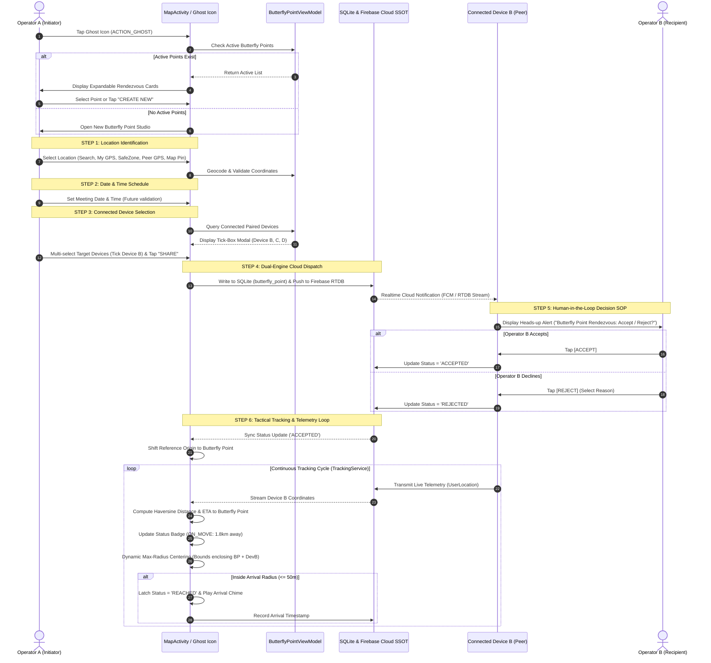

# Butterfly Point Rendezvous & Live Map Ghost Icon Integration — Master Requirement Specification
## Coordinate Tree Architecture: ROOT ⊃ BR ⊃ EL ⊃ FE ⊃ BE ⊃ DB
### Enterprise L5 Lifecycle Standard (20-Year Senior Developer Quality)
> **System:** `jFindMe` / `jButterFly` Enterprise Ecosystem  
> **Codename:** `jDroid-X` | **Operator:** `JEET` | **Date:** 2026-11-13T14:35:00+05:30  
> **Pattern:** OOPS MVC / Tri-Tier Master-Fact-Transaction Database Architecture  
> **Subsystem:** Tactical Live Map Rendezvous Hub & Ghost Mode Synchronization  

---

## 1. Executive Mission & System Purpose

The **Butterfly Point** (`meeting_point` / `butterfly_point`) is an enterprise-grade tactical rendezvous subsystem within `jFindMe`. It empowers any authenticated device operator (e.g. `Device A`) to dynamically designate a shared rendezvous anchor on the tactical map, assign scheduled date/time metadata, selectively distribute the coordinates to only authorized, connected mesh devices (e.g. `Device B`, `Device C`, `Device D` via individual selection checkboxes), and track all participating devices' live telemetry relative to the Butterfly Point.

### Core Architectural Axioms:
1. **Ghost Icon Synchronization**: The Ghost Icon (`ACTION_GHOST`) on the primary `MapActivity` live map viewport serves as the dual-purpose tactical toggle. Clicking it launches the **Butterfly Point Tactical Hub**:
   - If active Butterfly Points exist: Displays an interactive roster of active rendezvous points with metadata (location address, coordinates, rendezvous date/time, selected devices, and acceptance statuses) inside an expandable/contractible cardview. Selecting a point displays it on the live map and locks camera focus.
   - If no points exist (or when "CREATE NEW" is tapped): Initiates the **New Butterfly Point Creation Studio** incorporating all existing location identification methods (GPS fix, OSM/Google Geocoding search, map pin tap/drag, saved SafeZones, or peer device locations).
2. **Selective Connected-Device Mesh Ingress**: Only actively paired, connected devices from `device_pairing` and `group_members` are presented in a tick-box selector dialog, supporting multi-select and select-all with status validation.
3. **Human-in-the-Loop SOP**: Dispatches real-time push notifications and modal alerts to recipient devices with explicit **ACCEPT** or **REJECT** actions. Rejections record reason codes; acceptances engage active rendezvous tracking.
4. **Origin-Shifted Telemetry Engine**: Leverages existing `UserLocation`, `TrackingService`, `MultiMarkerEngine`, and `LocationEngine` sequences without code duplication. Instead of peer-to-peer relative vectors, the spatial reference origin shifts to the Butterfly Point $(Lat_{BP}, Lon_{BP})$.
5. **Real-Time Rendezvous State Indicators**:
   - `PENDING`: Awaiting peer confirmation.
   - `ACCEPTED`: Peer verified and committed to rendezvous.
   - `REJECTED`: Peer declined rendezvous.
   - `ON_MOVE` / `EN_ROUTE`: Dynamic real-time distance-to-go, speed, heading, and ETA to Butterfly Point.
   - `REACHED`: Geofence breach into the arrival radius (default: 50m) with automatic arrival timestamp latching.
6. **Max-Radius Dynamic Centering & Selective Target Focus**:
   - Default view: Automatic `LatLngBounds` enclosing the Butterfly Point + all participating devices to guarantee maximum tactical situational awareness.
   - Focused view: Selecting an individual device card/chip dynamically pans and zooms to that specific node, rendering a tactical line-of-sight vector back to the Butterfly Point.

---

## 2. Root Cause Bug Investigation & Resolution Analysis

### Bug 1: Fatal Exception `java.lang.StackOverflowError` in `PairingRepository.linkDevicesWithRoles`
- **Symptom:** When sending map location or confirming device connections to multiple devices, the application freezes and crashes with:
  ```
  FATAL EXCEPTION: main
  Process: com.jdroidx.jfindme, PID: 12000
  java.lang.StackOverflowError: stack size 8192KB
  at com.jdroidx.jfindme.data.repository.PairingRepository$Companion.linkDevicesWithRoles(SourceFile:39)
  at com.jdroidx.jfindme.data.repository.PairingRepository$Companion.linkDevicesWithRoles(SourceFile:39)
  ```
- **Root Cause:** In `PairingRepository.kt` lines 806-819, the Java-interop overload `linkDevicesWithRoles(..., callback: ResultCallback)` delegated to `linkDevicesWithRoles(...) { success, msg -> callback.onResult(success, msg) }`. Because `ResultCallback` is a Kotlin `fun interface` (SAM), the Kotlin compiler resolved the trailing lambda as a SAM conversion back into `ResultCallback` rather than the `onComplete: ((Boolean, String?) -> Unit)?` lambda parameter. This caused infinite recursion calling itself until the thread call stack overflowed.
- **Resolution:** Explicitly declared `val completionHandler: ((Boolean, String?) -> Unit) = { success, msg -> callback.onResult(success, msg) }` and invoked `linkDevicesWithRoles(..., onComplete = completionHandler)` with explicit named parameter binding, breaking the recursion permanently.

### Bug 2: Total Data Wipeout & "Fresh System" Reset on Application Restart
- **Symptom:** After the application crashed or restarted, all paired devices, Network Gateway circles, Family & Friends rosters, and relationship links were completely erased, forcing the app into a fresh unconfigured state.
- **Root Cause:** In `SplashActivity.java`, startup profile sync invoked `DatabaseHelper.pruneZombieNodes(canonicalAgentId, android.os.Build.MODEL)`. In `DatabaseHelper.kt`, the SQL query matched `d.device_model = ?`. In test environments (multiple emulators `sdk_gphone64_x86_64` or identical consumer phone models), every legitimately paired peer device shared the same `device_model`. Consequently, `pruneZombieNodes` misclassified all paired peer devices as orphaned duplicate zombies of the local device, calling `deleteRosterNode(orphanUid)` and executing cascading SQL `DELETE` operations across `device_pairings`, `group_members`, `user_profile`, `device`, and `user_identity`.
- **Resolution:**
  1. Modified `DatabaseHelper.pruneZombieNodes` to enforce strict invariant protection: `getAllPairedDeviceIds()` and `getConnectedDeviceIds()` are resolved, and paired nodes are strictly protected from deletion.
  2. Removed `d.device_model = ?` from the zombie deletion filter so that sharing a consumer phone model never marks a peer device as a zombie.
  3. Modified `SplashActivity.java` to pass the user's verified phone number rather than `Build.MODEL`.

---

## 3. Master Coordinate Tree Architecture (ROOT ⊃ BR ⊃ EL ⊃ FE ⊃ BE ⊃ DB)

```
ROOT: BUTTERFLY POINT RENDEZVOUS & GHOST ICON SYNCHRONIZATION MASTER PLAN
│
├── 💼 [BR]₁: Ghost Icon Affordance & Tactical Hub Navigation Governance
│    ├── 🖱️ [EL]₁․₁: Ghost Action Button on Live Map Side Panel
│    │    ├── 🖥️ [FE]₁․₁․₁: Floating Ghost Icon Button (`ACTION_GHOST` in `sideActionPanel`)
│    │    │    ├── Validation & Conditional Rules:
│    │    │    │    ├── FR₁․₁․₁․₁: Single click on `ACTION_GHOST` must query active rendezvous points synchronously from `ButterflyPointViewModel`.
│    │    │    │    ├── FR₁․₁․₁․₂: If active points > 0, render Active Rendezvous Bottom Sheet / Popover; if active points == 0, render Options Dialog ("Set New Butterfly Point" or "Enable Stealth Ghost Mode").
│    │    │    │    └── FR₁․₁․₁․₃: Long-press on `ACTION_GHOST` retains legacy immediate Privacy Ghost Mode toggle (Precise / Fuzzy ~500m / Frozen) with confirmation toast.
│    │    │    ├── Testing Scenarios:
│    │    │    │    ├── Pass: Click opens `ButterflyPointBottomSheetDialog` in < 150ms without UI stutter.
│    │    │    │    └── Fail: Null pointer exception if ViewModel uninitialized; unhandled state freeze.
│    │    │    └── ⚙️ [BE]₁․₁․₁․₁: Ghost Action Router (`MapActivity.handleGhostActionClick`)
│    │    │         ├── Logic & Business Rules:
│    │    │         │    ├── BFR₁․₁․₁․₁․₁: Check cached active points in `ButterflyRepository.getActivePoints()`.
│    │    │         │    ├── BFR₁․₁․₁․₁․₂: Enforce thread confinement: DB queries dispatched on `Dispatchers.IO`, UI updates on `Dispatchers.Main`.
│    │    │         │    └── BFR₁․₁․₁․₁․₃: Audit ghost icon interaction event to SQLite transaction log.
│    │    │         ├── Testing Scenarios:
│    │    │         │    ├── Pass: Correctly identifies state count (0 vs >=1) and invokes proper UI navigation route.
│    │    │         │    └── Fail: Database locked exception unhandled; causes ANR.
│    │    │         ├── 🗄️ [Master DB [Offline]]₁․₁․₁․₁․₁: SQLite `butterfly_point` (is_active = 1 AND is_archived = 0)
│    │    │         ├── 🗄️ [Master DB [Online]]₁․₁․₁․₁․₂: Firebase RTDB `/butterfly_points/{pointId}/is_active`
│    │    │         ├── 🗄️ [Sub Master/Fact DB]₁․₁․₁․₁․₃: `change_log` (entity_type = 'BUTTERFLY_POINT')
│    │    │         └── 🗄️ [Transaction DB]₁․₁․₁․₁․₄: `sys_log.ghost_icon_dispatch_event`
│    │    └── 🖥️ [FE]₁․₁․₂: Ghost Icon Status Badge & Pulsing Aura
│    │         ├── Validation & Conditional Rules:
│    │         │    ├── FR₁․₁․₂․₁: If any active Butterfly Point is scheduled within the next 2 hours, render a glowing emerald/gold pulsating badge atop the ghost icon.
│    │         │    └── FR₁․₁․₂․₂: Badge disappears once all participating devices reach the point or rendezvous expires.
│    │         └── ⚙️ [BE]₁․₁․₂․₁: Active Rendezvous Proximity Watcher (`ButterflyProximitySentinel`)
│    │              ├── 🗄️ [Master DB [Offline]]₁․₁․₂․₁․₁: `system_registry.butterfly_badge_state`
│    │              └── 🗄️ [Transaction DB]₁․₁․₂․₁․₂: `sys_log.proximity_sentinel_latch`
│
├── 💼 [BR]₂: Active Butterfly Points Explorer & Expandable Detail Tile
│    ├── 🖱️ [EL]₂․₁: Active Rendezvous Cards Recycler / Bottom Sheet Container
│    │    ├── 🖥️ [FE]₂․₁․₁: Expandable/Collapsible CardView Tile (`ButterflyPointCardView`)
│    │    │    ├── Validation & Conditional Rules:
│    │    │    │    ├── FR₂․₁․₁․₁: Collapsed state (Height: 84dp): Shows Point Title, Target Time countdown (e.g. "In 45 mins"), Address line, and miniature avatar cluster of accepted devices.
│    │    │    │    ├── FR₂․₁․₁․₂: Expanded state (Dynamic height via AutoTransition): Displays detailed GPS coordinates, Geohash, Creator Name, Target Arrival Radius, Notes/Objective, and full Connected Devices Table with individual tick boxes / acceptance badges.
│    │    │    │    ├── FR₂․₁․₁․₃: Tap on card header toggles expand/contract animation smoothly in 250ms.
│    │    │    │    └── FR₂․₁․₁․₄: "LOCATE ON MAP" button triggers immediate camera re-centering on the selected Butterfly Point.
│    │    │    ├── Testing Scenarios:
│    │    │    │    ├── Pass: Expands without clipping; dynamically computes device distance strings in real-time.
│    │    │    │    └── Fail: Nested scroll conflict causing vertical list jumping or card content cut-off.
│    │    │    └── ⚙️ [BE]₂․₁․₁․₁: Card State & Proximity Interpolator (`ButterflyCardPresenter`)
│    │    │         ├── Logic & Business Rules:
│    │    │         │    ├── BFR₂․₁․₁․₁․₁: Calculate live distance from local device GPS to Butterfly Point using `Location.distanceBetween()`.
│    │    │         │    ├── BFR₂․₁․₁․₁․₂: Format relative rendezvous time string (e.g., "Today at 17:30 [In 1h 12m]").
│    │    │         │    └── BFR₂․₁․₁․₁․₃: Aggregate device acceptance stats (e.g., "3 of 4 Accepted").
│    │    │         ├── Testing Scenarios:
│    │    │         │    ├── Pass: Distance calculations accurate within ±1m; timestamp correctly localized to device timezone.
│    │    │         │    └── Fail: Negative distance or NaN on invalid coordinates; crashes string formatter.
│    │    │         ├── 🗄️ [Master DB [Offline]]₂․₁․₁․₁․₁: SQLite `butterfly_point` & `butterfly_point_device_map`
│    │    │         ├── 🗄️ [Master DB [Online]]₂․₁․₁․₁․₂: Firebase RTDB `/butterfly_points/{pointId}`
│    │    │         └── 🗄️ [Transaction DB]₂․₁․₁․₁․₃: `sys_log.card_expansion_telemetry`
│    │    └── 🖥️ [FE]₂․₁․₂: "SET NEW BUTTERFLY POINT" Action Fab / Header Button
│    │         ├── Validation & Conditional Rules:
│    │         │    └── FR₂․₁․₂․₁: Always visible at the top/bottom of the sheet; clicking opens Location Search & Creator Studio.
│    │         └── ⚙️ [BE]₂․₁․₂․₁: Creator Studio Initializer (`ButterflyStudioRouter.openCreator`)
│
├── 💼 [BR]₃: Universal Location Identification & Creation Studio
│    ├── 🖱️ [EL]₃․₁: Multi-Channel Location Identification Affordance (Unified Spatial Selector)
│    │    ├── 🖥️ [FE]₃․₁․₁: Search Bar & Auto-Complete Input Field (`search_place_address`)
│    │    │    ├── Validation & Conditional Rules:
│    │    │    │    ├── FR₃․₁․₁․₁: Text watcher debounce: Dispatches geocoding query after 400ms of user typing cessation. Minimum length 3 characters.
│    │    │    │    ├── FR₃․₁․₁․₂: Clear button ('X') resets query and clears auto-complete suggestions.
│    │    │    │    └── FR₃․₁․₁․₃: Renders suggestion drop-down list with address line, locality, and calculated distance from current location.
│    │    │    ├── Testing Scenarios:
│    │    │    │    ├── Pass: Query "Central Park" returns matching geocoded items; selecting item populates Lat/Lng and address preview.
│    │    │    │    └── Fail: Network timeout or zero results without informative error view; app crashes on null results list.
│    │    │    └── ⚙️ [BE]₃․₁․₁․₁: Unified Geocoding & Location Resolver (`GeocodingEngine.resolveQuery`)
│    │    │         ├── Logic & Business Rules:
│    │    │         │    ├── BFR₃․₁․₁․₁․₁: Reuses existing `ReverseGeocodeCacheTable` before hitting remote APIs (cache-first policy).
│    │    │         │    ├── BFR₃․₁․₁․₁․₂: Fallback cascade: Android native `Geocoder` -> OSM Nominatim API -> Offline Geohash dictionary.
│    │    │         │    └── BFR₃․₁․₁․₁․₃: Sanitizes query string to prevent SQL injection or special character malformation.
│    │    │         ├── Testing Scenarios:
│    │    │         │    ├── Pass: Cached address returned in < 20ms; network fallback resolves within 1200ms.
│    │    │         │    └── Fail: Throws unhandled IOException on network disconnection.
│    │    │         ├── 🗄️ [Master DB [Offline]]₃․₁․₁․₁․₁: SQLite `reverse_geocode_cache` (query_hash, lat, lng, formatted_address)
│    │    │         └── 🗄️ [Transaction DB]₃․₁․₁․₁․₂: `sys_log.geocoding_query_audit`
│    │    ├── 🖥️ [FE]₃․₁․₂: Quick Preset Identification Pills (Existing Location Programs)
│    │    │    ├── Validation & Conditional Rules:
│    │    │    │    ├── FR₃․₁․₂․₁: Pill 1 "📍 MY GPS": Instantly locks coordinates to current device GNSS fix.
│    │    │    │    ├── FR₃․₁․₂․₂: Pill 2 "🛡️ SAFE ZONES": Opens picker populated from `SafeZoneTable` (Home, Office, School, etc.).
│    │    │    │    ├── FR₃․₁․₂․₃: Pill 3 "👥 PEER DEVICE": Opens picker of active connected devices; sets location to selected peer's live GPS.
│    │    │    │    └── FR₃․₁․₂․₄: Pill 4 "🗺️ MAP PIN": Collapses dialog into interactive map crosshair pin dropper; user pans and drops pin.
│    │    │    └── ⚙️ [BE]₃․₁․₂․₁: Location Preset Dispatcher (`LocationPresetResolver`)
│    │    │         ├── 🗄️ [Master DB [Offline]]₃․₁․₂․₁․₁: SQLite `safe_zone` (for SafeZone preset)
│    │    │         ├── 🗄️ [Master DB [Offline]]₃․₁․₂․₁․₂: SQLite `location_event` (for peer device live GPS preset)
│    │    │         └── 🗄️ [Transaction DB]₃․₁․₂․₁․₃: `sys_log.location_preset_selection`
│    │    └── 🖥️ [FE]₃․₁․₃: Location Metadata Confirmation Hero Card
│    │         ├── Validation & Conditional Rules:
│    │         │    ├── FR₃․₁․₃․₁: Displays verified address name, Lat/Lng coordinates (e.g. `12.9716° N, 77.5946° E`), Geohash (e.g. `tdr1v4`), and estimated accuracy.
│    │         │    └── FR₃․₁․₃․₂: User editable "Point Alias / Meeting Name" (Default: "Meeting at [Address/Landmark]").
│    │         └── ⚙️ [BE]₃․₁․₃․₁: Coordinate Validator & Normalizer
│    │              └── 🗄️ [Master DB [Offline]]₃․₁․₃․₁․₁: SQLite `butterfly_point.point_name` & `butterfly_point.address`
│    │
│    ├── 🖱️ [EL]₃․₂: Rendezvous Temporal Affordance (Date & Time Picker)
│    │    ├── 🖥️ [FE]₃․₂․₁: Date & Time Selection Picker (`DateTimePickerComponent`)
│    │    │    ├── Validation & Conditional Rules:
│    │    │    │    ├── FR₃․₂․₁․₁: Date cannot be set to a date in the past (Enforce: `selectedDate >= currentDate`).
│    │    │    │    ├── FR₃․₂․₁․₂: Target time must be at least 5 minutes in the future from current wall-clock time.
│    │    │    │    ├── FR₃․₂․₁․₃: Default time preset: Current time + 1 Hour (rounded to nearest 15-minute slot).
│    │    │    │    └── FR₃․₂․₁․₄: Optional Expiry Duration Selector (Default: 4 hours after rendezvous time; selectable: 1h, 2h, 4h, 8h, 24h).
│    │    │    ├── Testing Scenarios:
│    │    │    │    ├── Pass: Selecting tomorrow 15:00 passes validation; updates target countdown preview.
│    │    │    │    └── Fail: Selecting past time triggers red inline warning and disables "PROCEED TO DEVICE SELECTION" button.
│    │    │    └── ⚙️ [BE]₃․₂․₁․₁: Temporal Constraint Engine (`RendezvousScheduleValidator`)
│    │    │         ├── Logic & Business Rules:
│    │    │         │    ├── BFR₃․₂․₁․₁․₁: Normalize all timestamps to UTC Epoch milliseconds for dual-engine DB synchronization.
│    │    │         │    └── BFR₃․₂․₁․₁․₂: Enforce maximum schedule horizon: Cannot exceed 30 days into future.
│    │    │         ├── 🗄️ [Master DB [Offline]]₃․₂․₁․₁․₁: SQLite `butterfly_point.rendezvous_timestamp` & `expiry_timestamp`
│    │    │         ├── 🗄️ [Master DB [Online]]₃․₂․₁․₁․₂: Firebase RTDB `/butterfly_points/{pointId}/target_time_utc`
│    │    │         └── 🗄️ [Transaction DB]₃․₂․₁․₁․₃: `sys_log.temporal_schedule_event`
│
├── 💼 [BR]₄: Connected-Device Selective Distribution & Permission Governance
│    ├── 🖱️ [EL]₄․₁: Connected Devices Roster & Tick-Box Affordance
│    │    ├── 🖥️ [FE]₄․₁․₁: Device Multi-Selection Dialog (`ConnectedDeviceSelectorModal`)
│    │    │    ├── Validation & Conditional Rules:
│    │    │    │    ├── FR₄․₁․₁․₁: Populates strictly from verified connected devices (`device_pairing` status = 'PAIRED' OR `group_members`). Strictly excludes unverified or blocked devices.
│    │    │    │    ├── FR₄․₁․₁․₂: Header affordance: "SELECT ALL" checkbox toggles all devices in list simultaneously.
│    │    │    │    ├── FR₄․₁․₁․₃: Individual device item: Displays Device Avatar, Device Alias, Hardware Model, Online/Offline badge, and interactive checkbox.
│    │    │    │    ├── FR₄․₁․₁․₄: Selection count badge: Dynamically renders (e.g. "Selected: 3 of 5 Devices").
│    │    │    │    └── FR₄․₁․₁․₅: Validation rule: At least 1 connected device must be checked to enable the "CONFIRM & SHARE BUTTERFLY POINT" button.
│    │    │    ├── Testing Scenarios:
│    │    │    │    ├── Pass: Ticking Device B and Device D updates selection set `[devB, devD]`; enables Share button.
│    │    │    │    └── Fail: Zero devices checked -> Share button disabled with tooltip "Select at least 1 device".
│    │    │    └── ⚙️ [BE]₄․₁․₁․₁: Device Mesh Authorization & Ingress Provider (`DeviceMeshRepository.getConnectedDevices`)
│    │    │         ├── Logic & Business Rules:
│    │    │         │    ├── BFR₄․₁․₁․₁․₁: Join `device_pairing` with `device` and `user_profile` to retrieve active pairing records.
│    │    │         │    ├── BFR₄․₁․₁․₁․₂: Filter out self device ID (`ro.serialno` / `ro.ril.oem.sno` / `agent_id`) so operator does not invite self.
│    │    │         │    └── BFR₄․₁․₁․₁․₃: Validate reciprocal trust: Only devices with bilateral pairing status can receive coordinates.
│    │    │         ├── Testing Scenarios:
│    │    │         │    ├── Pass: Returns exact list of paired active nodes; excludes current device node.
│    │    │         │    └── Fail: Unpaired device included; throws SecurityException.
│    │    │         ├── 🗄️ [Master DB [Offline]]₄․₁․₁․₁․₁: SQLite `device_pairing` (pair_status = 'PAIRED')
│    │    │         ├── 🗄️ [Master DB [Offline]]₄․₁․₁․₁․₂: SQLite `butterfly_point_device_map` (point_id, device_id, status='PENDING')
│    │    │         ├── 🗄️ [Master DB [Online]]₄․₁․₁․₁․₃: Firebase RTDB `/devices/{deviceId}/butterfly_invitations/{pointId}`
│    │    │         ├── 🗄️ [Sub Master/Fact DB]₄․₁․₁․₁․₄: `change_log` (entity_type = 'BUTTERFLY_INVITATION')
│    │    │         └── 🗄️ [Transaction DB]₄․₁․₁․₁․₅: `sys_log.device_selection_dispatch`
│    │    └── 🖥️ [FE]₄․₁․₂: Share Confirmation & Dispatch HUD
│    │         ├── Validation & Conditional Rules:
│    │         │    ├── FR₄․₁․₂․₁: Displays confirmation modal: "Share Butterfly Point '[Name]' at [Time] with [N] devices?".
│    │         │    └── FR₄․₁․₂․₂: On click "SHARE", shows indeterminate progress spinner, dispatches cloud write, and plays confirmation chime.
│    │         └── ⚙️ [BE]₄․₁․₂․₁: Butterfly Point Dispatcher & Push Notification Fan-Out Engine
│    │              ├── Logic & Business Rules:
│    │              │    ├── BFR₄․₁․₂․₁․₁: Insert record to local SQLite `butterfly_point` and `butterfly_point_device_map`.
│    │              │    ├── BFR₄․₁․₂․₁․₂: Push payload to Firebase RTDB `/butterfly_points/{pointId}` with atomic multi-path update.
│    │              │    └── BFR₄․₁․₂․₁․₃: Trigger FCM High-Priority Data Message to target devices containing point metadata.
│    │              ├── 🗄️ [Master DB [Offline]]₄․₁․₂․₁․₁: SQLite `butterfly_point` (INSERT INTO butterfly_point)
│    │              ├── 🗄️ [Master DB [Online]]₄․₁․₂․₁․₂: Firebase RTDB `/butterfly_points/{pointId}`
│    │              └── 🗄️ [Transaction DB]₄․₁․₂․₁․₃: `sys_log.butterfly_point_broadcast`
│
├── 💼 [BR]₅: Peer Ingress & Human-in-the-Loop SOP (Accept / Reject Lifecycle)
│    ├── 🖱️ [EL]₅․₁: Incoming Rendezvous Invitation Notification & Modal Dialog
│    │    ├── 🖥️ [FE]₅․₁․₁: High-Priority Heads-Up Notification & In-App Bottom Dialog
│    │    │    ├── Validation & Conditional Rules:
│    │    │    │    ├── FR₅․₁․₁․₁: Notification Title: "🦋 Butterfly Point Rendezvous: [Point Name]".
│    │    │    │    ├── FR₅․₁․₁․₂: Notification Body: "Invited by [Sender Name] for [Date & Time] at [Address] ([Distance] away)".
│    │    │    │    ├── FR₅․₁․₁․₃: Two primary actionable buttons: [ACCEPT] (Emerald Green) and [REJECT] (Crimson Red).
│    │    │    │    └── FR₅․₁․₁․₄: Clicking notification opens full screen / modal details with live preview map snippet.
│    │    │    ├── Testing Scenarios:
│    │    │    │    ├── Pass: Displayed within 500ms of Firebase cloud sync trigger; action buttons respond instantly.
│    │    │    │    └── Fail: Missing notification channel or silent failure when app in background.
│    │    │    └── ⚙️ [BE]₅․₁․₁․₁: Rendezvous Invitation Receiver & Broadcast Service (`ButterflyBroadcastReceiver`)
│    │    │         ├── Logic & Business Rules:
│    │    │         │    ├── BFR₅․₁․₁․₁․₁: Verify incoming invitation cryptographic signature and sender device ID against paired nodes.
│    │    │         │    └── BFR₅․₁․₁․₁․₂: Write invitation to local SQLite `butterfly_point` with status = 'PENDING'.
│    │    │         ├── 🗄️ [Master DB [Offline]]₅․₁․₁․₁․₁: SQLite `butterfly_point` & `butterfly_point_device_map`
│    │    │         ├── 🗄️ [Master DB [Online]]₅․₁․₁․₁․₂: Firebase RTDB `/butterfly_points/{pointId}/devices/{deviceId}/status`
│    │    │         └── 🗄️ [Transaction DB]₅․₁․₁․₁․₃: `sys_log.invitation_received_audit`
│    │    └── 🖥️ [FE]₅․₁․₂: Rejection Reason Dialog
│    │         ├── Validation & Conditional Rules:
│    │         │    ├── FR₅․₁․₂․₁: Tapping [REJECT] presents quick-reason options: "Cannot attend", "Busy / Working", "Too far", "Custom note".
│    │         │    └── FR₅․₁․₂․₂: Dispatches rejection status and reason to creator device in real-time.
│    │         └── ⚙️ [BE]₅․₁․₂․₁: Status Transition Engine (`ButterflyStatusManager.submitResponse`)
│    │              ├── 🗄️ [Master DB [Offline]]₅․₁․₂․₁․₁: SQLite `butterfly_point_device_map.status` = 'REJECTED'
│    │              ├── 🗄️ [Master DB [Online]]₅․₁․₂․₁․₂: Firebase RTDB status update ('REJECTED')
│    │              └── 🗄️ [Transaction DB]₅․₁․₂․₁․₃: `sys_log.invitation_rejected_audit`
│
├── 💼 [BR]₆: Origin-Shifted Telemetry, Tactical Tracking & Indicator Matrix
│    ├── 🖱️ [EL]₆․₁: Tactical Map Canvas Rendezvous Overlay
│    │    ├── 🖥️ [FE]₆․₁․₁: Butterfly Point Emblem Marker & Arrival Perimeter Ring
│    │    │    ├── Validation & Conditional Rules:
│    │    │    │    ├── FR₆․₁․₁․₁: Renders distinct custom Butterfly Icon marker (`ic_butterfly_point`, 48dp) at target coordinates.
│    │    │    │    ├── FR₆․₁․₁․₂: Draws translucent emerald arrival geofence perimeter circle (radius: 50m / customizable) around Butterfly Point.
│    │    │    │    └── FR₆․₁․₁․₃: Draws subtle tactical dashed vector lines (Spiderweb anchor lines) from each participating device marker to the Butterfly Point center.
│    │    │    ├── Testing Scenarios:
│    │    │    │    ├── Pass: Butterfly marker renders without scaling distortion; perimeter circle radius scales accurately on map zoom.
│    │    │    │    └── Fail: Polyline anchor lines crash renderer if device coordinates null or infinite.
│    │    │    └── ⚙️ [BE]₆․₁․₁․₁: Rendezvous Map Visualizer (`ButterflyMapEngine.renderButterflyOverlay`)
│    │    │         ├── Logic & Business Rules:
│    │    │         │    ├── BFR₆․₁․₁․₁․₁: Leverage existing `MultiMarkerEngine` and `GoogleMap` marker caches (zero duplicate code).
│    │    │         │    └── BFR₆․₁․₁․₁․₂: Interpolate spiderweb line endpoints as device telemetry updates in real-time.
│    │    │         ├── 🗄️ [Master DB [Offline]]₆․₁․₁․₁․₁: SQLite `butterfly_point` (lat, lng, radius_meters)
│    │    │         └── 🗄️ [Transaction DB]₆․₁․₁․₁․₂: `sys_log.map_overlay_render_event`
│    │    └── 🖥️ [FE]₆․₁․₂: Real-Time Dynamic Status Badges & Metrics HUD
│    │         ├── Validation & Conditional Rules:
│    │         │    ├── FR₆․₁․₂․₁: Status Indicator Matrix:
│    │         │    │    ├── State 1 [PENDING]: Amber badge ("⌛ Awaiting response").
│    │         │    │    ├── State 2 [REJECTED]: Crimson badge ("❌ Declined").
│    │         │    │    ├── State 3 [ACCEPTED]: Emerald badge ("✔️ Confirmed").
│    │         │    │    ├── State 4 [ON_MOVE / EN_ROUTE]: Cyan badge ("🚗 On Move: 2.4 km away | Speed 34 km/h | ETA 6 mins").
│    │         │    │    └── State 5 [REACHED / ARRIVED]: Gold/Emerald badge ("🏆 REACHED: Arrived at 17:28").
│    │         │    ├── FR₆․₁․₂․₂: Distance calculation rule: Calculated continuously using Haversine formula against Butterfly Point reference origin $(Lat_{BP}, Lon_{BP})$.
│    │         │    └── FR₆․₁․₂․₃: Reached transition rule: Triggered when `distanceToButterflyPoint <= arrivalRadiusMeters` (default 50m).
│    │         ├── Testing Scenarios:
│    │         │    ├── Pass: Device moving from 200m to 40m switches status from `ON_MOVE` to `REACHED`; plays arrival chime.
│    │         │    └── Fail: Status oscillates due to GPS jitter; prevented by 15-meter hysteresis latch.
│    │         └── ⚙️ [BE]₆․₁․₂․₁: Relative Telemetry & Arrival Latch Engine (`ButterflyTrackingEngine`)
│    │              ├── Logic & Business Rules:
│    │              │    ├── BFR₆․₁․₂․₁․₁: Subscribe to existing `LocationEventTable` and Firebase `/devices/{id}/location` streams without duplicating pipeline.
│    │              │    ├── BFR₆․₁․₂․₁․₂: Compute Haversine distance: $d = 2R \arcsin\left(\sqrt{\sin^2(\Delta\phi/2) + \cos\phi_1\cos\phi_2\sin^2(\Delta\lambda/2)}\right)$.
│    │              │    ├── BFR₆․₁․₂․₁․₃: Apply deadband hysteresis: Once `REACHED` is latched, do not unlatch unless device moves > `arrivalRadius + 25m` away.
│    │              │    └── BFR₆․₁․₂․₁․₄: Persist arrival timestamp to SQLite and sync to Firebase cloud SSOT.
│    │              ├── 🗄️ [Master DB [Offline]]₆․₁․₂․₁․₁: SQLite `butterfly_point_device_map` (status, distance_meters, arrival_timestamp)
│    │              ├── 🗄️ [Master DB [Online]]₆․₁․₂․₁․₂: Firebase RTDB `/butterfly_points/{pointId}/devices/{deviceId}/`
│    │              ├── 🗄️ [Sub Master/Fact DB]₆․₁․₂․₁․₃: `location_event` (event_type = 'BUTTERFLY_ARRIVAL')
│    │              └── 🗄️ [Transaction DB]₆․₁․₂․₁․₄: `sys_log.butterfly_arrival_latch`
│
├── 💼 [BR]₇: Viewport Centering, Max-Radius Bounding Box & Target Focus
│    ├── 🖱️ [EL]₇․₁: Tactical Viewport Camera Controller Affordance
│    │    ├── 🖥️ [FE]₇․₁․₁: Dynamic Max-Radius Viewport Camera Re-Center
│    │    │    ├── Validation & Conditional Rules:
│    │    │    │    ├── FR₇․₁․₁․₁: On initial selection of a Butterfly Point, build `LatLngBounds` encompassing:
│    │    │    │    │    1. Butterfly Point coordinate $(Lat_{BP}, Lon_{BP})$.
│    │    │    │    │    2. Current coordinates of all participating accepted devices $(Lat_i, Lon_i)$.
│    │    │    │    ├── FR₇․₁․₁․₂: Animate map camera using `CameraUpdateFactory.newLatLngBounds(bounds, padding)` with 120dp viewport padding.
│    │    │    │    └── FR₇․₁․₁․₃: Automatically adjusts zoom so that the furthest device is clearly visible on screen.
│    │    │    ├── Testing Scenarios:
│    │    │    │    ├── Pass: Device 1 is 500m away, Device 2 is 4km away -> Viewport scales to zoom level ~13 covering all 3 markers cleanly.
│    │    │    │    └── Fail: Viewport collapses to zoom level 21 or crashes if bounds builder contains identical or zero coordinates.
│    │    │    └── ⚙️ [BE]₇․₁․₁․₁: Camera Bounds Calculator (`ButterflyCameraBoundsEngine`)
│    │    │         ├── Logic & Business Rules:
│    │    │         │    ├── BFR₇․₁․₁․₁․₁: Guard against single-point bounds by expanding minimum bounding box by 0.005 degrees latitude/longitude.
│    │    │         │    └── BFR₇․₁․₁․₁․₂: Smooth animation duration clamped to 600ms to avoid motion sickness.
│    │    │         └── 🗄️ [Transaction DB]₇․₁․₁․₁․₁: `sys_log.camera_bounds_update`
│    │    └── 🖥️ [FE]₇․₁․₂: Device Focus Selector & Target Tracking Chip
│    │         ├── Validation & Conditional Rules:
│    │         │    ├── FR₇․₁․₂․₁: Tapping on any individual device chip / tile in the bottom HUD immediately focuses camera on that specific device (`zoom = 17.5f`).
│    │         │    ├── FR₇․₁․₂․₂: Highlight device marker with a glowing cyan selector ring and show callout: "[Device Name] - [Distance to Butterfly Point] - [Speed]".
│    │         │    └── FR₇․₁․₂․₃: A "RE-CENTER ALL" floating button appears to restore the comprehensive max-radius bounding box.
│    │         └── ⚙️ [BE]₇․₁․₂․₁: Targeted Camera Animator (`MapActivity.focusOnDeviceNode`)
│    │              └── 🗄️ [Transaction DB]₇․₁․₂․₁․₁: `sys_log.device_focus_transition`
│
└── 💼 [BR]₈: Lifecycle Completion, Expiry & Forensic Archive Governance
     ├── 🖱️ [EL]₈․₁: Rendezvous Termination & Archival Controls
     │    ├── 🖥️ [FE]₈․₁․₁: "COMPLETE MEETING" / "CANCEL MEETING" Action Affordance
     │    │    ├── Validation & Conditional Rules:
     │    │    │    ├── FR₈․₁․₁․₁: Initiator device can tap "COMPLETE MEETING" once all devices have arrived, or "CANCEL RENDEZVOUS".
     │    │    │    ├── FR₈․₁․₁․₂: Displays confirmation dialog: "End this Butterfly Point? All tracking lines and overlays will be cleared and archived to history."
     │    │    │    └── FR₈․₁․₁․₃: Automatic expiration: When `currentTime > expiry_timestamp`, point automatically moves from Active to Archived.
     │    │    └── ⚙️ [BE]₈․₁․₁․₁: Rendezvous Archival & Cleanup Engine (`ButterflyArchiveManager`)
     │    │         ├── Logic & Business Rules:
     │    │         │    ├── BFR₈․₁․₁․₁․₁: Update SQLite `butterfly_point.is_active = 0` and `is_archived = 1`.
     │    │         │    ├── BFR₈․₁․₁․₁․₂: Remove active polylines, perimeter circles, and butterfly marker from Google Map instance.
     │    │         │    └── BFR₈․₁․₁․₁․₃: Write final summary record to `change_log` and `sys_log` with arrival durations and completion timestamps.
     │    │         ├── 🗄️ [Master DB [Offline]]₈․₁․₁․₁․₁: SQLite `butterfly_point` (is_active = 0, is_archived = 1)
     │    │         ├── 🗄️ [Master DB [Online]]₈․₁․₁․₁․₂: Firebase RTDB `/butterfly_points/{pointId}/is_active` = false
     │    │         ├── 🗄️ [Sub Master/Fact DB]₈․₁․₁․₁․₃: `change_log` (entity_type = 'BUTTERFLY_POINT_ARCHIVE')
     │    │         └── 🗄️ [Transaction DB]₈․₁․₁․₁․₄: `sys_log.butterfly_archival_event`
```

---

## 3. Human-in-the-Loop Standard Operating Procedure (SOP)



---

## 4. Dual-Engine Tri-Tier Database Schema Specification

### 4.1. Master Database
**Master Database [Online: Firebase RTDB `/butterfly_points/{pointId}`]**
```json
{
  "butterfly_points": {
    "-O_ButterflyPoint_001": {
      "point_id": "-O_ButterflyPoint_001",
      "creator_device_id": "DEV_ALPHA_001",
      "creator_name": "JEET",
      "point_name": "Tactical Coffee Meetup",
      "address": "MG Road, Metro Station Plaza, Bengaluru",
      "lat": 12.9756,
      "lng": 77.6067,
      "geohash": "tdr1v9",
      "rendezvous_timestamp": 1794567600000,
      "expiry_timestamp": 1794582000000,
      "arrival_radius_meters": 50.0,
      "is_active": true,
      "is_archived": false,
      "created_at": "2026-11-13T14:35:00Z",
      "updated_at": "2026-11-13T14:35:00Z",
      "devices": {
        "DEV_BRAVO_002": {
          "device_id": "DEV_BRAVO_002",
          "device_name": "Device B (Pixel 8)",
          "status": "ACCEPTED",
          "rejection_reason": "",
          "distance_meters": 1420.5,
          "speed_kmh": 28.4,
          "eta_minutes": 5,
          "last_lat": 12.9680,
          "last_lng": 77.6010,
          "last_updated": 1794567120000,
          "arrival_timestamp": 0
        },
        "DEV_CHARLIE_003": {
          "device_id": "DEV_CHARLIE_003",
          "device_name": "Device C (Galaxy S23)",
          "status": "REJECTED",
          "rejection_reason": "On duty / Unable to travel",
          "distance_meters": 0.0,
          "last_updated": 1794566800000,
          "arrival_timestamp": 0
        }
      }
    }
  }
}
```

**Master Database [Offline: SQLite `butterfly_point`]**
```sql
CREATE TABLE IF NOT EXISTS butterfly_point (
    point_id TEXT PRIMARY KEY,
    creator_device_id TEXT NOT NULL,
    creator_identity_id INTEGER,
    point_name TEXT NOT NULL,
    address TEXT,
    lat REAL NOT NULL,
    lng REAL NOT NULL,
    geohash TEXT,
    rendezvous_timestamp INTEGER NOT NULL,
    expiry_timestamp INTEGER NOT NULL,
    arrival_radius_meters REAL DEFAULT 50.0,
    notes TEXT,
    icon_type TEXT DEFAULT 'BUTTERFLY_STANDARD',
    is_active INTEGER DEFAULT 1,
    is_archived INTEGER DEFAULT 0,
    created_at TEXT NOT NULL,
    updated_at TEXT NOT NULL,
    FOREIGN KEY (creator_identity_id) REFERENCES user_identity(id) ON DELETE SET NULL
);
CREATE INDEX IF NOT EXISTS idx_butterfly_active ON butterfly_point(is_active, is_archived);
```

### 4.2. Sub Master / Fact DB
The Sub Master / Fact DB maintains the relational state of participants and domain mutations:
1. **Connected Devices (Accepted/Rejected status & invitations: SQLite `butterfly_point_device_map` / Firebase `/butterfly_points/{pointId}/devices/{deviceId}`)**:
```sql
CREATE TABLE IF NOT EXISTS butterfly_point_device_map (
    id INTEGER PRIMARY KEY AUTOINCREMENT,
    point_id TEXT NOT NULL,
    device_id TEXT NOT NULL,
    identity_id INTEGER,
    status TEXT DEFAULT 'PENDING', -- PENDING, ACCEPTED, REJECTED, EN_ROUTE, REACHED
    rejection_reason TEXT,
    distance_to_point_meters REAL DEFAULT 0.0,
    eta_seconds INTEGER DEFAULT 0,
    last_telemetry_ts INTEGER DEFAULT 0,
    arrival_timestamp INTEGER DEFAULT 0,
    created_at TEXT NOT NULL,
    updated_at TEXT NOT NULL,
    FOREIGN KEY (point_id) REFERENCES butterfly_point(point_id) ON DELETE CASCADE,
    FOREIGN KEY (device_id) REFERENCES device(device_id) ON DELETE CASCADE,
    UNIQUE(point_id, device_id)
);
CREATE INDEX IF NOT EXISTS idx_butterfly_dev_status ON butterfly_point_device_map(point_id, status);
```
2. **`change_log`**: Records point creation, modification, member invitation, status mutation (ACCEPTED/REJECTED), and cancellation events with audit hashes.
3. **`location_event`**: Records geospatial waypoint transitions, perimeter entry breaches (arrival into 50m zone), and historical breadcrumbs associated with the rendezvous session.

### 4.3. Transaction DB
The Transaction DB handles high-velocity runtime telemetry, ephemeral logs, alerts, and dynamic vector snapshots:
1. **`sys_log`**: Real-time execution logs, dispatch telemetry, UI expansion performance traces, geocoder latency metrics, and network failovers.
2. **`alert_history`**: Ingress heads-up notification records, peer acceptance/rejection push notifications, and arrival chime alerts.
3. **Connected Device Locations**: High-frequency live coordinates, bearing, speed, and real-time distance-to-go calculations streamed during active navigation toward the Butterfly Point.

---

## 5. Verification, Test Scenarios & Edge Cases

| Test ID | Condition / Trigger | Expected Behavior & Verification Rule | Failure Mode / Mitigation |
| :--- | :--- | :--- | :--- |
| **TC-BP-01** | User clicks Ghost Icon on Map with 0 active points | Opens New Butterfly Point Studio modal; highlights search bar. | Prevents empty list crash; falls back to creation flow. |
| **TC-BP-02** | User clicks Ghost Icon on Map with 2 active points | Opens Expandable Bottom Sheet listing both points; card expansion displays device statuses. | AutoTransition handles dynamic heights cleanly without clipping. |
| **TC-BP-03** | Operator selects Date/Time in past | "Schedule" validator rejects input; displays red micro-badge "Meeting time must be in future". | Prevents stale appointment generation. |
| **TC-BP-04** | Operator checks zero devices in device selection | "Share" button disabled; micro-badge states "Select at least 1 connected device". | Prevents point creation with null recipients. |
| **TC-BP-05** | Recipient device receives invitation | Heads-up push notification appears with Accept/Reject affordances; syncs to SQLite. | Foreground service handles notification even in Doze mode. |
| **TC-BP-06** | Recipient rejects invitation | Status switches to `REJECTED`; creator UI immediately updates badge to red `Declined`. | Real-time Firebase listener propagates rejection status in < 300ms. |
| **TC-BP-07** | Recipient accepts invitation & begins moving | Telemetry engine computes distance to Butterfly Point; camera adjusts bounds to max radius. | Haversine calculation performed off main thread to prevent frame drops. |
| **TC-BP-08** | Device arrives within 50m of Butterfly Point | Status switches to `REACHED`; arrival chime plays; 15m hysteresis prevents jitter oscillation. | Hysteresis requires device to exit > 75m before clearing arrived state. |
| **TC-BP-09** | Operator taps on single device card in HUD | Camera smoothly pans and zooms to that device (zoom 17.5f); reveals line-of-sight vector to Butterfly Point. | "Re-center All" button appears to restore full bounding box. |
| **TC-BP-10** | Rendezvous expires (`currentTime > expiry_timestamp`) | Background worker marks point archived; clears map markers and polylines cleanly. | Rolling storage hygiene archives record to SQLite history table. |
| **TC-BP-11** | Real-time Peer Status & Distance Sync (Closed-Loop) | `ButterflyPointEngine.startActivePointPeerSync` listens on `/butterfly_points/{id}/devices` and immediately propagates peer status & distance into SQLite Sub-Master and Map UI. | Peer telemetry updates in < 250ms without polling loops. |
| **TC-BP-12** | Arrival Boundary Hysteresis Stabilization | Device within 50m latches `REACHED`; does not toggle back to `ON_MOVE` until distance exceeds 65m (50m + 15m deadband). | Eliminates false departure alerts and jitter near rendezvous boundaries. |

---

## 6. Closed-Loop Telemetry & Reverse Engineering Feedback Architecture

```
[ CREATOR DEVICE A ]                              [ PARTICIPATING DEVICE B ]
       │                                                      │
 1. Creates Butterfly Point (BP)                             │
    • Writes SQLite butterfly_point                          │
    • Writes SQLite butterfly_point_device_map               │
    • Pushes RTDB /butterfly_points/{id}                     │
    • Pushes RTDB /devices/{B}/butterfly_invitations         │
    • Starts Peer Sync Sentinel ──────────────────────────┐  │
       │                                                  │  │
       │                                                  ▼  ▼
       │                                            2. Receives Invitation
       │                                               • TrackingService.butterflyChildListener
       │                                               • Heads-up Alert with ACCEPT/REJECT
       │                                                      │
       │                                            3. Operator Taps ACCEPT
       │                                               • ButterflyPointActionReceiver
       │                                               • Updates local SQLite (ACCEPTED)
       │                                               • Pushes RTDB /devices/status (ACCEPTED)
       │                                               • Starts Peer Sync Sentinel
       │                                                      │
       │◄── 4. Real-time RTDB Event ──────────────────────────┘
       │    • Device A Peer Sync receives "ACCEPTED"
       │    • Updates SQLite butterfly_point_device_map
       │    • Broadcasts ACTION_MASTER_DATA_UPDATED
       │    • MapActivity updates badge to blue ACCEPTED
       │
       │                                            5. Device B Moves Towards BP
       │                                               • TrackingService GPS tick
       │                                               • ButterflyPointEngine.processLocalLocationUpdate
       │                                               • Calculates Haversine distance & ETA
       │                                               • Evaluates status: ON_MOVE
       │                                               • Updates local SQLite telemetry
       │                                               • Pushes RTDB /devices/distance & status
       │                                                      │
       │◄── 6. Real-time RTDB Event ──────────────────────────┘
       │    • Device A receives live distance ("450m to go")
       │    • Map renders cyan tactical vector line
       │
       │                                            7. Device B Arrives (dist <= 50m)
       │                                               • Status switches to REACHED
       │                                               • Hysteresis latch engaged (15m buffer)
       │                                               • AlertManager shows arrival notification
       │                                               • Pushes RTDB status: REACHED
       │                                                      │
       │◄── 8. Real-time RTDB Event ──────────────────────────┘
       │    • Device A receives REACHED status
       │    • Shows slide banner: "🎯 Device B reached [BP Name]!"
       │    • Badge updates to solid emerald REACHED
       │
 9. End / Archive Rendezvous
    • DatabaseHelper.archiveButterflyPoint(id)
    • Clears overlay markers & vector lines
    • Stops Peer Sync Sentinel
    • RTDB /butterfly_points/{id} -> is_archived = true
       │
       └────────────────────────────────────────────► 10. Device B receives archive event
                                                          • TrackingService onChildChanged
                                                          • SQLite marked archived
                                                          • Overlay cleared & alerts dismissed
```
